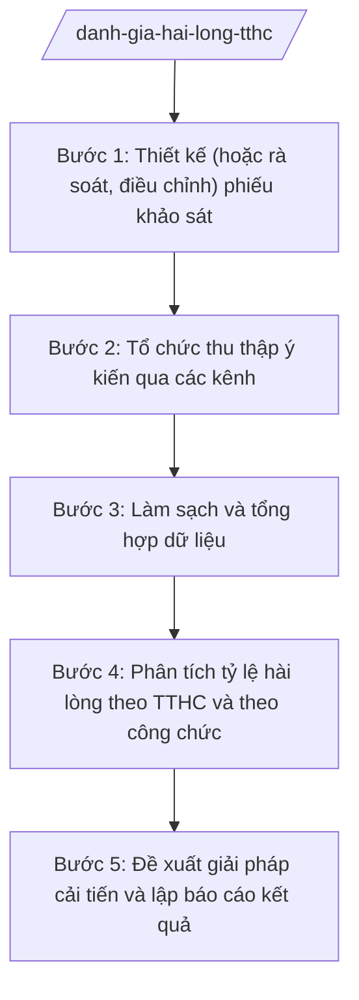

# Skill: Khảo sát mức độ hài lòng giải quyết TTHC

## Khi nào dùng

- Khi cần đánh giá định kỳ mức độ hài lòng của người dân, tổ chức đối với chất lượng giải quyết TTHC tại Trung tâm Phục vụ hành chính công xã.
- Khi cần thiết kế hoặc điều chỉnh phiếu khảo sát hài lòng cho phù hợp với danh mục TTHC thuộc thẩm quyền cấp xã.
- Khi cần tổng hợp, phân tích tỷ lệ hài lòng theo từng TTHC và theo từng công chức trực tiếp xử lý để phục vụ đánh giá thi đua, kiểm điểm trách nhiệm.
- Khi lãnh đạo UBND xã yêu cầu đề xuất giải pháp cải tiến chất lượng phục vụ dựa trên ý kiến phản hồi của người dân.
- Khi cần chuẩn bị số liệu mức độ hài lòng phục vụ báo cáo cải cách hành chính (CCHC) của xã.

## Đầu vào (Input)

| Trường | Mô tả | Bắt buộc |
|--------|-------|----------|
| `danh_muc_tthc` | Danh sách TTHC thuộc thẩm quyền cấp xã được đưa vào phạm vi khảo sát | Có |
| `ky_khao_sat` | Kỳ khảo sát (tháng/quý/năm) và thời gian thực hiện khảo sát | Có |
| `doi_tuong_khao_sat` | Đối tượng khảo sát (người dân, tổ chức đã được giải quyết TTHC trong kỳ) | Có |
| `mau_phieu_hien_hanh` | Mẫu phiếu khảo sát đang sử dụng (nếu có) để điều chỉnh, bổ sung | Không |
| `kenh_thu_thap` | Các kênh thu thập dự kiến: trực tiếp tại quầy, mã QR tại Trung tâm, mã tra cứu trên giấy hẹn, điện thoại | Không |
| `du_lieu_phan_hoi` | Dữ liệu phản hồi đã thu thập (phiếu giấy, dữ liệu quét QR, ghi âm phỏng vấn...) | Không |
| `danh_sach_cong_chuc` | Danh sách công chức trực tiếp giải quyết TTHC trong kỳ khảo sát | Không |

## Quy trình

**Bước 1. Thiết kế (hoặc rà soát, điều chỉnh) phiếu khảo sát**

- Làm gì: Xây dựng phiếu khảo sát gồm các nhóm nội dung: thông tin chung về TTHC được giải quyết; đánh giá thái độ phục vụ của công chức; đánh giá thời gian giải quyết; đánh giá thủ tục, thành phần hồ sơ; đánh giá cơ sở vật chất Trung tâm; ý kiến đề xuất khác. Mỗi tiêu chí dùng thang đo 5 mức (rất hài lòng → rất không hài lòng).
- Dùng input: `danh_muc_tthc`, `mau_phieu_hien_hanh`, `ky_khao_sat`.
- Vai trò: Công chức Trung tâm PVHCC dự thảo phiếu. AI hỗ trợ: gợi ý cấu trúc phiếu theo nhóm TTHC, soạn câu hỏi rõ ràng, tránh câu hỏi dẫn dắt; rút gọn phiếu không quá 15 câu. ⏱ 0,5–1 ngày (ước tính) làm việc.
- Lưu ý nghiệp vụ: Phiếu khảo sát không thu thập thông tin cá nhân nhạy cảm; phải có phần cam kết bảo mật và mục đích sử dụng kết quả.
- → Kết quả bước: Mẫu phiếu khảo sát hài lòng (bản giấy và bản điện tử có mã QR).

**Bước 2. Tổ chức thu thập ý kiến qua các kênh**

- Làm gì: Triển khai thu thập đồng thời qua các kênh: phát phiếu trực tiếp tại quầy trả kết quả; dán mã QR khảo sát tại khu vực chờ và trên giấy hẹn trả kết quả (mã tra cứu gắn với mã hồ sơ); gọi điện thoại phỏng vấn mẫu ngẫu nhiên.
- Dùng input: `doi_tuong_khao_sat`, `kenh_thu_thap`, `ky_khao_sat`.
- Vai trò: Công chức Trung tâm PVHCC tổ chức thực hiện; công chức đầu mối các phòng phối hợp nhắc người dân khi trả kết quả. AI hỗ trợ: tạo mã QR cho từng TTHC, theo dõi tiến độ thu thập theo kênh, nhắc khi tỷ lệ thu hồi phiếu thấp. ⏱ ~suốt kỳ khảo sát (ước tính).
- Lưu ý nghiệp vụ: Khuyến khích người dân tự nguyện tham gia, không ép buộc; công chức trực tiếp giải quyết hồ sơ không được can thiệp vào việc người dân đánh giá mình.
- → Kết quả bước: Bộ dữ liệu phản hồi đã thu thập từ các kênh, có ghi rõ kênh thu thập.

**Bước 3. Làm sạch và tổng hợp dữ liệu**

- Làm gì: Loại bỏ phiếu không hợp lệ (để trống quá 50% câu hỏi, đánh dấu trùng lặp bất thường); nhập phiếu giấy vào bảng tổng hợp; chuẩn hóa dữ liệu từ các kênh về cùng một định dạng.
- Dùng input: `du_lieu_phan_hoi`.
- Vai trò: Công chức Trung tâm PVHCC thực hiện nhập liệu, kiểm tra. AI hỗ trợ: phát hiện phiếu bất thường, tổng hợp tự động theo tiêu chí. ⏱ 1–2 ngày (ước tính) làm việc.
- Lưu ý nghiệp vụ: Ghi rõ số phiếu phát ra, số phiếu thu về hợp lệ theo từng kênh; không tự ý loại bỏ phiếu đánh giá thấp mà không có căn cứ kỹ thuật.
- → Kết quả bước: Bảng dữ liệu khảo sát đã làm sạch, sẵn sàng phân tích.

**Bước 4. Phân tích tỷ lệ hài lòng theo TTHC và theo công chức**

- Làm gì: Tính tỷ lệ hài lòng chung (tỷ lệ "hài lòng" + "rất hài lòng"); phân tích chi tiết theo từng TTHC, từng tiêu chí (thái độ, thời gian, thủ tục, cơ sở vật chất) và theo từng công chức trực tiếp xử lý; so sánh với kỳ khảo sát trước.
- Dùng input: `du_lieu_phan_hoi`, `danh_muc_tthc`, `danh_sach_cong_chuc`.
- Vai trò: Công chức Trung tâm PVHCC phân tích. AI hỗ trợ: tính toán tỷ lệ, vẽ biểu đồ so sánh theo TTHC/công chức/kỳ, chỉ ra điểm yếu nổi bật. ⏱ 1 ngày (ước tính) làm việc.
- Lưu ý nghiệp vụ: Kết quả phân tích theo công chức chỉ dùng cho mục đích quản lý nội bộ, không công khai danh tính cá nhân trên các kênh công khai.
- → Kết quả bước: Bảng tổng hợp tỷ lệ hài lòng chi tiết theo TTHC, tiêu chí và công chức xử lý.

**Bước 5. Đề xuất giải pháp cải tiến và lập báo cáo kết quả**

- Làm gì: Căn cứ các tiêu chí có tỷ lệ hài lòng thấp và ý kiến đề xuất của người dân, xây dựng các giải pháp cải tiến cụ thể (rút ngắn thời gian, cải thiện thái độ phục vụ, bổ sung trang thiết bị...); lập báo cáo kết quả khảo sát trình lãnh đạo.
- Dùng input: `du_lieu_phan_hoi`, `danh_muc_tthc`.
- Vai trò: Công chức Trung tâm PVHCC dự thảo; Phó Chủ tịch UBND xã phụ trách kiểm tra; Chủ tịch UBND xã phê duyệt giải pháp cải tiến. AI hỗ trợ: tổng hợp ý kiến đề xuất thành nhóm giải pháp, dự thảo báo cáo kết quả khảo sát. ⏱ 1–2 ngày (ước tính) làm việc.
- Lưu ý nghiệp vụ: Giải pháp cải tiến phải gắn trách nhiệm cụ thể (ai làm, làm gì, thời hạn nào); báo cáo công khai kết quả chung tại Trung tâm PVHCC.
- → Kết quả bước: Báo cáo kết quả khảo sát mức độ hài lòng kèm danh mục giải pháp cải tiến đã được phê duyệt.

## Luồng quy trình (Workflow)

## 5. Đầu ra (Output)

- Mẫu phiếu khảo sát mức độ hài lòng (bản giấy + bản điện tử kèm mã QR).
- Bảng dữ liệu khảo sát đã làm sạch.
- Bảng tổng hợp tỷ lệ hài lòng theo TTHC, tiêu chí và công chức xử lý.
- Báo cáo kết quả khảo sát mức độ hài lòng của người dân, tổ chức.
- Danh mục giải pháp cải tiến chất lượng giải quyết TTHC.

### Cấu trúc output chuẩn

Sản phẩm chính: **Báo cáo kết quả khảo sát mức độ hài lòng**, thể thức theo NĐ 30/2020/NĐ-CP:

1. Quốc hiệu "CỘNG HÒA XÃ HỘI CHỦ NGHĨA VIỆT NAM" – Tiêu ngữ "Độc lập – Tự do – Hạnh phúc"; tên cơ quan ban hành (ỦY BAN NHÂN DÂN XÃ A — TRUNG TÂM PHỤC VỤ HÀNH CHÍNH CÔNG).
2. Số, ký hiệu văn bản (…/BC-TTPVHCC); địa danh và ngày, tháng, năm ban hành.
3. Tên loại và trích yếu: "BÁO CÁO kết quả khảo sát mức độ hài lòng của người dân, tổ chức đối với việc giải quyết TTHC tại Trung tâm Phục vụ hành chính công xã A kỳ ...".
4. Phần I — Tổ chức thực hiện: phạm vi, đối tượng, thời gian, phương thức và các kênh thu thập (trực tiếp, QR, mã tra cứu, điện thoại); số phiếu phát ra/thu về hợp lệ.
5. Phần II — Kết quả: tỷ lệ hài lòng chung; bảng tỷ lệ hài lòng chi tiết theo từng TTHC; theo từng tiêu chí đánh giá; theo công chức trực tiếp xử lý (phần nội bộ); so sánh với kỳ trước.
6. Phần III — Ý kiến, kiến nghị của người dân, tổ chức (tổng hợp theo nhóm).
7. Phần IV — Đánh giá chung và giải pháp cải tiến: nhận xét ưu điểm, hạn chế; danh mục giải pháp cải tiến (nội dung, đơn vị/cá nhân thực hiện, thời hạn).
8. Chữ ký người có thẩm quyền (ký, ghi rõ họ tên, đóng dấu).
9. Nơi nhận: UBND xã (để báo cáo), các phòng chuyên môn liên quan, niêm yết công khai tại Trung tâm PVHCC; lưu: VT, TTPVHCC.

## 6. Checklist nghiệm thu

1. Phiếu khảo sát bao quát đủ các nhóm nội dung (thái độ phục vụ, thời gian, thủ tục, cơ sở vật chất, ý kiến khác); không quá 15 câu; có cam kết bảo mật.
2. Thu thập qua ít nhất 02 kênh khác nhau; số phiếu hợp lệ đạt tối thiểu 70% số hồ sơ được giải quyết trong kỳ (hoặc theo chỉ tiêu UBND xã giao).
3. Dữ liệu đã làm sạch; ghi rõ số phiếu phát ra, thu về, loại bỏ theo từng kênh.
4. Bảng tổng hợp có tỷ lệ hài lòng chung, chi tiết theo từng TTHC và từng tiêu chí; có so sánh với kỳ trước.
5. Phân tích theo công chức chỉ lưu hành nội bộ, không công khai danh tính cá nhân.
6. Ý kiến, kiến nghị của người dân được tổng hợp đầy đủ, không lược bỏ ý kiến tiêu cực.
7. Mỗi giải pháp cải tiến gắn rõ trách nhiệm thực hiện và thời hạn hoàn thành.
8. Báo cáo đủ 4 phần theo cấu trúc chuẩn; kết quả chung được niêm yết công khai tại Trung tâm PVHCC.
9. Báo cáo đã qua human gate: Phó Chủ tịch phụ trách kiểm tra, Chủ tịch UBND xã phê duyệt trước khi công khai.

## 7. Ví dụ mô phỏng
*Dữ liệu dưới đây là giả lập 100% phục vụ minh họa.*

**Input mẫu:**

- Kỳ khảo sát: quý III năm 2026; thời gian thu thập: 01/7–30/9/2026.
- Phạm vi: 3 TTHC — "Chứng thực bản sao", "Đăng ký khai sinh", "Đăng ký kết hôn".
- Kênh thu thập: phiếu trực tiếp tại quầy + mã QR trên giấy hẹn.
- Phát ra 100 phiếu, thu về 90 phiếu hợp lệ (60 phiếu trực tiếp, 30 phiếu qua QR).
- Công chức trực tiếp xử lý: Bà Trần Thị H, Ông Nguyễn Văn G (tên giả lập).

**Output mẫu:**

CỘNG HÒA XÃ HỘI CHỦ NGHĨA VIỆT NAM
Độc lập – Tự do – Hạnh phúc

ỦY BAN NHÂN DÂN XÃ A
TRUNG TÂM PHỤC VỤ HÀNH CHÍNH CÔNG

Số: 11/BC-TTPVHCC
Xã A, ngày 10 tháng 10 năm 2026

**BÁO CÁO
Kết quả khảo sát mức độ hài lòng của người dân, tổ chức đối với việc giải quyết
thủ tục hành chính tại Trung tâm Phục vụ hành chính công xã A quý III năm 2026**

Kính gửi: Ủy ban nhân dân xã A

**I. TỔ CHỨC THỰC HIỆN**

- Phạm vi: 03 TTHC (Chứng thực bản sao; Đăng ký khai sinh; Đăng ký kết hôn).
- Đối tượng: người dân, tổ chức được giải quyết TTHC trong quý III/2026.
- Kênh thu thập: phiếu trực tiếp tại quầy trả kết quả; mã QR trên giấy hẹn trả kết quả.
- Số phiếu phát ra: 100; số phiếu thu về hợp lệ: 90 (60 trực tiếp, 30 qua QR).

**II. KẾT QUẢ**

Tỷ lệ hài lòng chung: 90% (81/90 phiếu đánh giá "hài lòng" hoặc "rất hài lòng").

| STT | Tên TTHC | Số phiếu | Tỷ lệ hài lòng |
|-----|----------|----------|----------------|
| 1 | Chứng thực bản sao | 50 | 92% |
| 2 | Đăng ký khai sinh | 25 | 88% |
| 3 | Đăng ký kết hôn | 15 | 87% |

Theo tiêu chí: thái độ phục vụ 94%; thời gian giải quyết 86%; thủ tục, thành phần hồ sơ 90%; cơ sở vật chất 82%. So với quý II/2026, tỷ lệ hài lòng chung tăng 05 điểm phần trăm.

**III. Ý KIẾN, KIẾN NGHỊ CỦA NGƯỜI DÂN**

- Đề nghị bổ sung ghế chờ và quạt mát tại khu vực chờ (10 ý kiến).
- Đề nghị rút ngắn thời gian chờ chứng thực bản sao vào giờ cao điểm (05 ý kiến).

**IV. ĐÁNH GIÁ CHUNG VÀ GIẢI PHÁP CẢI TIẾN**

Ưu điểm: thái độ phục vụ của công chức được đánh giá cao; tỷ lệ hài lòng tăng so với quý trước. Hạn chế: cơ sở vật chất khu vực chờ còn thiếu; thời gian chờ giờ cao điểm còn dài.

Giải pháp cải tiến:

| STT | Giải pháp | Đơn vị thực hiện | Thời hạn |
|-----|-----------|-----------------|----------|
| 1 | Bổ sung 10 ghế chờ, 02 quạt tại khu vực chờ | Trung tâm PVHCC | 30/11/2026 |
| 2 | Bố trí thêm 01 công chức chứng thực vào giờ cao điểm buổi sáng | Văn phòng HĐND và UBND xã | 15/11/2026 |

Nơi nhận:
- UBND xã (để báo cáo);
- Văn phòng HĐND và UBND xã;
- Niêm yết tại Trung tâm PVHCC;
- Lưu: VT, TTPVHCC.

**TM. TRUNG TÂM PHỤC VỤ HÀNH CHÍNH CÔNG**
**PHÓ CHỦ TỊCH UBND XÃ PHỤ TRÁCH**
*(ký ban hành sau khi Chủ tịch UBND xã phê duyệt tại human gate)*
*(Ký, ghi rõ họ tên, đóng dấu)*
Trần Thị B

*(Dữ liệu trên là giả lập 100% phục vụ minh họa.)*

## 8. Human gate

- Công chức Trung tâm PVHCC thiết kế phiếu khảo sát → Phó Chủ tịch UBND xã phụ trách (Bà Trần Thị B) duyệt mẫu phiếu trước khi triển khai thu thập.
- Công chức Trung tâm PVHCC tổng hợp, phân tích, dự thảo báo cáo → Phó Chủ tịch phụ trách kiểm tra số liệu, nội dung → Chủ tịch UBND xã (Ông Nguyễn Văn A) phê duyệt báo cáo và danh mục giải pháp cải tiến trước khi công khai.
- Kết quả phân tích theo từng công chức chỉ báo cáo nội bộ cho lãnh đạo UBND xã, không công khai khi chưa có ý kiến của người có thẩm quyền.

## 9. Giới hạn

- AI KHÔNG ra quyết định hành chính thay người có thẩm quyền; không tự phê duyệt mẫu phiếu khảo sát hay giải pháp cải tiến.
- AI không tự ký, tự phát hành báo cáo; không tự công khai kết quả khảo sát khi chưa được phê duyệt.
- AI không bịa số liệu khảo sát, không bịa ý kiến người dân; mọi con số phải xuất phát từ dữ liệu thu thập thực tế.
- AI không công khai danh tính công chức bị đánh giá thấp trên các kênh công khai.
- AI không dùng văn bản pháp luật đã hết hiệu lực làm căn cứ.

## 10. Căn cứ & lưu ý

- Nghị định 118/2025/NĐ-CP ngày 09/6/2025 của Chính phủ về cơ chế một cửa, một cửa liên thông trong giải quyết thủ tục hành chính (quy định về đánh giá chất lượng giải quyết TTHC, lấy ý kiến người dân, tổ chức).
- Văn bản 7216/VPCP-KSTT ngày 04/8/2025 của Văn phòng Chính phủ hướng dẫn tổ chức, hoạt động của Trung tâm Phục vụ hành chính công trong mô hình chính quyền địa phương 2 cấp.
- Nghị định 150/2025/NĐ-CP ngày 12/6/2025 của Chính phủ (quy định về Trung tâm Phục vụ hành chính công thuộc UBND cấp xã).
- Nghị định 30/2020/NĐ-CP của Chính phủ về công tác văn thư (thể thức văn bản hành chính).
- Lưu ý: kết quả khảo sát là một trong các tiêu chí đánh giá cải cách hành chính của xã; số liệu phải trung thực, tuyệt đối không làm đẹp số liệu.
