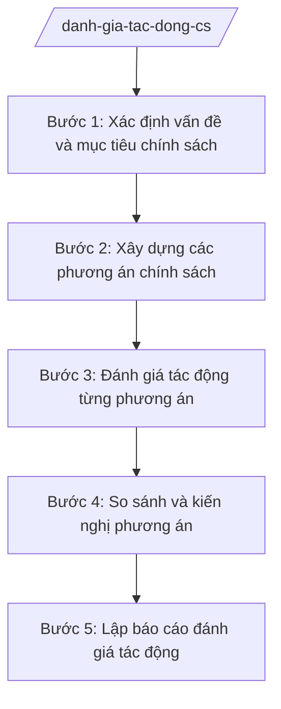

# Skill: Đánh giá tác động chính sách

## 2. Khi nào dùng
- Chuẩn bị hồ sơ đề nghị xây dựng nghị quyết của HĐND tỉnh, quyết định của UBND tỉnh có chứa chính sách mới.
- Cơ quan chủ trì cần so sánh các phương án chính sách để kiến nghị phương án tối ưu.
- Sở Tư pháp yêu cầu bổ sung báo cáo đánh giá tác động trong quá trình thẩm định.

## 3. Đầu vào (Input)
| Trường | Mô tả | Bắt buộc |
|--------|-------|----------|
| `ten_chinh_sach` | Tên chính sách dự kiến ban hành | Có |
| `van_de_can_giai_quyet` | Vấn đề thực tiễn cần giải quyết, bằng chứng | Có |
| `muc_tieu` | Mục tiêu của chính sách | Có |
| `phuong_an` | Các phương án chính sách (tối thiểu 2: giữ nguyên hiện trạng và phương án đề xuất) | Có |
| `doi_tuong_tac_dong` | Nhóm đối tượng chịu tác động (người dân, doanh nghiệp, cơ quan nhà nước) | Có |
| `so_lieu_nen` | Số liệu nền về kinh tế – xã hội liên quan | Có |
| `thoi_gian_danh_gia` | Thời gian thực hiện đánh giá | Không |

## 4. Quy trình

**Bước 1. Xác định vấn đề và mục tiêu chính sách**
- Làm gì: Mô tả vấn đề thực tiễn, nguyên nhân, hậu quả nếu không can thiệp; xác định mục tiêu cụ thể, đo được của chính sách.
- Dùng input: `van_de_can_giai_quyet`, `muc_tieu`, `so_lieu_nen`
- Vai trò: Chuyên viên cơ quan chủ trì phân tích; AI hỗ trợ hệ thống hóa vấn đề, gợi ý khung mục tiêu SMART — 1 ngày làm việc
- Lưu ý nghiệp vụ: Vấn đề phải có bằng chứng bằng số liệu, không cảm tính; mục tiêu phải đo được để đánh giá sau này.
- → Kết quả bước: Bản mô tả vấn đề và mục tiêu chính sách.

**Bước 2. Xây dựng các phương án chính sách**
- Làm gì: Xây dựng tối thiểu 2 phương án (phương án 0: giữ nguyên; phương án đề xuất và/hoặc phương án thay thế), nêu nội dung cụ thể từng phương án.
- Dùng input: `phuong_an`, `muc_tieu`
- Vai trò: Chuyên viên xây dựng; AI hỗ trợ gợi ý cấu trúc so sánh phương án — 1 ngày làm việc
- Lưu ý nghiệp vụ: Mỗi phương án phải đủ cụ thể để đánh giá được tác động; không xây dựng phương án hình thức.
- → Kết quả bước: Bảng mô tả các phương án chính sách.

**Bước 3. Đánh giá tác động từng phương án**
- Làm gì: Đánh giá tác động của từng phương án trên các khía cạnh: kinh tế, xã hội, thủ tục hành chính, ngân sách nhà nước, giới, môi trường; xác định chi phí – lợi ích, nhóm chịu tác động.
- Dùng input: `phuong_an`, `doi_tuong_tac_dong`, `so_lieu_nen`
- Vai trò: Chuyên viên phân tích; AI hỗ trợ lập ma trận tác động, ước tính định lượng sơ bộ — 3 ngày làm việc
- Lưu ý nghiệp vụ: Đánh giá cả tác động tích cực và tiêu cực; nêu rõ giả định khi ước tính; không phóng đại lợi ích, giấu chi phí.
- → Kết quả bước: Ma trận đánh giá tác động theo từng phương án.

**Bước 4. So sánh và kiến nghị phương án**
- Làm gì: So sánh các phương án theo tiêu chí mục tiêu, chi phí – lợi ích, tính khả thi; kiến nghị phương án lựa chọn kèm lý do.
- Dùng input: Ma trận đánh giá tác động Bước 3
- Vai trò: Trưởng phòng chuyên môn thuộc Sở rà soát; AI hỗ trợ lập bảng so sánh tổng hợp — 1 ngày làm việc
- Lưu ý nghiệp vụ: Kiến nghị phải dựa trên bằng chứng đánh giá, không theo ý chí chủ quan.
- → Kết quả bước: Bảng so sánh và kiến nghị phương án chính sách.

**Bước 5. Lập báo cáo đánh giá tác động**
- Làm gì: Soạn báo cáo đánh giá tác động (RIA) đưa vào hồ sơ đề nghị xây dựng VBQPPL.
- Dùng input: Kết quả các bước 1–4
- Vai trò: Chuyên viên soạn; Trưởng phòng kiểm tra; Giám đốc Sở ký duyệt; AI hỗ trợ soạn thảo theo khung chuẩn — 1 ngày làm việc
- Lưu ý nghiệp vụ: Báo cáo là thành phần bắt buộc của hồ sơ; phải trung thực về hạn chế của đánh giá.
- → Kết quả bước: Báo cáo đánh giá tác động chính sách.

## Luồng quy trình (Workflow)

## 5. Đầu ra (Output)
- Báo cáo đánh giá tác động chính sách (RIA).
- Ma trận đánh giá tác động theo phương án.
- Bảng so sánh và kiến nghị phương án.

### Cấu trúc output chuẩn
Khung báo cáo đánh giá tác động chính sách, đúng thể thức NĐ 30/2020/NĐ-CP:
1. Quốc hiệu "CỘNG HÒA XÃ HỘI CHỦ NGHĨA VIỆT NAM" – Tiêu ngữ "Độc lập – Tự do – Hạnh phúc"; số, ký hiệu; địa danh, ngày tháng năm.
2. Tên báo cáo: "BÁO CÁO đánh giá tác động chính sách ...".
3. Phần I: Sự cần thiết, mục tiêu của chính sách.
4. Phần II: Các phương án chính sách (mô tả chi tiết từng phương án).
5. Phần III: Đánh giá tác động từng phương án (kinh tế; xã hội; thủ tục hành chính; ngân sách; giới; môi trường).
6. Phần IV: So sánh các phương án; kiến nghị phương án lựa chọn.
7. Phần V: Hạn chế của đánh giá và kiến nghị tiếp theo.
8. Chữ ký người có thẩm quyền.
9. Nơi nhận: cơ quan chủ trì soạn thảo chính sách; cơ quan thẩm định; Lưu: VT, đơn vị soạn thảo.

## 6. Checklist nghiệm thu
- [ ] Vấn đề chính sách được mô tả có bằng chứng số liệu.
- [ ] Có tối thiểu 2 phương án (bao gồm phương án giữ nguyên).
- [ ] Đánh giá đủ 6 khía cạnh tác động cho từng phương án.
- [ ] Nêu rõ giả định khi ước tính định lượng.
- [ ] Bảng so sánh có tiêu chí rõ ràng, kiến nghị có cơ sở.
- [ ] Báo cáo đúng khung cấu trúc chuẩn.
- [ ] Đã qua kiểm tra của Trưởng phòng và ký duyệt của Giám đốc Sở.

## 7. Ví dụ mô phỏng
*Dữ liệu dưới đây là giả lập 100% phục vụ minh họa.*

**Input mẫu:**
- ten_chinh_sach: Chính sách hỗ trợ lãi suất cho doanh nghiệp nhỏ và vừa trên địa bàn tỉnh A
- van_de_can_giai_quyet: Tỷ lệ DNNVV tiếp cận vốn ngân hàng của tỉnh A chỉ đạt 30%, thấp hơn bình quân 45%
- phuong_an: Phương án 0 (giữ nguyên); Phương án 1 (hỗ trợ 2%/năm lãi suất, tối đa 500 triệu đồng/DN); Phương án 2 (bảo lãnh tín dụng qua Quỹ bảo lãnh)
- doi_tuong_tac_dong: 2.000 DNNVV trên địa bàn tỉnh A

**Output mẫu (trích):**
> **BÁO CÁO**
> **Đánh giá tác động chính sách hỗ trợ lãi suất cho doanh nghiệp nhỏ và vừa trên địa bàn tỉnh A**
>
> I. Sự cần thiết: ... (số liệu giả lập)
> II. Các phương án: Phương án 0 — giữ nguyên, không can thiệp; Phương án 1 — hỗ trợ 2%/năm lãi suất...; Phương án 2 — bảo lãnh tín dụng...
> III. Đánh giá tác động:
> - Phương án 1: chi phí ngân sách ước 20 tỷ đồng/năm; ~800 DN thụ hưởng; tác động TTHC: tăng 1 thủ tục xét duyệt...
> - Phương án 2: chi phí 8 tỷ đồng/năm; ~400 DN thụ hưởng...
> IV. Kiến nghị: lựa chọn Phương án 1 vì ...

## 8. Human gate
- Trưởng phòng chuyên môn thuộc Sở: kiểm tra ma trận đánh giá và kiến nghị phương án (Bước 4).
- Giám đốc Sở: ký duyệt báo cáo đánh giá tác động (Bước 5).
- Sở Tư pháp: xem xét báo cáo trong quá trình thẩm định hồ sơ đề nghị xây dựng VBQPPL.

## 9. Giới hạn
- AI không thay con người quyết định lựa chọn phương án chính sách.
- Không bịa số liệu tác động; mọi ước tính phải nêu rõ giả định và nguồn số liệu nền.
- Không bỏ qua phương án giữ nguyên hiện trạng (phương án 0).
- Không viện dẫn văn bản hết hiệu lực.

## 10. Căn cứ & lưu ý
- TT 09/2025/TT-BTP (Sở Tư pháp thẩm định hồ sơ đề nghị xây dựng VBQPPL, trong đó có báo cáo đánh giá tác động).
- Luật Ban hành văn bản quy phạm pháp luật (quy định về đánh giá tác động chính sách) — dẫn tên, tra cứu bản hiện hành khi áp dụng.
