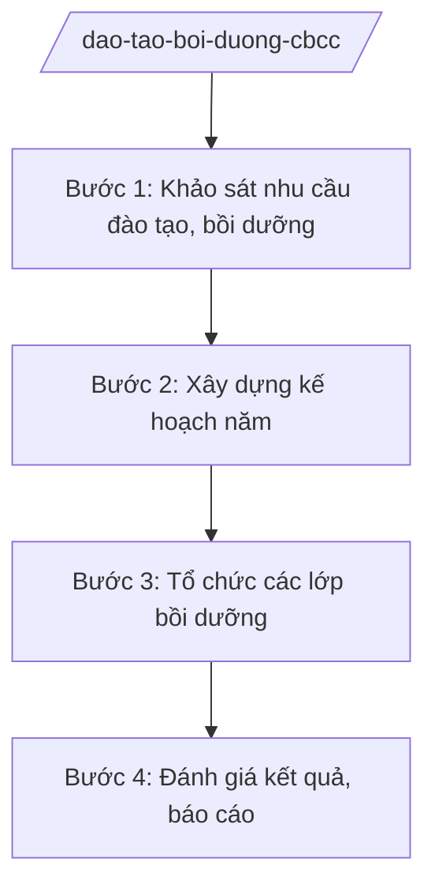

# Skill: Kế hoạch đào tạo, bồi dưỡng CBCCVC

## 2. Khi nào dùng
- Lập kế hoạch đào tạo, bồi dưỡng CBCCVC hằng năm của tỉnh.
- Tổ chức các lớp bồi dưỡng theo tiêu chuẩn ngạch, chức danh; bồi dưỡng chuyên môn, nghiệp vụ.
- Báo cáo kết quả đào tạo, bồi dưỡng gửi Bộ Nội vụ, UBND tỉnh.

## 3. Đầu vào (Input)
| Trường | Mô tả | Bắt buộc |
|--------|-------|----------|
| `nam_ke_hoach` | Năm kế hoạch đào tạo, bồi dưỡng | Có |
| `nhu_cau_dao_tao` | Nhu cầu đào tạo, bồi dưỡng của các cơ quan, đơn vị | Có |
| `doi_tuong` | Đối tượng đào tạo, bồi dưỡng (theo ngạch, chức danh, lĩnh vực) | Có |
| `noi_dung_chuong_trinh` | Nội dung, chương trình bồi dưỡng | Có |
| `kinh_phi` | Kinh phí đào tạo, bồi dưỡng | Có |

## 4. Quy trình

**Bước 1. Khảo sát nhu cầu đào tạo, bồi dưỡng**
- Làm gì: Gửi văn bản đề nghị các cơ quan, đơn vị đăng ký nhu cầu (số lượng, đối tượng, nội dung); tổng hợp nhu cầu toàn tỉnh.
- Dùng input: `nhu_cau_dao_tao`, `doi_tuong`
- Vai trò: Chuyên viên Phòng Đào tạo, bồi dưỡng (Sở Nội vụ tỉnh A) tổng hợp; AI hỗ trợ lập bảng tổng hợp nhu cầu ⏱ ~5 ngày làm việc (ước tính)
- Lưu ý nghiệp vụ: Nhu cầu phải gắn với tiêu chuẩn ngạch, chức danh và yêu cầu vị trí việc làm; tránh đăng ký hình thức.
- → Kết quả bước: Bảng tổng hợp nhu cầu đào tạo, bồi dưỡng toàn tỉnh.

**Bước 2. Xây dựng kế hoạch năm**
- Làm gì: Xây dựng kế hoạch: lớp bồi dưỡng, đối tượng, số lượng, thời gian, địa điểm, giảng viên, kinh phí; trình UBND tỉnh phê duyệt.
- Dùng input: `nhu_cau_dao_tao`, `kinh_phi`, `noi_dung_chuong_trinh`
- Vai trò: Trưởng phòng Đào tạo, bồi dưỡng chủ trì; AI hỗ trợ lập kế hoạch chi tiết ⏱ ~3 ngày làm việc (ước tính)
- Lưu ý nghiệp vụ: Ưu tiên bồi dưỡng theo tiêu chuẩn bắt buộc (ngạch, chức danh lãnh đạo); kinh phí trong dự toán được giao.
- → Kết quả bước: Kế hoạch đào tạo, bồi dưỡng năm đã phê duyệt.

**Bước 3. Tổ chức các lớp bồi dưỡng**
- Làm gì: Phối hợp cơ sở đào tạo tổ chức lớp: chiêu sinh, quản lý lớp học, giảng viên, kiểm tra, đánh giá; cấp chứng chỉ.
- Dùng input: ke_hoach nam
- Vai trò: Đơn vị tổ chức thực hiện; AI hỗ trợ lập danh sách học viên, theo dõi điểm danh, tổng hợp kết quả ⏱ theo lịch lớp (ước tính)
- Lưu ý nghiệp vụ: Đảm bảo chất lượng giảng dạy; kiểm tra, đánh giá nghiêm túc; chứng chỉ đúng mẫu quy định.
- → Kết quả bước: Các lớp bồi dưỡng đã tổ chức; danh sách cấp chứng chỉ.

**Bước 4. Đánh giá kết quả, báo cáo**
- Làm gì: Đánh giá kết quả thực hiện kế hoạch (số lớp, số học viên, chất lượng); báo cáo UBND tỉnh, Bộ Nội vụ.
- Dùng input: Kết quả các lớp Bước 3
- Vai trò: Chuyên viên tổng hợp; Giám đốc Sở Nội vụ ký báo cáo; AI hỗ trợ lập báo cáo ⏱ ~3 ngày làm việc (ước tính)
- Lưu ý nghiệp vụ: Đánh giá gắn với hiệu quả công việc sau bồi dưỡng, không chỉ đếm số lượng.
- → Kết quả bước: Báo cáo kết quả đào tạo, bồi dưỡng năm.

## Luồng quy trình (Workflow)

## 5. Đầu ra (Output)
- Kế hoạch đào tạo, bồi dưỡng CBCCVC năm.
- Danh sách lớp, học viên, chứng chỉ.
- Báo cáo kết quả đào tạo, bồi dưỡng năm.

**Cấu trúc output chuẩn:**
- Thể thức: tuân thủ Nghị định 30/2020/NĐ-CP về công tác văn thư.
Khung kế hoạch đào tạo, bồi dưỡng:
1. Quốc hiệu "CỘNG HÒA XÃ HỘI CHỦ NGHĨA VIỆT NAM", Tiêu ngữ "Độc lập – Tự do – Hạnh phúc"; số, ký hiệu; địa danh, ngày tháng năm.
2. Tên: "KẾ HOẠCH đào tạo, bồi dưỡng cán bộ, công chức, viên chức năm ... tỉnh A".
3. Mục đích, yêu cầu.
4. Đối tượng, nội dung, số lượng lớp (bảng chi tiết).
5. Kinh phí; thời gian, địa điểm.
6. Tổ chức thực hiện; chữ ký.
- Nơi nhận: liệt kê các cơ quan, đơn vị nhận để biết/thực hiện; kết thúc bằng "- Lưu: VT, [mã đơn vị]".

> **Chuẩn tài liệu đầu ra** (thứ tự ưu tiên):
> 1. Chuẩn riêng của ngành/cơ quan chủ quản — mẫu, biểu mẫu, quy chuẩn tại văn bản quy phạm chuyên ngành (xem mục "Căn cứ & lưu ý").
> 2. Tài liệu không có quy chuẩn riêng — thể thức NĐ 30/2020/NĐ-CP: Quốc hiệu và Tiêu ngữ; tên cơ quan ban hành; số, ký hiệu; địa danh và thời gian; tên loại và trích yếu; nội dung; chức vụ, họ tên, chữ ký người có thẩm quyền; dấu, chữ ký số; nơi nhận (kèm Phụ lục nếu có).

## 6. Checklist nghiệm thu
- [ ] Nhu cầu được khảo sát đầy đủ các cơ quan, đơn vị.
- [ ] Kế hoạch bám tiêu chuẩn ngạch, chức danh và vị trí việc làm.
- [ ] Kinh phí trong dự toán được giao.
- [ ] Tổ chức lớp đảm bảo chất lượng, đánh giá nghiêm túc.
- [ ] Chứng chỉ đúng mẫu, đúng đối tượng.
- [ ] Báo cáo kết quả đúng thời hạn.
- [ ] Đúng thể thức văn bản theo NĐ 30/2020/NĐ-CP.

## 7. Ví dụ mô phỏng
*Dữ liệu dưới đây là giả lập 100% phục vụ minh họa.*

**Input mẫu:**
- nam_ke_hoach: 2026
- nhu_cau_dao_tao: 20 lớp, 1.000 học viên (giả lập)
- kinh_phi: 5 tỷ đồng (giả lập)

**Output mẫu (trích kế hoạch):**
> **KẾ HOẠCH**
> **Đào tạo, bồi dưỡng cán bộ, công chức, viên chức năm 2026 tỉnh A**
>
> 1. Mục đích: ...
> 2. Nội dung: 20 lớp bồi dưỡng (bảng chi tiết)... (giả lập)
> (Dữ liệu giả lập 100% phục vụ minh họa)

## 8. Human gate
- Trưởng phòng Đào tạo, bồi dưỡng: kiểm tra kế hoạch (Bước 2).
- Giám đốc Sở Nội vụ: ký kế hoạch và báo cáo.
- Chủ tịch UBND tỉnh: phê duyệt kế hoạch năm.

## 9. Giới hạn
- AI không thay hội đồng đánh giá kết quả học tập của học viên.
- Không bịa danh sách học viên, kết quả cấp chứng chỉ.
- Không tổ chức lớp ngoài kế hoạch đã phê duyệt khi chưa được cho phép.

## 10. Căn cứ & lưu ý
- TT 10/2025/TT-BNV (Sở Nội vụ: đào tạo, bồi dưỡng CBCCVC).
- Quy định về đào tạo, bồi dưỡng cán bộ, công chức, viên chức — dẫn tên, tra cứu bản hiện hành khi áp dụng.
