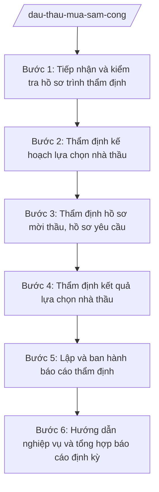

# Skill: Đấu thầu, mua sắm công

## 2. Khi nào dùng

- Chủ đầu tư trình kế hoạch lựa chọn nhà thầu (KHLCNT) của dự án/gói thầu thuộc thẩm quyền phê duyệt của UBND tỉnh, Chủ tịch UBND tỉnh;
- Cần thẩm định hồ sơ mời thầu, hồ sơ yêu cầu (HSMT/HSYC) trước khi phát hành;
- Cần thẩm định kết quả lựa chọn nhà thầu trước khi phê duyệt;
- Cần hướng dẫn nghiệp vụ đấu thầu, mua sắm công cho các sở, ban, ngành và UBND cấp xã;
- Cần tổng hợp, báo cáo tình hình đấu thầu, mua sắm công trên địa bàn tỉnh.

## 3. Đầu vào (Input)

| Trường | Mô tả | Bắt buộc |
|--------|-------|----------|
| `ho_so_khlcnt` | Hồ sơ trình phê duyệt kế hoạch lựa chọn nhà thầu: tờ trình, dự thảo KHLCNT, quyết định phê duyệt dự án | Có |
| `ten_chu_dau_tu` | Tên chủ đầu tư/bên mời thầu | Có |
| `gia_goi_thau` | Giá gói thầu và nguồn vốn thực hiện | Có |
| `hinh_thuc_lcnt` | Hình thức lựa chọn nhà thầu đề xuất (đấu thầu rộng rãi, chào hàng cạnh tranh, chỉ định thầu...) | Có |
| `hsmt_hsyc` | Hồ sơ mời thầu/hồ sơ yêu cầu cần thẩm định (khi thẩm định HSMT) | Không |
| `ket_qua_lcnt` | Báo cáo đánh giá HSDT/HSĐX và tờ trình phê duyệt kết quả (khi thẩm định kết quả) | Không |
| `loai_tham_dinh` | Loại thẩm định: KHLCNT / HSMT-HSYC / kết quả LCNT | Có |

## 4. Quy trình

**Bước 1. Tiếp nhận và kiểm tra hồ sơ trình thẩm định**
- Làm gì: Tiếp nhận hồ sơ trình thẩm định (KHLCNT, HSMT/HSYC hoặc kết quả LCNT); kiểm tra thành phần hồ sơ, thẩm quyền trình, tính hợp lệ; lập phiếu tiếp nhận, yêu cầu bổ sung nếu thiếu.
- Dùng input: `ho_so_khlcnt`, `hsmt_hsyc`, `ket_qua_lcnt`, `loai_tham_dinh`, `ten_chu_dau_tu`.
- Vai trò: Chuyên viên Phòng Quản lý đấu thầu (Sở Tài chính) tiếp nhận, AI hỗ trợ lập checklist thành phần hồ sơ và phiếu tiếp nhận; ⏱ ~1–2 ngày làm việc (ước tính).
- Lưu ý nghiệp vụ: Chỉ thụ lý khi hồ sơ đủ thành phần và đúng thẩm quyền; thời hạn thẩm định tính từ ngày nhận đủ hồ sơ hợp lệ.
- → Kết quả bước: Phiếu tiếp nhận hồ sơ hợp lệ (hoặc văn bản yêu cầu bổ sung).

**Bước 2. Thẩm định kế hoạch lựa chọn nhà thầu**
- Làm gì: (Áp dụng khi `loai_tham_dinh` là KHLCNT) Rà soát: tên gói thầu, giá gói thầu, nguồn vốn, hình thức và phương thức LCNT, thời gian tổ chức LCNT, loại hợp đồng, thời gian thực hiện hợp đồng; kiểm tra sự phù hợp với quyết định phê duyệt dự án và quy định pháp luật.
- Dùng input: `ho_so_khlcnt`, `gia_goi_thau`, `hinh_thuc_lcnt`.
- Vai trò: Chuyên viên Phòng Quản lý đấu thầu thẩm định, AI hỗ trợ đối chiếu nội dung KHLCNT với quyết định phê duyệt dự án, cảnh báo hình thức LCNT không phù hợp với giá trị gói thầu; ⏱ ~3–5 ngày làm việc (ước tính).
- Lưu ý nghiệp vụ: Hình thức LCNT phải đúng quy định theo giá trị và tính chất gói thầu; không chia nhỏ gói thầu để áp dụng hình thức LCNT đơn giản hơn.
- → Kết quả bước: Dự thảo Báo cáo thẩm định KHLCNT (đủ điều kiện trình phê duyệt / cần chỉnh sửa).

**Bước 3. Thẩm định hồ sơ mời thầu, hồ sơ yêu cầu**
- Làm gì: (Áp dụng khi `loai_tham_dinh` là HSMT-HSYC) Rà soát HSMT/HSYC: tiêu chuẩn đánh giá, điều kiện tiên quyết, yêu cầu kỹ thuật, điều khoản hợp đồng; phát hiện các tiêu chí hạn chế cạnh tranh, "cài" điều kiện không phù hợp.
- Dùng input: `hsmt_hsyc`, `ho_so_khlcnt`.
- Vai trò: Chuyên viên Phòng Quản lý đấu thầu thẩm định, AI hỗ trợ rà soát các tiêu chí đánh giá, cảnh báo điều khoản hạn chế nhà thầu; ⏱ ~3–5 ngày làm việc (ước tính).
- Lưu ý nghiệp vụ: HSMT/HSYC phải bảo đảm cạnh tranh, công bằng, minh bạch; mọi tiêu chí đánh giá phải có căn cứ, không được "đo ni đóng giày".
- → Kết quả bước: Dự thảo Báo cáo thẩm định HSMT/HSYC với kiến nghị chỉnh sửa cụ thể.

**Bước 4. Thẩm định kết quả lựa chọn nhà thầu**
- Làm gì: (Áp dụng khi `loai_tham_dinh` là kết quả LCNT) Rà soát báo cáo đánh giá HSDT/HSĐX của tổ chuyên gia: tính tuân thủ quy trình, tính chính xác của việc chấm điểm, xếp hạng nhà thầu; kiểm tra nhà thầu được đề nghị trúng thầu đáp ứng yêu cầu.
- Dùng input: `ket_qua_lcnt`, `hsmt_hsyc`.
- Vai trò: Chuyên viên Phòng Quản lý đấu thầu thẩm định, AI hỗ trợ đối chiếu kết quả đánh giá với tiêu chuẩn trong HSMT, cảnh báo điểm bất thường; ⏱ ~3–5 ngày làm việc (ước tính).
- Lưu ý nghiệp vụ: Kết quả LCNT chỉ được thẩm định thông qua khi quy trình tuân thủ đúng quy định và nhà thầu trúng thầu đáp ứng đầy đủ yêu cầu của HSMT.
- → Kết quả bước: Dự thảo Báo cáo thẩm định kết quả LCNT.

**Bước 5. Lập và ban hành báo cáo thẩm định**
- Làm gì: Tổng hợp kết quả thẩm định thành Báo cáo thẩm định của Sở Tài chính: nêu nội dung thẩm định, nhận xét từng nội dung, kết luận và kiến nghị; trình lãnh đạo Sở ký ban hành; gửi báo cáo đến chủ đầu tư và người có thẩm quyền phê duyệt.
- Dùng input: Kết quả Bước 2/3/4 (theo `loai_tham_dinh`).
- Vai trò: Chuyên viên soạn thảo; Trưởng phòng, Phó Giám đốc rà soát; Giám đốc Sở Tài chính (ông Hoàng Văn S) ký ban hành; AI hỗ trợ dựng khung báo cáo, rà soát nhất quán; ⏱ ~1–2 ngày làm việc (ước tính).
- Lưu ý nghiệp vụ: Báo cáo thẩm định chỉ có giá trị tham mưu; quyết định phê duyệt thuộc thẩm quyền của người có thẩm quyền (UBND tỉnh/Chủ tịch UBND tỉnh) theo phân cấp.
- → Kết quả bước: Báo cáo thẩm định của Sở Tài chính đã ký, gửi các bên liên quan.

**Bước 6. Hướng dẫn nghiệp vụ và tổng hợp báo cáo định kỳ**
- Làm gì: Hướng dẫn nghiệp vụ đấu thầu, mua sắm công cho các sở, ban, ngành, UBND cấp xã (văn bản hướng dẫn, tập huấn); tổng hợp tình hình đấu thầu, mua sắm công trên địa bàn tỉnh báo cáo UBND tỉnh và Bộ Tài chính theo định kỳ.
- Dùng input: Số liệu LCNT các đơn vị báo cáo về.
- Vai trò: Chuyên viên Phòng Quản lý đấu thầu thực hiện, AI hỗ trợ tổng hợp số liệu, soạn báo cáo định kỳ; ⏱ ~theo kỳ báo cáo. (ước tính)
- Lưu ý nghiệp vụ: Định vị cấp tỉnh là quản lý nhà nước, hướng dẫn nghiệp vụ — không trực tiếp tổ chức LCNT thay chủ đầu tư (trừ gói thầu của chính Sở làm chủ đầu tư).
- → Kết quả bước: Văn bản hướng dẫn nghiệp vụ + báo cáo định kỳ về đấu thầu, mua sắm công.

## Luồng quy trình (Workflow)

## 5. Đầu ra (Output)

- Phiếu tiếp nhận hồ sơ thẩm định (hoặc văn bản yêu cầu bổ sung);
- Báo cáo thẩm định KHLCNT / HSMT-HSYC / kết quả LCNT của Sở Tài chính (đã ký);
- Văn bản thông báo kết quả thẩm định gửi chủ đầu tư;
- Văn bản hướng dẫn nghiệp vụ đấu thầu cho các đơn vị;
- Báo cáo định kỳ tình hình đấu thầu, mua sắm công trên địa bàn tỉnh.

**Cấu trúc output chuẩn (Báo cáo thẩm định về đấu thầu):**
- Thể thức: tuân thủ Nghị định 30/2020/NĐ-CP về công tác văn thư.

1. Quốc hiệu "CỘNG HÒA XÃ HỘI CHỦ NGHĨA VIỆT NAM", Tiêu ngữ "Độc lập – Tự do – Hạnh phúc";
2. Tên cơ quan ban hành: SỞ TÀI CHÍNH TỈNH A; số, ký hiệu văn bản; địa danh và ngày, tháng, năm ban hành;
3. Tên loại và trích yếu: BÁO CÁO — Thẩm định (kế hoạch lựa chọn nhà thầu / hồ sơ mời thầu / kết quả lựa chọn nhà thầu)... (tên gói thầu/dự án);
4. Phần "Kính gửi": người có thẩm quyền phê duyệt (UBND tỉnh A / Chủ tịch UBND tỉnh A...);
5. Căn cứ thẩm định (quy định pháp luật về đấu thầu; văn bản trình thẩm định...);
6. Nội dung thẩm định theo từng nội dung (đối với KHLCNT: tên gói thầu, giá gói thầu, nguồn vốn, hình thức LCNT, thời gian tổ chức...; đối với HSMT: tiêu chuẩn đánh giá, điều khoản hợp đồng...; đối với kết quả: quy trình đánh giá, xếp hạng...);
7. Kết luận và kiến nghị (đủ điều kiện trình phê duyệt / cần chỉnh sửa nội dung... / không đủ điều kiện);
8. Nơi nhận;
9. Thẩm quyền, chức vụ, họ tên người ký: GIÁM ĐỐC — (chữ ký, họ tên), dấu của cơ quan.

## 6. Checklist nghiệm thu

- [ ] Hồ sơ trình thẩm định đầy đủ thành phần, đúng thẩm quyền, có phiếu tiếp nhận;
- [ ] Đã thẩm định đúng loại theo yêu cầu (KHLCNT / HSMT-HSYC / kết quả LCNT);
- [ ] Hình thức LCNT phù hợp với giá trị, tính chất gói thầu; không chia nhỏ gói thầu;
- [ ] HSMT/HSYC bảo đảm cạnh tranh, không có tiêu chí hạn chế nhà thầu;
- [ ] Kết luận thẩm định rõ ràng, kiến nghị cụ thể cho từng nội dung chưa đạt;
- [ ] Báo cáo thẩm định đúng thể thức, đã được lãnh đạo Sở ký, gửi đúng thời hạn;
- [ ] Căn cứ pháp lý đầy đủ, đúng văn bản còn hiệu lực, không bịa số hiệu;
- [ ] Nội dung thẩm định dựa trên hồ sơ thật, AI không tự bịa số liệu gói thầu.

## 7. Ví dụ mô phỏng

*Dữ liệu dưới đây là giả lập 100% phục vụ minh họa.*

### Input mẫu

| Trường | Giá trị giả lập |
|--------|-----------------|
| ho_so_khlcnt | Tờ trình + dự thảo KHLCNT của Ban Quản lý dự án tỉnh A (giả lập) |
| ten_chu_dau_tu | Ban Quản lý dự án đầu tư xây dựng tỉnh A (giả lập) |
| gia_goi_thau | Gói thầu xây lắp: 100 tỷ đồng; nguồn vốn NSĐP |
| hinh_thuc_lcnt | Đấu thầu rộng rãi trong nước |
| loai_tham_dinh | Thẩm định KHLCNT |

### Output mẫu (Báo cáo thẩm định — trích)

> **CỘNG HÒA XÃ HỘI CHỦ NGHĨA VIỆT NAM**
> **Độc lập – Tự do – Hạnh phúc**
>
> **SỞ TÀI CHÍNH TỈNH A**
> Số: 1234/BC-STC
> Tỉnh A, ngày 20 tháng 3 năm 2027
>
> **BÁO CÁO**
> **Thẩm định kế hoạch lựa chọn nhà thầu dự án (giả lập)**
>
> Kính gửi: Ủy ban nhân dân tỉnh A.
>
> Căn cứ quy định pháp luật về đấu thầu;
> Căn cứ Tờ trình của Ban Quản lý dự án đầu tư xây dựng tỉnh A;
> Sở Tài chính tỉnh A báo cáo kết quả thẩm định KHLCNT như sau:
>
> 1. Tên gói thầu, giá gói thầu, nguồn vốn: gói thầu xây lắp, giá 100 tỷ đồng, nguồn vốn NSĐP — phù hợp quyết định phê duyệt dự án...
> 2. Hình thức lựa chọn nhà thầu: đấu thầu rộng rãi trong nước — phù hợp quy định...
> 3. Kết luận: KHLCNT đủ điều kiện trình UBND tỉnh phê duyệt.
>
> ***Nơi nhận:*** ...
>
> **GIÁM ĐỐC**
> *(ký, đóng dấu)*
> **Hoàng Văn S**

## 8. Human gate

1. Chuyên viên Phòng Quản lý đấu thầu tiếp nhận, thẩm định và soạn thảo báo cáo (Bước 1–4);
2. Trưởng phòng và Phó Giám đốc Sở phụ trách rà soát báo cáo thẩm định (Bước 5);
3. Giám đốc Sở Tài chính xem xét, ký ban hành Báo cáo thẩm định (Bước 5);
4. Người có thẩm quyền (UBND tỉnh/Chủ tịch UBND tỉnh) quyết định phê duyệt trên cơ sở báo cáo thẩm định — quyết định cuối cùng không thuộc Sở Tài chính.

## 9. Giới hạn

- AI KHÔNG ra quyết định thẩm định thông qua hay phê duyệt thay người có thẩm quyền;
- AI KHÔNG tự ký, tự phát hành báo cáo thẩm định hay bất kỳ văn bản nào;
- AI KHÔNG bịa số liệu gói thầu, kết quả đánh giá HSDT;
- AI KHÔNG bịa căn cứ pháp lý, không trích dẫn văn bản đã hết hiệu lực;
- AI KHÔNG can thiệp để "chọn" nhà thầu trúng thầu hay định hướng kết quả LCNT.

## 10. Căn cứ & lưu ý

- Thông tư 57/2025/TT-BTC hướng dẫn chức năng, nhiệm vụ, quyền hạn của Sở Tài chính và lĩnh vực tài chính – kế hoạch của phòng chuyên môn thuộc UBND cấp xã;
- Luật Đấu thầu (chỉ nêu tên luật, không kèm số hiệu);
- Nghị định 150/2025/NĐ-CP về tổ chức cơ quan chuyên môn thuộc UBND cấp tỉnh, cấp xã;
- Nghị định 30/2020/NĐ-CP về công tác văn thư (chỉ dùng cho thể thức văn bản);
- Lưu ý: Sở Tài chính thực hiện quản lý nhà nước về đấu thầu, thẩm định theo phân cấp; không trực tiếp tổ chức lựa chọn nhà thầu thay chủ đầu tư; cấp xã tổ chức mua sắm, đấu thầu thuộc thẩm quyền theo phân cấp và hướng dẫn của Sở.
