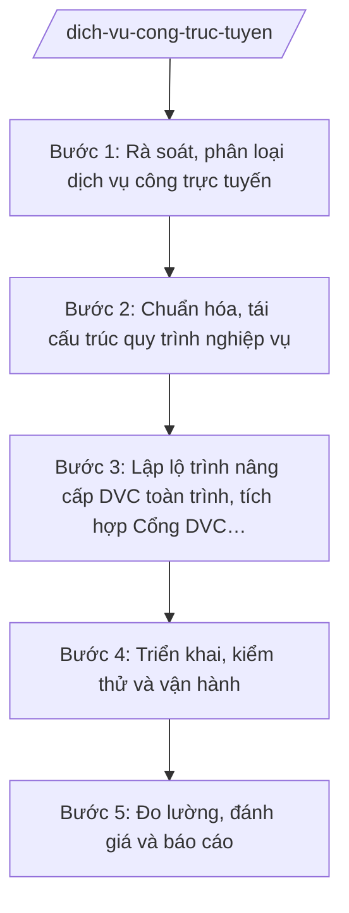

# Skill: Dịch vụ công trực tuyến (chính quyền số)

## 2. Khi nào dùng
- Rà soát toàn bộ danh mục dịch vụ công trực tuyến của các sở, ban, ngành, UBND xã.
- Chuẩn hóa, tái cấu trúc quy trình nghiệp vụ giải quyết thủ tục hành chính trên môi trường điện tử.
- Xây dựng lộ trình cung cấp DVC trực tuyến toàn trình, tích hợp Cổng Dịch vụ công quốc gia.
- Đánh giá mức độ sử dụng, mức độ hài lòng của người dân, doanh nghiệp đối với DVC trực tuyến.
- Báo cáo kết quả cung cấp DVC trực tuyến gửi Bộ KH&CN và UBND tỉnh.

## 3. Đầu vào (Input)
| Trường | Mô tả | Bắt buộc |
|--------|-------|----------|
| `danh_sach_dvc` | Danh mục DVC của các sở, ban, ngành, UBND xã (tên TTHC, mức độ trực tuyến hiện tại) | Có |
| `ty_le_toan_trinh_hien_tai` | Tỷ lệ DVC trực tuyến toàn trình hiện tại của tỉnh | Có |
| `phan_anh_nguoi_dung` | Phản ánh, kiến nghị của người dân, doanh nghiệp về DVC trực tuyến | Không |
| `ke_hoach_nang_cap` | Định hướng nâng cấp: DVC ưu tiên chuyển toàn trình, thời gian, nguồn lực | Không |
| `nguoi_ky` | Người ký ban hành (Chủ tịch UBND tỉnh đối với kế hoạch; Giám đốc Sở đối với báo cáo) | Có |

## 4. Quy trình

**Bước 1. Rà soát, phân loại dịch vụ công trực tuyến**
- Làm gì: Rà soát toàn bộ DVC của các sở, ban, ngành, UBND xã; phân loại mức độ trực tuyến: toàn trình, một phần, chưa trực tuyến; xác định DVC đủ/không đủ điều kiện cung cấp toàn trình.
- Dùng input: `danh_sach_dvc`, `ty_le_toan_trinh_hien_tai`
- Vai trò: Chuyên viên Phòng Chuyển đổi số phối hợp các sở, ngành rà soát; AI hỗ trợ lập bảng phân loại DVC, thống kê tỷ lệ theo từng mức độ ⏱ ~5 ngày làm việc (ước tính)
- Lưu ý nghiệp vụ: Phân loại phải đúng thực chất (toàn trình là nộp – xử lý – trả kết quả hoàn toàn trực tuyến); DVC không đủ điều kiện phải nêu rõ lý do (cần bản giấy, cần đối chiếu bản chính...).
- → Kết quả bước: Bảng rà soát, phân loại DVC trực tuyến toàn tỉnh.

**Bước 2. Chuẩn hóa, tái cấu trúc quy trình nghiệp vụ**
- Làm gì: Đánh giá quy trình nghiệp vụ từng DVC ưu tiên; cắt giảm bước không cần thiết, chuẩn hóa biểu mẫu điện tử; tái cấu trúc quy trình trước khi số hóa.
- Dùng input: Bảng phân loại ở Bước 1, `phan_anh_nguoi_dung`
- Vai trò: Chuyên viên phối hợp đơn vị chủ trì TTHC rà soát quy trình; Trưởng phòng kiểm tra; AI hỗ trợ vẽ sơ đồ quy trình hiện tại – đề xuất, soạn biểu mẫu điện tử ⏱ ~5 ngày làm việc (ước tính)
- Lưu ý nghiệp vụ: Số hóa quy trình rườm rà chỉ làm tăng phiền hà trên môi trường điện tử; phải tái cấu trúc trước khi nâng cấp; lấy phản ánh người dùng làm căn cứ cải tiến.
- → Kết quả bước: Quy trình nghiệp vụ đã chuẩn hóa của các DVC ưu tiên.

**Bước 3. Lập lộ trình nâng cấp DVC toàn trình, tích hợp Cổng DVC quốc gia**
- Làm gì: Lập lộ trình nâng cấp từng nhóm DVC lên toàn trình theo quý; kế hoạch tích hợp, đồng bộ dữ liệu với Cổng Dịch vụ công quốc gia.
- Dùng input: `ke_hoach_nang_cap`, quy trình đã chuẩn hóa ở Bước 2
- Vai trò: Trưởng phòng Chuyển đổi số lập lộ trình; Phó Giám đốc Sở xem xét; Giám đốc Sở ký Tờ trình; Chủ tịch UBND tỉnh phê duyệt kế hoạch; AI hỗ trợ lập bảng lộ trình, theo dõi tiến độ tích hợp ⏱ ~5 ngày làm việc (ước tính)
- Lưu ý nghiệp vụ: Lộ trình phải phù hợp năng lực hệ thống thông tin và nhân lực; ưu tiên DVC có tần suất sử dụng cao; tích hợp Cổng DVC quốc gia phải bảo đảm đồng bộ, an toàn dữ liệu.
- → Kết quả bước: Kế hoạch nâng cấp DVC trực tuyến toàn trình đã phê duyệt.

**Bước 4. Triển khai, kiểm thử và vận hành**
- Làm gì: Phối hợp đơn vị cung cấp hệ thống triển khai nâng cấp; kiểm thử chức năng, an toàn; tập huấn cán bộ; vận hành chính thức.
- Dùng input: Kế hoạch nâng cấp đã phê duyệt
- Vai trò: Chuyên viên phối hợp triển khai, kiểm thử; đơn vị vận hành hệ thống thực hiện kỹ thuật; AI hỗ trợ lập kịch bản kiểm thử, tổng hợp lỗi ⏱ theo tiến độ kế hoạch (ước tính)
- Lưu ý nghiệp vụ: Kiểm thử kỹ trước khi vận hành chính thức; có phương án dự phòng khi hệ thống lỗi; tập huấn đầy đủ cho cán bộ tiếp nhận, xử lý hồ sơ.
- → Kết quả bước: DVC toàn trình vận hành chính thức + biên bản nghiệm thu kỹ thuật.

**Bước 5. Đo lường, đánh giá và báo cáo**
- Làm gì: Đo lường tỷ lệ hồ sơ trực tuyến, tỷ lệ đúng hạn, mức độ hài lòng người dùng; đánh giá kết quả; báo cáo UBND tỉnh, Bộ KH&CN.
- Dùng input: Số liệu vận hành hệ thống, `phan_anh_nguoi_dung`
- Vai trò: Chuyên viên tổng hợp số liệu; Phó Giám đốc Sở chỉ đạo đánh giá; AI hỗ trợ tính toán chỉ số, soạn báo cáo đánh giá ⏱ ~3 ngày làm việc (ước tính)
- Lưu ý nghiệp vụ: Đánh giá bằng số liệu hệ thống, không cảm tính; phản ánh của người dân là thước đo quan trọng nhất của chất lượng DVC.
- → Kết quả bước: Báo cáo đánh giá kết quả cung cấp DVC trực tuyến của tỉnh.

## Luồng quy trình (Workflow)

## 5. Đầu ra (Output)
- Kế hoạch nâng cấp dịch vụ công trực tuyến toàn trình của UBND tỉnh.
- Quy trình nghiệp vụ đã chuẩn hóa của các DVC ưu tiên.
- Báo cáo đánh giá kết quả cung cấp DVC trực tuyến.

**Cấu trúc output chuẩn:**
Khung Kế hoạch nâng cấp DVC trực tuyến toàn trình (theo NĐ 30/2020/NĐ-CP):
1. Quốc hiệu "CỘNG HÒA XÃ HỘI CHỦ NGHĨA VIỆT NAM", Tiêu ngữ "Độc lập – Tự do – Hạnh phúc".
2. Số, ký hiệu văn bản: số 1234/KH-UBND.
3. Địa danh và ngày, tháng, năm: "Tỉnh A, ngày ... tháng ... năm ...".
4. Tên loại và trích yếu: "KẾ HOẠCH / Nâng cấp dịch vụ công trực tuyến toàn trình tỉnh A năm ...".
5. Căn cứ: TT 10/2025/TT-BKHCN; NĐ 132/2025/NĐ-CP; NĐ 118/2025/NĐ-CP; NĐ 150/2025/NĐ-CP; Tờ trình của Giám đốc Sở KH&CN.
6. Nội dung bắt buộc: I. Mục đích, yêu cầu; II. Kết quả rà soát DVC hiện tại; III. Lộ trình nâng cấp (danh mục DVC chuyển toàn trình theo quý; tích hợp Cổng DVC quốc gia); IV. Kinh phí; V. Tổ chức thực hiện (Sở KH&CN thường trực; các sở, ngành, UBND xã thực hiện).
7. Nơi nhận: Bộ KH&CN; Thường trực Tỉnh ủy; HĐND tỉnh; các sở, ban, ngành; UBND các xã; lưu VT.
8. Chữ ký: "TM. ỦY BAN NHÂN DÂN / CHỦ TỊCH" + họ tên Phạm Văn P, đóng dấu.

## 6. Checklist nghiệm thu
- [ ] Rà soát đầy đủ DVC của sở, ngành, xã; phân loại mức độ trực tuyến đúng thực chất.
- [ ] Quy trình nghiệp vụ được tái cấu trúc, chuẩn hóa trước khi nâng cấp.
- [ ] Lộ trình nâng cấp cụ thể theo quý, có tích hợp Cổng DVC quốc gia.
- [ ] Kiểm thử kỹ trước vận hành chính thức; cán bộ được tập huấn.
- [ ] Đánh giá bằng số liệu hệ thống và mức độ hài lòng người dùng.
- [ ] Văn bản đúng thể thức NĐ 30/2020/NĐ-CP; đúng thẩm quyền ký.
- [ ] Không bịa số liệu, không trích dẫn văn bản hết hiệu lực.
- [ ] Đã qua human gate: chuyên viên soạn → Trưởng phòng kiểm tra → Phó Giám đốc/Giám đốc Sở → Chủ tịch UBND tỉnh phê duyệt kế hoạch.

## 7. Ví dụ mô phỏng
*Dữ liệu dưới đây là giả lập 100% phục vụ minh họa.*

### Input mẫu
- danh_sach_dvc: 1.200 TTHC của các sở, ngành, UBND xã tỉnh A
- ty_le_toan_trinh_hien_tai: 45% DVC trực tuyến toàn trình
- phan_anh_nguoi_dung: Người dân phản ánh một số DVC "toàn trình" vẫn yêu cầu nộp bản giấy khi nhận kết quả
- ke_hoach_nang_cap: Năm 2027 nâng thêm 300 DVC lên toàn trình, tích hợp 100% DVC toàn trình lên Cổng DVC quốc gia
- nguoi_ky: Ông Phạm Văn P – Chủ tịch UBND tỉnh A

### Output mẫu
**KẾ HOẠCH** số 1234/KH-UBND
Nâng cấp dịch vụ công trực tuyến toàn trình tỉnh A năm 2027

CỘNG HÒA XÃ HỘI CHỦ NGHĨA VIỆT NAM
Độc lập – Tự do – Hạnh phúc

Tỉnh A, ngày 09 tháng 10 năm 2026

I. MỤC ĐÍCH, YÊU CẦU
Nâng tỷ lệ DVC trực tuyến toàn trình từ 45% lên 70%; khắc phục tình trạng DVC "toàn trình" vẫn yêu cầu bản giấy.

II. KẾT QUẢ RÀ SOÁT
Tổng 1.200 TTHC: 540 DVC toàn trình (45%), 420 DVC một phần, 240 DVC chưa trực tuyến; 120 DVC không đủ điều kiện toàn trình (cần đối chiếu bản chính).

III. LỘ TRÌNH NÂNG CẤP NĂM 2027
- Quý I–II: Chuẩn hóa quy trình, nâng cấp 150 DVC có tần suất sử dụng cao.
- Quý III: Nâng cấp 150 DVC còn lại; kiểm thử, vận hành.
- Quý IV: Tích hợp 100% DVC toàn trình lên Cổng Dịch vụ công quốc gia; đánh giá, báo cáo.

IV. TỔ CHỨC THỰC HIỆN
Sở KH&CN thường trực, theo dõi; các sở, ban, ngành, UBND xã rà soát, chuẩn hóa quy trình thuộc phạm vi quản lý; báo cáo tiến độ hằng quý.

Nơi nhận:
- Bộ KH&CN;
- Thường trực Tỉnh ủy, HĐND tỉnh;
- Các sở, ban, ngành; UBND các xã;
- Lưu: VT.

TM. ỦY BAN NHÂN DÂN
CHỦ TỊCH
Phạm Văn P

## 8. Human gate
Chuyên viên Phòng Chuyển đổi số rà soát, soạn kế hoạch → Trưởng phòng kiểm tra → Phó Giám đốc Sở xem xét → Giám đốc Sở ký Tờ trình → Chủ tịch UBND tỉnh phê duyệt kế hoạch. AI chỉ hỗ trợ rà soát, phân loại, soạn thảo, theo dõi tiến độ — không thay con người quyết định danh mục DVC nâng cấp và đánh giá chất lượng.

## 9. Giới hạn
AI tuyệt đối KHÔNG: ra quyết định hành chính thay người có thẩm quyền; tự ký/phát hành văn bản; bịa số liệu, căn cứ pháp lý, trích dẫn; dùng văn bản hết hiệu lực. Đặc biệt: không tự công bố DVC đạt "toàn trình" khi quy trình vẫn yêu cầu bản giấy, không bịa tỷ lệ hài lòng của người dân.

## 10. Căn cứ & lưu ý
- TT 10/2025/TT-BKHCN (27/6/2025; hiệu lực 01/7/2025).
- NĐ 132/2025/NĐ-CP (12/6/2025) — phân định thẩm quyền CQĐP 2 cấp lĩnh vực quản lý nhà nước của Bộ KH&CN.
- NĐ 118/2025/NĐ-CP (09/6/2025) — cơ chế một cửa, một cửa liên thông trong giải quyết TTHC.
- NĐ 150/2025/NĐ-CP (12/6/2025; hiệu lực 16/6/2025); sửa đổi bởi NĐ 370/2025/NĐ-CP.
- NĐ 30/2020/NĐ-CP (thể thức văn bản hành chính).
- Lưu ý: DVC trực tuyến toàn trình phải bảo đảm người dân nộp hồ sơ – xử lý – nhận kết quả hoàn toàn trên môi trường điện tử; việc tích hợp Cổng DVC quốc gia phải bảo đảm đồng bộ và an toàn dữ liệu.
