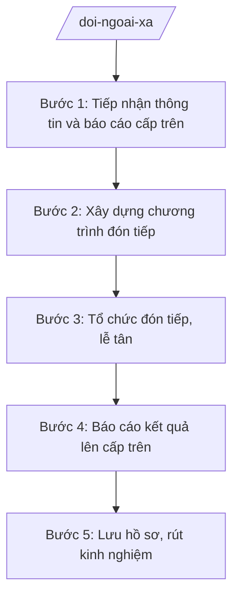

# Skill: Công tác đối ngoại cấp xã (đón tiếp đoàn khách, lễ tân)

## 2. Khi nào dùng

- Đón tiếp đoàn khách, đoàn công tác có yếu tố nước ngoài đến thăm, làm việc tại xã (theo chương trình của cấp trên hoặc đề nghị được chấp thuận).
- Tổ chức lễ tân các sự kiện của xã có khách mời là người nước ngoài, tổ chức quốc tế.
- Phối hợp với cơ quan cấp trên (Sở Ngoại vụ nơi có, UBND tỉnh) trong hoạt động đối ngoại liên quan đến địa bàn xã.
- Báo cáo kết quả hoạt động đối ngoại phát sinh tại xã lên cấp trên theo quy định.

**Lưu ý phạm vi:** cấp xã KHÔNG có thẩm quyền ký kết điều ước quốc tế, thỏa thuận quốc tế nhân danh Nhà nước; mọi hoạt động đối ngoại của xã thực hiện theo phân cấp, phân quyền về đối ngoại và phải báo cáo, xin ý kiến cấp trên khi vượt thẩm quyền.

## 3. Đầu vào (Input)

| Trường | Mô tả | Bắt buộc |
|--------|-------|----------|
| `thong_tin_doan` | Thông tin đoàn khách (thành phần, quốc tịch/tổ chức, mục đích, thời gian) | Có |
| `chuong_trinh` | Chương trình, nội dung làm việc dự kiến | Có |
| `yeu_cau_cap_tren` | Văn bản chỉ đạo, chấp thuận của cấp trên (nếu có) | Không |
| `dieu_kien_don_tiep` | Điều kiện đón tiếp của xã (địa điểm, phiên dịch, lễ tân) | Có |

## 4. Quy trình

**Bước 1. Tiếp nhận thông tin và báo cáo cấp trên**

- Làm gì: Tiếp nhận thông tin đoàn khách; đánh giá tính chất, thẩm quyền; báo cáo UBND tỉnh (qua Sở Ngoại vụ nơi có) xin ý kiến chỉ đạo đối với đoàn cấp cao hoặc nội dung nhạy cảm.
- Dùng input: `thong_tin_doan`, `yeu_cau_cap_tren`.
- Vai trò: Công chức Văn phòng HĐND và UBND xã A tiếp nhận, tổng hợp; AI hỗ trợ soạn báo cáo xin ý kiến ⏱ ~0,5–1 ngày làm việc (ước tính).
- Lưu ý nghiệp vụ: Không tự ý nhận lời, cam kết nội dung vượt thẩm quyền của xã; đoàn có yếu tố nhạy cảm phải báo cáo cấp trên trước khi đón tiếp.
- → Kết quả bước: Báo cáo xin ý kiến cấp trên (nếu cần) + xác nhận chương trình đón tiếp.

**Bước 2. Xây dựng chương trình đón tiếp**

- Làm gì: Lập chương trình chi tiết (đón, chào xã giao, nội dung làm việc, tham quan, tiễn); phân công nhiệm vụ (lễ tân, phiên dịch, an ninh, hậu cần); dự trù kinh phí.
- Dùng input: `thong_tin_doan`, `chuong_trinh`, `dieu_kien_don_tiep`.
- Vai trò: Chánh Văn phòng HĐND và UBND (ông Phạm Văn C) chủ trì xây dựng; AI hỗ trợ soạn chương trình, phân công nhiệm vụ ⏱ ~1–2 ngày làm việc (ước tính).
- Lưu ý nghiệp vụ: Chương trình phải phù hợp cấp đoàn, phong tục đối tác; bố trí phiên dịch đủ năng lực; kinh phí trong dự toán được giao.
- → Kết quả bước: Chương trình đón tiếp + bảng phân công nhiệm vụ.

**Bước 3. Tổ chức đón tiếp, lễ tân**

- Làm gì: Thực hiện đón tiếp theo chương trình (chào xã giao lãnh đạo xã, nội dung làm việc, tham quan thực tế); đảm bảo lễ tân, phiên dịch, an ninh, y tế.
- Dùng input: `chuong_trinh` (đã duyệt), `dieu_kien_don_tiep`.
- Vai trò: Phó Chủ tịch UBND xã (bà Trần Thị B) hoặc Chủ tịch UBND xã (ông Nguyễn Văn A) chủ trì đón tiếp tùy cấp đoàn; Văn phòng điều hành; AI hỗ trợ soạn lời chào, tài liệu giới thiệu xã ⏱ ~trong ngày diễn ra (ước tính).
- Lưu ý nghiệp vụ: Tuân thủ nghi thức lễ tân nhà nước ở mức phù hợp cấp xã; không phát ngôn, cam kết vượt thẩm quyền; ghi chép đầy đủ nội dung làm việc.
- → Kết quả bước: Buổi đón tiếp, làm việc hoàn thành + biên bản ghi nhớ nội dung (nếu có).

**Bước 4. Báo cáo kết quả lên cấp trên**

- Làm gì: Tổng hợp kết quả đón tiếp, nội dung làm việc, kiến nghị (nếu có); soạn báo cáo gửi UBND tỉnh (qua Sở Ngoại vụ nơi có) theo quy định.
- Dùng input: kết quả Bước 3.
- Vai trò: Công chức Văn phòng soạn báo cáo; AI hỗ trợ soạn báo cáo đúng thể thức NĐ 30/2020/NĐ-CP ⏱ ~0,5–1 ngày làm việc (ước tính).
- Lưu ý nghiệp vụ: Báo cáo trung thực, đầy đủ; kiến nghị của đoàn khách phải được chuyển đúng đầu mối, theo dõi đến khi có trả lời.
- → Kết quả bước: Báo cáo kết quả đón tiếp đoàn khách gửi cấp trên.

**Bước 5. Lưu hồ sơ, rút kinh nghiệm**

- Làm gì: Lưu trữ đầy đủ hồ sơ đoàn (thông tin, chương trình, báo cáo, hình ảnh); đánh giá, rút kinh nghiệm công tác đón tiếp.
- Dùng input: toàn bộ hồ sơ các bước trên.
- Vai trò: Văn phòng HĐND và UBND lưu trữ; AI hỗ trợ sắp xếp hồ sơ, soạn biên bản rút kinh nghiệm ⏱ ~0,5 ngày làm việc (ước tính).
- Lưu ý nghiệp vụ: Hồ sơ đối ngoại lưu trữ cẩn thận, đúng quy định văn thư, lưu trữ; bảo mật thông tin nhạy cảm (nếu có).
- → Kết quả bước: Hồ sơ đoàn khách được lưu trữ đầy đủ.

## Luồng quy trình (Workflow)

## 5. Đầu ra (Output)

**Danh sách sản phẩm:**
1. Báo cáo xin ý kiến cấp trên (nếu đoàn vượt thẩm quyền xã).
2. Chương trình đón tiếp + bảng phân công nhiệm vụ.
3. Biên bản ghi nhớ nội dung làm việc (nếu có).
4. Báo cáo kết quả đón tiếp đoàn khách gửi cấp trên.
5. Hồ sơ đoàn khách lưu trữ.

**Cấu trúc output chuẩn** (Báo cáo — thể thức văn bản hành chính theo NĐ 30/2020/NĐ-CP):
1. Quốc hiệu "CỘNG HÒA XÃ HỘI CHỦ NGHĨA VIỆT NAM" – Tiêu ngữ "Độc lập – Tự do – Hạnh phúc".
2. Tên cơ quan: ỦY BAN NHÂN DÂN XÃ A; số, ký hiệu; địa danh, ngày tháng năm.
3. Tên loại và trích yếu: "BÁO CÁO Kết quả đón tiếp đoàn ...".
4. Kính gửi: Ủy ban nhân dân tỉnh A (qua Sở Ngoại vụ — nơi có).
5. Nội dung: thông tin đoàn; chương trình đã thực hiện; kết quả, nội dung làm việc chính; kiến nghị, đề xuất (nếu có).
6. Nơi nhận; chữ ký người có thẩm quyền.

## 6. Checklist nghiệm thu

- [ ] Đoàn vượt thẩm quyền đã báo cáo, xin ý kiến cấp trên trước khi đón tiếp
- [ ] Chương trình đón tiếp phù hợp cấp đoàn, có phân công nhiệm vụ cụ thể
- [ ] Lễ tân, phiên dịch, an ninh được bố trí đầy đủ
- [ ] Không có phát ngôn, cam kết vượt thẩm quyền của cấp xã
- [ ] Báo cáo kết quả gửi cấp trên đầy đủ, đúng hạn
- [ ] Hồ sơ đoàn được lưu trữ đầy đủ, bảo mật thông tin nhạy cảm
- [ ] Đủ thành phần thể thức văn bản hành chính theo NĐ 30/2020/NĐ-CP
- [ ] Căn cứ pháp lý đúng, còn hiệu lực, không bịa số hiệu văn bản
- [ ] Đã qua human gate: Chánh Văn phòng kiểm tra → Phó Chủ tịch/Chủ tịch UBND xã quyết định
- [ ] Dữ liệu ví dụ (nếu có) 100% hư cấu theo quy ước

## 7. Ví dụ mô phỏng

*Dữ liệu dưới đây là giả lập 100% phục vụ minh họa.*

**Input mẫu:**
- `thong_tin_doan`: Đoàn công tác của tổ chức phi chính phủ nước Anpha (giả lập), 04 người, khảo sát dự án nước sạch nông thôn
- `chuong_trinh`: chào xã giao lãnh đạo xã; khảo sát 02 thôn; làm việc về kế hoạch phối hợp
- `yeu_cau_cap_tren`: Công văn chấp thuận của UBND tỉnh A (giả lập)
- `dieu_kien_don_tiep`: hội trường UBND xã A; 01 phiên dịch viên tiếng Anh (giả lập)

**Output mẫu (trích Báo cáo):**

CỘNG HÒA XÃ HỘI CHỦ NGHĨA VIỆT NAM
Độc lập – Tự do – Hạnh phúc

ỦY BAN NHÂN DÂN XÃ A
Số: 45/BC-UBND
Xã A, ngày 20 tháng 03 năm 2026

**BÁO CÁO**
**Kết quả đón tiếp đoàn công tác tổ chức phi chính phủ nước Anpha (giả lập)**

*Kính gửi:* Ủy ban nhân dân tỉnh A.

Thực hiện Công văn chấp thuận của UBND tỉnh A (giả lập), UBND xã A đã đón tiếp đoàn công tác của tổ chức phi chính phủ nước Anpha (giả lập) gồm 04 người, từ ngày 18 đến 19/3/2026, với nội dung:

1. Chào xã giao lãnh đạo UBND xã A (bà Trần Thị B – Phó Chủ tịch UBND xã chủ trì).
2. Khảo sát thực tế 02 thôn về nhu cầu nước sạch nông thôn.
3. Trao đổi kế hoạch phối hợp triển khai dự án (đoàn ghi nhận, không cam kết thay cấp có thẩm quyền).

*Kiến nghị:* đề nghị UBND tỉnh xem xét, cho ý kiến về đề xuất dự án của đoàn (chi tiết kèm theo).

*Nơi nhận:* ... **CHỦ TỊCH** (ký tên, đóng dấu — phần ký do người có thẩm quyền thực hiện)

## 8. Human gate (người kiểm duyệt)

- Công chức Văn phòng soạn thảo → Chánh Văn phòng HĐND và UBND (ông Phạm Văn C) kiểm tra → Phó Chủ tịch UBND xã (bà Trần Thị B) hoặc Chủ tịch UBND xã (ông Nguyễn Văn A) quyết định chương trình đón tiếp, ký báo cáo.
- Đoàn cấp cao hoặc nội dung nhạy cảm: phải có ý kiến chấp thuận của cấp trên trước khi đón tiếp.

## 9. Giới hạn (guardrails)

- AI KHÔNG thay lãnh đạo xã quyết định nội dung làm việc với đoàn khách nước ngoài.
- Cấp xã KHÔNG ký kết điều ước quốc tế, thỏa thuận quốc tế nhân danh Nhà nước — AI phải cảnh báo khi nội dung có dấu hiệu vượt thẩm quyền.
- AI KHÔNG tự ký, đóng dấu, phát hành văn bản hành chính.
- KHÔNG bịa thông tin đoàn khách, nội dung làm việc, số hiệu văn bản, căn cứ pháp lý.
- KHÔNG dùng văn bản đã hết hiệu lực.
- KHÔNG tư vấn vượt thẩm quyền của cấp xã trong lĩnh vực đối ngoại.

## 10. Căn cứ & lưu ý

- Nghị định 134/2025/NĐ-CP ngày 12/6/2025: phân quyền, phân cấp trong lĩnh vực đối ngoại (xã thực hiện hoạt động đối ngoại theo phân cấp, báo cáo cấp trên).
- Nghị định 150/2025/NĐ-CP: Văn phòng HĐND và UBND cấp xã tham mưu lĩnh vực đối ngoại.
- Nghị định 30/2020/NĐ-CP: thể thức văn bản hành chính.
- Lưu ý: hoạt động đối ngoại ở cấp xã chủ yếu là đón tiếp, lễ tân, phối hợp; mọi nội dung vượt thẩm quyền phải báo cáo, xin ý kiến cấp trên (Sở Ngoại vụ nơi có / UBND tỉnh).
