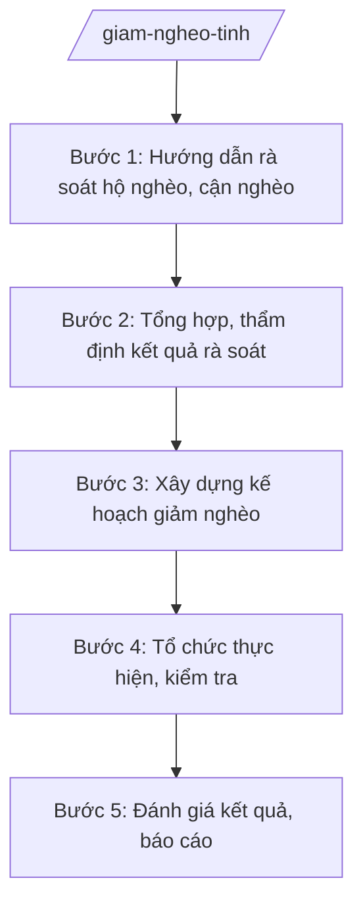

# Skill: Chương trình giảm nghèo cấp tỉnh

## 2. Khi nào dùng
- Rà soát hộ nghèo, hộ cận nghèo hằng năm theo chuẩn nghèo đa chiều.
- Xây dựng kế hoạch giảm nghèo của tỉnh; phân bổ vốn chương trình mục tiêu quốc gia.
- Kiểm tra, đánh giá kết quả giảm nghèo; báo cáo Bộ Nội vụ, UBND tỉnh.

## 3. Đầu vào (Input)
| Trường | Mô tả | Bắt buộc |
|--------|-------|----------|
| `nam_ke_hoach` | Năm kế hoạch / rà soát | Có |
| `chuan_ngheo` | Chuẩn nghèo đa chiều áp dụng | Có |
| `so_lieu_ra_soat` | Số liệu rà soát hộ nghèo, cận nghèo của cấp xã | Có |
| `nguon_luc` | Nguồn lực (vốn CTMTQG, ngân sách tỉnh, xã hội hóa) | Có |
| `muc_tieu_giam_ngheo` | Mục tiêu giảm nghèo của tỉnh | Có |

## 4. Quy trình

**Bước 1. Hướng dẫn rà soát hộ nghèo, cận nghèo**
- Làm gì: Ban hành văn bản hướng dẫn rà soát theo chuẩn nghèo đa chiều: quy trình bình xét, chấm điểm thiếu hụt, công khai danh sách.
- Dùng input: `nam_ke_hoach`, `chuan_ngheo`
- Vai trò: Chuyên viên Phòng Bảo trợ xã hội (Sở Nội vụ tỉnh A) soạn; AI hỗ trợ soạn hướng dẫn, biểu mẫu ⏱ ~3 ngày làm việc (ước tính)
- Lưu ý nghiệp vụ: Rà soát phải dân chủ, công khai tại cộng đồng; tránh bỏ sót hộ thật sự nghèo và đưa sai hộ không nghèo vào danh sách.
- → Kết quả bước: Văn bản hướng dẫn rà soát.

**Bước 2. Tổng hợp, thẩm định kết quả rà soát**
- Làm gì: Tổng hợp kết quả rà soát của UBND cấp xã; thẩm định, phúc tra xác suất; chốt danh sách hộ nghèo, cận nghèo toàn tỉnh.
- Dùng input: `so_lieu_ra_soat`
- Vai trò: Chuyên viên tổng hợp; AI hỗ trợ lập bảng tổng hợp, phát hiện số liệu bất thường ⏱ ~10 ngày làm việc (ước tính)
- Lưu ý nghiệp vụ: Phúc tra độc lập ít nhất 5% số hộ; xử lý nghiêm việc khai man, bình xét không đúng quy trình.
- → Kết quả bước: Danh sách hộ nghèo, cận nghèo toàn tỉnh đã thẩm định.

**Bước 3. Xây dựng kế hoạch giảm nghèo**
- Làm gì: Xây dựng kế hoạch: mục tiêu giảm tỷ lệ hộ nghèo; giải pháp (hỗ trợ sinh kế, đào tạo nghề, tín dụng, y tế, giáo dục, nhà ở); phân bổ nguồn lực theo địa bàn.
- Dùng input: `muc_tieu_giam_ngheo`, `nguon_luc`, danh sách Bước 2
- Vai trò: Trưởng phòng Bảo trợ xã hội chủ trì; AI hỗ trợ lập kế hoạch, bảng phân bổ ⏱ ~5 ngày làm việc (ước tính)
- Lưu ý nghiệp vụ: Ưu tiên địa bàn đặc biệt khó khăn, hộ nghèo là người có công, dân tộc thiểu số; giải pháp phải phù hợp nguyên nhân nghèo của từng nhóm.
- → Kết quả bước: Kế hoạch giảm nghèo năm của tỉnh (trình phê duyệt).

**Bước 4. Tổ chức thực hiện, kiểm tra**
- Làm gì: Phân bổ vốn, triển khai các dự án, chính sách hỗ trợ; kiểm tra tiến độ tại địa phương.
- Dùng input: Kế hoạch đã phê duyệt
- Vai trò: Các sở, ngành, UBND cấp xã thực hiện; Sở Nội vụ kiểm tra; AI hỗ trợ lập bảng theo dõi tiến độ ⏱ trong năm (ước tính)
- Lưu ý nghiệp vụ: Vốn phải đến đúng đối tượng; kiểm tra thực tế, không chỉ kiểm tra trên giấy.
- → Kết quả bước: Báo cáo tiến độ thực hiện.

**Bước 5. Đánh giá kết quả, báo cáo**
- Làm gì: Đánh giá tỷ lệ giảm nghèo, hiệu quả các giải pháp; báo cáo UBND tỉnh, Bộ Nội vụ; đề xuất năm tiếp theo.
- Dùng input: Kết quả rà soát cuối năm, báo cáo tiến độ
- Vai trò: Chuyên viên tổng hợp; Giám đốc Sở Nội vụ ký báo cáo; AI hỗ trợ phân tích, soạn báo cáo ⏱ ~5 ngày làm việc (ước tính)
- Lưu ý nghiệp vụ: Đánh giá trung thực, không "làm đẹp" số liệu; phân tích nguyên nhân hộ tái nghèo, phát sinh nghèo.
- → Kết quả bước: Báo cáo kết quả giảm nghèo năm.

## Luồng quy trình (Workflow)

## 5. Đầu ra (Output)
- Kế hoạch giảm nghèo năm của tỉnh.
- Danh sách hộ nghèo, hộ cận nghèo toàn tỉnh.
- Báo cáo kết quả giảm nghèo năm.

**Cấu trúc output chuẩn:**
- Thể thức: tuân thủ Nghị định 30/2020/NĐ-CP về công tác văn thư.
Khung kế hoạch giảm nghèo:
1. Quốc hiệu "CỘNG HÒA XÃ HỘI CHỦ NGHĨA VIỆT NAM", Tiêu ngữ "Độc lập – Tự do – Hạnh phúc"; số, ký hiệu; địa danh, ngày tháng năm.
2. Tên: "KẾ HOẠCH thực hiện công tác giảm nghèo năm ... tỉnh A".
3. Mục tiêu (tỷ lệ giảm nghèo, chỉ tiêu cụ thể).
4. Nhiệm vụ, giải pháp (theo nhóm nguyên nhân nghèo).
5. Nguồn lực, phân bổ.
6. Tổ chức thực hiện; chữ ký.
- Nơi nhận: liệt kê các cơ quan, đơn vị nhận để biết/thực hiện; kết thúc bằng "- Lưu: VT, [mã đơn vị]".
## 6. Checklist nghiệm thu
- [ ] Rà soát đúng quy trình, công khai, dân chủ.
- [ ] Có phúc tra xác suất, xử lý vi phạm bình xét.
- [ ] Danh sách hộ nghèo, cận nghèo chính xác.
- [ ] Kế hoạch có mục tiêu đo được, giải pháp phù hợp nguyên nhân nghèo.
- [ ] Nguồn lực phân bổ đúng đối tượng, đúng địa bàn ưu tiên.
- [ ] Đánh giá trung thực, không làm đẹp số liệu.
- [ ] Báo cáo đúng thời hạn, đúng thể thức NĐ 30/2020/NĐ-CP.

## 7. Ví dụ mô phỏng
*Dữ liệu dưới đây là giả lập 100% phục vụ minh họa.*

**Input mẫu:**
- nam_ke_hoach: 2026
- muc_tieu_giam_ngheo: Giảm tỷ lệ hộ nghèo từ 5% xuống 4% (giả lập)
- so_lieu_ra_soat: 20.000 hộ nghèo, 15.000 hộ cận nghèo (giả lập)

**Output mẫu (trích kế hoạch):**
> **KẾ HOẠCH**
> **Thực hiện công tác giảm nghèo năm 2026 tỉnh A**
>
> 1. Mục tiêu: giảm 1 điểm phần trăm tỷ lệ hộ nghèo... (giả lập)
> 2. Giải pháp: hỗ trợ sinh kế 500 hộ; đào tạo nghề 2.000 lao động... (giả lập)
> (Dữ liệu giả lập 100% phục vụ minh họa)

## 8. Human gate
- Trưởng phòng Bảo trợ xã hội: kiểm tra kết quả rà soát và kế hoạch (Bước 2–3).
- Giám đốc Sở Nội vụ: ký trình kế hoạch, ký báo cáo.
- Chủ tịch UBND tỉnh: phê duyệt kế hoạch giảm nghèo năm.

## 9. Giới hạn
- AI không thay cộng đồng bình xét hộ nghèo.
- Không bịa danh sách hộ nghèo, số liệu rà soát.
- Không "làm đẹp" tỷ lệ giảm nghèo; phản ánh trung thực tái nghèo, phát sinh nghèo.
- Mọi số liệu phải từ kết quả rà soát của cấp xã đã thẩm định.

## 10. Căn cứ & lưu ý
- TT 10/2025/TT-BNV (Sở Nội vụ: bảo trợ xã hội, giảm nghèo).
- Chuẩn nghèo đa chiều và Chương trình mục tiêu quốc gia giảm nghèo — dẫn tên, tra cứu bản hiện hành khi áp dụng.
