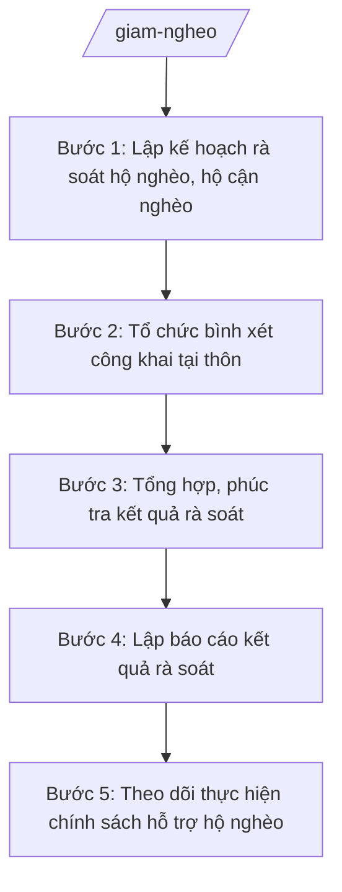

# Skill: Rà soát hộ nghèo/cận nghèo, giảm nghèo

## 2. Khi nào dùng

- Lập kế hoạch rà soát hộ nghèo, hộ cận nghèo định kỳ hằng năm (hoặc đột xuất) theo chuẩn nghèo hiện hành.
- Tổ chức bình xét, công nhận hộ nghèo, hộ cận nghèo công khai tại các thôn.
- Tổng hợp kết quả rà soát toàn xã, lập báo cáo gửi cấp có thẩm quyền.
- Theo dõi, tổng hợp việc thực hiện các chính sách hỗ trợ hộ nghèo, hộ cận nghèo trên địa bàn (hỗ trợ sản xuất, vay vốn, y tế, giáo dục...).
- Phục vụ xây dựng kế hoạch giảm nghèo hằng năm của xã.

## 3. Đầu vào (Input)

| Trường | Mô tả | Bắt buộc |
|--------|-------|----------|
| `nam_ra_soat` | Năm thực hiện rà soát | Có |
| `chuan_ngheo_ap_dung` | Chuẩn nghèo đang áp dụng (mức thu nhập, tiêu chí theo quy định hiện hành) | Có |
| `danh_sach_ho_hien_co` | Danh sách hộ nghèo, hộ cận nghèo hiện quản lý (chủ hộ, thôn, nguyên nhân nghèo) | Có |
| `phieu_dieu_tra` | Phiếu điều tra, thu thập thông tin hộ gia đình phục vụ chấm điểm phân loại | Có |
| `ke_hoach_giam_ngheo` | Kế hoạch giảm nghèo của xã trong năm (chỉ tiêu, giải pháp) | Không |
| `so_lieu_ho_tro` | Số liệu thực hiện chính sách hỗ trợ hộ nghèo trong kỳ (số hộ được hỗ trợ theo từng chính sách) | Không |

## 4. Quy trình

**Bước 1. Lập kế hoạch rà soát hộ nghèo, hộ cận nghèo**

- Làm gì: Xây dựng kế hoạch rà soát: mục đích, yêu cầu; đối tượng, phạm vi rà soát; chuẩn nghèo áp dụng; tiến độ theo thôn; phân công lực lượng (công chức VH-XH, trưởng thôn, điều tra viên); kinh phí.
- Dùng input: `nam_ra_soat`, `chuan_ngheo_ap_dung`, `danh_sach_ho_hien_co`.
- Vai trò: Công chức văn hóa – xã hội phụ trách lĩnh vực giảm nghèo soạn thảo; AI hỗ trợ soạn kế hoạch đúng thể thức NĐ 30/2020/NĐ-CP, lập tiến độ theo thôn ⏱ ~2–3 giờ (ước tính). Trưởng phòng Văn hóa – Xã hội kiểm tra; trình Chủ tịch UBND xã phê duyệt.
- Lưu ý nghiệp vụ: Kế hoạch phải được phê duyệt trước khi triển khai; tiến độ phải bảo đảm hoàn thành trước thời hạn báo cáo cấp trên.
- → Kết quả bước: Kế hoạch rà soát hộ nghèo, hộ cận nghèo năm ... đã được phê duyệt.

**Bước 2. Tổ chức bình xét công khai tại thôn**

- Làm gì: Điều tra viên thu thập thông tin, chấm điểm phân loại từng hộ theo phiếu điều tra; tổ chức họp dân tại thôn để bình xét công khai danh sách hộ nghèo, hộ cận nghèo dự kiến; lập biên bản họp bình xét.
- Dùng input: `phieu_dieu_tra`, `chuan_ngheo_ap_dung`, `danh_sach_ho_hien_co`.
- Vai trò: Công chức văn hóa – xã hội hướng dẫn nghiệp vụ, phối hợp trưởng thôn tổ chức họp dân; AI hỗ trợ tổng hợp phiếu điều tra, lập danh sách bình xét, soạn biên bản họp ⏱ ~2–4 giờ/thôn tùy số hộ (ước tính).
- Lưu ý nghiệp vụ: Bình xét phải công khai, dân chủ, có biên bản họp dân; hộ nào có ý kiến khác nhau phải ghi rõ và xác minh lại, không áp đặt.
- → Kết quả bước: Biên bản họp bình xét từng thôn + danh sách hộ nghèo, hộ cận nghèo dự kiến.

**Bước 3. Tổng hợp, phúc tra kết quả rà soát**

- Làm gì: Tổng hợp kết quả bình xét của các thôn; phúc tra các trường hợp có ý kiến khác nhau hoặc nghi vấn; lập danh sách chính thức hộ nghèo, hộ cận nghèo toàn xã.
- Dùng input: `phieu_dieu_tra`, kết quả bình xét các thôn, `danh_sach_ho_hien_co`.
- Vai trò: Công chức văn hóa – xã hội tổng hợp, phúc tra; AI hỗ trợ đối chiếu số liệu, phát hiện chênh lệch, lập bảng tổng hợp ⏱ ~2–3 giờ (ước tính). Trưởng phòng Văn hóa – Xã hội kiểm tra.
- Lưu ý nghiệp vụ: Số liệu tổng hợp phải khớp với biên bản bình xét từng thôn; trường hợp loại ra/đưa vào sau phúc tra phải có lý do rõ ràng, có biên bản.
- → Kết quả bước: Danh sách chính thức hộ nghèo, hộ cận nghèo toàn xã sau rà soát.

**Bước 4. Lập báo cáo kết quả rà soát**

- Làm gì: Soạn báo cáo kết quả rà soát: tình hình chung; kết quả (số hộ nghèo/cận nghèo, tỷ lệ, phân bố theo thôn, biến động so với năm trước); nguyên nhân nghèo chủ yếu; khó khăn, kiến nghị.
- Dùng input: `nam_ra_soat`, danh sách chính thức tại Bước 3, `danh_sach_ho_hien_co` (để so sánh biến động).
- Vai trò: Công chức văn hóa – xã hội soạn thảo; AI hỗ trợ tính tỷ lệ, so sánh biến động, soạn báo cáo đúng thể thức NĐ 30/2020/NĐ-CP ⏱ ~2–3 giờ (ước tính). Trưởng phòng Văn hóa – Xã hội kiểm tra trước khi trình ký.
- Lưu ý nghiệp vụ: Số liệu báo cáo phải khớp tuyệt đối với danh sách chính thức; phân tích nguyên nhân phải dựa trên phiếu điều tra, không suy diễn.
- → Kết quả bước: Báo cáo kết quả rà soát hộ nghèo, hộ cận nghèo năm ...

**Bước 5. Theo dõi thực hiện chính sách hỗ trợ hộ nghèo**

- Làm gì: Tổng hợp tình hình thực hiện các chính sách hỗ trợ hộ nghèo, hộ cận nghèo trong kỳ (hỗ trợ sản xuất, vay vốn ưu đãi, hỗ trợ y tế, giáo dục, nhà ở...); đánh giá mức độ tiếp cận chính sách; đề xuất giải pháp.
- Dùng input: `so_lieu_ho_tro`, `ke_hoach_giam_ngheo`, danh sách hộ nghèo chính thức.
- Vai trò: Công chức văn hóa – xã hội tổng hợp; AI hỗ trợ lập bảng theo dõi theo từng chính sách, đối chiếu chỉ tiêu kế hoạch ⏱ ~2 giờ (ước tính).
- Lưu ý nghiệp vụ: Theo dõi đến từng hộ, từng chính sách; hộ nghèo chưa tiếp cận được chính sách phải nêu rõ nguyên nhân và hướng hỗ trợ.
- → Kết quả bước: Bảng theo dõi thực hiện chính sách hỗ trợ hộ nghèo (lồng ghép trong báo cáo hoặc phụ lục).

## Luồng quy trình (Workflow)

## 5. Đầu ra (Output)

**Danh sách sản phẩm:**
1. Kế hoạch rà soát hộ nghèo, hộ cận nghèo năm ...
2. Báo cáo kết quả rà soát hộ nghèo, hộ cận nghèo năm ... (kèm danh sách chính thức và bảng theo dõi chính sách hỗ trợ).
3. Biên bản họp bình xét tại thôn (tài liệu kèm theo, lưu hồ sơ).

**Cấu trúc output chuẩn** (Kế hoạch rà soát — thể thức văn bản hành chính theo NĐ 30/2020/NĐ-CP):
1. Quốc hiệu – Tiêu ngữ: "CỘNG HÒA XÃ HỘI CHỦ NGHĨA VIỆT NAM / Độc lập – Tự do – Hạnh phúc".
2. Tên cơ quan ban hành: ỦY BAN NHÂN DÂN XÃ A.
3. Số, ký hiệu văn bản.
4. Địa danh và ngày, tháng, năm ban hành.
5. Tên loại và trích yếu nội dung: "KẾ HOẠCH rà soát hộ nghèo, hộ cận nghèo năm ... trên địa bàn xã A".
6. Căn cứ ban hành (chuẩn nghèo hiện hành, văn bản pháp lý liên quan).
7. Nội dung: mục đích, yêu cầu; đối tượng, phạm vi; nội dung và phương pháp rà soát; tiến độ thực hiện theo thôn; tổ chức thực hiện (phân công nhiệm vụ); kinh phí.
8. Nơi nhận.
9. Chữ ký: chức danh, họ tên người ký (Chủ tịch UBND xã).

**Cấu trúc báo cáo kết quả** (theo NĐ 30/2020/NĐ-CP): quốc hiệu – tiêu ngữ; tên cơ quan; số, ký hiệu; địa danh, ngày tháng năm; tên loại và trích yếu ("BÁO CÁO kết quả rà soát hộ nghèo, hộ cận nghèo năm ..."); căn cứ; nội dung (tình hình chung; kết quả rà soát theo bảng tổng hợp; biến động so với năm trước; nguyên nhân nghèo chủ yếu; khó khăn, kiến nghị); nơi nhận; chữ ký.

## 6. Checklist nghiệm thu

- [ ] Kế hoạch rà soát được phê duyệt trước khi triển khai, có tiến độ cụ thể theo thôn
- [ ] 100% thôn đã tổ chức bình xét công khai, có biên bản họp dân
- [ ] Danh sách chính thức khớp với biên bản bình xét từng thôn; trường hợp điều chỉnh sau phúc tra có lý do rõ ràng
- [ ] Báo cáo có bảng tổng hợp: số hộ nghèo/cận nghèo, tỷ lệ, phân bố theo thôn, biến động so với năm trước
- [ ] Số liệu báo cáo khớp tuyệt đối với danh sách chính thức, không bịa số liệu
- [ ] Chuẩn nghèo áp dụng đúng quy định hiện hành của năm rà soát
- [ ] Đủ thành phần thể thức văn bản hành chính theo NĐ 30/2020/NĐ-CP
- [ ] Căn cứ pháp lý đúng, còn hiệu lực, không bịa số hiệu văn bản
- [ ] Đã qua human gate: Trưởng phòng kiểm tra, Chủ tịch UBND xã phê duyệt/ký
- [ ] Dữ liệu ví dụ (nếu có) 100% hư cấu theo quy ước

## 7. Ví dụ mô phỏng

*Dữ liệu dưới đây là giả lập 100% phục vụ minh họa.*

**Input mẫu:**
- `nam_ra_soat`: "2026"
- `chuan_ngheo_ap_dung`: chuẩn nghèo theo quy định hiện hành áp dụng năm 2026
- `danh_sach_ho_hien_co`: năm 2025 có 60 hộ nghèo, 45 hộ cận nghèo
- `phieu_dieu_tra`: đã điều tra 1.000 hộ trên địa bàn 5 thôn
- `ke_hoach_giam_ngheo`: chỉ tiêu giảm 10 hộ nghèo trong năm 2026

**Output mẫu:**

CỘNG HÒA XÃ HỘI CHỦ NGHĨA VIỆT NAM
Độc lập – Tự do – Hạnh phúc

ỦY BAN NHÂN DÂN XÃ A

Số: 25/KH-UBND

Xã A, ngày 05 tháng 10 năm 2026

**KẾ HOẠCH**
**Rà soát hộ nghèo, hộ cận nghèo năm 2026 trên địa bàn xã A**

*Căn cứ* chuẩn nghèo theo quy định hiện hành;
*Căn cứ* Thông tư 10/2025/TT-BNV ngày 19/6/2025 của Bộ Nội vụ,

Ủy ban nhân dân xã A xây dựng Kế hoạch rà soát hộ nghèo, hộ cận nghèo năm 2026 như sau:

**I. MỤC ĐÍCH, YÊU CẦU**
1. Xác định chính xác số hộ nghèo, hộ cận nghèo làm căn cứ thực hiện chính sách giảm nghèo năm 2026.
2. Việc rà soát phải bảo đảm công khai, dân chủ, đúng quy trình, đúng tiến độ.

**II. ĐỐI TƯỢNG, PHẠM VI**
- Đối tượng: toàn bộ hộ gia đình đang sinh sống trên địa bàn 5 thôn của xã A.
- Phạm vi: rà soát, phân loại hộ nghèo, hộ cận nghèo theo chuẩn nghèo hiện hành.

**III. NỘI DUNG, PHƯƠNG PHÁP**
1. Điều tra, thu thập thông tin hộ gia đình bằng phiếu điều tra; chấm điểm phân loại.
2. Tổ chức họp dân bình xét công khai tại từng thôn, lập biên bản.
3. Tổng hợp, phúc tra và báo cáo kết quả.

**IV. TIẾN ĐỘ THỰC HIỆN**
- Từ 10/10 đến 25/10/2026: điều tra, chấm điểm tại 5 thôn.
- Từ 26/10 đến 05/11/2026: họp dân bình xét công khai.
- Từ 06/11 đến 15/11/2026: tổng hợp, phúc tra, báo cáo.

**V. TỔ CHỨC THỰC HIỆN**
1. Phòng Văn hóa – Xã hội chủ trì, hướng dẫn nghiệp vụ; công chức phụ trách lĩnh vực giảm nghèo trực tiếp thực hiện.
2. Trưởng các thôn phối hợp tổ chức họp dân bình xét.
3. Kinh phí thực hiện theo dự toán được duyệt.

**Nơi nhận:**
- Phòng Văn hóa – Xã hội (thực hiện);
- Các thôn (phối hợp);
- Lưu: VT.

**TM. ỦY BAN NHÂN DÂN**
**CHỦ TỊCH**
Nguyễn Văn A

## 8. Human gate (người kiểm duyệt)

- Công chức văn hóa – xã hội soạn thảo → Trưởng phòng Văn hóa – Xã hội (ông Vũ Văn E) kiểm tra số liệu, thể thức → Chủ tịch UBND xã (ông Nguyễn Văn A) phê duyệt kế hoạch, ký báo cáo kết quả.
- Kết quả bình xét tại thôn phải có biên bản họp dân; số liệu tổng hợp do Trưởng phòng kiểm tra trước khi đưa vào báo cáo chính thức.

## 9. Giới hạn (guardrails)

- AI KHÔNG quyết định công nhận hộ nghèo, hộ cận nghèo thay quy trình bình xét và người có thẩm quyền.
- AI KHÔNG tự ký, đóng dấu, phát hành văn bản hành chính.
- KHÔNG bịa số liệu hộ nghèo, tỷ lệ, kết quả bình xét, số hiệu văn bản, căn cứ pháp lý.
- KHÔNG áp dụng chuẩn nghèo đã hết hiệu lực; khi trích dẫn TT 10/2025/TT-BNV phải đối chiếu nội dung đã được TT 06/2026/TT-BNV sửa đổi, bổ sung.
- KHÔNG suy diễn nguyên nhân nghèo vượt quá thông tin trong phiếu điều tra.

## 10. Căn cứ & lưu ý

- Thông tư 10/2025/TT-BNV ngày 19/6/2025 của Bộ Nội vụ: hướng dẫn chức năng, nhiệm vụ, quyền hạn của Sở Nội vụ và lĩnh vực nội vụ của phòng chuyên môn thuộc UBND cấp xã.
- Thông tư 06/2026/TT-BNV ngày 29/4/2026 (hiệu lực 15/6/2026): sửa đổi, bổ sung TT 10/2025/TT-BNV.
- Nghị định 150/2025/NĐ-CP: Phòng Văn hóa – Xã hội cấp xã tham mưu lĩnh vực nội vụ (trong đó có công tác giảm nghèo).
- Nghị định 370/2025/NĐ-CP: khung tổ chức phòng chuyên môn cấp xã.
- Nghị định 30/2020/NĐ-CP: thể thức văn bản hành chính.
- Lưu ý: việc rà soát phải thực hiện theo chuẩn nghèo và quy trình do cấp có thẩm quyền quy định; cấp xã tổ chức thực hiện, tổng hợp và báo cáo.
