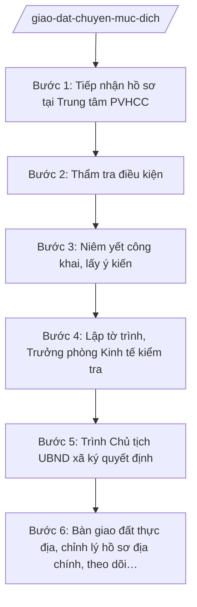

# Skill: Giao đất, cho thuê đất, chuyển mục đích SD đất

## 2. Khi nào dùng

- Hộ gia đình, cá nhân nộp hồ sơ đề nghị giao đất ở, đất nông nghiệp để sản xuất, kinh doanh.
- Người dân đề nghị Nhà nước cho thuê đất để sản xuất, kinh doanh trên địa bàn xã.
- Hộ gia đình, cá nhân đề nghị chuyển mục đích sử dụng đất (ví dụ: từ đất nông nghiệp sang đất ở).
- Điều chỉnh quyết định giao đất, cho thuê đất đã ban hành khi có thay đổi diện tích, mục đích sử dụng.
- Theo dõi, đôn đốc thực hiện nghĩa vụ tài chính về đất đai sau khi quyết định có hiệu lực.

## 3. Đầu vào (Input)

| Trường | Mô tả | Bắt buộc |
|--------|-------|----------|
| `ho_ten_nguoi_de_nghi` | Họ tên cá nhân hoặc chủ hộ gia đình đề nghị | Có |
| `doi_tuong` | Cá nhân / Hộ gia đình | Có |
| `hinh_thuc` | Giao đất / Cho thuê đất / Cho phép chuyển mục đích sử dụng đất | Có |
| `muc_dich_su_dung` | Mục đích sử dụng đất đề nghị (đất ở, đất trồng cây hằng năm...) | Có |
| `dien_tich` | Diện tích đề nghị (m²) | Có |
| `vi_tri_thua_dat` | Vị trí thửa đất: thôn, xã | Có |
| `thong_tin_thua_dat` | Số thửa, số tờ bản đồ địa chính (nếu có) | Không |
| `hien_trang_su_dung` | Hiện trạng sử dụng đất hiện tại của thửa đất | Có |
| `giay_to_kem_theo` | Danh mục giấy tờ kèm theo đơn (bản sao giấy tờ tùy thân, giấy tờ về quyền sử dụng đất...) | Có |
| `ngay_nop_hs` | Ngày nộp hồ sơ tại Trung tâm PVHCC | Có |

## 4. Quy trình

**Bước 1. Tiếp nhận hồ sơ tại Trung tâm PVHCC**

- Làm gì: Công chức Trung tâm PVHCC xã A tiếp nhận đơn đề nghị và giấy tờ kèm theo; kiểm tra tính đầy đủ, hợp lệ của thành phần hồ sơ; viết phiếu tiếp nhận và hẹn trả kết quả; chuyển hồ sơ cho Phòng Kinh tế xã A thụ lý.
- Dùng input: `ho_ten_nguoi_de_nghi`, `hinh_thuc`, `giay_to_kem_theo`, `ngay_nop_hs`.
- Vai trò: Công chức Trung tâm PVHCC xã A tiếp nhận; AI hỗ trợ kiểm tra checklist thành phần hồ sơ theo từng hình thức (giao đất / cho thuê đất / chuyển mục đích), soạn phiếu hẹn trả kết quả ⏱ ~15 phút/hồ sơ (ước tính).
- Lưu ý nghiệp vụ: Nếu hồ sơ thiếu, hướng dẫn bổ sung 01 lần bằng văn bản, ghi rõ thành phần còn thiếu; không thụ lý hồ sơ khi người đề nghị không thuộc đối tượng cá nhân, hộ gia đình.
- → Kết quả bước: Phiếu tiếp nhận và hẹn trả kết quả; hồ sơ được chuyển cho Phòng Kinh tế.

**Bước 2. Thẩm tra điều kiện**

- Làm gì: Công chức địa chính (Phòng Kinh tế) thẩm tra: đối chiếu diện tích đề nghị với hạn mức giao đất, cho thuê đất; kiểm tra tính phù hợp với quy hoạch, kế hoạch sử dụng đất của xã; xác minh nguồn gốc, hiện trạng, tình trạng tranh chấp của thửa đất; kiểm tra nghĩa vụ tài chính liên quan.
- Dùng input: `doi_tuong`, `hinh_thuc`, `muc_dich_su_dung`, `dien_tich`, `vi_tri_thua_dat`, `thong_tin_thua_dat`, `hien_trang_su_dung`.
- Vai trò: Công chức địa chính – Phòng Kinh tế xã A thực hiện thẩm tra hồ sơ và kiểm tra thực địa; AI hỗ trợ tra cứu, đối chiếu hạn mức và quy hoạch, lập bảng tổng hợp kết quả thẩm tra ⏱ ~1–2 ngày làm việc (gồm kiểm tra thực địa) (ước tính).
- Lưu ý nghiệp vụ: Ba điều kiện bắt buộc phải đồng thời đạt: (1) trong hạn mức; (2) phù hợp quy hoạch, kế hoạch sử dụng đất; (3) đất không có tranh chấp, không bị kê biên. Không đạt điều kiện nào → dự thảo văn bản từ chối, nêu rõ lý do.
- → Kết quả bước: Báo cáo kết quả thẩm tra (đạt/không đạt từng điều kiện) + biên bản kiểm tra thực địa.

**Bước 3. Niêm yết công khai, lấy ý kiến**

- Làm gì: Niêm yết công khai hồ sơ đề nghị tại trụ sở UBND xã và nhà văn hóa thôn nơi có đất; lấy ý kiến khu dân cư về việc giao đất, cho thuê đất, cho phép chuyển mục đích sử dụng đất; tổng hợp ý kiến, lập biên bản.
- Dùng input: `ho_ten_nguoi_de_nghi`, `hinh_thuc`, `dien_tich`, `vi_tri_thua_dat`.
- Vai trò: Công chức địa chính phối hợp trưởng thôn tổ chức niêm yết, lấy ý kiến; AI hỗ trợ soạn thông báo niêm yết, biên bản lấy ý kiến và tổng hợp ý kiến ⏱ ~0,5 ngày (chưa tính thời gian niêm yết theo quy định) (ước tính).
- Lưu ý nghiệp vụ: Thời gian niêm yết thực hiện theo quy định; mọi ý kiến phản đối phải được ghi nhận đầy đủ, xem xét và giải trình trong tờ trình.
- → Kết quả bước: Biên bản niêm yết công khai + biên bản lấy ý kiến khu dân cư.

**Bước 4. Lập tờ trình, Trưởng phòng Kinh tế kiểm tra**

- Làm gì: Công chức địa chính lập tờ trình đề nghị Chủ tịch UBND xã quyết định (kèm dự thảo quyết định); Trưởng phòng Kinh tế xã A kiểm tra tính đầy đủ, hợp lệ của hồ sơ, tính đúng đắn của căn cứ và nội dung dự thảo.
- Dùng input: toàn bộ input + kết quả các Bước 1–3.
- Vai trò: Công chức địa chính soạn tờ trình và dự thảo quyết định (AI hỗ trợ soạn thảo, kiểm tra căn cứ, đối chiếu số liệu); Trưởng phòng Kinh tế – Bà Hoàng Thị D kiểm tra, ký nháy ⏱ ~0,5–1 ngày (ước tính).
- Lưu ý nghiệp vụ: Tờ trình phải nêu rõ từng điều kiện đã thẩm tra, ý kiến khu dân cư, đề xuất cụ thể (đồng ý/từ chối và lý do). Dự thảo quyết định ghi đúng diện tích, vị trí, mục đích, thời hạn sử dụng đất.
- → Kết quả bước: Tờ trình + dự thảo quyết định đã được Trưởng phòng Kinh tế kiểm tra.

**Bước 5. Trình Chủ tịch UBND xã ký quyết định**

- Làm gì: Trình hồ sơ, tờ trình và dự thảo quyết định lên Chủ tịch UBND xã A xem xét, quyết định; sau khi ký, văn thư đánh số, đóng dấu, phát hành quyết định cho người đề nghị và các đơn vị liên quan.
- Dùng input: tờ trình, dự thảo quyết định (từ Bước 4).
- Vai trò: Văn phòng HĐND&UBND trình hồ sơ; Chủ tịch UBND xã – Ông Nguyễn Văn A xem xét, ký quyết định (thẩm quyền theo NĐ 151/2025/NĐ-CP); văn thư phát hành; AI hỗ trợ: kiểm tra thể thức, số/ký hiệu quyết định trước khi trình ký ⏱ ~0,5 ngày (chưa tính thời gian chờ lãnh đạo) (ước tính).
- Lưu ý nghiệp vụ: Chỉ Chủ tịch UBND xã ký quyết định giao đất, cho thuê đất, cho phép chuyển mục đích sử dụng đất đối với cá nhân, hộ gia đình; không ủy quyền ký thay. Số quyết định lấy theo sổ đăng ký văn bản đi.
- → Kết quả bước: Quyết định đã ký, đóng dấu, phát hành; hồ sơ lưu đầy đủ.

**Bước 6. Bàn giao đất thực địa, chỉnh lý hồ sơ địa chính, theo dõi nghĩa vụ tài chính**

- Làm gì: Tổ chức bàn giao đất trên thực địa (xác định mốc giới), lập biên bản bàn giao; chỉnh lý hồ sơ địa chính, cập nhật cơ sở dữ liệu đất đai; thông báo nghĩa vụ tài chính (tiền sử dụng đất, tiền thuê đất, thuế) và theo dõi việc thực hiện.
- Dùng input: quyết định đã ban hành, `vi_tri_thua_dat`, `dien_tich`, `thong_tin_thua_dat`.
- Vai trò: Công chức địa chính chủ trì bàn giao thực địa, chỉnh lý hồ sơ; AI hỗ trợ soạn biên bản bàn giao, thông báo nghĩa vụ tài chính, lập sổ theo dõi ⏱ ~1 ngày (ước tính).
- Lưu ý nghiệp vụ: Biên bản bàn giao phải có chữ ký của người được giao đất/cho thuê đất và đại diện UBND xã; chỉnh lý hồ sơ địa chính ngay sau bàn giao để tránh sai lệch dữ liệu.
- → Kết quả bước: Biên bản bàn giao đất thực địa; hồ sơ địa chính đã chỉnh lý; sổ theo dõi nghĩa vụ tài chính.

## Luồng quy trình (Workflow)

## 5. Đầu ra (Output)

- Quyết định giao đất / cho thuê đất / cho phép chuyển mục đích sử dụng đất (Chủ tịch UBND xã ký).
- Tờ trình đề nghị quyết định (kèm báo cáo thẩm tra, biên bản niêm yết, biên bản lấy ý kiến khu dân cư).
- Biên bản bàn giao đất trên thực địa.
- Thông báo nghĩa vụ tài chính về đất đai.

### Cấu trúc output chuẩn

Khung cố định của Quyết định giao đất / cho thuê đất / cho phép chuyển mục đích sử dụng đất, các phần bắt buộc theo đúng thứ tự, đúng thể thức NĐ 30/2020/NĐ-CP:

1. **Quốc hiệu – tiêu ngữ** (canh giữa, phía trên cùng): CỘNG HÒA XÃ HỘI CHỦ NGHĨA VIỆT NAM / Độc lập – Tự do – Hạnh phúc
2. **Tên cơ quan ban hành** (canh trái): ỦY BAN NHÂN DÂN XÃ A
3. **Số, ký hiệu văn bản** (dưới tên cơ quan, canh trái): Số: .../QĐ-UBND
4. **Địa danh, ngày tháng năm ban hành** (canh phải): Xã A, ngày ... tháng ... năm ...
5. **Tên loại và trích yếu** (canh giữa): QUYẾT ĐỊNH — Về việc giao đất (cho thuê đất / cho phép chuyển mục đích sử dụng đất) cho ông (bà) ...
6. **Căn cứ**: Luật Đất đai; NĐ 151/2025/NĐ-CP; quy hoạch, kế hoạch sử dụng đất của xã; đơn đề nghị của ông (bà) ...; tờ trình của Phòng Kinh tế xã A.
7. **Nội dung** (phần QUYẾT ĐỊNH): Điều 1. Giao (cho thuê / cho phép chuyển mục đích) ... m² đất tại ... cho ông (bà) ..., mục đích sử dụng ..., thời hạn sử dụng ...; Điều 2. Nghĩa vụ tài chính phải thực hiện; Điều 3. Trách nhiệm của Phòng Kinh tế, công chức địa chính và người được giao đất/cho thuê đất; Điều 4. Hiệu lực thi hành.
8. **Nơi nhận** (cuối văn bản, canh trái): người được giao đất/cho thuê đất; Phòng Kinh tế xã A; Trung tâm PVHCC xã A; Lưu: VT, ĐC.
9. **Chữ ký, chức vụ người ký** (canh phải): "TM. ỦY BAN NHÂN DÂN" / CHỦ TỊCH / họ tên người ký; đóng dấu UBND xã.

## 6. Checklist nghiệm thu

1. Quyết định có đủ 9 thành phần thể thức theo đúng thứ tự mục 5, không thiếu mục nào.
2. Người ký là Chủ tịch UBND xã; có đóng dấu UBND xã.
3. Diện tích, vị trí, mục đích, thời hạn sử dụng đất trong quyết định khớp 100% với hồ sơ thẩm tra và đơn đề nghị.
4. Ba điều kiện (hạn mức; phù hợp quy hoạch, kế hoạch sử dụng đất; không tranh chấp) đều được thẩm tra và thể hiện trong tờ trình.
5. Đã thực hiện niêm yết công khai và lấy ý kiến khu dân cư; có biên bản kèm theo hồ sơ.
6. Căn cứ pháp lý còn hiệu lực (Luật Đất đai, NĐ 151/2025/NĐ-CP); không viện dẫn văn bản hết hiệu lực.
7. Số quyết định đúng định dạng ".../QĐ-UBND", không trùng số trong sổ đăng ký văn bản đi.
8. Có biên bản bàn giao đất thực địa sau khi quyết định có hiệu lực.
9. Hồ sơ địa chính được chỉnh lý, cập nhật sau bàn giao.
10. Đã qua human gate: công chức địa chính thẩm tra → Trưởng phòng Kinh tế kiểm tra → Chủ tịch UBND xã ký.

## 7. Ví dụ mô phỏng

*Dữ liệu dưới đây là giả lập 100% phục vụ minh họa.*

### Input mẫu

| Trường | Giá trị |
|--------|---------|
| ho_ten_nguoi_de_nghi | Ông Nguyễn Văn Dân |
| doi_tuong | Hộ gia đình |
| hinh_thuc | Cho phép chuyển mục đích sử dụng đất |
| muc_dich_su_dung | Đất ở tại nông thôn |
| dien_tich | 300 m² |
| vi_tri_thua_dat | Thôn 1, xã A |
| thong_tin_thua_dat | Thửa 50, tờ bản đồ số 10 |
| hien_trang_su_dung | Đất trồng cây hằng năm, không có tranh chấp |
| giay_to_kem_theo | Đơn đề nghị; bản sao giấy tờ về quyền sử dụng đất; bản sao giấy tờ tùy thân |
| ngay_nop_hs | 05/10/2026 |

### Output mẫu

CỘNG HÒA XÃ HỘI CHỦ NGHĨA VIỆT NAM
Độc lập – Tự do – Hạnh phúc

ỦY BAN NHÂN DÂN XÃ A			Số: 123/QĐ-UBND

						Xã A, ngày 09 tháng 10 năm 2026

QUYẾT ĐỊNH
Về việc cho phép chuyển mục đích sử dụng đất cho hộ ông Nguyễn Văn Dân

Căn cứ Luật Đất đai;
Căn cứ Nghị định số 151/2025/NĐ-CP ngày 12/6/2025 của Chính phủ về phân định thẩm quyền của chính quyền địa phương 2 cấp, phân quyền, phân cấp trong lĩnh vực đất đai;
Căn cứ kế hoạch sử dụng đất năm 2026 của xã A;
Xét đơn đề nghị ngày 05/10/2026 của hộ ông Nguyễn Văn Dân;
Theo đề nghị của Trưởng phòng Kinh tế xã A tại Tờ trình số 45/TTr-KT ngày 08/10/2026,

QUYẾT ĐỊNH:

Điều 1. Cho phép hộ ông Nguyễn Văn Dân chuyển mục đích sử dụng 300 m² đất (thửa đất số 50, tờ bản đồ số 10, tại thôn 1, xã A) từ đất trồng cây hằng năm sang đất ở tại nông thôn.

Điều 2. Hộ ông Nguyễn Văn Dân có trách nhiệm thực hiện nghĩa vụ tài chính về đất đai theo thông báo của cơ quan thuế; sử dụng đất đúng mục đích, đúng diện tích được cho phép.

Điều 3. Phòng Kinh tế xã A, công chức địa chính và hộ ông Nguyễn Văn Dân chịu trách nhiệm thi hành Quyết định này. Phòng Kinh tế xã A tổ chức bàn giao mốc giới trên thực địa và chỉnh lý hồ sơ địa chính.

Điều 4. Quyết định này có hiệu lực kể từ ngày ký.

Nơi nhận:
- Hộ ông Nguyễn Văn Dân;
- Phòng Kinh tế xã A;
- Trung tâm PVHCC xã A;
- Lưu: VT, ĐC (2b).

TM. ỦY BAN NHÂN DÂN
CHỦ TỊCH

Nguyễn Văn A

## 8. Human gate

- **Công chức địa chính – Phòng Kinh tế xã A** → thẩm tra điều kiện, soạn tờ trình và dự thảo quyết định; chịu trách nhiệm về tính chính xác của số liệu, hiện trạng.
- **Trưởng phòng Kinh tế xã A (Bà Hoàng Thị D)** → kiểm tra tính đầy đủ, hợp lệ của hồ sơ và dự thảo; ký nháy trước khi trình.
- **Chủ tịch UBND xã A (Ông Nguyễn Văn A)** → xem xét, ký ban hành quyết định (thẩm quyền theo NĐ 151/2025/NĐ-CP).
- Không phát hành quyết định khi chưa có chữ ký của Chủ tịch UBND xã.

## 9. Giới hạn

- AI KHÔNG ra quyết định hành chính thay người có thẩm quyền; chỉ hỗ trợ thẩm tra, soạn thảo dự thảo.
- AI KHÔNG tự ký, tự đóng dấu, tự phát hành quyết định dưới bất kỳ hình thức nào.
- AI KHÔNG bịa số liệu diện tích, vị trí thửa đất, thông tin quy hoạch; mọi số liệu phải từ hồ sơ và kết quả thẩm tra thực địa.
- AI KHÔNG tự xác định hạn mức, quy hoạch thay cơ quan có thẩm quyền; khi thông tin quy hoạch chưa rõ phải yêu cầu xác minh.
- AI KHÔNG viện dẫn văn bản đã hết hiệu lực.

## 10. Căn cứ & lưu ý

- Luật Đất đai: quy định về giao đất, cho thuê đất, cho phép chuyển mục đích sử dụng đất (chỉ nêu tên luật, không kèm số hiệu).
- NĐ 151/2025/NĐ-CP: phân định thẩm quyền CQĐP 2 cấp, phân quyền, phân cấp trong lĩnh vực đất đai — Chủ tịch UBND xã quyết định giao đất, cho thuê đất, cho phép chuyển mục đích sử dụng đất đối với cá nhân, hộ gia đình.
- NĐ 30/2020/NĐ-CP: thể thức, kỹ thuật trình bày quyết định hành chính.
- NĐ 118/2025/NĐ-CP: tiếp nhận, trả kết quả qua Trung tâm PVHCC theo cơ chế một cửa.
- Lưu ý: Phòng Kinh tế xã A là đầu mối tham mưu lĩnh vực đất đai (NĐ 150/2025/NĐ-CP); khi xã tổ chức khác khung chuẩn, đối chiếu bảng mapping lĩnh vực → đầu mối trong khung-phong-ban-cap-xa.md.
