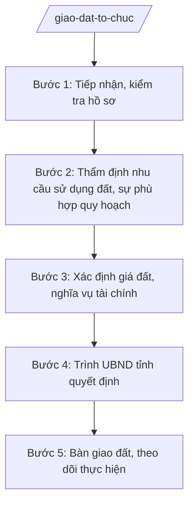

# Skill: Giao đất, cho thuê đất đối với tổ chức

## 2. Khi nào dùng

- Khi tổ chức (doanh nghiệp, đơn vị sự nghiệp...) đề nghị giao đất, cho thuê đất để thực hiện dự án.
- Khi thẩm định nhu cầu sử dụng đất, sự phù hợp quy hoạch, kế hoạch sử dụng đất.
- Khi trình UBND tỉnh quyết định giao đất/cho thuê đất, xác định giá đất, tiền sử dụng đất/thuê đất.

## 3. Đầu vào (Input)

| Trường | Mô tả | Bắt buộc |
|--------|-------|----------|
| `to_chuc` | Tên tổ chức đề nghị | Có |
| `du_an` | Tên dự án đầu tư | Có |
| `dien_tich` | Diện tích đề nghị (ha/m²), vị trí | Có |
| `hinh_thuc` | Giao đất có thu tiền / không thu tiền / cho thuê đất | Có |
| `ho_so_du_an` | Quyết định chấp thuận chủ trương đầu tư / GCN đăng ký đầu tư | Không |

## 4. Quy trình

**Bước 1. Tiếp nhận, kiểm tra hồ sơ**
- Làm gì: Tiếp nhận hồ sơ đề nghị giao/cho thuê đất; kiểm tra tính đầy đủ (đơn, dự án đầu tư, bản đồ địa chính, báo cáo nhu cầu sử dụng đất...).
- Dùng input: `to_chuc`, `du_an`, `dien_tich`, `hinh_thuc`, `ho_so_du_an`.
- Vai trò: Chuyên viên Phòng Quản lý đất đai (Sở NN&MT) tiếp nhận; AI hỗ trợ checklist hồ sơ — ⏱ 3 ngày.
- Lưu ý nghiệp vụ: Dự án phải có chấp thuận chủ trương đầu tư còn hiệu lực; đất đề nghị phải trong kế hoạch sử dụng đất hằng năm cấp tỉnh đã phê duyệt.
- → Kết quả bước: Phiếu kiểm tra hồ sơ.

**Bước 2. Thẩm định nhu cầu sử dụng đất, sự phù hợp quy hoạch**
- Làm gì: Thẩm định: nhu cầu diện tích có phù hợp quy mô dự án; phù hợp quy hoạch sử dụng đất, quy hoạch tỉnh; không thuộc đất cấm, đất quốc phòng/an ninh.
- Dùng input: `dien_tich`, `du_an`.
- Vai trò: Trưởng phòng chủ trì; AI hỗ trợ đối chiếu bản đồ quy hoạch, định mức sử dụng đất — ⏱ 7 ngày.
- Lưu ý nghiệp vụ: Diện tích vượt định mức phải cắt giảm; đất lúa, đất rừng chuyển mục đích phải đúng thẩm quyền (HĐND tỉnh chấp thuận).
- → Kết quả bước: Báo cáo thẩm định nhu cầu sử dụng đất.

**Bước 3. Xác định giá đất, nghĩa vụ tài chính**
- Làm gì: Phối hợp Sở Tài chính, Hội đồng thẩm định giá đất xác định giá đất cụ thể; tính tiền sử dụng đất/tiền thuê đất.
- Dùng input: `dien_tich`, `hinh_thuc`.
- Vai trò: Hội đồng thẩm định giá đất tỉnh; AI hỗ trợ tổng hợp hồ sơ — ⏱ 15–20 ngày.
- Lưu ý nghiệp vụ: Giá đất sát giá thị trường; công khai, minh bạch; chống thất thu ngân sách.
- → Kết quả bước: Phương án giá đất trình UBND tỉnh phê duyệt.

**Bước 4. Trình UBND tỉnh quyết định**
- Làm gì: Hoàn thiện tờ trình + dự thảo quyết định giao đất/cho thuê đất trình UBND tỉnh.
- Dùng input: Toàn bộ kết quả các bước trên.
- Vai trò: Giám đốc Sở NN&MT ký tờ trình; AI hỗ trợ soạn thảo — ⏱ 3 ngày.
- Lưu ý nghiệp vụ: Hồ sơ trình đầy đủ: tờ trình, dự thảo quyết định, báo cáo thẩm định, phương án giá đất, trích lục bản đồ.
- → Kết quả bước: Hồ sơ trình UBND tỉnh hoàn chỉnh.

**Bước 5. Bàn giao đất, theo dõi thực hiện**
- Làm gì: Tổ chức bàn giao đất ngoài thực địa; theo dõi tiến độ thực hiện dự án; đề xuất thu hồi nếu chậm tiến độ, không đưa đất vào sử dụng.
- Dùng input: `to_chuc`, `du_an`.
- Vai trò: Văn phòng Đăng ký đất đai + UBND cấp xã phối hợp; AI hỗ trợ nhắc tiến độ — ⏱ theo tiến độ dự án.
- Lưu ý nghiệp vụ: Dự án chậm tiến độ quá thời hạn luật định phải xem xét thu hồi đất, tránh "ôm đất" đầu cơ.
- → Kết quả bước: Biên bản bàn giao đất + báo cáo theo dõi.

## Luồng quy trình (Workflow)

## 5. Đầu ra (Output)

- Báo cáo thẩm định nhu cầu sử dụng đất.
- Phương án giá đất cụ thể.
- Tờ trình + dự thảo quyết định giao đất/cho thuê đất của UBND tỉnh.
- Biên bản bàn giao đất ngoài thực địa.

**Cấu trúc output chuẩn (Quyết định giao đất/cho thuê đất):**
- Thể thức: tuân thủ Nghị định 30/2020/NĐ-CP về công tác văn thư.

1. Quốc hiệu "CỘNG HÒA XÃ HỘI CHỦ NGHĨA VIỆT NAM", Tiêu ngữ "Độc lập – Tự do – Hạnh phúc"; tên cơ quan (UBND tỉnh A); số, ký hiệu.
2. Tên loại: **QUYẾT ĐỊNH** — về việc giao đất/cho thuê đất cho [tên tổ chức] thực hiện [dự án].
3. Căn cứ pháp lý; đề nghị của Sở NN&MT.
4. **Điều 1.** Giao/cho thuê [diện tích] đất tại [vị trí] cho [tổ chức]; hình thức, thời hạn; mục đích sử dụng.
5. **Điều 2.** Giá đất, tiền sử dụng đất/thuê đất phải nộp; thời hạn nộp.
6. **Điều 3.** Trách nhiệm của tổ chức, Sở NN&MT, Sở Tài chính, UBND cấp xã.
7. **Điều 4.** Hiệu lực; trách nhiệm thi hành.
8. Nơi nhận; chữ ký Chủ tịch UBND tỉnh.

## 6. Checklist nghiệm thu

- [ ] Dự án có chấp thuận chủ trương đầu tư còn hiệu lực.
- [ ] Đất trong kế hoạch sử dụng đất hằng năm đã phê duyệt.
- [ ] Diện tích trong định mức; đất lúa/rừng chuyển mục đích đúng thẩm quyền.
- [ ] Giá đất được Hội đồng thẩm định, UBND tỉnh phê duyệt.
- [ ] Hồ sơ trình đầy đủ: tờ trình, dự thảo, báo cáo thẩm định, trích lục bản đồ.
- [ ] Văn bản đúng thể thức NĐ 30/2020/NĐ-CP.

## 7. Ví dụ mô phỏng

*Dữ liệu dưới đây là giả lập 100% phục vụ minh họa.*

**Input mẫu:** to_chuc = "Công ty TNHH AB"; du_an = "Nhà máy chế biến nông sản AB"; dien_tich = "5 ha tại xã A"; hinh_thuc = "Cho thuê đất trả tiền hằng năm".

**Output mẫu (trích Quyết định):**

> **ỦY BAN NHÂN DÂN TỈNH A**
> Số: 1234/QĐ-UBND
>
> **QUYẾT ĐỊNH**
> Về việc cho Công ty TNHH AB thuê đất thực hiện dự án Nhà máy chế biến nông sản AB
>
> *Căn cứ* Nghị định 151/2025/NĐ-CP; đề nghị của Sở Nông nghiệp và Môi trường tại Tờ trình số 123/TTr-SNNMT...
>
> **Điều 1.** Cho Công ty TNHH AB thuê 50.000 m² đất tại xã A, tỉnh A để thực hiện dự án Nhà máy chế biến nông sản AB; hình thức thuê đất trả tiền hằng năm; thời hạn 50 năm.
> **Điều 2.** Giá đất, tiền thuê đất theo phương án đã được UBND tỉnh phê duyệt; Công ty nộp tiền thuê đất theo thông báo của cơ quan thuế./.
>
> *Nơi nhận:* ... — **CHỦ TỊCH** *(ký, đóng dấu)* — Phạm Văn P

## 8. Human gate

- Chuyên viên thẩm định → Trưởng phòng kiểm tra → Phó Giám đốc Sở duyệt → Giám đốc Sở ký tờ trình → **UBND tỉnh quyết định** (giao/cho thuê đất đối với tổ chức thuộc thẩm quyền tỉnh).
- Giá đất: Hội đồng thẩm định giá đất thông qua → UBND tỉnh phê duyệt.

## 9. Giới hạn

- AI không tự quyết định giao đất, không tự xác định giá đất.
- Không bịa số liệu quy hoạch, giá đất, ý kiến thẩm định.
- Không dùng văn bản hết hiệu lực làm căn cứ.

## 10. Căn cứ & lưu ý

- Nghị định 151/2025/NĐ-CP về phân định thẩm quyền chính quyền địa phương 2 cấp, phân quyền, phân cấp trong lĩnh vực đất đai.
- Thông tư 19/2025/TT-BNNMT của Bộ Nông nghiệp và Môi trường hướng dẫn chức năng, nhiệm vụ của cơ quan chuyên môn về nông nghiệp và môi trường.
- Luật Đất đai và các văn bản hướng dẫn (dẫn tên, áp dụng bản hiện hành).
- Nghị định 150/2025/NĐ-CP về tổ chức cơ quan chuyên môn thuộc UBND cấp tỉnh.
- Nghị định 30/2020/NĐ-CP về công tác văn thư (thể thức văn bản).
- Lưu ý: phân biệt rõ thẩm quyền — tổ chức thuộc UBND tỉnh; cá nhân, hộ gia đình, cộng đồng dân cư thuộc Chủ tịch UBND cấp xã (NĐ 151/2025/NĐ-CP).
