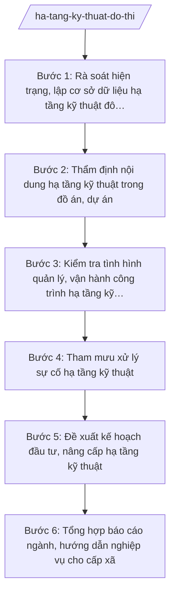

# Skill: Quản lý hạ tầng kỹ thuật đô thị

## 2. Khi nào dùng

- Sở Xây dựng tỉnh A thẩm định nội dung hạ tầng kỹ thuật trong đồ án quy hoạch, dự án đầu tư xây dựng (cấp thoát nước, chiếu sáng, cây xanh, xử lý chất thải);
- Cần kiểm tra tình hình đầu tư, quản lý, vận hành các công trình hạ tầng kỹ thuật đô thị (nhà máy nước, trạm xử lý nước thải, bãi chôn lấp, hệ thống chiếu sáng);
- Tiếp nhận tin báo sự cố hạ tầng kỹ thuật (vỡ đường ống cấp nước, ngập úng, sự cố bãi rác...) cần tham mưu chỉ đạo xử lý;
- Cần tổng hợp hiện trạng hạ tầng kỹ thuật đô thị, báo cáo UBND tỉnh; hướng dẫn nghiệp vụ cho cấp xã.

## 3. Đầu vào (Input)

| Trường | Mô tả | Bắt buộc |
|--------|-------|----------|
| `ho_so_du_an_htkt` | Hồ sơ dự án/đồ án có nội dung hạ tầng kỹ thuật đề nghị thẩm định | Có (thẩm định) |
| `danh_muc_ct_htkt` | Danh mục công trình hạ tầng kỹ thuật đô thị trên địa bàn (tên, vị trí, đơn vị quản lý, hiện trạng) | Có |
| `bao_cao_van_hanh` | Báo cáo của đơn vị quản lý, vận hành về tình hình hoạt động hệ thống | Không |
| `tin_bao_su_co_htkt` | Tin báo sự cố hạ tầng kỹ thuật: loại sự cố, vị trí, mức độ ảnh hưởng | Có (xử lý sự cố) |
| `bao_cao_cap_xa` | Báo cáo của UBND xã về hiện trạng hạ tầng kỹ thuật trên địa bàn | Không |
| `chi_tieu_quy_hoach` | Chỉ tiêu hạ tầng kỹ thuật theo quy hoạch được duyệt | Có (thẩm định) |

## 4. Quy trình

**Bước 1. Rà soát hiện trạng, lập cơ sở dữ liệu hạ tầng kỹ thuật đô thị**
- Làm gì: Thu thập, cập nhật danh mục công trình hạ tầng kỹ thuật đô thị toàn tỉnh (cấp nước, thoát nước, chiếu sáng, cây xanh, xử lý chất thải, nghĩa trang); đánh giá hiện trạng vận hành, công suất, tỷ lệ đáp ứng so với quy hoạch.
- Dùng input: `danh_muc_ct_htkt`, `bao_cao_van_hanh`, `bao_cao_cap_xa`.
- Vai trò: Chuyên viên Phòng Hạ tầng kỹ thuật thu thập, AI hỗ trợ xây dựng cơ sở dữ liệu, lập bảng đánh giá hiện trạng theo tiêu chí, phát hiện điểm nghẽn (quá tải, xuống cấp); ⏱ ~7–10 ngày làm việc (ước tính).
- Lưu ý nghiệp vụ: Dữ liệu phải được đơn vị quản lý, UBND xã xác nhận; phân loại công trình theo mức độ ưu tiên đầu tư, sửa chữa.
- → Kết quả bước: Cơ sở dữ liệu + báo cáo đánh giá hiện trạng hạ tầng kỹ thuật đô thị toàn tỉnh.

**Bước 2. Thẩm định nội dung hạ tầng kỹ thuật trong đồ án, dự án**
- Làm gì: Thẩm định phương án cấp thoát nước, chiếu sáng, cây xanh, xử lý chất thải trong đồ án quy hoạch, dự án đầu tư: kiểm tra sự phù hợp với quy hoạch chuyên ngành, quy chuẩn kỹ thuật, khả năng đấu nối với hệ thống hiện hữu; lập phiếu thẩm định.
- Dùng input: `ho_so_du_an_htkt`, `chi_tieu_quy_hoach`, kết quả Bước 1.
- Vai trò: Chuyên viên Phòng Hạ tầng kỹ thuật thẩm định, AI hỗ trợ lập phiếu thẩm định theo checklist, đối chiếu chỉ tiêu thiết kế với quy hoạch và hiện trạng hệ thống, liệt kê nội dung cần bổ sung; ⏱ ~5–7 ngày làm việc (ước tính).
- Lưu ý nghiệp vụ: Phương án phải bảo đảm khả năng đấu nối thực tế với hệ thống hiện hữu; không thẩm định đạt khi chưa có giải pháp xử lý nước thải, chất thải phù hợp.
- → Kết quả bước: Phiếu thẩm định nội dung hạ tầng kỹ thuật (đạt / cần bổ sung).

**Bước 3. Kiểm tra tình hình quản lý, vận hành công trình hạ tầng kỹ thuật**
- Làm gì: Lập kế hoạch kiểm tra định kỳ/đột xuất các công trình hạ tầng kỹ thuật trọng điểm (nhà máy nước, trạm xử lý nước thải, bãi chôn lấp, hệ thống chiếu sáng đô thị); kiểm tra hồ sơ quản lý, quy trình vận hành, chất lượng đầu ra (nước sạch, nước thải sau xử lý); lập biên bản kiểm tra.
- Dùng input: Kết quả Bước 1, `bao_cao_van_hanh`.
- Vai trò: Đoàn kiểm tra của Sở thực hiện, AI hỗ trợ soạn kế hoạch, biên bản kiểm tra, tổng hợp tồn tại; ⏱ ~5–7 ngày làm việc/đợt (ước tính).
- Lưu ý nghiệp vụ: Chú trọng kiểm tra chất lượng nước thải sau xử lý, việc chấp hành quy định môi trường của bãi chôn lấp; biên bản có chữ ký các bên.
- → Kết quả bước: Biên bản kiểm tra + bảng tổng hợp tồn tại trong quản lý, vận hành.

**Bước 4. Tham mưu xử lý sự cố hạ tầng kỹ thuật**
- Làm gì: Tiếp nhận tin báo sự cố (vỡ ống cấp nước, ngập úng, sự cố bãi rác, cây xanh gãy đổ...); phối hợp đơn vị quản lý, UBND xã khắc phục khẩn cấp; tham mưu UBND tỉnh chỉ đạo đối với sự cố lớn, ảnh hưởng rộng; tổng hợp báo cáo.
- Dùng input: `tin_bao_su_co_htkt`.
- Vai trò: Chuyên viên Phòng Hạ tầng kỹ thuật tiếp nhận, lãnh đạo Sở chỉ đạo, AI hỗ trợ soạn văn bản chỉ đạo khẩn, tổng hợp báo cáo sự cố; ⏱ ~1–3 ngày làm việc (khẩn cấp trong ngày) (ước tính).
- Lưu ý nghiệp vụ: Ưu tiên bảo đảm an toàn người dân và khôi phục dịch vụ thiết yếu (cấp nước, thoát nước); sự cố môi trường nghiêm trọng phải phối hợp cơ quan quản lý môi trường.
- → Kết quả bước: Văn bản chỉ đạo xử lý sự cố + báo cáo kết quả khắc phục.

**Bước 5. Đề xuất kế hoạch đầu tư, nâng cấp hạ tầng kỹ thuật**
- Làm gì: Trên cơ sở đánh giá hiện trạng và kết quả kiểm tra: đề xuất danh mục dự án đầu tư mới, nâng cấp, sửa chữa hạ tầng kỹ thuật; xác định thứ tự ưu tiên, khái toán nhu cầu vốn; soạn tờ trình UBND tỉnh.
- Dùng input: Kết quả Bước 1–3.
- Vai trò: Trưởng phòng Hạ tầng kỹ thuật đề xuất, AI hỗ trợ lập bảng danh mục ưu tiên theo tiêu chí, soạn tờ trình; ⏱ ~5–7 ngày làm việc (ước tính).
- Lưu ý nghiệp vụ: Đề xuất phải gắn với quy hoạch, khả năng cân đối ngân sách; phối hợp Sở Tài chính về nguồn vốn.
- → Kết quả bước: Tờ trình đề xuất kế hoạch đầu tư, nâng cấp hạ tầng kỹ thuật đô thị.

**Bước 6. Tổng hợp báo cáo ngành, hướng dẫn nghiệp vụ cho cấp xã**
- Làm gì: Tổng hợp tình hình đầu tư, quản lý, vận hành hạ tầng kỹ thuật đô thị toàn tỉnh; báo cáo UBND tỉnh và Bộ Xây dựng theo định kỳ; ban hành văn bản hướng dẫn nghiệp vụ quản lý hạ tầng kỹ thuật cho UBND xã.
- Dùng input: Kết quả Bước 1–5.
- Vai trò: Trưởng phòng Hạ tầng kỹ thuật tổng hợp, AI hỗ trợ soạn báo cáo định kỳ, văn bản hướng dẫn nghiệp vụ; ⏱ ~3–5 ngày làm việc (ước tính).
- Lưu ý nghiệp vụ: Báo cáo trung thực, số liệu thống nhất; hướng dẫn cấp xã phải cụ thể, dễ áp dụng.
- → Kết quả bước: Báo cáo ngành hạ tầng kỹ thuật đô thị + văn bản hướng dẫn nghiệp vụ gửi cấp xã.

## Luồng quy trình (Workflow)

## 5. Đầu ra (Output)

- Cơ sở dữ liệu + báo cáo đánh giá hiện trạng hạ tầng kỹ thuật đô thị;
- Phiếu thẩm định nội dung hạ tầng kỹ thuật trong đồ án, dự án;
- Biên bản kiểm tra quản lý, vận hành công trình hạ tầng kỹ thuật;
- Văn bản chỉ đạo xử lý sự cố hạ tầng kỹ thuật;
- Tờ trình đề xuất kế hoạch đầu tư, nâng cấp hạ tầng kỹ thuật;
- Báo cáo ngành hạ tầng kỹ thuật đô thị (định kỳ);
- Văn bản hướng dẫn nghiệp vụ quản lý hạ tầng kỹ thuật gửi cấp xã.

**Cấu trúc output chuẩn (Báo cáo đánh giá hiện trạng hạ tầng kỹ thuật):**
- Thể thức: tuân thủ Nghị định 30/2020/NĐ-CP về công tác văn thư.

1. Quốc hiệu "CỘNG HÒA XÃ HỘI CHỦ NGHĨA VIỆT NAM", Tiêu ngữ "Độc lập – Tự do – Hạnh phúc";
2. Tên cơ quan: SỞ XÂY DỰNG TỈNH A; số, ký hiệu văn bản; địa danh và ngày, tháng, năm;
3. Tên loại và trích yếu: BÁO CÁO — Về hiện trạng hạ tầng kỹ thuật đô thị trên địa bàn tỉnh A...;
4. Phần "Kính gửi": Ủy ban nhân dân tỉnh A;
5. Căn cứ (văn bản về phân định thẩm quyền, phân quyền, phân cấp lĩnh vực xây dựng; Thông tư 10/2025/TT-BXD; quy hoạch có liên quan; văn bản giao nhiệm vụ...);
6. Nội dung: hiện trạng từng lĩnh vực (cấp nước, thoát nước, chiếu sáng, cây xanh, xử lý chất thải rắn, nghĩa trang): quy mô, công suất, tỷ lệ đáp ứng; tồn tại, nguyên nhân; đề xuất đầu tư, nâng cấp theo thứ tự ưu tiên;
7. Nơi nhận;
8. Thẩm quyền, chức vụ, họ tên người ký: TM. SỞ XÂY DỰNG — GIÁM ĐỐC — (chữ ký, họ tên), dấu của cơ quan.

## 6. Checklist nghiệm thu

- [ ] Cơ sở dữ liệu hạ tầng kỹ thuật đầy đủ, được đơn vị quản lý và UBND xã xác nhận;
- [ ] Nội dung hạ tầng kỹ thuật trong đồ án, dự án được thẩm định đúng quy chuẩn, bảo đảm khả năng đấu nối;
- [ ] Kiểm tra vận hành có kế hoạch, biên bản đầy đủ, chú trọng chất lượng môi trường;
- [ ] Sự cố hạ tầng kỹ thuật được tiếp nhận, xử lý kịp thời, ưu tiên an toàn người dân;
- [ ] Đề xuất đầu tư gắn với quy hoạch, có thứ tự ưu tiên, phối hợp về nguồn vốn;
- [ ] Báo cáo ngành trung thực, số liệu thống nhất; đã hướng dẫn nghiệp vụ cho cấp xã.

## 7. Ví dụ mô phỏng

*Dữ liệu dưới đây là giả lập 100% phục vụ minh họa.*

### Input mẫu

| Trường | Giá trị giả lập |
|--------|-----------------|
| danh_muc_ct_htkt | Nhà máy nước A (công suất 20.000 m³/ngày đêm); trạm xử lý nước thải B (10.000 m³/ngày đêm); bãi chôn lấp C; hệ thống chiếu sáng 500 tuyến phố |
| tin_bao_su_co_htkt | Vỡ đường ống cấp nước chính đường số 1, xã A, ngày 02/6/2027; 5.000 hộ dân mất nước |
| bao_cao_van_hanh | Nhà máy nước A vận hành ổn định; trạm B quá tải 120% công suất thiết kế |

### Output mẫu (Văn bản chỉ đạo xử lý sự cố — trích)

> **CỘNG HÒA XÃ HỘI CHỦ NGHĨA VIỆT NAM**
> **Độc lập – Tự do – Hạnh phúc**
>
> Số: 123/CV-SXD
> *Tỉnh A, ngày 02 tháng 6 năm 2027*
>
> **V/v khẩn trương khắc phục sự cố vỡ đường ống cấp nước chính**
>
> Kính gửi: Công ty Cổ phần Cấp nước A; UBND xã A.
>
> Ngày 02/6/2027, đường ống cấp nước chính trên đường số 1, xã A bị vỡ làm khoảng 5.000 hộ dân mất nước. Sở Xây dựng tỉnh A yêu cầu:
>
> 1. Công ty Cổ phần Cấp nước A khẩn trương cô lập đoạn ống vỡ, tổ chức sửa chữa, phấn đấu cấp nước trở lại trong 24 giờ; bố trí xe téc cấp nước tạm cho khu vực bị ảnh hưởng...
> 2. UBND xã A phối hợp bảo đảm an toàn giao thông khu vực thi công, thông tin đến người dân...
> 3. Báo cáo kết quả khắc phục về Sở trước 17h00 ngày 03/6/2027...
>
> *Nơi nhận:* ...
>
> **GIÁM ĐỐC**
> *(Chữ ký, dấu)*
> **Hoàng Văn S**

## 8. Human gate

- Chuyên viên Phòng Hạ tầng kỹ thuật thu thập dữ liệu, thẩm định, kiểm tra;
- Trưởng phòng Hạ tầng kỹ thuật kiểm tra, soạn thảo báo cáo, tờ trình;
- Phó Giám đốc/Giám đốc Sở ký văn bản chỉ đạo, báo cáo;
- Chủ tịch UBND tỉnh A xem xét, chỉ đạo đối với sự cố lớn và kế hoạch đầu tư (AI không thay người ký).

## 9. Giới hạn

- AI KHÔNG ra quyết định đầu tư, không ký văn bản chỉ đạo hay báo cáo thay người có thẩm quyền;
- Không bịa số liệu hiện trạng, công suất, căn cứ pháp lý; số liệu phải từ đơn vị quản lý, UBND xã;
- Không dùng văn bản đã hết hiệu lực; chỉ viện dẫn văn bản có thật trong `tai-lieu-moi-nhat.md`;
- Quyết định xử lý sự cố khẩn cấp do con người chỉ đạo — AI chỉ hỗ trợ soạn thảo, tổng hợp.

## 10. Căn cứ & lưu ý

- NĐ 140/2025/NĐ-CP ngày 12/6/2025 — phân định thẩm quyền CQĐP 2 cấp trong lĩnh vực quản lý nhà nước của Bộ Xây dựng;
- NĐ 144/2025/NĐ-CP ngày 12/6/2025 — phân quyền, phân cấp trong lĩnh vực quản lý nhà nước của Bộ Xây dựng;
- TT 10/2025/TT-BXD ngày 14/6/2025 — hướng dẫn chức năng, nhiệm vụ, quyền hạn của Sở Xây dựng, Sở Quy hoạch – Kiến trúc và lĩnh vực xây dựng cấp xã;
- NĐ 150/2025/NĐ-CP (hiệu lực 16/6/2025); NĐ 370/2025/NĐ-CP sửa đổi, bổ sung;
- NĐ 30/2020/NĐ-CP — thể thức, kỹ thuật trình bày văn bản hành chính.
