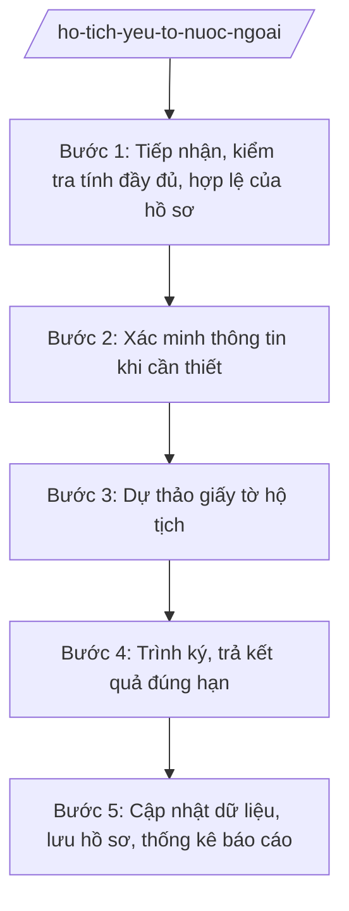

# Skill: Đăng ký hộ tịch có yếu tố nước ngoài

## 2. Khi nào dùng
- Tiếp nhận hồ sơ đăng ký kết hôn có yếu tố nước ngoài (một bên là người nước ngoài, người Việt Nam định cư ở nước ngoài).
- Tiếp nhận hồ sơ đăng ký khai sinh, khai tử, đăng ký nhận cha, mẹ, con có yếu tố nước ngoài thuộc thẩm quyền cấp tỉnh.
- Cần xác minh thông tin, tình trạng hôn nhân của đương sự trước khi đăng ký.
- Cần trình Giám đốc Sở Tư pháp ký Giấy chứng nhận kết hôn, Trích lục hộ tịch và trả kết quả đúng hạn.
- Cần cập nhật Cơ sở dữ liệu hộ tịch điện tử, lưu hồ sơ, thống kê báo cáo.

## 3. Đầu vào (Input)

| Trường | Mô tả | Bắt buộc |
|--------|-------|----------|
| `to_khai_dk` | Tờ khai đăng ký hộ tịch theo mẫu quy định | Có |
| `giay_to_tuy_than` | Hộ chiếu/CCCD và giấy tờ chứng minh nhân thân của các bên | Có |
| `giay_to_tinh_trang_hn` | Giấy xác nhận tình trạng hôn nhân, giấy tờ chứng minh quan hệ (tùy loại việc) | Có |
| `loai_viec` | Loại việc hộ tịch: kết hôn / khai sinh / khai tử / nhận cha, mẹ, con | Có |
| `giay_to_nuoc_ngoai` | Giấy tờ do cơ quan nước ngoài cấp (đã hợp pháp hóa lãnh sự, dịch công chứng nếu có) | Không |
| `thoi_han_giai_quyet` | Thời hạn giải quyết theo quy định | Có |

## 4. Quy trình

**Bước 1. Tiếp nhận, kiểm tra tính đầy đủ, hợp lệ của hồ sơ**
- Làm gì: Tiếp nhận hồ sơ tại Trung tâm Phục vụ hành chính công tỉnh (hoặc bộ phận tiếp nhận của Sở Tư pháp); kiểm tra tờ khai, giấy tờ tùy thân, giấy tờ chứng minh tình trạng hôn nhân/quan hệ; hướng dẫn bổ sung nếu thiếu; viết giấy hẹn trả kết quả.
- Dùng input: `to_khai_dk`, `giay_to_tuy_than`, `giay_to_tinh_trang_hn`, `loai_viec`
- Vai trò: Chuyên viên Phòng Hành chính tư pháp (Sở Tư pháp tỉnh A) tiếp nhận, kiểm tra. AI hỗ trợ lập checklist giấy tờ theo từng loại việc hộ tịch có yếu tố nước ngoài, soạn giấy hẹn trả kết quả ⏱ ~0,5 ngày làm việc (ước tính).
- Lưu ý nghiệp vụ: Giấy tờ do cơ quan nước ngoài cấp phải được hợp pháp hóa lãnh sự và dịch công chứng theo quy định, trừ trường hợp được miễn; kiểm tra kỹ tính thống nhất thông tin nhân thân giữa các giấy tờ.
- → Kết quả bước: Hồ sơ đầy đủ, hợp lệ được tiếp nhận + giấy hẹn trả kết quả; hồ sơ thiếu được hướng dẫn bổ sung một lần bằng văn bản.

**Bước 2. Xác minh thông tin khi cần thiết**
- Làm gì: Đối chiếu thông tin trong hồ sơ với Cơ sở dữ liệu hộ tịch điện tử, cơ sở dữ liệu quốc gia về dân cư; gửi văn bản xác minh đến cơ quan có thẩm quyền khi có nghi vấn về tình trạng hôn nhân, quan hệ nhân thân.
- Dùng input: hồ sơ đã tiếp nhận, `giay_to_nuoc_ngoai`
- Vai trò: Chuyên viên Phòng Hành chính tư pháp thực hiện xác minh. AI hỗ trợ soạn văn bản đề nghị xác minh, theo dõi thời hạn trả lời xác minh ⏱ ~theo thời hạn xác minh quy định (ước tính).
- Lưu ý nghiệp vụ: Chỉ xác minh khi thực sự cần thiết, không kéo dài thời hạn giải quyết; mọi văn bản xác minh phải lưu vào hồ sơ.
- → Kết quả bước: Kết quả xác minh (đủ điều kiện đăng ký / phát hiện vướng mắc cần xử lý).

**Bước 3. Dự thảo giấy tờ hộ tịch**
- Làm gì: Dự thảo Giấy chứng nhận kết hôn / Trích lục khai sinh, khai tử / Quyết định đăng ký nhận cha, mẹ, con theo đúng mẫu quy định; ghi đầy đủ, chính xác thông tin các bên.
- Dùng input: hồ sơ đã thẩm định, kết quả xác minh
- Vai trò: Chuyên viên Phòng Hành chính tư pháp dự thảo. AI hỗ trợ điền mẫu giấy tờ hộ tịch từ dữ liệu hồ sơ, kiểm tra tính thống nhất thông tin trước khi trình ký ⏱ ~0,5 ngày làm việc (ước tính).
- Lưu ý nghiệp vụ: Thông tin trên giấy tờ hộ tịch phải khớp tuyệt đối với giấy tờ trong hồ sơ; tên người nước ngoài ghi đúng theo hộ chiếu; không tẩy xóa, viết tắt.
- → Kết quả bước: Dự thảo giấy tờ hộ tịch đúng mẫu, thông tin chính xác, kèm hồ sơ trình ký.

**Bước 4. Trình ký, trả kết quả đúng hạn**
- Làm gì: Trình Giám đốc Sở Tư pháp ký giấy tờ hộ tịch; đóng dấu; trả kết quả cho người yêu cầu theo giấy hẹn (trực tiếp hoặc qua dịch vụ bưu chính); thu phí, lệ phí theo quy định.
- Dùng input: dự thảo giấy tờ hộ tịch, `thoi_han_giai_quyet`
- Vai trò: Trưởng phòng Hành chính tư pháp kiểm tra lần cuối; Giám đốc Sở Tư pháp ký. AI hỗ trợ theo dõi thời hạn giải quyết, cảnh báo hồ sơ sắp quá hạn ⏱ ~01 ngày làm việc (ước tính).
- Lưu ý nghiệp vụ: Trả kết quả đúng thời hạn ghi trên giấy hẹn; trường hợp từ chối đăng ký phải trả lời bằng văn bản, nêu rõ lý do.
- → Kết quả bước: Giấy tờ hộ tịch đã ký, đóng dấu, trả cho người yêu cầu đúng hạn.

**Bước 5. Cập nhật dữ liệu, lưu hồ sơ, thống kê báo cáo**
- Làm gì: Cập nhật thông tin đăng ký vào Cơ sở dữ liệu hộ tịch điện tử; sắp xếp, lưu trữ hồ sơ theo quy định; thống kê số lượng việc hộ tịch có yếu tố nước ngoài theo loại việc; báo cáo định kỳ.
- Dùng input: giấy tờ hộ tịch đã cấp, sổ đăng ký
- Vai trò: Chuyên viên Phòng Hành chính tư pháp cập nhật dữ liệu, lưu hồ sơ. AI hỗ trợ tổng hợp thống kê theo loại việc, quốc tịch và soạn báo cáo định kỳ ⏱ ~01 ngày làm việc (ước tính).
- Lưu ý nghiệp vụ: Dữ liệu điện tử phải khớp với sổ giấy; hồ sơ lưu trữ đầy đủ để phục vụ tra cứu, cấp trích lục sau này.
- → Kết quả bước: Dữ liệu hộ tịch điện tử đã cập nhật; hồ sơ lưu trữ đầy đủ; báo cáo thống kê định kỳ.

## Luồng quy trình (Workflow)

## 5. Đầu ra (Output)

Sản phẩm:
- Giấy chứng nhận kết hôn / Trích lục khai sinh, khai tử / Quyết định đăng ký nhận cha, mẹ, con có yếu tố nước ngoài (đã ký, đóng dấu) — trả người yêu cầu
- Giấy hẹn trả kết quả; văn bản hướng dẫn bổ sung hồ sơ / văn bản từ chối đăng ký (nếu có)
- Dữ liệu đăng ký đã cập nhật trên Cơ sở dữ liệu hộ tịch điện tử
- Báo cáo thống kê việc hộ tịch có yếu tố nước ngoài định kỳ — lưu hồ sơ, gửi cấp trên

**Cấu trúc output chuẩn:**

Khung Giấy chứng nhận kết hôn có yếu tố nước ngoài gồm các phần theo đúng mẫu quy định và thể thức NĐ 30/2020/NĐ-CP:
1. Quốc hiệu "CỘNG HÒA XÃ HỘI CHỦ NGHĨA VIỆT NAM" — Tiêu ngữ "Độc lập – Tự do – Hạnh phúc"
2. Tên cơ quan đăng ký: "SỞ TƯ PHÁP TỈNH A"; số đăng ký, quyển số
3. Tên giấy tờ: "GIẤY CHỨNG NHẬN KẾT HÔN"
4. Nội dung: họ tên, ngày sinh, quốc tịch, giấy tờ tùy thân của bên nam và bên nữ; ngày đăng ký kết hôn; chữ ký của hai bên
5. Xác nhận đăng ký: "Đã đăng ký kết hôn theo quy định"; địa danh, ngày, tháng, năm
6. Chữ ký: "GIÁM ĐỐC" (hoặc người được ủy quyền) + chữ ký + họ tên, đóng dấu Sở Tư pháp tỉnh A
- Nơi nhận: liệt kê các cơ quan, đơn vị nhận để biết/thực hiện; kết thúc bằng "- Lưu: VT, [mã đơn vị]".

> **Chuẩn tài liệu đầu ra** (thứ tự ưu tiên):
> 1. Chuẩn riêng của ngành/cơ quan chủ quản — mẫu, biểu mẫu, quy chuẩn tại văn bản quy phạm chuyên ngành (xem mục "Căn cứ & lưu ý").
> 2. Tài liệu không có quy chuẩn riêng — thể thức NĐ 30/2020/NĐ-CP: Quốc hiệu và Tiêu ngữ; tên cơ quan ban hành; số, ký hiệu; địa danh và thời gian; tên loại và trích yếu; nội dung; chức vụ, họ tên, chữ ký người có thẩm quyền; dấu, chữ ký số; nơi nhận (kèm Phụ lục nếu có).

## 6. Checklist nghiệm thu
- [ ] Hồ sơ được kiểm tra đầy đủ, hợp lệ; giấy tờ nước ngoài đã hợp pháp hóa lãnh sự, dịch công chứng theo quy định
- [ ] Thông tin nhân thân thống nhất giữa các giấy tờ trong hồ sơ
- [ ] Đã xác minh khi cần thiết; kết quả xác minh lưu trong hồ sơ
- [ ] Giấy tờ hộ tịch đúng mẫu, thông tin khớp tuyệt đối với hồ sơ, không tẩy xóa
- [ ] Trình ký đúng thẩm quyền Giám đốc Sở Tư pháp; trả kết quả đúng thời hạn giấy hẹn
- [ ] Trường hợp từ chối đăng ký có văn bản trả lời nêu rõ lý do
- [ ] Dữ liệu đã cập nhật trên Cơ sở dữ liệu hộ tịch điện tử, khớp với sổ giấy
- [ ] Thể thức văn bản đúng NĐ 30/2020/NĐ-CP
- [ ] Không có thông tin, căn cứ pháp lý nào do AI bịa ra
- [ ] Đã qua human gate: chuyên viên tiếp nhận, thẩm định → Trưởng phòng kiểm tra → Giám đốc Sở ký giấy tờ hộ tịch

## 7. Ví dụ mô phỏng

*Dữ liệu dưới đây là giả lập 100% phục vụ minh họa.*

### Input mẫu
- loai_viec: Đăng ký kết hôn có yếu tố nước ngoài
- to_khai_dk: Tờ khai đăng ký kết hôn của bà Trần Thị M (giả lập) và ông Peter Q. (giả lập)
- giay_to_tuy_than: CCCD của bà Trần Thị M (thường trú xã A, tỉnh A); hộ chiếu của ông Peter Q., quốc tịch nước B (giả lập)
- giay_to_tinh_trang_hn: Giấy xác nhận tình trạng hôn nhân của UBND xã A cấp cho bà Trần Thị M; giấy xác nhận độc thân do cơ quan nước B cấp cho ông Peter Q. (đã hợp pháp hóa lãnh sự, dịch công chứng)
- thoi_han_giai_quyet: Theo thời hạn quy định hiện hành

### Output mẫu

**GIẤY CHỨNG NHẬN KẾT HÔN**

CỘNG HÒA XÃ HỘI CHỦ NGHĨA VIỆT NAM
Độc lập – Tự do – Hạnh phúc

SỞ TƯ PHÁP TỈNH A

Số đăng ký: 12/2026; Quyển số: 01

**GIẤY CHỨNG NHẬN KẾT HÔN**

Họ tên bên nữ: Trần Thị M — Ngày sinh: 01/01/1995 — Quốc tịch: Việt Nam — Giấy tờ tùy thân: CCCD (giả lập)
Họ tên bên nam: Peter Q. — Ngày sinh: 02/02/1990 — Quốc tịch: nước B — Giấy tờ tùy thân: Hộ chiếu (giả lập)

Đã đăng ký kết hôn theo quy định của pháp luật.

Tỉnh A, ngày 20 tháng 08 năm 2026

Hai bên ký tên: (Trần Thị M) (Peter Q.)

GIÁM ĐỐC
(ký, đóng dấu)
Hoàng Văn S

## 8. Human gate
Chuyên viên Phòng Hành chính tư pháp tiếp nhận, thẩm định hồ sơ → Trưởng phòng kiểm tra → Giám đốc Sở Tư pháp ký giấy tờ hộ tịch. AI chỉ hỗ trợ kiểm tra hồ sơ, điền mẫu, theo dõi thời hạn; việc quyết định đăng ký hay từ chối đăng ký do con người thực hiện.

## 9. Giới hạn
AI tuyệt đối KHÔNG: quyết định đăng ký hay từ chối đăng ký thay người có thẩm quyền; tự ký giấy tờ hộ tịch; bịa thông tin nhân thân, tình trạng hôn nhân; dùng giấy tờ, văn bản hết hiệu lực; tiếp nhận hồ sơ vượt thẩm quyền cấp tỉnh.

## 10. Căn cứ & lưu ý
- TT 09/2025/TT-BTP (Sở Tư pháp tham mưu quản lý nhà nước về hành chính tư pháp, trong đó có hộ tịch; hiệu lực 01/7/2025)
- NĐ 120/2025/NĐ-CP (phân định thẩm quyền CQĐP 2 cấp trong lĩnh vực quản lý nhà nước của Bộ Tư pháp)
- NĐ 150/2025/NĐ-CP; NĐ 370/2025/NĐ-CP (tổ chức cơ quan chuyên môn thuộc UBND cấp tỉnh)
- NĐ 30/2020/NĐ-CP (thể thức văn bản hành chính)
- Lưu ý: việc đăng ký hộ tịch có yếu tố nước ngoài thực hiện theo quy định pháp luật chuyên ngành hiện hành về hộ tịch; giấy tờ do cơ quan nước ngoài cấp phải hợp pháp hóa lãnh sự và dịch công chứng theo quy định, trừ trường hợp được miễn.
