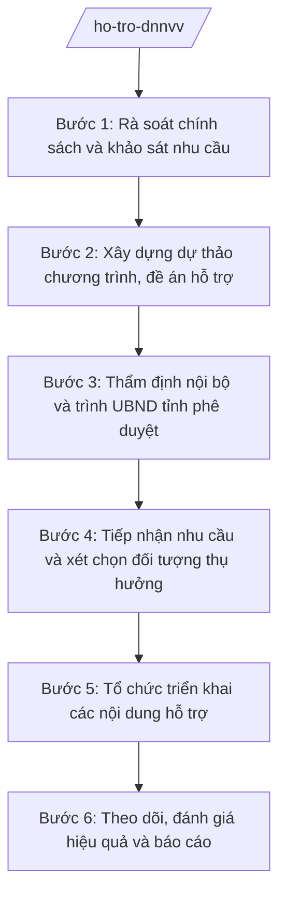

# Skill: Hỗ trợ DNNVV, kinh tế tập thể

## 2. Khi nào dùng

- Cần xây dựng chương trình, đề án, kế hoạch hỗ trợ DNNVV, kinh tế tập thể của tỉnh hằng năm hoặc theo giai đoạn;
- Cần rà soát, đề xuất chính sách hỗ trợ của tỉnh (hỗ trợ lãi suất, đào tạo, tư vấn, chuyển đổi số, tiếp cận vốn...);
- Cần xét chọn, phê duyệt đối tượng thụ hưởng hỗ trợ từ nguồn ngân sách tỉnh;
- Cần theo dõi, đánh giá hiệu quả các chương trình hỗ trợ đã triển khai;
- Cần hướng dẫn UBND cấp xã triển khai chính sách hỗ trợ kinh tế tập thể, hợp tác xã trên địa bàn.

## 3. Đầu vào (Input)

| Trường | Mô tả | Bắt buộc |
|--------|-------|----------|
| `chuong_trinh_du_kien` | Dự kiến chương trình/đề án hỗ trợ: mục tiêu, đối tượng, nội dung, kinh phí | Có |
| `nhu_cau_dnnvv` | Nhu cầu hỗ trợ của DNNVV, hợp tác xã trên địa bàn (khảo sát, đề xuất) | Có |
| `nguon_kinh_phi` | Nguồn kinh phí: ngân sách tỉnh, nguồn hỗ trợ của trung ương, nguồn khác | Có |
| `chinh_sach_hien_hanh` | Các chính sách hỗ trợ DNNVV, kinh tế tập thể đang thực hiện của tỉnh và trung ương | Có |
| `ket_qua_ky_truoc` | Kết quả thực hiện chương trình hỗ trợ kỳ trước (nếu có) | Không |
| `dinh_huong_tinh` | Định hướng phát triển DNNVV, kinh tế tập thể của Tỉnh ủy, UBND tỉnh | Có |

## 4. Quy trình

**Bước 1. Rà soát chính sách và khảo sát nhu cầu**
- Làm gì: Rà soát các chính sách hỗ trợ DNNVV, kinh tế tập thể của trung ương và của tỉnh đang thực hiện; khảo sát, tổng hợp nhu cầu hỗ trợ của doanh nghiệp, hợp tác xã trên địa bàn; đánh giá kết quả chương trình kỳ trước.
- Dùng input: `chinh_sach_hien_hanh`, `nhu_cau_dnnvv`, `ket_qua_ky_truoc`.
- Vai trò: Chuyên viên Phòng Kinh tế (Sở Tài chính) thực hiện, AI hỗ trợ tổng hợp kết quả khảo sát, phân loại nhu cầu theo nhóm (vốn, đào tạo, tư vấn, công nghệ...); ⏱ ~5–7 ngày làm việc (ước tính).
- Lưu ý nghiệp vụ: Nhu cầu phải được khảo sát thực tế, tránh xây dựng chương trình theo suy đoán; đánh giá thẳng thắn hạn chế của kỳ trước để không lặp lại.
- → Kết quả bước: Báo cáo rà soát chính sách + tổng hợp nhu cầu hỗ trợ của DNNVV, HTX.

**Bước 2. Xây dựng dự thảo chương trình, đề án hỗ trợ**
- Làm gì: Soạn dự thảo chương trình/đề án hỗ trợ DNNVV, kinh tế tập thể: mục tiêu, đối tượng thụ hưởng, nội dung hỗ trợ, mức hỗ trợ, kinh phí, thời gian thực hiện, trách nhiệm các bên; lấy ý kiến các sở, ngành liên quan.
- Dùng input: Kết quả Bước 1, `nguon_kinh_phi`, `dinh_huong_tinh`.
- Vai trò: Chuyên viên Phòng Kinh tế soạn thảo, AI hỗ trợ dựng khung đề án, rà soát tính khả thi của mức hỗ trợ và kinh phí; ⏱ ~5–7 ngày làm việc (ước tính).
- Lưu ý nghiệp vụ: Nội dung hỗ trợ phải đúng đối tượng DNNVV, kinh tế tập thể theo quy định; mức hỗ trợ và kinh phí phải trong khả năng cân đối ngân sách tỉnh; không trùng lặp với chính sách trung ương.
- → Kết quả bước: Dự thảo chương trình/đề án hỗ trợ + tổng hợp ý kiến các sở, ngành.

**Bước 3. Thẩm định nội bộ và trình UBND tỉnh phê duyệt**
- Làm gì: Trưởng phòng và Phó Giám đốc Sở phụ trách rà soát dự thảo đề án; Giám đốc Sở Tài chính (ông Hoàng Văn S) xem xét, ký Tờ trình của Sở trình UBND tỉnh; hoàn thiện theo ý kiến chỉ đạo; UBND tỉnh phê duyệt chương trình/đề án.
- Dùng input: Dự thảo chương trình/đề án ở Bước 2.
- Vai trò: Trưởng phòng, Phó Giám đốc, Giám đốc Sở kiểm tra và quyết định; AI hỗ trợ rà soát tính nhất quán, thể thức văn bản; ⏱ ~3–5 ngày làm việc (ước tính).
- Lưu ý nghiệp vụ: AI chỉ hỗ trợ kỹ thuật; quyết định nội dung, kinh phí hỗ trợ thuộc thẩm quyền của UBND tỉnh.
- → Kết quả bước: Tờ trình của Sở đã ký + quyết định phê duyệt chương trình/đề án của UBND tỉnh.

**Bước 4. Tiếp nhận nhu cầu và xét chọn đối tượng thụ hưởng**
- Làm gì: Thông báo, tiếp nhận hồ sơ đề nghị hỗ trợ của DNNVV, hợp tác xã; kiểm tra điều kiện thụ hưởng theo đề án đã phê duyệt; tổ chức xét chọn (hội đồng hoặc theo quy trình của đề án); công khai danh sách đối tượng được hỗ trợ.
- Dùng input: Hồ sơ đề nghị hỗ trợ của DNNVV, HTX; chương trình/đề án đã phê duyệt.
- Vai trò: Chuyên viên Phòng Kinh tế tiếp nhận, thẩm tra; hội đồng xét chọn (nếu có) quyết định; AI hỗ trợ kiểm tra điều kiện thụ hưởng, lập danh sách xét chọn; ⏱ ~7–10 ngày làm việc (ước tính).
- Lưu ý nghiệp vụ: Xét chọn phải công khai, minh bạch, đúng đối tượng, đúng tiêu chí của đề án; mọi trường hợp không đạt phải thông báo lý do bằng văn bản.
- → Kết quả bước: Danh sách đối tượng được hỗ trợ đã phê duyệt, công khai.

**Bước 5. Tổ chức triển khai các nội dung hỗ trợ**
- Làm gì: Triển khai từng nội dung hỗ trợ theo đề án: hỗ trợ đào tạo, tư vấn, chuyển đổi số, xúc tiến thương mại, tiếp cận vốn...; ký hợp đồng với đơn vị cung ứng dịch vụ hỗ trợ (nếu thuê ngoài); giải ngân kinh phí theo tiến độ.
- Dùng input: Danh sách đối tượng ở Bước 4; kế hoạch triển khai của đề án.
- Vai trò: Chuyên viên Phòng Kinh tế tổ chức thực hiện, phối hợp các đơn vị liên quan; AI hỗ trợ lập kế hoạch triển khai chi tiết, theo dõi tiến độ từng nội dung; ⏱ ~theo tiến độ đề án. (ước tính)
- Lưu ý nghiệp vụ: Giải ngân đúng đối tượng, đúng nội dung, có chứng từ đầy đủ; việc thuê đơn vị cung ứng dịch vụ phải tuân thủ quy định về đấu thầu, mua sắm.
- → Kết quả bước: Các hoạt động hỗ trợ được triển khai, có hồ sơ, chứng từ đầy đủ.

**Bước 6. Theo dõi, đánh giá hiệu quả và báo cáo**
- Làm gì: Theo dõi tiến độ, chất lượng các nội dung hỗ trợ; đánh giá hiệu quả chương trình (số DNNVV/HTX được hỗ trợ, mức độ hài lòng, tác động đến sản xuất kinh doanh); tổng hợp báo cáo UBND tỉnh và Bộ Tài chính theo định kỳ; đề xuất điều chỉnh, tiếp tục hoặc dừng chương trình.
- Dùng input: Hồ sơ triển khai ở Bước 5; phản hồi của đối tượng thụ hưởng.
- Vai trò: Chuyên viên Phòng Kinh tế theo dõi, đánh giá; AI hỗ trợ tổng hợp số liệu, soạn báo cáo đánh giá; ⏱ ~theo kỳ báo cáo. (ước tính)
- Lưu ý nghiệp vụ: Đánh giá phải trung thực, dựa trên số liệu và phản hồi thực tế; kết quả đánh giá là căn cứ xây dựng chương trình kỳ tiếp theo.
- → Kết quả bước: Báo cáo đánh giá hiệu quả chương trình hỗ trợ + đề xuất kỳ tiếp theo.

## Luồng quy trình (Workflow)

## 5. Đầu ra (Output)

- Báo cáo rà soát chính sách và tổng hợp nhu cầu hỗ trợ;
- Dự thảo chương trình/đề án hỗ trợ DNNVV, kinh tế tập thể;
- Tờ trình của Sở Tài chính trình UBND tỉnh phê duyệt chương trình/đề án;
- Quyết định phê duyệt chương trình/đề án của UBND tỉnh (do UBND tỉnh ban hành);
- Danh sách đối tượng được hỗ trợ (đã phê duyệt, công khai);
- Hồ sơ triển khai, giải ngân kinh phí hỗ trợ;
- Báo cáo đánh giá hiệu quả chương trình hỗ trợ.

**Cấu trúc output chuẩn (Tờ trình Sở Tài chính về chương trình hỗ trợ DNNVV):**
- Thể thức: tuân thủ Nghị định 30/2020/NĐ-CP về công tác văn thư.

1. Quốc hiệu "CỘNG HÒA XÃ HỘI CHỦ NGHĨA VIỆT NAM", Tiêu ngữ "Độc lập – Tự do – Hạnh phúc";
2. Tên cơ quan ban hành: SỞ TÀI CHÍNH TỈNH A; số, ký hiệu văn bản; địa danh và ngày, tháng, năm ban hành;
3. Tên loại và trích yếu: TỜ TRÌNH — Về việc đề nghị UBND tỉnh phê duyệt chương trình/đề án hỗ trợ doanh nghiệp nhỏ và vừa, kinh tế tập thể...;
4. Phần "Kính gửi": Ủy ban nhân dân tỉnh A;
5. Căn cứ ban hành (quy định pháp luật về hỗ trợ DNNVV; định hướng của tỉnh...);
6. Nội dung: sự cần thiết; mục tiêu, đối tượng, nội dung và mức hỗ trợ; kinh phí và nguồn kinh phí; thời gian thực hiện; tổ chức thực hiện; kiến nghị UBND tỉnh phê duyệt;
7. Nơi nhận;
8. Thẩm quyền, chức vụ, họ tên người ký: GIÁM ĐỐC — (chữ ký, họ tên), dấu của cơ quan.

## 6. Checklist nghiệm thu

- [ ] Đã rà soát chính sách hiện hành và khảo sát nhu cầu thực tế của DNNVV, HTX;
- [ ] Chương trình/đề án xác định rõ mục tiêu, đối tượng, nội dung, mức hỗ trợ, kinh phí;
- [ ] Nội dung hỗ trợ đúng đối tượng theo quy định, không trùng lặp chính sách trung ương;
- [ ] Kinh phí trong khả năng cân đối ngân sách tỉnh, có nguồn kinh phí rõ ràng;
- [ ] Xét chọn đối tượng công khai, minh bạch, đúng tiêu chí; có thông báo lý do cho trường hợp không đạt;
- [ ] Giải ngân đúng đối tượng, đúng nội dung, chứng từ đầy đủ;
- [ ] Có báo cáo đánh giá hiệu quả dựa trên số liệu và phản hồi thực tế;
- [ ] Căn cứ pháp lý đầy đủ, đúng văn bản còn hiệu lực, không bịa số hiệu;
- [ ] Thể thức văn bản hành chính đúng quy định; số liệu do khảo sát thực tế, AI không tự bịa.

## 7. Ví dụ mô phỏng

*Dữ liệu dưới đây là giả lập 100% phục vụ minh họa.*

### Input mẫu

| Trường | Giá trị giả lập |
|--------|-----------------|
| chuong_trinh_du_kien | Chương trình hỗ trợ chuyển đổi số cho 100 DNNVV tỉnh A năm 2027 |
| nhu_cau_dnnvv | 200 DNNVV khảo sát, 80% có nhu cầu hỗ trợ chuyển đổi số (giả lập) |
| nguon_kinh_phi | Ngân sách tỉnh: 20 tỷ đồng (giả lập) |
| chinh_sach_hien_hanh | Chương trình hỗ trợ DNNVV tỉnh A giai đoạn 2021–2025 (giả lập) |
| dinh_huong_tinh | Ưu tiên hỗ trợ chuyển đổi số, nâng cao năng lực cạnh tranh cho DNNVV |

### Output mẫu (Tờ trình — trích)

> **CỘNG HÒA XÃ HỘI CHỦ NGHĨA VIỆT NAM**
> **Độc lập – Tự do – Hạnh phúc**
>
> **SỞ TÀI CHÍNH TỈNH A**
> Số: 1234/TTr-STC
> Tỉnh A, ngày 10 tháng 2 năm 2027
>
> **TỜ TRÌNH**
> **Về việc đề nghị UBND tỉnh phê duyệt Chương trình hỗ trợ chuyển đổi số cho doanh nghiệp nhỏ và vừa tỉnh A năm 2027 (giả lập)**
>
> Kính gửi: Ủy ban nhân dân tỉnh A.
>
> Căn cứ quy định pháp luật về hỗ trợ doanh nghiệp nhỏ và vừa;
> Sở Tài chính tỉnh A trình UBND tỉnh phê duyệt Chương trình với các nội dung chính:
>
> 1. Mục tiêu: hỗ trợ 100 DNNVV ứng dụng chuyển đổi số...
> 2. Kinh phí: 20 tỷ đồng từ ngân sách tỉnh...
>
> Sở Tài chính kính trình UBND tỉnh xem xét, phê duyệt./.
>
> ***Nơi nhận:*** ...
>
> **GIÁM ĐỐC**
> *(ký, đóng dấu)*
> **Hoàng Văn S**

## 8. Human gate

1. Chuyên viên Phòng Kinh tế rà soát, khảo sát và soạn thảo đề án (Bước 1–2);
2. Trưởng phòng và Phó Giám đốc Sở phụ trách rà soát dự thảo đề án (Bước 3);
3. Giám đốc Sở Tài chính xem xét, ký Tờ trình trình UBND tỉnh (Bước 3);
4. UBND tỉnh phê duyệt chương trình/đề án — quyết định cuối cùng thuộc thẩm quyền UBND tỉnh;
5. Hội đồng xét chọn (nếu có) quyết định danh sách đối tượng thụ hưởng (Bước 4).

## 9. Giới hạn

- AI KHÔNG quyết định nội dung, kinh phí hỗ trợ hay danh sách đối tượng thụ hưởng thay người có thẩm quyền;
- AI KHÔNG tự ký, tự phát hành văn bản hay phê duyệt hỗ trợ;
- AI KHÔNG bịa nhu cầu của DNNVV, số liệu khảo sát, kết quả đánh giá;
- AI KHÔNG bịa căn cứ pháp lý, không trích dẫn văn bản đã hết hiệu lực;
- AI KHÔNG "vẽ" đối tượng thụ hưởng không có trong hồ sơ thực tế.

## 10. Căn cứ & lưu ý

- Thông tư 57/2025/TT-BTC hướng dẫn chức năng, nhiệm vụ, quyền hạn của Sở Tài chính và lĩnh vực tài chính – kế hoạch của phòng chuyên môn thuộc UBND cấp xã;
- Quy định pháp luật về hỗ trợ doanh nghiệp nhỏ và vừa; về kinh tế tập thể, hợp tác xã (chỉ nêu tên, không kèm số hiệu);
- Nghị định 150/2025/NĐ-CP về tổ chức cơ quan chuyên môn thuộc UBND cấp tỉnh, cấp xã;
- Nghị định 30/2020/NĐ-CP về công tác văn thư (chỉ dùng cho thể thức văn bản);
- Lưu ý: chương trình hỗ trợ chỉ được triển khai sau khi UBND tỉnh phê duyệt; việc lựa chọn đơn vị cung ứng dịch vụ hỗ trợ phải tuân thủ quy định về đấu thầu, mua sắm; Sở hướng dẫn UBND cấp xã triển khai chính sách hỗ trợ kinh tế tập thể theo phân cấp.
