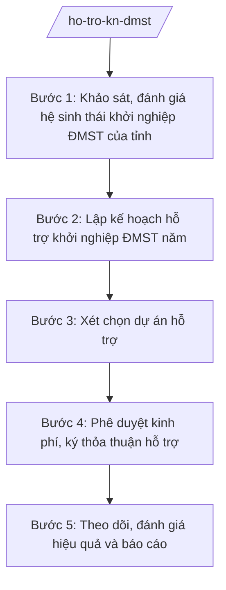

# Skill: Hỗ trợ khởi nghiệp đổi mới sáng tạo

## 2. Khi nào dùng
- Xây dựng kế hoạch/chương trình hỗ trợ khởi nghiệp đổi mới sáng tạo của tỉnh hằng năm.
- Xét chọn, hỗ trợ kinh phí cho dự án khởi nghiệp ĐMST, vườn ươm, không gian khởi nghiệp.
- Tổ chức cuộc thi ý tưởng khởi nghiệp, ngày hội khởi nghiệp, kết nối gọi vốn cho startup.
- Đánh giá hệ sinh thái khởi nghiệp ĐMST của tỉnh, báo cáo Bộ KH&CN và UBND tỉnh.

## 3. Đầu vào (Input)
| Trường | Mô tả | Bắt buộc |
|--------|-------|----------|
| `nam_ke_hoach` | Năm lập kế hoạch hỗ trợ khởi nghiệp ĐMST | Có |
| `nhu_cau_ho_tro` | Nhu cầu hỗ trợ của startup, vườn ươm, trường đại học, tổ chức hỗ trợ khởi nghiệp trên địa bàn | Có |
| `chuong_trinh_tinh` | Chương trình/kế hoạch hỗ trợ ĐMST của tỉnh (nếu đã ban hành) | Không |
| `ho_so_du_an` | Hồ sơ đề nghị hỗ trợ của dự án khởi nghiệp (ý tưởng, mô hình kinh doanh, nhu cầu vốn) | Không |
| `du_toan_kinh_phi` | Dự toán kinh phí hỗ trợ từ ngân sách và nguồn huy động khác | Có |
| `nguoi_ky` | Người có thẩm quyền ký (Giám đốc Sở đối với quyết định hỗ trợ; Chủ tịch UBND tỉnh đối với kế hoạch) | Có |

## 4. Quy trình

**Bước 1. Khảo sát, đánh giá hệ sinh thái khởi nghiệp ĐMST của tỉnh**
- Làm gì: Khảo sát số lượng startup, vườn ươm, không gian làm việc chung, quỹ đầu tư, chuyên gia cố vấn trên địa bàn; đánh giá điểm mạnh, điểm yếu của hệ sinh thái.
- Dùng input: `nhu_cau_ho_tro`, `chuong_trinh_tinh`, `nam_ke_hoach`
- Vai trò: Chuyên viên Phòng Quản lý công nghệ (hoặc đơn vị được giao) khảo sát, tổng hợp; AI hỗ trợ thiết kế phiếu khảo sát, tổng hợp số liệu, lập bảng đánh giá SWOT ⏱ ~5 ngày làm việc (ước tính)
- Lưu ý nghiệp vụ: Số liệu phải từ khảo sát thực tế, không ước đoán; phân biệt rõ startup công nghệ với hộ kinh doanh thông thường.
- → Kết quả bước: Báo cáo đánh giá hệ sinh thái khởi nghiệp ĐMST của tỉnh.

**Bước 2. Lập kế hoạch hỗ trợ khởi nghiệp ĐMST năm**
- Làm gì: Xây dựng kế hoạch năm: đào tạo, ươm tạo, hỗ trợ hoàn thiện sản phẩm, kết nối gọi vốn, truyền thông; phân công đơn vị thực hiện, dự toán kinh phí.
- Dùng input: Báo cáo đánh giá ở Bước 1, `du_toan_kinh_phi`, `nguoi_ky`
- Vai trò: Trưởng phòng chủ trì soạn kế hoạch; Phó Giám đốc Sở xem xét; Giám đốc Sở ký Tờ trình; Chủ tịch UBND tỉnh phê duyệt kế hoạch (nếu là kế hoạch của UBND tỉnh); AI hỗ trợ soạn kế hoạch theo khung mục tiêu – nhiệm vụ – kinh phí ⏱ ~5 ngày làm việc (ước tính)
- Lưu ý nghiệp vụ: Kế hoạch phải cụ thể hóa chương trình ĐMST của tỉnh; nội dung hỗ trợ đúng đối tượng khởi nghiệp ĐMST; kinh phí rõ nguồn ngân sách và nguồn xã hội hóa.
- → Kết quả bước: Dự thảo kế hoạch hỗ trợ khởi nghiệp ĐMST năm của UBND tỉnh.

**Bước 3. Xét chọn dự án hỗ trợ**
- Làm gì: Thông báo tiếp nhận hồ sơ đề nghị hỗ trợ; tổ chức Hội đồng xét chọn đánh giá tính đổi mới sáng tạo, tính khả thi, hiệu quả của dự án.
- Dùng input: `ho_so_du_an`, tiêu chí xét chọn trong kế hoạch
- Vai trò: Chuyên viên kiểm tra tính đầy đủ hồ sơ; Hội đồng xét chọn (do Sở thành lập, có chuyên gia) đánh giá; AI hỗ trợ tổng hợp hồ sơ, lập bảng điểm ⏱ ~5 ngày làm việc (ước tính)
- Lưu ý nghiệp vụ: Đánh giá dựa trên tính mới, tính sáng tạo, khả năng thương mại hóa; không hỗ trợ dự án không có yếu tố đổi mới sáng tạo; công khai kết quả xét chọn.
- → Kết quả bước: Biên bản xét chọn + danh sách dự án được hỗ trợ.

**Bước 4. Phê duyệt kinh phí, ký thỏa thuận hỗ trợ**
- Làm gì: Lập Tờ trình đề nghị hỗ trợ kinh phí từng dự án; ký thỏa thuận/quyết định hỗ trợ với đơn vị thụ hưởng; giải ngân theo tiến độ.
- Dùng input: Danh sách dự án được hỗ trợ ở Bước 3, `du_toan_kinh_phi`, `nguoi_ky`
- Vai trò: Chuyên viên soạn Tờ trình; Trưởng phòng kiểm tra; Giám đốc Sở ký quyết định hỗ trợ (trong thẩm quyền); AI hỗ trợ soạn thảo văn bản, theo dõi tiến độ giải ngân ⏱ ~3 ngày làm việc (ước tính)
- Lưu ý nghiệp vụ: Mức hỗ trợ theo đúng chính sách của tỉnh; thỏa thuận ghi rõ cam kết của bên thụ hưởng, điều kiện thu hồi kinh phí khi vi phạm.
- → Kết quả bước: Quyết định hỗ trợ kinh phí + thỏa thuận hỗ trợ đã ký.

**Bước 5. Theo dõi, đánh giá hiệu quả và báo cáo**
- Làm gì: Theo dõi tiến độ dự án được hỗ trợ; đánh giá hiệu quả (sản phẩm, việc làm, vốn huy động thêm); tổ chức sự kiện kết nối; báo cáo tổng kết năm.
- Dùng input: Báo cáo tiến độ của đơn vị thụ hưởng, số liệu gọi vốn, việc làm tạo ra
- Vai trò: Chuyên viên theo dõi, đôn đốc; Phó Giám đốc Sở chỉ đạo đánh giá; AI hỗ trợ tổng hợp số liệu hiệu quả, soạn báo cáo ⏱ ~3 ngày làm việc (ước tính)
- Lưu ý nghiệp vụ: Đánh giá bằng chỉ số đo được (số startup được ươm tạo, vốn gọi được, sản phẩm ra thị trường); dự án không đạt cam kết thì xem xét thu hồi kinh phí theo thỏa thuận.
- → Kết quả bước: Báo cáo tổng kết hỗ trợ khởi nghiệp ĐMST năm của tỉnh.

## Luồng quy trình (Workflow)

## 5. Đầu ra (Output)
- Kế hoạch hỗ trợ khởi nghiệp đổi mới sáng tạo năm của UBND tỉnh.
- Quyết định phê duyệt danh sách dự án được hỗ trợ kinh phí (kèm mức hỗ trợ).
- Báo cáo tổng kết hỗ trợ khởi nghiệp ĐMST năm.

**Cấu trúc output chuẩn:**
Khung Quyết định hỗ trợ kinh phí dự án khởi nghiệp ĐMST (theo NĐ 30/2020/NĐ-CP):
1. Quốc hiệu "CỘNG HÒA XÃ HỘI CHỦ NGHĨA VIỆT NAM", Tiêu ngữ "Độc lập – Tự do – Hạnh phúc".
2. Số, ký hiệu văn bản: số 1234/QĐ-SKHCN.
3. Địa danh và ngày, tháng, năm: "Tỉnh A, ngày ... tháng ... năm ...".
4. Tên loại và trích yếu: "QUYẾT ĐỊNH / Phê duyệt danh sách dự án khởi nghiệp đổi mới sáng tạo được hỗ trợ kinh phí năm ...".
5. Căn cứ: TT 10/2025/TT-BKHCN; NĐ 132/2025/NĐ-CP; kế hoạch hỗ trợ khởi nghiệp ĐMST của UBND tỉnh A; biên bản họp Hội đồng xét chọn.
6. Nội dung bắt buộc: Điều 1. Phê duyệt danh sách ... dự án được hỗ trợ (phụ lục: tên dự án, đơn vị chủ trì, mức hỗ trợ); Điều 2. Kinh phí và phương thức giải ngân; Điều 3. Trách nhiệm của đơn vị thụ hưởng và cơ quan quản lý; Điều 4. Hiệu lực.
7. Nơi nhận: UBND tỉnh A; Sở Tài chính; Kho bạc Nhà nước khu vực; các đơn vị thụ hưởng; lưu VT.
8. Chữ ký: "GIÁM ĐỐC" + họ tên Vũ Thị T, đóng dấu.

## 6. Checklist nghiệm thu
- [ ] Kế hoạch hỗ trợ cụ thể hóa chương trình ĐMST của tỉnh, đúng đối tượng khởi nghiệp ĐMST.
- [ ] Hồ sơ dự án được xét chọn theo tiêu chí công khai; có biên bản Hội đồng xét chọn.
- [ ] Mức hỗ trợ đúng chính sách của tỉnh; thỏa thuận ghi rõ cam kết và điều kiện thu hồi.
- [ ] Kinh phí giải ngân theo tiến độ, có theo dõi, đôn đốc.
- [ ] Đánh giá hiệu quả bằng chỉ số đo được (startup được ươm tạo, vốn gọi được, sản phẩm ra thị trường).
- [ ] Văn bản đúng thể thức NĐ 30/2020/NĐ-CP; đúng thẩm quyền ký.
- [ ] Không bịa số liệu, không trích dẫn văn bản hết hiệu lực.
- [ ] Đã qua human gate: chuyên viên soạn → Trưởng phòng kiểm tra → Phó Giám đốc/Giám đốc Sở → UBND tỉnh phê duyệt kế hoạch.

## 7. Ví dụ mô phỏng
*Dữ liệu dưới đây là giả lập 100% phục vụ minh họa.*

### Input mẫu
- nam_ke_hoach: 2027
- nhu_cau_ho_tro: 35 startup công nghệ, 02 vườn ươm, 01 không gian làm việc chung tại tỉnh A; nhu cầu lớn nhất là vốn ươm tạo và kết nối thị trường
- ho_so_du_an: 20 hồ sơ đề nghị hỗ trợ; Hội đồng xét chọn đạt 08 dự án
- du_toan_kinh_phi: 3 tỷ đồng ngân sách tỉnh + huy động xã hội hóa
- nguoi_ky: Bà Vũ Thị T – Giám đốc Sở KH&CN tỉnh A

### Output mẫu
**QUYẾT ĐỊNH** số 1234/QĐ-SKHCN
Phê duyệt danh sách dự án khởi nghiệp đổi mới sáng tạo được hỗ trợ kinh phí năm 2027

CỘNG HÒA XÃ HỘI CHỦ NGHĨA VIỆT NAM
Độc lập – Tự do – Hạnh phúc

Tỉnh A, ngày 09 tháng 10 năm 2026

GIÁM ĐỐC SỞ KHOA HỌC VÀ CÔNG NGHỆ TỈNH A

Căn cứ Thông tư số 10/2025/TT-BKHCN ngày 27/6/2025 của Bộ Khoa học và Công nghệ;
Căn cứ Kế hoạch hỗ trợ khởi nghiệp đổi mới sáng tạo năm 2027 của UBND tỉnh A;
Xét biên bản họp Hội đồng xét chọn dự án khởi nghiệp đổi mới sáng tạo;
Xét đề nghị của Trưởng phòng Quản lý công nghệ,

QUYẾT ĐỊNH:

Điều 1. Phê duyệt danh sách 08 dự án khởi nghiệp đổi mới sáng tạo được hỗ trợ kinh phí năm 2027 (chi tiết tại phụ lục kèm theo), tổng kinh phí hỗ trợ 1,6 tỷ đồng.

Điều 2. Kinh phí hỗ trợ từ nguồn ngân sách sự nghiệp KH&CN, giải ngân theo tiến độ thực hiện dự án.

Điều 3. Đơn vị thụ hưởng cam kết thực hiện đúng nội dung dự án đã được phê duyệt; trường hợp vi phạm, Sở thu hồi kinh phí theo thỏa thuận đã ký.

Điều 4. Quyết định có hiệu lực kể từ ngày ký.

Nơi nhận:
- UBND tỉnh A;
- Sở Tài chính; Kho bạc Nhà nước khu vực;
- Các đơn vị thụ hưởng;
- Lưu: VT.

GIÁM ĐỐC
Vũ Thị T

## 8. Human gate
Chuyên viên soạn kế hoạch, hồ sơ xét chọn → Trưởng phòng kiểm tra → Phó Giám đốc Sở xem xét → Giám đốc Sở ký Tờ trình; kế hoạch của UBND tỉnh do Chủ tịch UBND tỉnh phê duyệt. Kết quả xét chọn dự án do Hội đồng xét chọn quyết định; AI chỉ hỗ trợ tổng hợp hồ sơ, soạn thảo — không thay con người đánh giá tính đổi mới sáng tạo của dự án.

## 9. Giới hạn
AI tuyệt đối KHÔNG: ra quyết định hành chính thay người có thẩm quyền; tự ký/phát hành văn bản; bịa số liệu, căn cứ pháp lý, trích dẫn; dùng văn bản hết hiệu lực; can thiệp kết quả xét chọn của Hội đồng. Đặc biệt: không tự đánh giá "đổi mới sáng tạo" thay hội đồng chuyên môn, không bịa số vốn startup gọi được.

## 10. Căn cứ & lưu ý
- TT 10/2025/TT-BKHCN (27/6/2025; hiệu lực 01/7/2025).
- NĐ 132/2025/NĐ-CP (12/6/2025) — phân định thẩm quyền CQĐP 2 cấp lĩnh vực quản lý nhà nước của Bộ KH&CN.
- NĐ 150/2025/NĐ-CP (12/6/2025; hiệu lực 16/6/2025); sửa đổi bởi NĐ 370/2025/NĐ-CP.
- NĐ 30/2020/NĐ-CP (thể thức văn bản hành chính).
- Luật Khoa học, công nghệ và đổi mới sáng tạo (chỉ nêu tên).
- Lưu ý: hỗ trợ khởi nghiệp ĐMST là nhiệm vụ quản lý nhà nước về đổi mới sáng tạo của Sở KH&CN; mức hỗ trợ và đối tượng thực hiện theo chính sách của tỉnh A, không áp dụng máy móc chính sách của địa phương khác.
