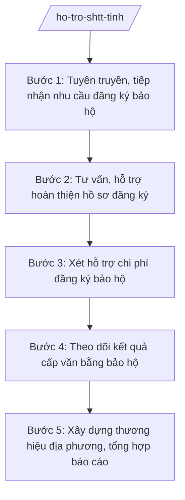

# Skill: Hỗ trợ đăng ký sở hữu trí tuệ

## 2. Khi nào dùng
- Xây dựng chương trình/kế hoạch hỗ trợ đăng ký bảo hộ SHTT của tỉnh hằng năm.
- Tuyên truyền, tư vấn cho doanh nghiệp, hợp tác xã, cá nhân về đăng ký sáng chế, nhãn hiệu, kiểu dáng công nghiệp.
- Hỗ trợ hoàn thiện hồ sơ đăng ký bảo hộ gửi cơ quan có thẩm quyền.
- Xét hỗ trợ chi phí đăng ký bảo hộ SHTT theo chính sách của tỉnh.
- Xây dựng, quản lý chỉ dẫn địa lý, nhãn hiệu tập thể, nhãn hiệu chứng nhận cho sản phẩm đặc sản của tỉnh.

## 3. Đầu vào (Input)
| Trường | Mô tả | Bắt buộc |
|--------|-------|----------|
| `nam_ke_hoach` | Năm triển khai chương trình hỗ trợ đăng ký SHTT | Có |
| `doi_tuong_ho_tro` | Doanh nghiệp, hợp tác xã, tổ chức, cá nhân có nhu cầu đăng ký bảo hộ | Có |
| `loai_doi_tuong_shtt` | Loại đối tượng: sáng chế, giải pháp hữu ích, kiểu dáng công nghiệp, nhãn hiệu, chỉ dẫn địa lý | Có |
| `ho_so_dang_ky_bao_ho` | Hồ sơ đăng ký bảo hộ do đối tượng cung cấp (tờ khai, mô tả, mẫu nhãn hiệu...) | Không |
| `kinh_phi_ho_tro` | Mức kinh phí hỗ trợ chi phí đăng ký theo chính sách của tỉnh | Có |
| `nguoi_ky` | Người có thẩm quyền ký (Giám đốc Sở đối với quyết định hỗ trợ) | Có |

## 4. Quy trình

**Bước 1. Tuyên truyền, tiếp nhận nhu cầu đăng ký bảo hộ**
- Làm gì: Tuyên truyền chính sách hỗ trợ đăng ký SHTT đến doanh nghiệp, hợp tác xã; tiếp nhận nhu cầu đăng ký bảo hộ sáng chế, nhãn hiệu, kiểu dáng công nghiệp, chỉ dẫn địa lý.
- Dùng input: `doi_tuong_ho_tro`, `loai_doi_tuong_shtt`, `nam_ke_hoach`.
- Vai trò: Chuyên viên Phòng Quản lý công nghệ (hoặc bộ phận SHTT) tuyên truyền, tiếp nhận; AI hỗ trợ soạn tài liệu tuyên truyền, lập danh sách nhu cầu ⏱ ~5 ngày làm việc (ước tính)
- Lưu ý nghiệp vụ: Phân loại đúng đối tượng SHTT ngay từ đầu (nhãn hiệu khác sáng chế về điều kiện bảo hộ); ưu tiên sản phẩm chủ lực, đặc sản của tỉnh.
- → Kết quả bước: Danh sách nhu cầu đăng ký bảo hộ SHTT của tỉnh trong năm.

**Bước 2. Tư vấn, hỗ trợ hoàn thiện hồ sơ đăng ký**
- Làm gì: Tư vấn tra cứu khả năng bảo hộ; hướng dẫn, hỗ trợ hoàn thiện tờ khai, bản mô tả, mẫu nhãn hiệu; nộp hồ sơ đến cơ quan có thẩm quyền.
- Dùng input: `ho_so_dang_ky_bao_ho`, `loai_doi_tuong_shtt`.
- Vai trò: Chuyên viên tư vấn, rà soát hồ sơ; AI hỗ trợ kiểm tra tính đầy đủ của hồ sơ theo danh mục thành phần, soạn văn bản hướng dẫn bổ sung ⏱ ~3 ngày làm việc/hồ sơ (ước tính)
- Lưu ý nghiệp vụ: Hồ sơ phải đầy đủ thành phần theo quy định; tra cứu sơ bộ để tránh nộp đơn trùng/không có khả năng bảo hộ gây lãng phí chi phí.
- → Kết quả bước: Hồ sơ đăng ký bảo hộ hoàn chỉnh, đã nộp cơ quan có thẩm quyền.

**Bước 3. Xét hỗ trợ chi phí đăng ký bảo hộ**
- Làm gì: Tiếp nhận đề nghị hỗ trợ chi phí; xét theo tiêu chí chính sách của tỉnh; lập danh sách đối tượng được hỗ trợ.
- Dùng input: `ho_so_dang_ky_bao_ho`, `kinh_phi_ho_tro`, `nguoi_ky`.
- Vai trò: Chuyên viên thẩm định hồ sơ đề nghị; Trưởng phòng kiểm tra; Giám đốc Sở ký Quyết định hỗ trợ; AI hỗ trợ đối chiếu tiêu chí, lập bảng tổng hợp ⏱ ~3 ngày làm việc (ước tính)
- Lưu ý nghiệp vụ: Chỉ hỗ trợ đối tượng đủ điều kiện theo chính sách của tỉnh; mức hỗ trợ đúng quy định; một đối tượng không nhận trùng hỗ trợ cho cùng một đơn đăng ký.
- → Kết quả bước: Quyết định phê duyệt danh sách đối tượng được hỗ trợ chi phí đăng ký SHTT.

**Bước 4. Theo dõi kết quả cấp văn bằng bảo hộ**
- Làm gì: Theo dõi tiến trình thẩm định đơn tại cơ quan có thẩm quyền; đôn đốc bổ sung hồ sơ khi có thông báo; cập nhật kết quả cấp văn bằng.
- Dùng input: Danh sách đơn đã nộp, thông báo của cơ quan thẩm định.
- Vai trò: Chuyên viên theo dõi, đôn đốc; AI hỗ trợ lập bảng theo dõi trạng thái từng đơn, nhắc lịch bổ sung ⏱ thường xuyên trong năm (ước tính)
- Lưu ý nghiệp vụ: Thời gian thẩm định đơn có thể kéo dài; phải theo dõi sát để kịp thời bổ sung, tránh đơn bị từ chối vì quá hạn.
- → Kết quả bước: Bảng theo dõi trạng thái đơn đăng ký + danh sách văn bằng bảo hộ đã được cấp.

**Bước 5. Xây dựng thương hiệu địa phương, tổng hợp báo cáo**
- Làm gì: Hỗ trợ xây dựng chỉ dẫn địa lý, nhãn hiệu tập thể/chứng nhận cho sản phẩm đặc sản của tỉnh; quảng bá tài sản trí tuệ; báo cáo tổng kết năm.
- Dùng input: Kết quả cấp văn bằng ở Bước 4, danh sách sản phẩm đặc sản của tỉnh.
- Vai trò: Phó Giám đốc Sở chỉ đạo; chuyên viên triển khai; AI hỗ trợ soạn báo cáo tổng kết, thống kê số lượng đơn/văn bằng ⏱ ~3 ngày làm việc (ước tính)
- Lưu ý nghiệp vụ: Chỉ dẫn địa lý, nhãn hiệu tập thể phải gắn với chất lượng, nguồn gốc thật của sản phẩm địa phương; quản lý việc sử dụng sau khi được bảo hộ.
- → Kết quả bước: Báo cáo tổng kết công tác SHTT năm của tỉnh.

## Luồng quy trình (Workflow)

## 5. Đầu ra (Output)
- Chương trình/kế hoạch hỗ trợ đăng ký bảo hộ SHTT năm của tỉnh.
- Quyết định phê duyệt danh sách đối tượng được hỗ trợ chi phí đăng ký SHTT.
- Báo cáo tổng kết công tác sở hữu trí tuệ năm.

**Cấu trúc output chuẩn:**
Khung Quyết định hỗ trợ chi phí đăng ký SHTT (theo NĐ 30/2020/NĐ-CP):
1. Quốc hiệu "CỘNG HÒA XÃ HỘI CHỦ NGHĨA VIỆT NAM", Tiêu ngữ "Độc lập – Tự do – Hạnh phúc".
2. Số, ký hiệu văn bản: số 1234/QĐ-SKHCN.
3. Địa danh và ngày, tháng, năm: "Tỉnh A, ngày ... tháng ... năm ...".
4. Tên loại và trích yếu: "QUYẾT ĐỊNH / Phê duyệt danh sách tổ chức, cá nhân được hỗ trợ chi phí đăng ký bảo hộ sở hữu trí tuệ năm ...".
5. Căn cứ: TT 10/2025/TT-BKHCN; NĐ 132/2025/NĐ-CP; chính sách hỗ trợ SHTT của UBND tỉnh A.
6. Nội dung bắt buộc: Điều 1. Phê duyệt danh sách ... tổ chức, cá nhân được hỗ trợ (phụ lục: tên, loại đối tượng SHTT, mức hỗ trợ); Điều 2. Kinh phí và phương thức hỗ trợ; Điều 3. Tổ chức thực hiện; Điều 4. Hiệu lực.
7. Nơi nhận: UBND tỉnh A; Sở Tài chính; các tổ chức, cá nhân được hỗ trợ; lưu VT.
8. Chữ ký: "GIÁM ĐỐC" + họ tên Vũ Thị T, đóng dấu.

## 6. Checklist nghiệm thu
- [ ] Đối tượng SHTT được phân loại đúng (sáng chế/nhãn hiệu/kiểu dáng/chỉ dẫn địa lý).
- [ ] Hồ sơ đăng ký bảo hộ đầy đủ thành phần trước khi nộp cơ quan có thẩm quyền.
- [ ] Đối tượng hỗ trợ chi phí đủ điều kiện theo chính sách của tỉnh; không trùng hỗ trợ.
- [ ] Mức hỗ trợ đúng quy định; có theo dõi trạng thái từng đơn đăng ký.
- [ ] Chỉ dẫn địa lý/nhãn hiệu tập thể gắn với sản phẩm đặc sản thật của tỉnh.
- [ ] Văn bản đúng thể thức NĐ 30/2020/NĐ-CP; đúng thẩm quyền ký.
- [ ] Không bịa số liệu, không trích dẫn văn bản hết hiệu lực.
- [ ] Đã qua human gate: chuyên viên soạn → Trưởng phòng kiểm tra → Phó Giám đốc/Giám đốc Sở ký.

## 7. Ví dụ mô phỏng
*Dữ liệu dưới đây là giả lập 100% phục vụ minh họa.*

### Input mẫu
- nam_ke_hoach: 2027
- doi_tuong_ho_tro: 25 doanh nghiệp, hợp tác xã tại tỉnh A (chế biến nông sản, thủ công mỹ nghệ)
- loai_doi_tuong_shtt: 20 nhãn hiệu, 03 kiểu dáng công nghiệp bao bì, 02 hồ sơ chỉ dẫn địa lý cho đặc sản địa phương
- kinh_phi_ho_tro: 500 triệu đồng
- nguoi_ky: Bà Vũ Thị T – Giám đốc Sở KH&CN tỉnh A

### Output mẫu
**QUYẾT ĐỊNH** số 1234/QĐ-SKHCN
Phê duyệt danh sách tổ chức, cá nhân được hỗ trợ chi phí đăng ký bảo hộ sở hữu trí tuệ năm 2027

CỘNG HÒA XÃ HỘI CHỦ NGHĨA VIỆT NAM
Độc lập – Tự do – Hạnh phúc

Tỉnh A, ngày 09 tháng 10 năm 2026

GIÁM ĐỐC SỞ KHOA HỌC VÀ CÔNG NGHỆ TỈNH A

Căn cứ Thông tư số 10/2025/TT-BKHCN ngày 27/6/2025 của Bộ Khoa học và Công nghệ;
Căn cứ chính sách hỗ trợ đăng ký bảo hộ sở hữu trí tuệ của UBND tỉnh A;
Xét đề nghị của Trưởng phòng Quản lý công nghệ,

QUYẾT ĐỊNH:

Điều 1. Phê duyệt danh sách 25 tổ chức, cá nhân được hỗ trợ chi phí đăng ký bảo hộ sở hữu trí tuệ năm 2027 (chi tiết tại phụ lục kèm theo), gồm 20 nhãn hiệu, 03 kiểu dáng công nghiệp và 02 chỉ dẫn địa lý; tổng kinh phí hỗ trợ 500 triệu đồng.

Điều 2. Kinh phí hỗ trợ từ nguồn ngân sách sự nghiệp KH&CN, chi trả sau khi đơn đăng ký được cơ quan có thẩm quyền tiếp nhận hợp lệ.

Điều 3. Phòng Quản lý công nghệ theo dõi, hướng dẫn các tổ chức, cá nhân hoàn thiện hồ sơ và báo cáo kết quả.

Điều 4. Quyết định có hiệu lực kể từ ngày ký.

Nơi nhận:
- UBND tỉnh A;
- Sở Tài chính;
- Các tổ chức, cá nhân được hỗ trợ;
- Lưu: VT.

GIÁM ĐỐC
Vũ Thị T

## 8. Human gate
Chuyên viên soạn chương trình, hồ sơ hỗ trợ → Trưởng phòng kiểm tra tính đầy đủ hồ sơ, đối chiếu tiêu chí chính sách → Phó Giám đốc Sở xem xét → Giám đốc Sở ký Quyết định hỗ trợ. AI chỉ hỗ trợ tư vấn tra cứu sơ bộ, kiểm tra thành phần hồ sơ, soạn thảo — không thay con người quyết định đối tượng được hỗ trợ và mức hỗ trợ.

## 9. Giới hạn
AI tuyệt đối KHÔNG: ra quyết định hành chính thay người có thẩm quyền; tự ký/phát hành văn bản; bịa số liệu, căn cứ pháp lý, trích dẫn; dùng văn bản hết hiệu lực. Đặc biệt: không cam kết chắc chắn đơn đăng ký sẽ được cấp văn bằng (việc thẩm định thuộc cơ quan có thẩm quyền), không bịa kết quả tra cứu khả năng bảo hộ.

## 10. Căn cứ & lưu ý
- TT 10/2025/TT-BKHCN (27/6/2025; hiệu lực 01/7/2025).
- NĐ 132/2025/NĐ-CP (12/6/2025) — phân định thẩm quyền CQĐP 2 cấp lĩnh vực quản lý nhà nước của Bộ KH&CN.
- NĐ 150/2025/NĐ-CP (12/6/2025; hiệu lực 16/6/2025); sửa đổi bởi NĐ 370/2025/NĐ-CP.
- NĐ 30/2020/NĐ-CP (thể thức văn bản hành chính).
- Luật Sở hữu trí tuệ (chỉ nêu tên).
- Lưu ý: Sở KH&CN chỉ hỗ trợ, tư vấn và xét hỗ trợ chi phí đăng ký; việc thẩm định và cấp văn bằng bảo hộ thuộc thẩm quyền của cơ quan trung ương; không hứa hẹn kết quả cấp văn bằng với người dân, doanh nghiệp.
