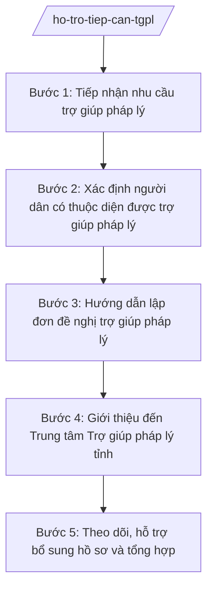

# Skill: Hỗ trợ tiếp cận trợ giúp pháp lý

## 2. Khi nào dùng
- Người dân đến bộ phận một cửa xã yêu cầu được trợ giúp pháp lý miễn phí (tranh chấp đất đai, hôn nhân gia đình, lao động, bồi thường...).
- Công chức tư pháp xã phát hiện vụ việc có dấu hiệu người dân thuộc diện được TGPL nhưng chưa biết quyền của mình.
- UBND xã cần tổng hợp, theo dõi tình hình giới thiệu người dân đi TGPL trong kỳ báo cáo.
- Người dân được giới thiệu quay lại nhờ hỗ trợ bổ sung hồ sơ theo yêu cầu của Trung tâm TGPL.

## 3. Đầu vào (Input)
| Trường | Mô tả | Bắt buộc |
|--------|-------|----------|
| `ho_ten_nguoi_yeu_cau` | Họ tên người đề nghị trợ giúp pháp lý | Có |
| `doi_tuong_uu_tien` | Thuộc diện nào: người nghèo, người có công với cách mạng, trẻ em, người dân tộc thiểu số, người khuyết tật, nạn nhân bạo lực gia đình... | Có |
| `tom_tat_vu_viec` | Tóm tắt nội dung vụ việc cần trợ giúp (tranh chấp, khiếu nại, hình sự...) | Có |
| `giay_to_chung_minh` | Giấy tờ chứng minh thuộc diện được TGPL (sổ hộ nghèo, giấy chứng nhận người có công, giấy khai sinh...) | Không |
| `thong_tin_lien_he` | Địa chỉ, số điện thoại liên hệ của người yêu cầu | Có |
| `can_bo_tiep_nhan` | Công chức tiếp nhận tại bộ phận một cửa | Có |

## 4. Quy trình

**Bước 1. Tiếp nhận nhu cầu trợ giúp pháp lý**
- Làm gì: Ghi nhận thông tin người yêu cầu, tóm tắt vụ việc vào phiếu tiếp nhận tại bộ phận một cửa; hẹn thời gian trả kết quả tư vấn ban đầu.
- Dùng input: `ho_ten_nguoi_yeu_cau`, `tom_tat_vu_viec`, `thong_tin_lien_he`, `can_bo_tiep_nhan`
- Vai trò: Công chức tư pháp – hộ tịch xã trực tiếp tiếp nhận; AI hỗ trợ soạn phiếu tiếp nhận chuẩn, gợi ý câu hỏi làm rõ vụ việc — 30 phút
- Lưu ý nghiệp vụ: Ghi đúng lời người dân trình bày, không suy diễn; với người không biết chữ, đọc lại cho nghe và điểm chỉ/lăn tay theo quy định.
- → Kết quả bước: Phiếu tiếp nhận nhu cầu TGPL đã ghi đầy đủ thông tin.

**Bước 2. Xác định người dân có thuộc diện được trợ giúp pháp lý**
- Làm gì: Đối chiếu thông tin người yêu cầu với các diện được TGPL; kiểm tra giấy tờ chứng minh; kết luận có/không thuộc diện.
- Dùng input: `doi_tuong_uu_tien`, `giay_to_chung_minh`, `ho_ten_nguoi_yeu_cau`
- Vai trò: Công chức tư pháp – hộ tịch xã xác minh; AI hỗ trợ tra cứu, đối chiếu tiêu chí diện được TGPL, lập biên bản xác minh — 0,5 ngày làm việc
- Lưu ý nghiệp vụ: Thiếu giấy tờ thì hướng dẫn bổ sung, không từ chối ngay; người thuộc nhiều diện thì ghi đủ các diện; lưu ý bảo mật thông tin cá nhân.
- → Kết quả bước: Biên bản xác minh diện được TGPL (đủ điều kiện / chưa đủ điều kiện + lý do).

**Bước 3. Hướng dẫn lập đơn đề nghị trợ giúp pháp lý**
- Làm gì: Hướng dẫn người dân viết đơn đề nghị TGPL theo mẫu; kiểm tra đơn đã đủ nội dung (thông tin cá nhân, diện được TGPL, nội dung vụ việc, yêu cầu trợ giúp).
- Dùng input: `ho_ten_nguoi_yeu_cau`, `doi_tuong_uu_tien`, `tom_tat_vu_viec`, `giay_to_chung_minh`
- Vai trò: Công chức tư pháp – hộ tịch xã hướng dẫn trực tiếp; AI hỗ trợ soạn thảo đơn từ thông tin đã tiếp nhận, kiểm tra tính đầy đủ — 30 phút
- Lưu ý nghiệp vụ: Đơn phải do chính người yêu cầu ký (hoặc điểm chỉ); kèm bản sao giấy tờ chứng minh diện được TGPL; giữ 01 bản lưu tại xã.
- → Kết quả bước: Đơn đề nghị trợ giúp pháp lý hoàn chỉnh, có chữ ký người yêu cầu.

**Bước 4. Giới thiệu đến Trung tâm Trợ giúp pháp lý tỉnh**
- Làm gì: Lập giấy giới thiệu của UBND xã gửi Trung tâm TGPL tỉnh A; chuyển đơn đề nghị + hồ sơ kèm theo; thông báo cho người dân địa chỉ, thời gian liên hệ Trung tâm.
- Dùng input: Đơn đề nghị TGPL, `giay_to_chung_minh`, `thong_tin_lien_he`
- Vai trò: Chánh Văn phòng HĐND và UBND kiểm tra hồ sơ; AI hỗ trợ soạn giấy giới thiệu đúng thể thức — 0,5 ngày làm việc
- Lưu ý nghiệp vụ: Xã chỉ làm đầu mối giới thiệu, hỗ trợ — KHÔNG trực tiếp thực hiện TGPL; giấy giới thiệu phải có số, ký hiệu, đóng dấu UBND xã.
- → Kết quả bước: Giấy giới thiệu + bộ hồ sơ đề nghị TGPL đã chuyển đến Trung tâm TGPL tỉnh A.

**Bước 5. Theo dõi, hỗ trợ bổ sung hồ sơ và tổng hợp**
- Làm gì: Ghi sổ theo dõi từng trường hợp đã giới thiệu; khi Trung tâm yêu cầu bổ sung hồ sơ thì liên hệ, hỗ trợ người dân hoàn thiện; định kỳ tổng hợp báo cáo.
- Dùng input: Sổ theo dõi, thông tin phản hồi từ Trung tâm TGPL, `thong_tin_lien_he`
- Vai trò: Công chức tư pháp – hộ tịch xã theo dõi; AI hỗ trợ cập nhật sổ theo dõi, nhắc lịch bổ sung hồ sơ, tổng hợp số liệu báo cáo — 15 phút/trường hợp
- Lưu ý nghiệp vụ: Theo dõi đến khi có kết quả thụ lý/từ chối của Trung tâm; mọi liên hệ bổ sung phải có văn bản hoặc biên bản làm việc.
- → Kết quả bước: Sổ theo dõi TGPL cập nhật đầy đủ; báo cáo tổng hợp định kỳ.

## Luồng quy trình (Workflow)

## 5. Đầu ra (Output)
- Đơn đề nghị trợ giúp pháp lý (có chữ ký người yêu cầu).
- Giấy giới thiệu của UBND xã gửi Trung tâm TGPL tỉnh A.
- Sổ theo dõi tiếp nhận, giới thiệu TGPL.
- Báo cáo tổng hợp tình hình hỗ trợ tiếp cận TGPL (định kỳ).

### Cấu trúc output chuẩn
Khung giấy giới thiệu của UBND xã (theo NĐ 30/2020/NĐ-CP):
1. Quốc hiệu – tiêu ngữ: "CỘNG HÒA XÃ HỘI CHỦ NGHĨA VIỆT NAM / Độc lập – Tự do – Hạnh phúc".
2. Số, ký hiệu văn bản: số .../GT-UBND.
3. Địa danh và ngày, tháng, năm ban hành: "Xã A, ngày ... tháng ... năm ...".
4. Tên loại văn bản: "GIẤY GIỚI THIỆU".
5. Nội dung: giới thiệu ông/bà (họ tên, năm sinh, địa chỉ) thuộc diện được TGPL (nêu diện) đến Trung tâm TGPL tỉnh A để được trợ giúp pháp lý về vụ việc (tóm tắt); đề nghị Trung tâm quan tâm giải quyết.
6. Nơi nhận: Trung tâm TGPL tỉnh A; lưu VP.
7. Chữ ký: "TM. ỦY BAN NHÂN DÂN / CHỦ TỊCH" + họ tên người ký, đóng dấu.

## 6. Checklist nghiệm thu
- [ ] Phiếu tiếp nhận ghi đúng, đủ thông tin người yêu cầu và tóm tắt vụ việc.
- [ ] Đã xác minh và kết luận rõ người dân có/không thuộc diện được TGPL, có căn cứ.
- [ ] Đơn đề nghị TGPL có chữ ký (hoặc điểm chỉ) của người yêu cầu, kèm giấy tờ chứng minh.
- [ ] Giấy giới thiệu đúng thể thức NĐ 30/2020/NĐ-CP, có số/ký hiệu, đóng dấu UBND xã.
- [ ] Hồ sơ đã chuyển đến Trung tâm TGPL tỉnh A, có xác nhận tiếp nhận.
- [ ] Sổ theo dõi cập nhật đầy đủ từng trường hợp, đến khi có kết quả thụ lý.
- [ ] Không có nội dung nào do AI bịa đặt (họ tên, diện ưu tiên, vụ việc đều từ input).
- [ ] Đã qua human gate: công chức soạn → Chánh Văn phòng kiểm tra → Chủ tịch UBND xã ký.

## 7. Ví dụ mô phỏng
*Dữ liệu dưới đây là giả lập 100% phục vụ minh họa.*

### Input mẫu
- ho_ten_nguoi_yeu_cau: Bà Trần Thị Dân
- doi_tuong_uu_tien: Hộ nghèo
- tom_tat_vu_viec: Tranh chấp ranh giới đất với hộ liền kề, đã hòa giải ở thôn không thành
- giay_to_chung_minh: Giấy chứng nhận hộ nghèo (bản sao)
- thong_tin_lien_he: Số 123 đường B, xã A, tỉnh A; ĐT 0900 000 001
- can_bo_tiep_nhan: Bà Trần Thị H

### Output mẫu
**GIẤY GIỚI THIỆU** số 123/GT-UBND

CỘNG HÒA XÃ HỘI CHỦ NGHĨA VIỆT NAM
Độc lập – Tự do – Hạnh phúc

Xã A, ngày 09 tháng 10 năm 2026

ỦY BAN NHÂN DÂN XÃ A trân trọng giới thiệu:

Bà Trần Thị Dân, sinh năm 1960, trú tại Số 123 đường B, xã A, tỉnh A, thuộc diện hộ nghèo được trợ giúp pháp lý, đến Trung tâm Trợ giúp pháp lý tỉnh A để được trợ giúp pháp lý về vụ việc tranh chấp ranh giới đất với hộ liền kề (đã hòa giải ở thôn không thành).

Đề nghị Trung tâm quan tâm, giải quyết theo quy định.

Nơi nhận:
- Trung tâm TGPL tỉnh A;
- Lưu: VP.

TM. ỦY BAN NHÂN DÂN
CHỦ TỊCH
Nguyễn Văn A

## 8. Human gate
Công chức tư pháp – hộ tịch xã soạn thảo đơn, giấy giới thiệu → Chánh Văn phòng HĐND và UBND kiểm tra tính đầy đủ, đúng diện được TGPL → Chủ tịch UBND xã ký giấy giới thiệu trước khi chuyển đến Trung tâm TGPL tỉnh A. AI chỉ hỗ trợ soạn thảo, tuyệt đối không tự ký, không tự gửi hồ sơ.

## 9. Giới hạn
AI tuyệt đối KHÔNG: ra quyết định hành chính thay người có thẩm quyền; tự ký/phát hành văn bản; bịa số liệu, căn cứ pháp lý, trích dẫn; dùng văn bản hết hiệu lực; tư vấn vượt thẩm quyền cấp xã. Đặc biệt: xã không trực tiếp thực hiện TGPL — AI không được "kết luận" kết quả trợ giúp thay Trung tâm TGPL tỉnh.

## 10. Căn cứ & lưu ý
- TT 09/2025/TT-BTP (hướng dẫn chức năng, nhiệm vụ lĩnh vực tư pháp của Văn phòng HĐND & UBND cấp xã; hiệu lực 01/7/2025).
- NĐ 30/2020/NĐ-CP (thể thức văn bản hành chính — áp dụng cho giấy giới thiệu).
- Luật Tổ chức chính quyền địa phương 72/2025/QH15.
- Lưu ý: diện được TGPL gồm người nghèo, người có công với cách mạng, trẻ em, người dân tộc thiểu số, người khuyết tật và các đối tượng chính sách khác theo quy định; khi chính sách thay đổi, đối chiếu văn bản hiện hành, không áp dụng máy móc danh sách cũ.
