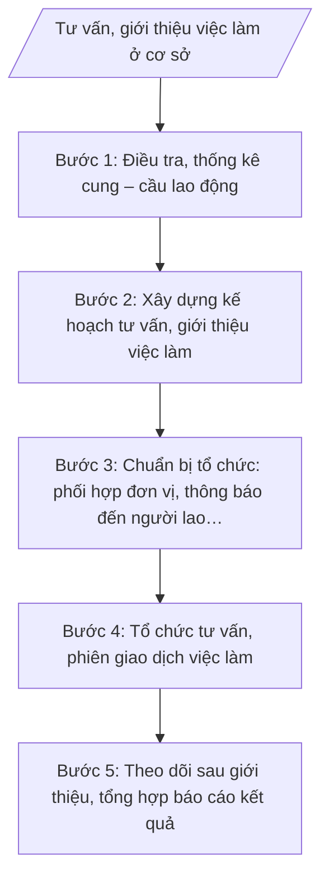

# Skill: Tư vấn, giới thiệu việc làm

## 2. Khi nào dùng

- Lập kế hoạch tư vấn, giới thiệu việc làm hằng năm hoặc theo đợt của xã.
- Tổ chức phiên giao dịch việc làm, ngày hội tư vấn hướng nghiệp tại xã.
- Điều tra, thống kê cung – cầu lao động phục vụ công tác quản lý lao động, việc làm.
- Tư vấn cho người lao động đi làm việc ở nước ngoài theo hợp đồng; theo dõi tình hình lao động sau giới thiệu.

## 3. Đầu vào (Input)

| Trường | Mô tả | Bắt buộc |
|--------|-------|----------|
| `doi_tuong_lao_dong` | Nhóm lao động cần hỗ trợ: độ tuổi, trình độ, nghề nghiệp, tình trạng việc làm (thất nghiệp, thiếu việc làm, học sinh tốt nghiệp...) | Có |
| `nhu_cau_tuyen_dung` | Nhu cầu tuyển dụng của doanh nghiệp, cơ sở sản xuất kinh doanh trên địa bàn và khu vực lân cận: số lượng, ngành nghề, yêu cầu | Có |
| `thoi_gian_dia_diem` | Thời gian, địa điểm dự kiến tổ chức tư vấn/phiên giao dịch việc làm | Có |
| `don_vi_phoi_hop` | Đơn vị phối hợp: Trung tâm Dịch vụ việc làm tỉnh A, doanh nghiệp, cơ sở đào tạo nghề, Đoàn Thanh niên, Hội Phụ nữ xã... | Không |
| `nguon_luc` | Kinh phí, địa điểm, trang thiết bị phục vụ tổ chức | Không |
| `so_lieu_ky_truoc` | Kết quả giới thiệu việc làm kỳ trước (số người được tư vấn, số người có việc làm) để đối chiếu | Không |

## 4. Quy trình

**Bước 1. Điều tra, thống kê cung – cầu lao động**

- Làm gì: Lập phiếu điều tra; phối hợp trưởng thôn/tổ dân phố thu thập thông tin người lao động có nhu cầu tìm việc (tuổi, trình độ, nghề, nguyện vọng) và nhu cầu tuyển dụng của doanh nghiệp, cơ sở sản xuất trên địa bàn; tổng hợp thành bảng cung – cầu lao động.
- Dùng input: `doi_tuong_lao_dong`, `nhu_cau_tuyen_dung`.
- Vai trò: Công chức văn hóa – xã hội phụ trách lĩnh vực lao động, việc làm trực tiếp điều tra, tổng hợp. AI hỗ trợ: thiết kế mẫu phiếu điều tra, chuẩn hóa dữ liệu, lập bảng đối chiếu cung – cầu theo ngành nghề/trình độ. ⏱ 2–3 ngày (ước tính) làm việc.
- Lưu ý nghiệp vụ: Số liệu điều tra phải có chữ ký xác nhận của trưởng thôn/tổ dân phố; không trùng lặp đối tượng giữa các thôn; phân loại rõ lao động thất nghiệp, thiếu việc làm, lao động có nhu cầu chuyển đổi nghề.
- → Kết quả bước: Bảng tổng hợp cung – cầu lao động của xã (số lượng, cơ cấu theo tuổi, trình độ, ngành nghề).

**Bước 2. Xây dựng kế hoạch tư vấn, giới thiệu việc làm**

- Làm gì: Căn cứ bảng cung – cầu, dự thảo Kế hoạch tư vấn, giới thiệu việc làm: mục đích, yêu cầu; đối tượng; nội dung (tư vấn trực tiếp, phiên giao dịch việc làm, tư vấn đi làm việc ở nước ngoài); thời gian, địa điểm; phân công tổ chức thực hiện; kinh phí; trình lãnh đạo UBND xã phê duyệt.
- Dùng input: Bảng cung – cầu ở Bước 1, `thoi_gian_dia_diem`, `don_vi_phoi_hop`, `nguon_luc`, `so_lieu_ky_truoc`.
- Vai trò: Công chức văn hóa – xã hội phụ trách lĩnh vực dự thảo kế hoạch. AI hỗ trợ: dàn ý kế hoạch theo cấu trúc chuẩn, gợi ý nội dung phù hợp với cơ cấu cung – cầu, kiểm tra thể thức văn bản theo NĐ 30/2020/NĐ-CP. ⏱ 0,5–1 ngày (ước tính) làm việc.
- Lưu ý nghiệp vụ: Kế hoạch phải khả thi với nguồn lực thực tế của xã; nội dung tư vấn đi làm việc ở nước ngoài phải gắn với thông tin chính thống, cảnh báo lừa đảo xuất khẩu lao động; kinh phí phải phù hợp dự toán được giao.
- → Kết quả bước: Dự thảo Kế hoạch tư vấn, giới thiệu việc làm (sẵn sàng trình ký).

**Bước 3. Chuẩn bị tổ chức: phối hợp đơn vị, thông báo đến người lao động**

- Làm gì: Liên hệ, thống nhất nội dung phối hợp với Trung tâm Dịch vụ việc làm tỉnh A, doanh nghiệp tuyển dụng, cơ sở đào tạo nghề; chuẩn bị địa điểm, trang thiết bị, tài liệu tư vấn; thông báo rộng rãi đến người lao động qua đài truyền thanh xã, nhóm Zalo thôn, niêm yết tại trụ sở UBND xã.
- Dùng input: `don_vi_phoi_hop`, `nguon_luc`, kế hoạch đã phê duyệt ở Bước 2.
- Vai trò: Công chức văn hóa – xã hội phụ trách lĩnh vực đầu mối liên hệ, chuẩn bị. AI hỗ trợ: soạn thư mời, thông báo, nội dung phát thanh tuyên truyền; lập checklist công tác chuẩn bị. ⏱ 2–3 ngày (ước tính) làm việc trước ngày tổ chức.
- Lưu ý nghiệp vụ: Thông báo phải đến được đúng đối tượng có nhu cầu (không chỉ thông báo chung chung); xác nhận số lượng doanh nghiệp, gian hàng tham gia trước ít nhất 3 ngày; chuẩn bị phương án dự phòng khi thời tiết xấu (nếu tổ chức ngoài trời).
- → Kết quả bước: Danh sách đơn vị tham gia đã xác nhận + thông báo đã phát hành + checklist chuẩn bị hoàn tất.

**Bước 4. Tổ chức tư vấn, phiên giao dịch việc làm**

- Làm gì: Tổ chức buổi tư vấn/phiên giao dịch việc làm theo kế hoạch: đón tiếp, hướng dẫn người lao động; doanh nghiệp giới thiệu nhu cầu tuyển dụng, phỏng vấn trực tiếp; tư vấn chính sách hỗ trợ, thông tin đi làm việc ở nước ngoài theo hợp đồng; lập danh sách người lao động đăng ký, kết quả phỏng vấn tại chỗ.
- Dùng input: Danh sách đơn vị tham gia ở Bước 3, bảng cung – cầu ở Bước 1.
- Vai trò: Công chức văn hóa – xã hội phụ trách lĩnh vực điều hành, ghi chép kết quả. AI hỗ trợ: mẫu phiếu đăng ký, mẫu biên bản tổng hợp kết quả tại chỗ; tổng hợp nhanh số liệu ngay sau sự kiện. ⏱ 0,5–1 ngày (ước tính) (ngày tổ chức sự kiện).
- Lưu ý nghiệp vụ: Ghi nhận đầy đủ, chính xác số người tham gia, số người đăng ký, số người trúng tuyển/phỏng vấn đạt; không hứa hẹn việc làm thay doanh nghiệp; tư vấn đi làm việc ở nước ngoài chỉ cung cấp thông tin chính thống, hướng dẫn liên hệ cơ quan có thẩm quyền.
- → Kết quả bước: Biên bản tổng hợp kết quả buổi tư vấn/phiên giao dịch việc làm (số liệu tại chỗ).

**Bước 5. Theo dõi sau giới thiệu, tổng hợp báo cáo kết quả**

- Làm gì: Sau 1–3 tháng, liên hệ người lao động đã được giới thiệu để nắm tình hình (đã có việc làm, thu nhập, còn làm việc hay đã nghỉ); tổng hợp toàn bộ kết quả các bước; dự thảo Báo cáo kết quả tư vấn, giới thiệu việc làm; trình Trưởng phòng kiểm tra, lãnh đạo UBND xã ký ban hành; gửi cấp trên, lưu hồ sơ.
- Dùng input: Biên bản ở Bước 4, `so_lieu_ky_truoc`, kết quả theo dõi sau giới thiệu.
- Vai trò: Công chức văn hóa – xã hội phụ trách lĩnh vực theo dõi, dự thảo báo cáo. AI hỗ trợ: mẫu phiếu theo dõi sau giới thiệu, dàn ý báo cáo theo cấu trúc chuẩn, đối chiếu số liệu các phần, rà soát thể thức NĐ 30/2020/NĐ-CP. ⏱ 1–2 ngày (ước tính) làm việc (chưa kể thời gian chờ theo dõi 1–3 tháng).
- Lưu ý nghiệp vụ: Số liệu kết quả phải có căn cứ (danh sách, phiếu theo dõi có xác nhận); phân biệt rõ số người được tư vấn, số người được giới thiệu, số người có việc làm thực tế; đánh giá trung thực, nêu rõ khó khăn, kiến nghị.
- → Kết quả bước: Báo cáo kết quả tư vấn, giới thiệu việc làm (bản dự thảo đã qua kiểm tra, sẵn sàng trình ký).

## Luồng quy trình (Workflow)

## 5. Đầu ra (Output)

**Sản phẩm:**
1. Kế hoạch tư vấn, giới thiệu việc làm (sản phẩm chính 1).
2. Báo cáo kết quả tư vấn, giới thiệu việc làm (sản phẩm chính 2).
3. Bảng tổng hợp cung – cầu lao động (phụ lục).
4. Biên bản tổng hợp kết quả buổi tư vấn/phiên giao dịch việc làm (phụ lục).

**Cấu trúc output chuẩn — Kế hoạch tư vấn, giới thiệu việc làm (thể thức theo NĐ 30/2020/NĐ-CP):**
1. Quốc hiệu "CỘNG HÒA XÃ HỘI CHỦ NGHĨA VIỆT NAM" – Tiêu ngữ "Độc lập – Tự do – Hạnh phúc".
2. Tên cơ quan ban hành: ỦY BAN NHÂN DÂN XÃ A.
3. Số, ký hiệu văn bản (Số: .../KH-UBND).
4. Địa danh, ngày, tháng, năm ban hành.
5. Tên loại và trích yếu nội dung: KẾ HOẠCH / Tư vấn, giới thiệu việc làm trên địa bàn xã A năm ...
6. Nội dung kế hoạch:
   - I. Mục đích, yêu cầu.
   - II. Đối tượng, phạm vi.
   - III. Nội dung thực hiện (điều tra cung – cầu; tư vấn trực tiếp; phiên giao dịch việc làm; tư vấn đi làm việc ở nước ngoài).
   - IV. Thời gian, địa điểm tổ chức.
   - V. Tổ chức thực hiện (phân công: Phòng Văn hóa – Xã hội chủ trì; các đơn vị phối hợp).
   - VI. Kinh phí thực hiện.
7. Nơi nhận.
8. Chữ ký: TM. ỦY BAN NHÂN DÂN / KT. CHỦ TỊCH / PHÓ CHỦ TỊCH (hoặc CHỦ TỊCH) / (ký tên, đóng dấu) — bà Trần Thị B / ông Nguyễn Văn A.

**Cấu trúc output chuẩn — Báo cáo kết quả tư vấn, giới thiệu việc làm:**
1. Quốc hiệu "CỘNG HÒA XÃ HỘI CHỦ NGHĨA VIỆT NAM" – Tiêu ngữ "Độc lập – Tự do – Hạnh phúc".
2. Tên cơ quan ban hành: ỦY BAN NHÂN DÂN XÃ A.
3. Số, ký hiệu văn bản (Số: .../BC-UBND).
4. Địa danh, ngày, tháng, năm ban hành.
5. Tên loại và trích yếu nội dung: BÁO CÁO / Kết quả tư vấn, giới thiệu việc làm trên địa bàn xã A năm ...
6. Nội dung báo cáo:
   - I. Tình hình lao động, việc làm trên địa bàn (tóm tắt bảng cung – cầu).
   - II. Kết quả thực hiện (số buổi tư vấn, phiên giao dịch; số người được tư vấn, giới thiệu; số người có việc làm; kết quả theo dõi sau giới thiệu).
   - III. Đánh giá chung (ưu điểm, tồn tại, nguyên nhân).
   - IV. Nhiệm vụ thời gian tới.
   - V. Kiến nghị, đề xuất.
7. Nơi nhận.
8. Chữ ký: TM. ỦY BAN NHÂN DÂN / CHỦ TỊCH / (ký tên, đóng dấu) — ông Nguyễn Văn A.

## 6. Checklist nghiệm thu

- [ ] Kế hoạch và báo cáo có đủ thành phần theo cấu trúc chuẩn mục 4, đúng thể thức NĐ 30/2020/NĐ-CP.
- [ ] Số, ký hiệu văn bản đúng định dạng .../KH-UBND và .../BC-UBND, đánh số liên tục.
- [ ] Bảng cung – cầu lao động có căn cứ điều tra (phiếu điều tra, xác nhận của thôn/tổ dân phố).
- [ ] Số liệu báo cáo khớp với biên bản tổng hợp tại chỗ và phiếu theo dõi sau giới thiệu.
- [ ] Phân biệt rõ: số người được tư vấn / số người được giới thiệu / số người có việc làm thực tế.
- [ ] Nội dung tư vấn đi làm việc ở nước ngoài có cảnh báo lừa đảo, hướng dẫn liên hệ cơ quan có thẩm quyền.
- [ ] Kinh phí trong kế hoạch phù hợp dự toán được giao, có nguồn rõ ràng.
- [ ] Không có số liệu, căn cứ pháp lý, số hiệu văn bản nào bị bịa đặt.
- [ ] Cả hai văn bản đã qua đủ 3 nấc human gate trước khi ban hành.
- [ ] Lưu hồ sơ đầy đủ: kế hoạch, báo cáo đã ký + phiếu điều tra + biên bản + phiếu theo dõi.

## 7. Ví dụ mô phỏng

*Dữ liệu dưới đây là giả lập 100% phục vụ minh họa.*

**Input mẫu:**
- doi_tuong_lao_dong: 120 lao động có nhu cầu tìm việc (60 thanh niên tốt nghiệp THPT, 40 lao động thiếu việc làm, 20 lao động muốn chuyển đổi nghề sang may mặc).
- nhu_cau_tuyen_dung: 03 doanh nghiệp trên địa bàn cần tuyển 80 lao động (may mặc 50, chế biến nông sản 20, dịch vụ 10).
- thoi_gian_dia_diem: Ngày 20/9/2026, tại Nhà văn hóa xã A.
- don_vi_phoi_hop: Trung tâm Dịch vụ việc làm tỉnh A, 03 doanh nghiệp, Đoàn Thanh niên xã A.
- nguon_luc: Kinh phí 10 triệu đồng từ dự toán xã; địa điểm: Nhà văn hóa xã A.
- so_lieu_ky_truoc: Năm 2025: tư vấn 100 người, giới thiệu 70 người, 45 người có việc làm.

**Output mẫu (Kế hoạch — trích cấu trúc chuẩn):**

> CỘNG HÒA XÃ HỘI CHỦ NGHĨA VIỆT NAM
> Độc lập – Tự do – Hạnh phúc
>
> ỦY BAN NHÂN DÂN XÃ A
> Số: 45/KH-UBND
>
> Xã A, ngày 01 tháng 9 năm 2026
>
> **KẾ HOẠCH**
> **Tư vấn, giới thiệu việc làm trên địa bàn xã A năm 2026**
>
> **I. Mục đích, yêu cầu**
>
> Tư vấn, giới thiệu việc làm cho 120 lao động có nhu cầu; kết nối cung – cầu lao động, phấn đấu ít nhất 60 lao động có việc làm sau giới thiệu. Tổ chức thiết thực, tiết kiệm, đúng đối tượng.
>
> **II. Đối tượng, phạm vi**
>
> Người lao động trên địa bàn xã A có nhu cầu tìm việc làm, chuyển đổi nghề; doanh nghiệp, cơ sở sản xuất kinh doanh có nhu cầu tuyển dụng.
>
> **III. Nội dung thực hiện**
>
> 1. Điều tra, cập nhật cung – cầu lao động (hoàn thành trước 10/9/2026).
> 2. Tổ chức 01 phiên giao dịch việc làm ngày 20/9/2026 tại Nhà văn hóa xã A: doanh nghiệp giới thiệu nhu cầu, phỏng vấn trực tiếp; tư vấn chính sách hỗ trợ việc làm; tư vấn đi làm việc ở nước ngoài theo hợp đồng (cung cấp thông tin chính thống, cảnh báo lừa đảo).
> 3. Theo dõi sau giới thiệu trong 3 tháng.
>
> **IV. Thời gian, địa điểm tổ chức**
>
> Ngày 20/9/2026, tại Nhà văn hóa xã A, xã A, tỉnh A.
>
> **V. Tổ chức thực hiện**
>
> - Phòng Văn hóa – Xã hội chủ trì, phối hợp Trung tâm Dịch vụ việc làm tỉnh A, Đoàn Thanh niên xã A tổ chức thực hiện.
> - Trưởng các thôn thông báo, vận động người lao động tham gia.
>
> **VI. Kinh phí thực hiện**
>
> 10 triệu đồng từ dự toán chi sự nghiệp của xã năm 2026.
>
> ***Nơi nhận:***
> - Trung tâm DVVL tỉnh A;
> - TT Đảng ủy, HĐND xã;
> - Chủ tịch, các Phó Chủ tịch UBND xã;
> - Các thôn trên địa bàn;
> - Lưu: VT, VH-XH.
>
> TM. ỦY BAN NHÂN DÂN
> KT. CHỦ TỊCH
> PHÓ CHỦ TỊCH
>
> Trần Thị B

## 8. Human gate

1. **Công chức văn hóa – xã hội phụ trách lĩnh vực lao động, việc làm**: soạn thảo kế hoạch, báo cáo; chịu trách nhiệm về số liệu điều tra và kết quả (Bước 1–5).
2. **Trưởng phòng Văn hóa – Xã hội (ông Vũ Văn E)**: kiểm tra kế hoạch, báo cáo; yêu cầu chỉnh sửa nếu chưa đạt (trước khi trình lãnh đạo UBND xã).
3. **Phó Chủ tịch UBND xã (bà Trần Thị B)**: xem xét, cho ý kiến (nếu được phân công phụ trách lĩnh vực).
4. **Chủ tịch UBND xã (ông Nguyễn Văn A)**: ký duyệt, ban hành kế hoạch và báo cáo. Văn bản chỉ có hiệu lực sau khi Chủ tịch ký.

## 9. Giới hạn

- AI KHÔNG ra quyết định hành chính thay người có thẩm quyền (không quyết định phê duyệt kế hoạch, không quyết định hỗ trợ kinh phí).
- AI không tự ký, không tự phát hành văn bản dưới danh nghĩa UBND xã hay bất kỳ cá nhân nào.
- AI không bịa số liệu lao động, nhu cầu tuyển dụng, kết quả giới thiệu việc làm; không bịa căn cứ pháp lý, số hiệu văn bản.
- AI không hứa hẹn việc làm thay doanh nghiệp; không cung cấp thông tin tuyển dụng, xuất khẩu lao động không có nguồn chính thống.
- AI không sử dụng văn bản pháp luật đã hết hiệu lực để làm căn cứ.

## 10. Căn cứ & lưu ý

- TT 10/2025/TT-BNV ngày 19/6/2025 của Bộ Nội vụ: hướng dẫn lĩnh vực nội vụ của phòng chuyên môn thuộc UBND cấp xã (sửa đổi, bổ sung bởi TT 06/2026/TT-BNV ngày 29/4/2026, hiệu lực 15/6/2026).
- NĐ 129/2025/NĐ-CP ngày 11/6/2025 của Chính phủ: phân định thẩm quyền chính quyền địa phương 2 cấp trong lĩnh vực quản lý nhà nước của Bộ Nội vụ.
- NĐ 150/2025/NĐ-CP ngày 12/6/2025 của Chính phủ: tổ chức Phòng Văn hóa – Xã hội thuộc UBND cấp xã (hiệu lực 16/6/2025); sửa đổi bởi NĐ 370/2025/NĐ-CP (hiệu lực 01/01/2026).
- NĐ 30/2020/NĐ-CP của Chính phủ: thể thức, kỹ thuật trình bày văn bản hành chính (áp dụng cho kế hoạch, báo cáo).
- Lưu ý: nội dung tư vấn đi làm việc ở nước ngoài chỉ cung cấp thông tin chính thống và hướng dẫn người lao động liên hệ cơ quan có thẩm quyền; tuyệt đối cảnh báo lừa đảo xuất khẩu lao động.
