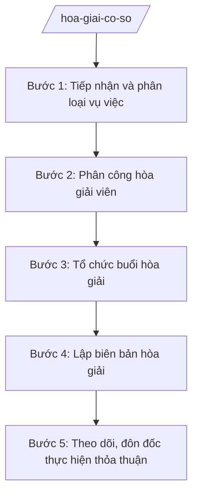

# Skill: Hòa giải ở cơ sở

## 2. Khi nào dùng
- Người dân gửi yêu cầu hòa giải hoặc thôn/tổ dân phố phát hiện mâu thuẫn, tranh chấp nhỏ trong cộng đồng (ranh giới đất, lối đi chung, gây tiếng ồn, mâu thuẫn gia đình, vay mượn nhỏ...).
- Cần phân công hòa giải viên thuộc Tổ hòa giải (do nhân dân bầu) phụ trách vụ việc.
- Cần tổ chức buổi hòa giải, lập biên bản hòa giải thành hoặc hòa giải không thành.
- Cần theo dõi, đôn đốc các bên thực hiện thỏa thuận đã đạt được.

## 3. Đầu vào (Input)

| Trường | Mô tả | Bắt buộc |
|--------|-------|----------|
| `yeu_cau_hoa_giai` | Đơn yêu cầu hòa giải hoặc biên bản phát hiện vụ việc (ghi rõ các bên, nội dung mâu thuẫn) | Có |
| `cac_ben` | Họ tên, địa chỉ các bên liên quan đến vụ việc | Có |
| `noi_dung_vu_viec` | Tóm tắt nội dung mâu thuẫn, tranh chấp | Có |
| `to_hoa_giai` | Danh sách Tổ hòa giải của thôn/tổ dân phố (hòa giải viên) | Có |
| `tai_lieu_lien_quan` | Giấy tờ, tài liệu liên quan vụ việc (nếu có) | Không |
| `da_toa_an_thu_ly` | Vụ việc đã được Tòa án thụ lý giải quyết hay chưa | Có |

## 4. Quy trình

**Bước 1. Tiếp nhận và phân loại vụ việc**
- Làm gì: Tiếp nhận đơn yêu cầu hòa giải hoặc thông tin vụ việc từ trưởng thôn/tổ trưởng dân phố; ghi vào Sổ theo dõi hòa giải; phân loại vụ việc thuộc phạm vi hòa giải ở cơ sở hay không.
- Dùng input: `yeu_cau_hoa_giai`, `cac_ben`, `noi_dung_vu_viec`, `da_toa_an_thu_ly`
- Vai trò: Trưởng thôn/tổ trưởng dân phố hoặc công chức Tư pháp – Hộ tịch tiếp nhận, vào sổ. AI hỗ trợ phân loại vụ việc, cảnh báo trường hợp không thuộc phạm vi hòa giải ⏱ ~30 phút/vụ việc (ước tính).
- Lưu ý nghiệp vụ: Không hòa giải vụ việc đã được Tòa án thụ lý giải quyết; vụ việc vi phạm pháp luật hình sự, hành chính nghiêm trọng phải chuyển cơ quan có thẩm quyền. Giải thích rõ cho người dân khi từ chối hòa giải.
- → Kết quả bước: Vụ việc đã ghi vào Sổ theo dõi hòa giải; kết luận thuộc/không thuộc phạm vi hòa giải ở cơ sở.

**Bước 2. Phân công hòa giải viên**
- Làm gì: Lựa chọn, phân công hòa giải viên trong Tổ hòa giải (do nhân dân bầu) phù hợp với tính chất vụ việc; thông báo cho các bên về thời gian, địa điểm hòa giải.
- Dùng input: `to_hoa_giai`, `cac_ben`, `noi_dung_vu_viec`
- Vai trò: Trưởng thôn/tổ trưởng dân phố (hoặc Tổ trưởng Tổ hòa giải) phân công. AI hỗ trợ gợi ý hòa giải viên phù hợp (am hiểu lĩnh vực tranh chấp, được các bên tin tưởng) và soạn giấy mời các bên ⏱ ~30 phút/vụ việc (ước tính).
- Lưu ý nghiệp vụ: Hòa giải viên phải khách quan, không có quyền lợi liên quan đến vụ việc; nếu một bên không tin tưởng hòa giải viên được phân công thì xem xét thay người khác. Mời đầy đủ các bên, ghi rõ thời gian, địa điểm.
- → Kết quả bước: Hòa giải viên đã được phân công; giấy mời đã gửi đến các bên.

**Bước 3. Tổ chức buổi hòa giải**
- Làm gì: Hòa giải viên chủ trì buổi hòa giải: cho các bên trình bày, làm rõ mâu thuẫn; phân tích đúng sai trên cơ sở pháp luật, phong tục tập quán tốt đẹp; vận động, thuyết phục các bên tự nguyện thỏa thuận.
- Dùng input: `noi_dung_vu_viec`, `tai_lieu_lien_quan`, ý kiến trình bày của các bên tại buổi hòa giải
- Vai trò: Hòa giải viên (Tổ hòa giải do nhân dân bầu) chủ trì; công chức Tư pháp – Hộ tịch hỗ trợ về mặt pháp lý khi cần. AI hỗ trợ chuẩn bị gợi ý phương án hòa giải dựa trên quy định pháp luật liên quan ⏱ ~01–02 giờ/buổi hòa giải (ước tính).
- Lưu ý nghiệp vụ: Hòa giải trên tinh thần tự nguyện, tôn trọng các bên; không ép buộc, không áp đặt ý chí; giữ bí mật thông tin đời tư các bên. Có thể hòa giải nhiều buổi nếu một buổi chưa xong.
- → Kết quả bước: Các bên đạt được thỏa thuận (hòa giải thành) hoặc không đạt thỏa thuận (hòa giải không thành), có ghi nhận đầy đủ diễn biến.

**Bước 4. Lập biên bản hòa giải**
- Làm gì: Lập biên bản hòa giải ghi rõ thời gian, địa điểm, thành phần, diễn biến và kết quả (hòa giải thành ghi rõ nội dung thỏa thuận; hòa giải không thành ghi rõ lý do); các bên và hòa giải viên cùng ký; gửi một bản cho UBND xã lưu.
- Dùng input: kết quả Bước 3 (nội dung thỏa thuận hoặc lý do không thành), `cac_ben`
- Vai trò: Hòa giải viên lập biên bản; các bên ký xác nhận. AI hỗ trợ soạn biên bản đúng mẫu, kiểm tra đầy đủ yếu tố (thời gian, địa điểm, thành phần, nội dung, chữ ký) ⏱ ~30 phút/biên bản (ước tính).
- Lưu ý nghiệp vụ: Biên bản hòa giải thành phải ghi cụ thể nội dung thỏa thuận, thời hạn thực hiện, trách nhiệm từng bên — càng chi tiết càng dễ theo dõi. Biên bản hòa giải không thành phải nêu rõ hướng giải quyết tiếp theo (khởi kiện tại Tòa án...).
- → Kết quả bước: Biên bản hòa giải thành/không thành đã có chữ ký các bên và hòa giải viên; 01 bản lưu tại UBND xã.

**Bước 5. Theo dõi, đôn đốc thực hiện thỏa thuận**
- Làm gì: Ghi biên bản vào Sổ theo dõi hòa giải; đôn đốc, nhắc nhở các bên thực hiện đúng thỏa thuận và thời hạn đã cam kết; ghi nhận kết quả thực hiện.
- Dùng input: biên bản hòa giải thành từ Bước 4
- Vai trò: Trưởng thôn/tổ trưởng dân phố hoặc hòa giải viên theo dõi; công chức Tư pháp – Hộ tịch tổng hợp vào sổ theo dõi chung của xã. AI hỗ trợ lập lịch nhắc việc theo thời hạn thỏa thuận và tổng hợp báo cáo công tác hòa giải định kỳ ⏱ ~15 phút/vụ việc/lần theo dõi (ước tính).
- Lưu ý nghiệp vụ: Nếu một bên không thực hiện thỏa thuận, vận động tiếp; nếu không được thì hướng dẫn bên còn lại khởi kiện tại Tòa án. Định kỳ báo cáo kết quả hòa giải về UBND xã.
- → Kết quả bước: Sổ theo dõi hòa giải đã cập nhật kết quả thực hiện thỏa thuận; báo cáo công tác hòa giải định kỳ của thôn/tổ dân phố.

## Luồng quy trình (Workflow)

## 5. Đầu ra (Output)

Sản phẩm:
- Biên bản hòa giải thành / hòa giải không thành — giao các bên, 01 bản lưu UBND xã
- Sổ theo dõi hòa giải ở cơ sở (của thôn/tổ dân phố và sổ tổng hợp của xã) — lưu tại UBND xã
- Báo cáo công tác hòa giải ở cơ sở định kỳ — gửi cấp trên, lưu hồ sơ

### Cấu trúc output chuẩn

Khung Biên bản hòa giải gồm các phần theo đúng thứ tự, đúng thể thức NĐ 30/2020/NĐ-CP:
1. Quốc hiệu "CỘNG HÒA XÃ HỘI CHỦ NGHĨA VIỆT NAM" — Tiêu ngữ "Độc lập – Tự do – Hạnh phúc"
2. Địa danh, ngày, tháng, năm lập biên bản (thôn/tổ dân phố, xã A, tỉnh A)
3. Tên loại văn bản: "BIÊN BẢN HÒA GIẢI"
4. Nội dung: thời gian, địa điểm hòa giải; thành phần (hòa giải viên, các bên, người chứng kiến nếu có); nội dung vụ việc; diễn biến hòa giải; kết quả: hòa giải thành (ghi rõ nội dung thỏa thuận, thời hạn thực hiện, trách nhiệm từng bên) hoặc hòa giải không thành (ghi rõ lý do và hướng giải quyết tiếp theo)
5. Chữ ký: các bên tham gia hòa giải (ký, ghi rõ họ tên); hòa giải viên (ký, ghi rõ họ tên); xác nhận của trưởng thôn/tổ trưởng dân phố
6. Phân phối: mỗi bên tranh chấp 01 bản biên bản; Tổ hòa giải lưu 01 bản; UBND xã lưu hồ sơ.

## 6. Checklist nghiệm thu
- [ ] Vụ việc đã ghi vào Sổ theo dõi hòa giải ngay khi tiếp nhận
- [ ] Vụ việc thuộc phạm vi hòa giải ở cơ sở (mâu thuẫn, tranh chấp nhỏ trong cộng đồng); không hòa giải vụ việc đã được Tòa án thụ lý
- [ ] Hòa giải viên thuộc Tổ hòa giải do nhân dân bầu, khách quan, không có quyền lợi liên quan
- [ ] Các bên được mời đầy đủ, đúng thời gian, địa điểm; hòa giải trên tinh thần tự nguyện
- [ ] Biên bản ghi đầy đủ: thời gian, địa điểm, thành phần, diễn biến, kết quả
- [ ] Biên bản hòa giải thành ghi cụ thể nội dung thỏa thuận, thời hạn, trách nhiệm từng bên
- [ ] Biên bản có chữ ký các bên và hòa giải viên; 01 bản lưu tại UBND xã
- [ ] Đã theo dõi, đôn đốc thực hiện thỏa thuận; cập nhật Sổ theo dõi
- [ ] Không có dữ liệu, căn cứ pháp lý nào do AI bịa ra
- [ ] Đã qua human gate: hòa giải viên tổ chức → trưởng thôn/tổ trưởng xác nhận → công chức Tư pháp – Hộ tịch tổng hợp, báo cáo UBND xã

## 7. Ví dụ mô phỏng

*Dữ liệu dưới đây là giả lập 100% phục vụ minh họa.*

### Input mẫu
- yeu_cau_hoa_giai: Đơn của ông Nguyễn Văn Dân đề nghị hòa giải tranh chấp lối đi chung với hộ bà Trần Thị Dân
- cac_ben: Ông Nguyễn Văn Dân (thôn B) và bà Trần Thị Dân (thôn B, xã A)
- noi_dung_vu_viec: Hai hộ tranh chấp lối đi chung rộng khoảng 02m giữa hai nhà; bà Trần Thị Dân dựng hàng rào lấn 0,5m lối đi
- to_hoa_giai: Tổ hòa giải thôn B gồm 05 hòa giải viên do nhân dân bầu
- da_toa_an_thu_ly: Chưa

### Output mẫu

**BIÊN BẢN HÒA GIẢI**

CỘNG HÒA XÃ HỘI CHỦ NGHĨA VIỆT NAM
Độc lập – Tự do – Hạnh phúc

Thôn B, xã A, tỉnh A, ngày 09 tháng 10 năm 2026

**BIÊN BẢN HÒA GIẢI**

Thời gian: 08 giờ 00 phút, ngày 09/10/2026. Địa điểm: Nhà văn hóa thôn B, xã A.
Thành phần:
- Hòa giải viên: Ông Nguyễn Văn G (Tổ hòa giải thôn B) — chủ trì.
- Các bên: Ông Nguyễn Văn Dân; bà Trần Thị Dân.

Nội dung vụ việc: Tranh chấp lối đi chung rộng khoảng 02m giữa hai hộ gia đình; bà Trần Thị Dân dựng hàng rào lấn 0,5m lối đi.

Diễn biến: Các bên đã trình bày ý kiến; hòa giải viên phân tích quy định pháp luật và vận động các bên thỏa thuận.

Kết quả: Hòa giải thành. Các bên thống nhất:
1. Bà Trần Thị Dân tự tháo dỡ phần hàng rào lấn lối đi trong thời hạn 07 ngày (trước ngày 16/10/2026), trả lại lối đi chung rộng 02m.
2. Ông Nguyễn Văn Dân không cản trở việc bà Trần Thị Dân tháo dỡ, sửa chữa hàng rào.
3. Hai bên cam kết giữ gìn đoàn kết, không tái diễn tranh chấp.

Các bên cùng ký tên dưới đây:

Ông Nguyễn Văn Dân (ký, ghi rõ họ tên)
Bà Trần Thị Dân (ký, ghi rõ họ tên)
Hòa giải viên: Nguyễn Văn G (ký, ghi rõ họ tên)
Xác nhận của Trưởng thôn B: (ký, ghi rõ họ tên)

## 8. Human gate
Trưởng thôn/tổ trưởng dân phố (hoặc Tổ trưởng Tổ hòa giải) phân công hòa giải viên → hòa giải viên thuộc Tổ hòa giải do nhân dân bầu trực tiếp tổ chức hòa giải, lập biên bản → công chức Tư pháp – Hộ tịch tổng hợp, báo cáo UBND xã. AI chỉ hỗ trợ phân loại vụ việc, soạn giấy mời, biên bản và theo dõi; việc hòa giải do con người thực hiện trực tiếp.

## 9. Giới hạn
AI tuyệt đối KHÔNG: thay hòa giải viên tiến hành hòa giải; quyết định đúng sai, áp đặt thỏa thuận thay các bên; tự ký biên bản hòa giải; bịa nội dung vụ việc, căn cứ pháp lý; hòa giải vụ việc đã được Tòa án thụ lý hoặc vụ việc hình sự, hành chính nghiêm trọng; tư vấn vượt thẩm quyền cấp xã.

## 10. Căn cứ & lưu ý
- Luật Hòa giải ở cơ sở
- TT 09/2025/TT-BTP (hướng dẫn chức năng, nhiệm vụ lĩnh vực tư pháp của Văn phòng HĐND & UBND cấp xã; hiệu lực 01/7/2025)
- Lưu ý: phạm vi hòa giải là mâu thuẫn, tranh chấp nhỏ trong cộng đồng; hòa giải trên tinh thần tự nguyện; không hòa giải vụ việc đã được Tòa án thụ lý.
