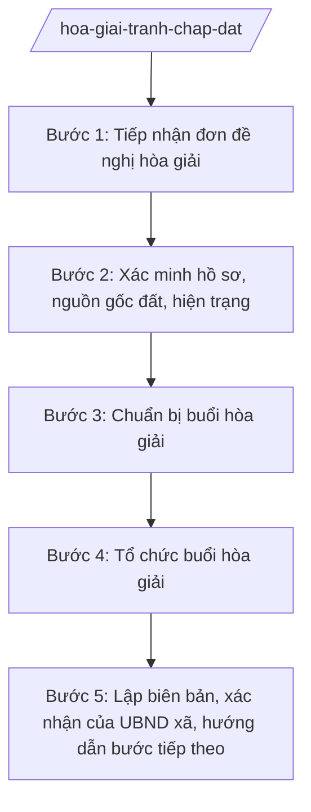

# Skill: Hòa giải tranh chấp đất đai ở cơ sở

## 2. Khi nào dùng

- Người dân nộp đơn đề nghị hòa giải tranh chấp đất đai tại UBND xã.
- Tranh chấp ranh giới, mốc giới, lối đi giữa các hộ gia đình, cá nhân sử dụng đất liền kề.
- Tranh chấp về quyền sử dụng đất chưa được cấp Giấy chứng nhận.
- Tranh chấp liên quan đến thừa kế quyền sử dụng đất giữa các thành viên gia đình.
- Tổ chức hòa giải lại đối với vụ việc đã hòa giải không thành trước đó nhưng các bên tiếp tục đề nghị (trong phạm vi xã).

## 3. Đầu vào (Input)

| Trường | Mô tả | Bắt buộc |
|--------|-------|----------|
| `ben_tranh_chap` | Họ tên các bên tranh chấp (bên đề nghị, bên liên quan) | Có |
| `noi_dung_tranh_chap` | Tóm tắt nội dung tranh chấp (ranh giới, diện tích, nguồn gốc...) | Có |
| `thong_tin_thua_dat` | Vị trí, diện tích, số thửa/tờ bản đồ của đất tranh chấp (nếu có) | Không |
| `giay_to_kem_theo` | Đơn đề nghị hòa giải và giấy tờ liên quan do các bên cung cấp | Có |
| `to_hoa_giai` | Tổ hòa giải ở thôn nơi có đất tranh chấp | Có |
| `thoi_gian_hoa_giai` | Thời gian dự kiến tổ chức buổi hòa giải | Có |
| `dia_diem_hoa_giai` | Địa điểm tổ chức (trụ sở UBND xã / nhà văn hóa thôn) | Có |
| `ngay_nop_don` | Ngày nộp đơn đề nghị hòa giải | Có |

## 4. Quy trình

**Bước 1. Tiếp nhận đơn đề nghị hòa giải**

- Làm gì: Công chức Trung tâm PVHCC xã A tiếp nhận đơn đề nghị hòa giải tranh chấp đất đai; kiểm tra tính đầy đủ của đơn và giấy tờ kèm theo; viết phiếu tiếp nhận; chuyển hồ sơ cho Phòng Kinh tế xã A (công chức địa chính) thụ lý.
- Dùng input: `ben_tranh_chap`, `noi_dung_tranh_chap`, `giay_to_kem_theo`, `ngay_nop_don`.
- Vai trò: Công chức Trung tâm PVHCC xã A tiếp nhận; AI hỗ trợ kiểm tra checklist thành phần hồ sơ, soạn phiếu tiếp nhận ⏱ ~15 phút/hồ sơ (ước tính).
- Lưu ý nghiệp vụ: Đơn phải ghi rõ họ tên, địa chỉ các bên, nội dung tranh chấp, yêu cầu hòa giải và có chữ ký của người đề nghị. Nếu đơn chưa rõ, hướng dẫn bổ sung 01 lần bằng văn bản.
- → Kết quả bước: Phiếu tiếp nhận; hồ sơ chuyển cho công chức địa chính thụ lý.

**Bước 2. Xác minh hồ sơ, nguồn gốc đất, hiện trạng**

- Làm gì: Công chức địa chính xác minh: nguồn gốc sử dụng đất của các bên, hiện trạng sử dụng, tình trạng pháp lý của thửa đất (đã cấp Giấy chứng nhận hay chưa, có đang thế chấp/kê biên không); kiểm tra thực địa ranh giới, mốc giới; thu thập ý kiến của những người liên quan nếu cần.
- Dùng input: `ben_tranh_chap`, `noi_dung_tranh_chap`, `thong_tin_thua_dat`, `giay_to_kem_theo`.
- Vai trò: Công chức địa chính – Phòng Kinh tế xã A thực hiện xác minh hồ sơ và thực địa; AI hỗ trợ tra cứu hồ sơ địa chính, tổng hợp bảng đối chiếu ý kiến/giấy tờ của các bên ⏱ ~1–2 ngày làm việc (ước tính).
- Lưu ý nghiệp vụ: Xác minh khách quan, không thiên vị bên nào; mọi giấy tờ do các bên cung cấp phải được đối chiếu với hồ sơ địa chính lưu tại xã. Kết quả xác minh là cơ sở để tổ hòa giải định hướng, không phải để kết luận đúng/sai thay cơ quan có thẩm quyền.
- → Kết quả bước: Báo cáo xác minh (nguồn gốc, hiện trạng, giấy tờ các bên) + biên bản kiểm tra thực địa.

**Bước 3. Chuẩn bị buổi hòa giải**

- Làm gì: Soạn giấy mời các bên tranh chấp, tổ hòa giải ở thôn, người có liên quan; chuẩn bị hồ sơ vụ việc (báo cáo xác minh, sơ đồ thửa đất, căn cứ pháp lý liên quan); dự thảo chương trình, nội dung định hướng buổi hòa giải.
- Dùng input: `ben_tranh_chap`, `to_hoa_giai`, `thoi_gian_hoa_giai`, `dia_diem_hoa_giai` + kết quả Bước 2.
- Vai trò: Công chức địa chính chuẩn bị; AI hỗ trợ tra cứu căn cứ pháp lý liên quan, soạn giấy mời, dự thảo chương trình và gợi ý các phương án thỏa thuận để tổ hòa giải tham khảo ⏱ ~0,5 ngày (ước tính).
- Lưu ý nghiệp vụ: Giấy mời phải gửi đến các bên đủ thời gian chuẩn bị theo quy định; AI chỉ hỗ trợ chuẩn bị hồ sơ, tra cứu căn cứ, dự thảo văn bản — tuyệt đối không đứng ra hòa giải, không áp đặt phương án thỏa thuận thay con người.
- → Kết quả bước: Giấy mời đã phát hành; hồ sơ vụ việc + dự thảo chương trình buổi hòa giải.

**Bước 4. Tổ chức buổi hòa giải**

- Làm gì: Tổ chức buổi hòa giải tại thời gian, địa điểm đã thông báo: tổ hòa giải chủ trì, các bên trình bày ý kiến, đối thoại, thương lượng; công chức địa chính ghi chép diễn biến đầy đủ, trung thực.
- Dùng input: hồ sơ vụ việc, dự thảo chương trình (từ Bước 3).
- Vai trò: Tổ hòa giải ở thôn + đại diện UBND xã (công chức địa chính) chủ trì, điều hành buổi hòa giải — con người thực hiện trực tiếp; AI không tham gia điều hành, AI hỗ trợ: ghi chép, tổng hợp ý kiến tại chỗ nếu được yêu cầu ⏱ ~theo buổi hòa giải thực tế (ước tính).
- Lưu ý nghiệp vụ: Hòa giải trên tinh thần tự nguyện, tôn trọng ý kiến các bên; không ép buộc thỏa thuận; bảo đảm các bên được trình bày đầy đủ. Hòa giải tại UBND cấp xã là thủ tục bắt buộc trước khi các bên thực hiện bước tiếp theo theo quy định của Luật Đất đai.
- → Kết quả bước: Diễn biến buổi hòa giải được ghi chép đầy đủ; xác định được hòa giải thành hay không thành.

**Bước 5. Lập biên bản, xác nhận của UBND xã, hướng dẫn bước tiếp theo**

- Làm gì: Lập biên bản hòa giải thành hoặc hòa giải không thành: ghi rõ nội dung thỏa thuận (nếu thành) hoặc lý do không thành và ý kiến của từng bên; lấy chữ ký của các bên, tổ hòa giải, người chứng kiến; trình lãnh đạo UBND xã xác nhận; giao 01 bản cho mỗi bên, lưu hồ sơ.
- Dùng input: `ben_tranh_chap`, `to_hoa_giai` + kết quả Bước 4.
- Vai trò: Công chức địa chính dự thảo biên bản (AI hỗ trợ soạn, kiểm tra tính đầy đủ các nội dung bắt buộc); Chủ tịch hoặc Phó Chủ tịch UBND xã được phân công xác nhận ⏱ ~0,5 ngày (ước tính).
- Lưu ý nghiệp vụ: Biên bản hòa giải thành phải ghi cụ thể nội dung thỏa thuận (ranh giới, diện tích, trách nhiệm các bên, thời hạn thực hiện). Trường hợp hòa giải không thành, hướng dẫn các bên về bước tiếp theo theo quy định; không được từ chối xác nhận biên bản.
- → Kết quả bước: Biên bản hòa giải thành / không thành có đầy đủ chữ ký và xác nhận của UBND xã; hồ sơ lưu đầy đủ.

## Luồng quy trình (Workflow)

## 5. Đầu ra (Output)

- Biên bản hòa giải tranh chấp đất đai thành / không thành (có chữ ký các bên, tổ hòa giải, xác nhận của UBND xã).
- Giấy mời tham dự buổi hòa giải.
- Báo cáo xác minh nguồn gốc, hiện trạng đất tranh chấp + biên bản kiểm tra thực địa.

### Cấu trúc output chuẩn

Khung cố định của Biên bản hòa giải tranh chấp đất đai, các phần bắt buộc theo đúng thứ tự, đúng thể thức NĐ 30/2020/NĐ-CP:

1. **Quốc hiệu – tiêu ngữ** (canh giữa, phía trên cùng): CỘNG HÒA XÃ HỘI CHỦ NGHĨA VIỆT NAM / Độc lập – Tự do – Hạnh phúc
2. **Tên cơ quan** (canh trái): ỦY BAN NHÂN DÂN XÃ A
3. **Tên biên bản** (canh giữa): BIÊN BẢN HÒA GIẢI TRANH CHẤP ĐẤT ĐAI (ghi rõ: hòa giải thành / hòa giải không thành)
4. **Thời gian, địa điểm** tổ chức buổi hòa giải.
5. **Thành phần tham gia**: tổ hòa giải (họ tên, chức danh); các bên tranh chấp (họ tên, địa chỉ); người có liên quan, người chứng kiến (nếu có); đại diện UBND xã.
6. **Nội dung**: tóm tắt nội dung tranh chấp; ý kiến trình bày của từng bên; kết quả hòa giải — nếu thành: nội dung thỏa thuận cụ thể (ranh giới, diện tích, trách nhiệm, thời hạn thực hiện); nếu không thành: lý do và ý kiến của từng bên.
7. **Chữ ký**: các bên tranh chấp, tổ hòa giải, người chứng kiến, người lập biên bản (ký, ghi rõ họ tên).
8. **Xác nhận của UBND xã**: "XÁC NHẬN" / TM. ỦY BAN NHÂN DÂN / CHỦ TỊCH (hoặc Phó Chủ tịch được phân công) / họ tên người ký; đóng dấu UBND xã.
9. Phân phối: mỗi bên tranh chấp 01 bản biên bản; UBND xã lưu 01 bản kèm hồ sơ vụ việc.

> **Checklist thể thức văn bản theo NĐ 30/2020/NĐ-CP** — đối chiếu trước khi trình ký:
> 1. Quốc hiệu và Tiêu ngữ.
> 2. Tên cơ quan, tổ chức ban hành văn bản.
> 3. Số, ký hiệu của văn bản.
> 4. Địa danh và thời gian ban hành văn bản.
> 5. Tên loại và trích yếu nội dung văn bản.
> 6. Nội dung văn bản.
> 7. Chức vụ, họ tên và chữ ký của người có thẩm quyền.
> 8. Dấu, chữ ký số của cơ quan, tổ chức.
> 9. Nơi nhận (kèm Phụ lục nếu có).

## 6. Checklist nghiệm thu

1. Biên bản có đủ 8 thành phần theo đúng thứ tự mục 5, không thiếu mục nào.
2. Ghi đúng họ tên, địa chỉ các bên tranh chấp; nội dung tranh chấp tóm tắt trung thực, khớp với đơn và báo cáo xác minh.
3. Biên bản hòa giải thành ghi cụ thể nội dung thỏa thuận (ranh giới, diện tích, trách nhiệm, thời hạn thực hiện); biên bản không thành ghi rõ lý do và ý kiến từng bên.
4. Có đầy đủ chữ ký của các bên, tổ hòa giải, người chứng kiến, người lập biên bản.
5. Có xác nhận của UBND xã (Chủ tịch hoặc Phó Chủ tịch được phân công ký), đóng dấu.
6. Đã thực hiện bước xác minh nguồn gốc, hiện trạng đất trước khi tổ chức hòa giải; có báo cáo xác minh kèm hồ sơ.
7. Giấy mời được gửi đến các bên đúng thời hạn; thành phần tham dự đúng quy định.
8. Không bịa số liệu, căn cứ pháp lý; mọi thông tin về thửa đất khớp với hồ sơ địa chính.
9. Đã qua human gate: công chức địa chính xác minh → Trưởng phòng Kinh tế kiểm tra hồ sơ → lãnh đạo UBND xã xác nhận biên bản; buổi hòa giải do con người chủ trì.

## 7. Ví dụ mô phỏng

*Dữ liệu dưới đây là giả lập 100% phục vụ minh họa.*

### Input mẫu

| Trường | Giá trị |
|--------|---------|
| ben_tranh_chap | Ông Nguyễn Văn Dân (bên đề nghị) – Bà Trần Thị Dân (bên liên quan) |
| noi_dung_tranh_chap | Tranh chấp ranh giới giữa hai thửa đất liền kề, diện tích tranh chấp khoảng 50 m² |
| thong_tin_thua_dat | Thửa 60 và thửa 61, tờ bản đồ số 10, thôn 1, xã A |
| giay_to_kem_theo | Đơn đề nghị hòa giải; bản sao giấy tờ về quyền sử dụng đất của hai bên |
| to_hoa_giai | Tổ hòa giải thôn 1, xã A |
| thoi_gian_hoa_giai | 08 giờ 00 phút, ngày 12/10/2026 |
| dia_diem_hoa_giai | Nhà văn hóa thôn 1, xã A |
| ngay_nop_don | 05/10/2026 |

### Output mẫu

CỘNG HÒA XÃ HỘI CHỦ NGHĨA VIỆT NAM
Độc lập – Tự do – Hạnh phúc

ỦY BAN NHÂN DÂN XÃ A

BIÊN BẢN HÒA GIẢI TRANH CHẤP ĐẤT ĐAI
(Hòa giải thành)

Hôm nay, hồi 08 giờ 00 phút ngày 12 tháng 10 năm 2026, tại Nhà văn hóa thôn 1, xã A, chúng tôi gồm:

1. Tổ hòa giải thôn 1, xã A: ông Nguyễn Văn G – Tổ trưởng; bà Trần Thị H – Tổ viên.
2. Các bên tranh chấp:
   - Ông Nguyễn Văn Dân, địa chỉ: thôn 1, xã A (bên đề nghị);
   - Bà Trần Thị Dân, địa chỉ: thôn 1, xã A (bên liên quan).
3. Đại diện UBND xã A: ông Nguyễn Văn G – Công chức địa chính, Phòng Kinh tế xã A.

Nội dung tranh chấp: ranh giới giữa thửa đất số 60 (ông Nguyễn Văn Dân sử dụng) và thửa đất số 61 (bà Trần Thị Dân sử dụng), tờ bản đồ số 10, thôn 1, xã A; diện tích tranh chấp khoảng 50 m².

Ý kiến các bên: sau khi trình bày và đối thoại, hai bên thống nhất xác định ranh giới theo mốc giới hiện trạng đã được công chức địa chính kiểm tra thực địa ngày 08/10/2026; phần diện tích 50 m² tranh chấp được xác định thuộc thửa đất số 60 của ông Nguyễn Văn Dân; bà Trần Thị Dân đồng ý không khiếu nại về ranh giới này.

Kết quả: hòa giải thành. Các bên cam kết thực hiện đúng nội dung thỏa thuận trên; mọi chi phí cắm mốc ranh giới do hai bên cùng chịu.

Biên bản được lập thành 03 bản có giá trị như nhau, mỗi bên giữ 01 bản, UBND xã A lưu 01 bản.

Các bên ký tên:

Ông Nguyễn Văn Dân			Bà Trần Thị Dân

Tổ hòa giải:				Người lập biên bản:
Nguyễn Văn G – Trần Thị H		Nguyễn Văn G

XÁC NHẬN
TM. ỦY BAN NHÂN DÂN
KT. CHỦ TỊCH
PHÓ CHỦ TỊCH

Trần Thị B

## 8. Human gate

- **Công chức địa chính – Phòng Kinh tế xã A** → xác minh nguồn gốc, hiện trạng đất; chuẩn bị hồ sơ, dự thảo biên bản; chịu trách nhiệm về tính chính xác của thông tin thửa đất.
- **Trưởng phòng Kinh tế xã A (Bà Hoàng Thị D)** → kiểm tra hồ sơ vụ việc và dự thảo biên bản trước buổi hòa giải và trước khi trình xác nhận.
- **Tổ hòa giải ở thôn + đại diện UBND xã** → trực tiếp chủ trì, điều hành buổi hòa giải (con người thực hiện, AI không thay thế).
- **Chủ tịch / Phó Chủ tịch UBND xã được phân công** → xác nhận biên bản hòa giải.

## 9. Giới hạn

- AI KHÔNG đứng ra hòa giải thay con người; chỉ hỗ trợ chuẩn bị hồ sơ, tra cứu căn cứ, dự thảo biên bản.
- AI KHÔNG ép buộc, áp đặt phương án thỏa thuận với các bên tranh chấp.
- AI KHÔNG kết luận đúng/sai về quyền sử dụng đất thay cơ quan có thẩm quyền.
- AI KHÔNG bịa số liệu diện tích, thông tin thửa đất, căn cứ pháp lý; mọi thông tin phải đối chiếu hồ sơ địa chính.
- AI KHÔNG viện dẫn văn bản đã hết hiệu lực.

## 10. Căn cứ & lưu ý

- Luật Đất đai: hòa giải tranh chấp đất đai tại UBND cấp xã là thủ tục bắt buộc trước khi các bên thực hiện bước tiếp theo (chỉ nêu tên luật, không kèm số hiệu).
- NĐ 151/2025/NĐ-CP: phân định thẩm quyền CQĐP 2 cấp, phân quyền, phân cấp trong lĩnh vực đất đai — căn cứ xác định vai trò, trách nhiệm của UBND cấp xã trong hòa giải tranh chấp đất đai.
- NĐ 30/2020/NĐ-CP: thể thức, kỹ thuật trình bày biên bản hành chính.
- Lưu ý: Phòng Kinh tế xã A là đầu mối tham mưu lĩnh vực đất đai (NĐ 150/2025/NĐ-CP); khi xã tổ chức khác khung chuẩn, đối chiếu bảng mapping lĩnh vực → đầu mối trong khung-phong-ban-cap-xa.md.
