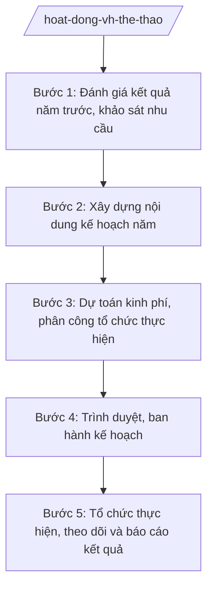

# Skill: Tổ chức hoạt động văn hóa, thể thao cơ sở

## 2. Khi nào dùng

- Lập kế hoạch hoạt động văn hóa – thể thao (VH-TT) cơ sở hằng năm của xã.
- Xây dựng đời sống văn hóa cơ sở: phong trào "Toàn dân đoàn kết xây dựng đời sống văn hóa", bình xét công nhận gia đình văn hóa, thôn văn hóa.
- Phát triển thể dục thể thao quần chúng: duy trì câu lạc bộ TDTT, tổ chức giải thể thao, ngày hội văn hóa – thể thao.
- Tổ chức hội thi, hội diễn văn nghệ, hội thi thể thao chào mừng các ngày lễ lớn trong năm.
- Báo cáo kết quả hoạt động VH-TT cơ sở gửi Sở VHTTDL tỉnh A và UBND xã.

## 3. Đầu vào (Input)

| Trường | Mô tả | Bắt buộc |
|--------|-------|----------|
| `nam_ke_hoach` | Năm lập kế hoạch (vd: 2027) | Có |
| `ket_qua_nam_truoc` | Kết quả hoạt động VH-TT năm trước: số sự kiện đã tổ chức, số gia đình/thôn văn hóa, số CLB TDTT | Có |
| `so_lieu_hien_trang` | Số thôn, số hộ dân; số nhà văn hóa thôn, sân thể thao, thiết chế văn hóa hiện có | Có |
| `su_kien_du_kien` | Danh mục hội thi, hội diễn, giải thể thao dự kiến (tên, thời gian, quy mô, đối tượng) | Có |
| `ngay_le_lon` | Các ngày lễ, kỷ niệm lớn trong năm cần tổ chức hoạt động chào mừng | Không |
| `du_toan_kinh_phi` | Dự toán kinh phí từ ngân sách xã và nguồn xã hội hóa | Không |
| `don_vi_phoi_hop` | MTTQ, các đoàn thể (Đoàn Thanh niên, Hội Phụ nữ, Hội Nông dân, Hội Cựu chiến binh...) | Không |
| `thoi_han` | Thời hạn ban hành kế hoạch năm | Có |

## 4. Quy trình

**Bước 1. Đánh giá kết quả năm trước, khảo sát nhu cầu**

- Làm gì: Tổng hợp, đánh giá kết quả hoạt động VH-TT năm trước (sự kiện, phong trào, gia đình/thôn văn hóa, CLB TDTT); khảo sát nhu cầu văn hóa, thể thao của người dân các thôn để làm cơ sở xây dựng kế hoạch năm mới.
- Dùng input: `ket_qua_nam_truoc`, `so_lieu_hien_trang`, `thoi_han`.
- Vai trò: Công chức VH-XH phụ trách văn hóa – thể thao (bà Trần Thị H) chủ trì tổng hợp, phối hợp trưởng thôn nắm nhu cầu. AI hỗ trợ: tổng hợp số liệu năm trước thành bảng đánh giá, thiết kế phiếu khảo sát nhu cầu ngắn gọn, phân tích kết quả khảo sát. ⏱ 5–7 ngày (ước tính) làm việc.
- Lưu ý nghiệp vụ: Đánh giá phải chỉ rõ mặt được, hạn chế và nguyên nhân; nhu cầu của người dân là căn cứ quan trọng để lựa chọn nội dung hoạt động, tránh tổ chức hình thức.
- → Kết quả bước: Báo cáo đánh giá kết quả năm trước + tổng hợp nhu cầu VH-TT của người dân.

**Bước 2. Xây dựng nội dung kế hoạch năm**

- Làm gì: Dự thảo Kế hoạch hoạt động VH-TT cơ sở năm gồm: phong trào xây dựng đời sống văn hóa (gia đình văn hóa, thôn văn hóa); phong trào TDTT quần chúng (CLB, giải thể thao); hội thi, hội diễn văn nghệ; hoạt động chào mừng ngày lễ lớn; lịch triển khai theo từng quý.
- Dùng input: `nam_ke_hoach`, `su_kien_du_kien`, `ngay_le_lon`, `don_vi_phoi_hop`, kết quả bước 1.
- Vai trò: Công chức VH-XH phụ trách văn hóa – thể thao soạn dự thảo, xin ý kiến MTTQ và các đoàn thể về nội dung phối hợp. AI hỗ trợ: soạn dự thảo kế hoạch theo thể thức NĐ 30/2020/NĐ-CP, sắp xếp lịch sự kiện theo quý tránh trùng lặp, lập bảng phân công phối hợp. ⏱ 3–4 ngày (ước tính) làm việc.
- Lưu ý nghiệp vụ: Nội dung phải bám 15 nhiệm vụ ngành VHTTDL giao cấp xã (TT 10/2025/TT-BVHTTDL); mỗi sự kiện ghi rõ mục đích, đối tượng, quy mô, thời gian, địa điểm, đơn vị chủ trì/phối hợp.
- → Kết quả bước: Dự thảo Kế hoạch hoạt động VH-TT cơ sở năm + phụ lục lịch sự kiện theo quý.

**Bước 3. Dự toán kinh phí, phân công tổ chức thực hiện**

- Làm gì: Lập dự toán kinh phí chi tiết từng hoạt động (ngân sách xã, xã hội hóa); phân công nhiệm vụ cụ thể cho Phòng VH-XH, các thôn, MTTQ và đoàn thể; xây dựng tiêu chí bình xét gia đình văn hóa, thôn văn hóa năm.
- Dùng input: `du_toan_kinh_phi`, dự thảo kế hoạch ở bước 2.
- Vai trò: Công chức VH-XH phụ trách văn hóa – thể thao lập dự toán, Trưởng phòng VH-XH (ông Vũ Văn E) rà soát tính khả thi. AI hỗ trợ: lập bảng dự toán chi tiết theo từng sự kiện, kiểm tra tổng mức trong khả năng kinh phí, soạn dự thảo tiêu chí bình xét gia đình/thôn văn hóa. ⏱ 2–3 ngày (ước tính) làm việc.
- Lưu ý nghiệp vụ: Kinh phí phải tiết kiệm, hiệu quả; nguồn xã hội hóa phải công khai, tự nguyện; tiêu chí bình xét phải cụ thể, dễ áp dụng thống nhất ở các thôn.
- → Kết quả bước: Bảng dự toán kinh phí + bảng phân công tổ chức thực hiện + dự thảo tiêu chí bình xét.

**Bước 4. Trình duyệt, ban hành kế hoạch**

- Làm gì: Trình dự thảo kế hoạch qua các nấc kiểm duyệt; ký ban hành; gửi kế hoạch đến các đơn vị phối hợp, các thôn và niêm yết công khai.
- Dùng input: Dự thảo kế hoạch và phụ lục ở bước 2–3.
- Vai trò: Công chức VH-XH phụ trách văn hóa – thể thao trình; Trưởng phòng VH-XH (ông Vũ Văn E) kiểm tra nội dung, thể thức; Chủ tịch UBND xã (ông Nguyễn Văn A) ký duyệt, ban hành. AI hỗ trợ: rà soát thể thức lần cuối, lập danh sách nơi nhận, lập phiếu trình ký. ⏱ 1–2 ngày (ước tính) làm việc.
- Lưu ý nghiệp vụ: Kế hoạch năm phải ban hành trước khi triển khai quý I; gửi MTTQ và các đoàn thể để chủ động phối hợp.
- → Kết quả bước: Kế hoạch đã ký ban hành, gửi đúng nơi nhận, niêm yết công khai.

**Bước 5. Tổ chức thực hiện, theo dõi và báo cáo kết quả**

- Làm gì: Triển khai các hoạt động theo kế hoạch; theo dõi tiến độ, đôn đốc các đầu mối; tổ chức bình xét, công nhận gia đình văn hóa, thôn văn hóa cuối năm; tổng hợp báo cáo kết quả năm.
- Dùng input: Kế hoạch đã ban hành; số liệu thực hiện từng sự kiện, kết quả bình xét.
- Vai trò: Công chức VH-XH phụ trách văn hóa – thể thao theo dõi, tổng hợp; Trưởng phòng VH-XH kiểm tra báo cáo trước khi trình Chủ tịch ký. AI hỗ trợ: lập bảng theo dõi tiến độ theo quý, tổng hợp kết quả bình xét, soạn dự thảo báo cáo kết quả năm. ⏱ theo dõi xuyên năm; tổng hợp báo cáo 3–5 ngày cuối năm.
- Lưu ý nghiệp vụ: Mọi sự kiện phải có hồ sơ lưu (kế hoạch chi tiết, danh sách, ảnh, kết quả); bình xét gia đình/thôn văn hóa phải dân chủ, công khai tại thôn trước khi trình xã công nhận.
- → Kết quả bước: Báo cáo kết quả hoạt động VH-TT cơ sở năm + quyết định công nhận gia đình văn hóa, thôn văn hóa (nếu có).

## Luồng quy trình (Workflow)

## 5. Đầu ra (Output)

### Sản phẩm

1. **Kế hoạch hoạt động văn hóa – thể thao cơ sở năm** (sản phẩm chính) — văn bản hành chính đúng thể thức, kèm phụ lục: lịch sự kiện theo quý; dự toán kinh phí; bảng phân công tổ chức thực hiện.
2. Báo cáo đánh giá kết quả hoạt động VH-TT năm trước.
3. Tiêu chí bình xét gia đình văn hóa, thôn văn hóa năm.
4. Báo cáo kết quả hoạt động VH-TT cơ sở năm.

### Cấu trúc output chuẩn (Kế hoạch hoạt động văn hóa – thể thao cơ sở năm)

1. Quốc hiệu – Tiêu ngữ: CỘNG HÒA XÃ HỘI CHỦ NGHĨA VIỆT NAM / Độc lập – Tự do – Hạnh phúc. (đúng thể thức NĐ 30/2020/NĐ-CP)
2. Tên cơ quan ban hành: ỦY BAN NHÂN DÂN XÃ A.
3. Số, ký hiệu văn bản: số/KH-UBND.
4. Địa danh, ngày tháng năm ban hành: Xã A, ngày … tháng … năm ….
5. Tên loại và trích yếu nội dung: KẾ HOẠCH / Hoạt động văn hóa – thể thao cơ sở năm … trên địa bàn xã A.
6. Căn cứ ban hành: Thông tư 10/2025/TT-BVHTTDL; Nghị định 137/2025/NĐ-CP; Nghị định 138/2025/NĐ-CP (ghi rõ số hiệu, ngày ban hành).
7. Nội dung chính:
   - I. Mục đích, yêu cầu;
   - II. Nội dung hoạt động (xây dựng đời sống văn hóa cơ sở; bình xét gia đình văn hóa, thôn văn hóa; phong trào TDTT quần chúng; hội thi, hội diễn, giải thể thao; hoạt động chào mừng ngày lễ lớn);
   - III. Kinh phí thực hiện (ngân sách, xã hội hóa);
   - IV. Tổ chức thực hiện (phân công Phòng VH-XH, các thôn, MTTQ, đoàn thể; tiến độ theo quý).
8. Nơi nhận (Sở VHTTDL tỉnh A; Thường trực Đảng ủy, HĐND xã; Chủ tịch, các Phó Chủ tịch UBND xã; MTTQ và các đoàn thể xã; trưởng các thôn; lưu VT, VH-XH).
9. Chữ ký, họ tên người ký: TM. ỦY BAN NHÂN DÂN / CHỦ TỊCH / (ký, đóng dấu, ghi rõ họ tên).

## 6. Checklist nghiệm thu

- [ ] Đủ 9 phần theo Cấu trúc output chuẩn mục 4, đúng thứ tự thể thức NĐ 30/2020/NĐ-CP.
- [ ] Nội dung bao quát đủ 4 nhóm: đời sống văn hóa cơ sở; gia đình/thôn văn hóa; TDTT quần chúng; hội thi, hội diễn, giải thể thao.
- [ ] Mỗi sự kiện ghi rõ mục đích, đối tượng, quy mô, thời gian, địa điểm, đơn vị chủ trì/phối hợp.
- [ ] Lịch triển khai phân theo quý, không trùng lặp thời gian giữa các sự kiện lớn.
- [ ] Dự toán kinh phí chi tiết, trong khả năng nguồn lực; nguồn xã hội hóa ghi rõ nguyên tắc tự nguyện, công khai.
- [ ] Căn cứ pháp lý ghi đúng số hiệu Thông tư 10/2025/TT-BVHTTDL, NĐ 137/2025/NĐ-CP, NĐ 138/2025/NĐ-CP.
- [ ] Phân công tổ chức thực hiện cụ thể đến từng đầu mối.
- [ ] Số/ký hiệu, ngày tháng, nơi nhận, chữ ký đầy đủ; không sai tên đơn vị/cá nhân.
- [ ] Đã qua đủ 3 nấc human gate: công chức soạn → Trưởng phòng kiểm tra → Chủ tịch ký duyệt.

## 7. Ví dụ mô phỏng

*Dữ liệu dưới đây là giả lập 100% phục vụ minh họa.*

**Input mẫu:**

| Trường | Giá trị mẫu |
|--------|-------------|
| nam_ke_hoach | 2027 |
| ket_qua_nam_truoc | 12 sự kiện; 800 gia đình văn hóa; 2/3 thôn văn hóa; 5 CLB TDTT |
| so_lieu_hien_trang | 3 thôn, 1.000 hộ dân; 3 nhà văn hóa thôn; 2 sân thể thao |
| su_kien_du_kien | Hội diễn văn nghệ quần chúng (quý I); Giải bóng đá xã (quý II); Ngày hội văn hóa – thể thao (quý III); Hội thi gia đình văn hóa tiêu biểu (quý IV) |
| ngay_le_lon | 30/4, 19/5, 2/9, ngày thành lập xã |
| du_toan_kinh_phi | Ngân sách xã: 200 triệu đồng; xã hội hóa: 100 triệu đồng |
| don_vi_phoi_hop | MTTQ xã, Đoàn Thanh niên, Hội Phụ nữ, Hội Nông dân |
| thoi_han | 15/12/2026 |

**Output mẫu:**

CỘNG HÒA XÃ HỘI CHỦ NGHĨA VIỆT NAM
Độc lập – Tự do – Hạnh phúc
---------------

ỦY BAN NHÂN DÂN XÃ A

Số: 46/KH-UBND

Xã A, ngày 10 tháng 12 năm 2026

**KẾ HOẠCH**
**Hoạt động văn hóa – thể thao cơ sở năm 2027 trên địa bàn xã A**

*Căn cứ* Thông tư số 10/2025/TT-BVHTTDL ngày 19/6/2025 của Bộ Văn hóa, Thể thao và Du lịch hướng dẫn chức năng, nhiệm vụ, quyền hạn của Sở Văn hóa, Thể thao và Du lịch và Phòng Văn hóa – Xã hội; Nghị định số 137/2025/NĐ-CP ngày 12/6/2025 về phân định thẩm quyền của chính quyền địa phương 02 cấp trong lĩnh vực văn hóa, thể thao và du lịch; Nghị định số 138/2025/NĐ-CP ngày 12/6/2025 về phân quyền, phân cấp trong lĩnh vực văn hóa, thể thao và du lịch;

UBND xã A ban hành Kế hoạch hoạt động văn hóa – thể thao cơ sở năm 2027 như sau:

**I. MỤC ĐÍCH, YÊU CẦU**

Nâng cao đời sống văn hóa tinh thần, sức khỏe người dân; xây dựng nếp sống văn minh; các hoạt động tổ chức thiết thực, tiết kiệm, an toàn.

**II. NỘI DUNG HOẠT ĐỘNG**

1. Xây dựng đời sống văn hóa cơ sở: phát động phong trào "Toàn dân đoàn kết xây dựng đời sống văn hóa"; duy trì 3 nhà văn hóa thôn hoạt động nền nếp.
2. Bình xét gia đình văn hóa, thôn văn hóa năm 2027 theo tiêu chí kèm theo (phấn đấu 850 gia đình văn hóa, 3/3 thôn văn hóa).
3. Phong trào TDTT quần chúng: duy trì 5 câu lạc bộ TDTT; phát triển thêm 2 CLB bóng chuyền hơi, cầu lông.
4. Hội thi, hội diễn, giải thể thao: Hội diễn văn nghệ quần chúng (quý I); Giải bóng đá xã chào mừng 30/4 (quý II); Ngày hội văn hóa – thể thao (quý III); Hội thi gia đình văn hóa tiêu biểu (quý IV).
5. Hoạt động chào mừng các ngày lễ lớn: 30/4, 19/5, 2/9 và ngày thành lập xã.

**III. KINH PHÍ THỰC HIỆN**

Tổng 300 triệu đồng, trong đó ngân sách xã 200 triệu đồng, xã hội hóa 100 triệu đồng (tự nguyện, công khai); chi tiết từng hoạt động tại phụ lục kèm theo.

**IV. TỔ CHỨC THỰC HIỆN**

1. Phòng Văn hóa – Xã hội chủ trì, xây dựng kế hoạch chi tiết từng sự kiện, theo dõi tiến độ theo quý.
2. MTTQ và các đoàn thể xã phối hợp vận động hội viên, đoàn viên tham gia.
3. Trưởng các thôn tổ chức bình xét gia đình văn hóa tại thôn, gửi kết quả về Phòng VH-XH trước 30/11/2027.

Trên đây là Kế hoạch hoạt động văn hóa – thể thao cơ sở năm 2027 của UBND xã A./.

***Nơi nhận:***
- Sở VHTTDL tỉnh A;
- Thường trực Đảng ủy xã;
- Thường trực HĐND xã;
- Chủ tịch, các Phó Chủ tịch UBND xã;
- MTTQ và các đoàn thể xã;
- Trưởng các thôn 1, 2, 3;
- Lưu: VT, VH-XH.

**TM. ỦY BAN NHÂN DÂN**
**CHỦ TỊCH**

*(Ký, đóng dấu)*

**Nguyễn Văn A**

## 8. Human gate (người kiểm duyệt)

- Công chức VH-XH phụ trách văn hóa – thể thao (bà Trần Thị H) soạn dự thảo kế hoạch, chịu trách nhiệm về nội dung, lịch sự kiện, dự toán.
- Trưởng phòng Văn hóa – Xã hội (ông Vũ Văn E) kiểm tra nội dung, thể thức ở bước 4; trả lại sửa nếu chưa đạt.
- Chủ tịch UBND xã (ông Nguyễn Văn A) ký duyệt, ban hành kế hoạch ở bước 4. Kế hoạch chỉ có hiệu lực sau khi Chủ tịch ký.

## 9. Giới hạn (guardrails)

- AI KHÔNG quyết định công nhận gia đình văn hóa, thôn văn hóa thay quy trình bình xét dân chủ ở thôn và quyết định của UBND xã.
- AI không tự ký, đóng dấu, phát hành kế hoạch dưới danh nghĩa UBND xã.
- AI không bịa số liệu phong trào, kết quả bình xét, kinh phí xã hội hóa.
- AI không bịa căn cứ pháp lý, số hiệu văn bản; không viện dẫn văn bản đã hết hiệu lực (không dùng TT 08/2021/TT-BVHTTDL đã bị TT 10/2025/TT-BVHTTDL thay thế).
- AI không đề xuất hoạt động văn hóa, thể thao trái thuần phong mỹ tục, gây mất an ninh trật tự.

## 10. Căn cứ & lưu ý

- Thông tư 10/2025/TT-BVHTTDL ngày 19/6/2025 (hiệu lực 01/7/2025) của Bộ VHTTDL — hướng dẫn chức năng, nhiệm vụ của Phòng Văn hóa – Xã hội trong các lĩnh vực thuộc phạm vi quản lý của Bộ (thay thế TT 08/2021/TT-BVHTTDL); chính quyền cấp xã được giao 15 nhiệm vụ ngành VHTTDL.
- Nghị định 137/2025/NĐ-CP ngày 12/6/2025 — phân định thẩm quyền của chính quyền địa phương 02 cấp trong lĩnh vực văn hóa, thể thao và du lịch.
- Nghị định 138/2025/NĐ-CP ngày 12/6/2025 — phân quyền, phân cấp trong lĩnh vực văn hóa, thể thao và du lịch.
- Nghị định 150/2025/NĐ-CP ngày 12/6/2025 (hiệu lực 16/6/2025) — tổ chức Phòng Văn hóa – Xã hội thuộc UBND cấp xã.
- Nghị định 370/2025/NĐ-CP ngày 31/12/2025 (hiệu lực 01/01/2026) — sửa đổi, bổ sung NĐ 150/2025/NĐ-CP.
- Nghị định 30/2020/NĐ-CP — thể thức văn bản hành chính.
- Lưu ý: bình xét gia đình văn hóa, thôn văn hóa thực hiện dân chủ, công khai tại thôn; xã công nhận trên cơ sở kết quả bình xét.
