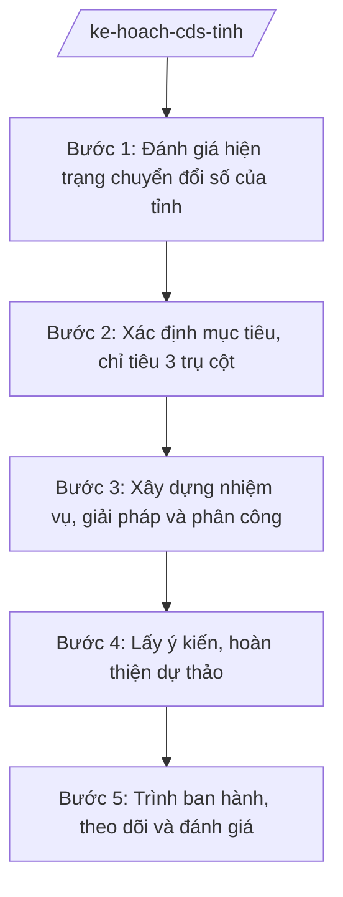

# Skill: Kế hoạch chuyển đổi số cấp tỉnh

## 2. Khi nào dùng
- Xây dựng kế hoạch chuyển đổi số của tỉnh hằng năm hoặc theo giai đoạn.
- Xác định chỉ tiêu chính quyền số, kinh tế số, xã hội số của tỉnh.
- Phân công nhiệm vụ CĐS cho các sở, ban, ngành và UBND xã.
- Đánh giá kết quả CĐS năm, chấm điểm chỉ số CĐS của tỉnh.
- Báo cáo công tác chuyển đổi số gửi Bộ KH&CN và UBND tỉnh.

## 3. Đầu vào (Input)
| Trường | Mô tả | Bắt buộc |
|--------|-------|----------|
| `nam_ke_hoach` | Năm/giai đoạn lập kế hoạch chuyển đổi số | Có |
| `hien_trang_cds` | Hiện trạng CĐS của tỉnh: hạ tầng số, nhân lực số, dịch vụ công trực tuyến, dữ liệu số | Có |
| `chi_tieu_trung_uong` | Chỉ tiêu, định hướng chuyển đổi số của Trung ương giao cho địa phương | Không |
| `de_xuat_so_nganh` | Đề xuất nhiệm vụ CĐS của các sở, ban, ngành, UBND xã | Có |
| `kinh_phi_du_kien` | Kinh phí dự kiến thực hiện kế hoạch (ngân sách + nguồn khác) | Có |
| `nguoi_ky` | Người ký ban hành (Chủ tịch UBND tỉnh đối với kế hoạch của UBND tỉnh) | Có |

## 4. Quy trình

**Bước 1. Đánh giá hiện trạng chuyển đổi số của tỉnh**
- Làm gì: Thu thập, đánh giá hiện trạng 3 trụ cột: chính quyền số (hạ tầng, DVC trực tuyến, dữ liệu), kinh tế số (doanh nghiệp công nghệ số, thương mại điện tử), xã hội số (người dân dùng dịch vụ số, kỹ năng số).
- Dùng input: `hien_trang_cds`, `chi_tieu_trung_uong`, `nam_ke_hoach`.
- Vai trò: Chuyên viên Phòng Chuyển đổi số (hoặc phòng CNTT) tổng hợp số liệu từ các sở, ngành, xã; AI hỗ trợ lập bảng đánh giá hiện trạng theo 3 trụ cột, so sánh với chỉ tiêu Trung ương ⏱ ~5 ngày làm việc (ước tính)
- Lưu ý nghiệp vụ: Số liệu phải có nguồn rõ ràng (báo cáo sở ngành, hệ thống giám sát); đánh giá thẳng thắn tồn tại (vùng lõm sóng, tỷ lệ DVC toàn trình thấp...).
- → Kết quả bước: Báo cáo đánh giá hiện trạng chuyển đổi số của tỉnh.

**Bước 2. Xác định mục tiêu, chỉ tiêu 3 trụ cột**
- Làm gì: Xác định mục tiêu tổng quát và chỉ tiêu cụ thể cho chính quyền số, kinh tế số, xã hội số (tỷ lệ DVC toàn trình, tỷ lệ hồ sơ trực tuyến, tỷ lệ dân số có kỹ năng số...).
- Dùng input: Báo cáo hiện trạng ở Bước 1, `chi_tieu_trung_uong`.
- Vai trò: Trưởng phòng Chuyển đổi số đề xuất chỉ tiêu; Phó Giám đốc Sở xem xét; AI hỗ trợ rà soát tính khả thi của chỉ tiêu so với hiện trạng và nguồn lực ⏱ ~3 ngày làm việc (ước tính)
- Lưu ý nghiệp vụ: Chỉ tiêu phải đo được, có cơ sở, không đặt quá cao so với nguồn lực; bám chỉ tiêu Trung ương giao nhưng phù hợp điều kiện tỉnh.
- → Kết quả bước: Bảng mục tiêu, chỉ tiêu chuyển đổi số của tỉnh (3 trụ cột).

**Bước 3. Xây dựng nhiệm vụ, giải pháp và phân công**
- Làm gì: Xây dựng nhiệm vụ, giải pháp cụ thể cho từng trụ cột; phân công đơn vị chủ trì, phối hợp, thời gian hoàn thành, kinh phí từng nhiệm vụ.
- Dùng input: `de_xuat_so_nganh`, `kinh_phi_du_kien`, bảng chỉ tiêu ở Bước 2.
- Vai trò: Chuyên viên soạn thảo; Trưởng phòng kiểm tra; AI hỗ trợ lập bảng phân công nhiệm vụ, dự toán kinh phí theo từng nhiệm vụ ⏱ ~5 ngày làm việc (ước tính)
- Lưu ý nghiệp vụ: Mỗi chỉ tiêu phải có ít nhất một nhiệm vụ tương ứng; nhiệm vụ cụ thể, có đầu mối chịu trách nhiệm; kinh phí rõ nguồn.
- → Kết quả bước: Dự thảo kế hoạch chuyển đổi số (nhiệm vụ, phân công, kinh phí).

**Bước 4. Lấy ý kiến, hoàn thiện dự thảo**
- Làm gì: Gửi dự thảo lấy ý kiến các sở, ban, ngành, UBND xã; tổng hợp, tiếp thu, giải trình ý kiến; hoàn thiện dự thảo kế hoạch.
- Dùng input: Dự thảo kế hoạch ở Bước 3.
- Vai trò: Chuyên viên tổng hợp ý kiến; Trưởng phòng rà soát tiếp thu; AI hỗ trợ tổng hợp ý kiến góp ý, soạn bảng tiếp thu – giải trình ⏱ ~5 ngày làm việc (ước tính)
- Lưu ý nghiệp vụ: Ý kiến không tiếp thu phải giải trình rõ lý do; bảo đảm sự đồng thuận của các đơn vị được phân công nhiệm vụ.
- → Kết quả bước: Dự thảo kế hoạch chuyển đổi số hoàn chỉnh + bảng tiếp thu ý kiến.

**Bước 5. Trình ban hành, theo dõi và đánh giá**
- Làm gì: Lập Tờ trình trình UBND tỉnh ban hành kế hoạch; theo dõi tiến độ hằng quý; cuối năm đánh giá kết quả, chấm điểm chỉ số CĐS; báo cáo Bộ KH&CN.
- Dùng input: Dự thảo hoàn chỉnh, `nguoi_ky`.
- Vai trò: Giám đốc Sở ký Tờ trình; Chủ tịch UBND tỉnh ký ban hành kế hoạch; chuyên viên theo dõi quý; AI hỗ trợ lập bảng theo dõi tiến độ, soạn báo cáo đánh giá năm ⏱ ~3 ngày làm việc (soạn trình) (ước tính)
- Lưu ý nghiệp vụ: Kế hoạch CĐS là văn bản của UBND tỉnh, đúng thể thức NĐ 30/2020/NĐ-CP; theo dõi quý để kịp thời đôn đốc đơn vị chậm tiến độ.
- → Kết quả bước: Kế hoạch chuyển đổi số của UBND tỉnh đã ban hành + báo cáo đánh giá kết quả năm.

## Luồng quy trình (Workflow)

## 5. Đầu ra (Output)
- Kế hoạch chuyển đổi số của UBND tỉnh (hằng năm/giai đoạn).
- Bảng mục tiêu, chỉ tiêu 3 trụ cột: chính quyền số, kinh tế số, xã hội số.
- Báo cáo đánh giá kết quả chuyển đổi số năm.

**Cấu trúc output chuẩn:**
Khung Kế hoạch chuyển đổi số của UBND tỉnh (theo NĐ 30/2020/NĐ-CP):
1. Quốc hiệu "CỘNG HÒA XÃ HỘI CHỦ NGHĨA VIỆT NAM", Tiêu ngữ "Độc lập – Tự do – Hạnh phúc".
2. Số, ký hiệu văn bản: số 1234/KH-UBND.
3. Địa danh và ngày, tháng, năm: "Tỉnh A, ngày ... tháng ... năm ...".
4. Tên loại và trích yếu: "KẾ HOẠCH / Chuyển đổi số tỉnh A năm ... (giai đoạn ...)".
5. Căn cứ: TT 10/2025/TT-BKHCN; NĐ 132/2025/NĐ-CP; NĐ 150/2025/NĐ-CP; định hướng chuyển đổi số của Trung ương; Tờ trình của Giám đốc Sở KH&CN.
6. Nội dung bắt buộc: I. Mục đích, yêu cầu; II. Đánh giá khái quát hiện trạng; III. Mục tiêu, chỉ tiêu (1. Chính quyền số; 2. Kinh tế số; 3. Xã hội số); IV. Nhiệm vụ, giải pháp trọng tâm; V. Kinh phí thực hiện; VI. Tổ chức thực hiện (phân công sở, ngành, UBND xã; chế độ báo cáo).
7. Nơi nhận: Bộ KH&CN; Thường trực Tỉnh ủy; HĐND tỉnh; các sở, ban, ngành; UBND các xã; lưu VT.
8. Chữ ký: "TM. ỦY BAN NHÂN DÂN / CHỦ TỊCH" + họ tên Phạm Văn P, đóng dấu.

## 6. Checklist nghiệm thu
- [ ] Đánh giá hiện trạng đầy đủ 3 trụ cột, số liệu có nguồn rõ ràng.
- [ ] Chỉ tiêu đo được, khả thi, bám chỉ tiêu Trung ương và phù hợp điều kiện tỉnh.
- [ ] Mỗi chỉ tiêu có nhiệm vụ tương ứng; nhiệm vụ có đơn vị chủ trì, thời gian, kinh phí.
- [ ] Đã lấy ý kiến sở, ngành, UBND xã; ý kiến không tiếp thu được giải trình.
- [ ] Kế hoạch đúng thể thức NĐ 30/2020/NĐ-CP; do Chủ tịch UBND tỉnh ký ban hành.
- [ ] Có cơ chế theo dõi quý và đánh giá cuối năm.
- [ ] Không bịa số liệu, không trích dẫn văn bản hết hiệu lực.
- [ ] Đã qua human gate: chuyên viên soạn → Trưởng phòng kiểm tra → Phó Giám đốc/Giám đốc Sở → Chủ tịch UBND tỉnh ký.

## 7. Ví dụ mô phỏng
*Dữ liệu dưới đây là giả lập 100% phục vụ minh họa.*

### Input mẫu
- nam_ke_hoach: 2027
- hien_trang_cds: Tỷ lệ DVC trực tuyến toàn trình 45%; 80% xã có hạ tầng Internet cáp quang; 60% cán bộ xã sử dụng thành thạo phần mềm quản lý văn bản
- chi_tieu_trung_uong: Phấn đấu 80% DVC đủ điều kiện cung cấp trực tuyến toàn trình
- de_xuat_so_nganh: 25 nhiệm vụ từ các sở, ngành, UBND xã (số hóa hồ sơ, đào tạo kỹ năng số, phát triển dữ liệu...)
- kinh_phi_du_kien: 50 tỷ đồng
- nguoi_ky: Ông Phạm Văn P – Chủ tịch UBND tỉnh A

### Output mẫu
**KẾ HOẠCH** số 1234/KH-UBND
Chuyển đổi số tỉnh A năm 2027

CỘNG HÒA XÃ HỘI CHỦ NGHĨA VIỆT NAM
Độc lập – Tự do – Hạnh phúc

Tỉnh A, ngày 09 tháng 10 năm 2026

I. MỤC ĐÍCH, YÊU CẦU
Đẩy mạnh chuyển đổi số toàn diện, nâng cao chất lượng phục vụ người dân, doanh nghiệp; khắc phục tồn tại năm 2026 (tỷ lệ DVC toàn trình mới đạt 45%).

II. MỤC TIÊU, CHỈ TIÊU NĂM 2027
1. Chính quyền số: 80% DVC đủ điều kiện cung cấp trực tuyến toàn trình; 100% hồ sơ công việc xử lý trên môi trường mạng.
2. Kinh tế số: 30% doanh nghiệp nhỏ và vừa sử dụng nền tảng số; phát triển thương mại điện tử nông sản.
3. Xã hội số: 70% người dân trưởng thành có kỹ năng số cơ bản; 100% xã có điểm hỗ trợ chuyển đổi số cộng đồng.

III. NHIỆM VỤ, GIẢI PHÁP TRỌNG TÂM
1. Hoàn thiện hạ tầng số, phủ sóng các vùng lõm (Sở KH&CN chủ trì).
2. Nâng cấp DVC trực tuyến toàn trình, tích hợp Cổng DVC quốc gia.
3. Đào tạo kỹ năng số cho cán bộ xã và người dân.
4. Phát triển dữ liệu số dùng chung của tỉnh.

IV. KINH PHÍ: 50 tỷ đồng từ ngân sách tỉnh và nguồn hợp pháp khác.

V. TỔ CHỨC THỰC HIỆN
Sở KH&CN là cơ quan thường trực, theo dõi, đôn đốc; các sở, ban, ngành, UBND xã thực hiện nhiệm vụ được phân công; báo cáo tiến độ hằng quý.

Nơi nhận:
- Bộ KH&CN;
- Thường trực Tỉnh ủy, HĐND tỉnh;
- Các sở, ban, ngành; UBND các xã;
- Lưu: VT.

TM. ỦY BAN NHÂN DÂN
CHỦ TỊCH
Phạm Văn P

## 8. Human gate
Chuyên viên Phòng Chuyển đổi số soạn kế hoạch → Trưởng phòng kiểm tra → Phó Giám đốc Sở xem xét → Giám đốc Sở ký Tờ trình trình UBND tỉnh → Chủ tịch UBND tỉnh ký ban hành. Chỉ tiêu CĐS do con người quyết định trên cơ sở hiện trạng và nguồn lực; AI chỉ hỗ trợ tổng hợp số liệu, soạn thảo, theo dõi tiến độ.

## 9. Giới hạn
AI tuyệt đối KHÔNG: ra quyết định hành chính thay người có thẩm quyền; tự ký/phát hành văn bản; bịa số liệu, căn cứ pháp lý, trích dẫn; dùng văn bản hết hiệu lực. Đặc biệt: không tự đặt chỉ tiêu CĐS thay lãnh đạo tỉnh, không bịa số liệu hiện trạng và kết quả đánh giá.

## 10. Căn cứ & lưu ý
- TT 10/2025/TT-BKHCN (27/6/2025; hiệu lực 01/7/2025).
- NĐ 132/2025/NĐ-CP (12/6/2025) — phân định thẩm quyền CQĐP 2 cấp lĩnh vực quản lý nhà nước của Bộ KH&CN.
- NĐ 150/2025/NĐ-CP (12/6/2025; hiệu lực 16/6/2025); sửa đổi bởi NĐ 370/2025/NĐ-CP.
- NĐ 30/2020/NĐ-CP (thể thức văn bản hành chính).
- Lưu ý: Sở KH&CN (tiếp nhận lĩnh vực CNTT, chuyển đổi số từ Sở TTTT cũ sau sáp nhập 2025) là cơ quan thường trực tham mưu công tác chuyển đổi số của tỉnh; kế hoạch CĐS do UBND tỉnh ban hành.
