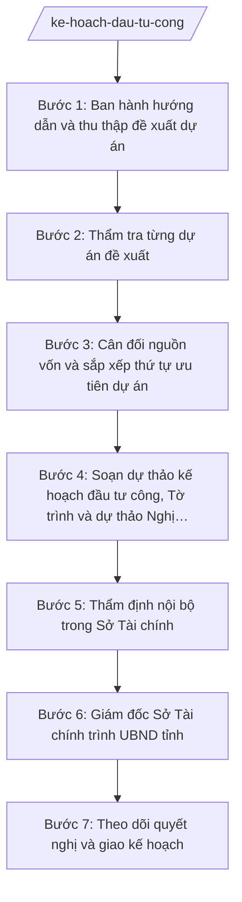

# Skill: Kế hoạch đầu tư công

## 2. Khi nào dùng

- Đến kỳ xây dựng kế hoạch đầu tư công trung hạn 5 năm hoặc kế hoạch đầu tư công hằng năm;
- Cần tổng hợp, thẩm tra danh mục dự án đầu tư công do các sở, ban, ngành, UBND cấp xã đề xuất;
- Cần cân đối nguồn vốn đầu tư công (vốn ngân sách địa phương, vốn NSTW hỗ trợ có mục tiêu...) với danh mục dự án;
- UBND tỉnh A cần Tờ trình và dự thảo Nghị quyết để trình HĐND tỉnh quyết nghị kế hoạch đầu tư công;
- Cần điều chỉnh kế hoạch đầu tư công giữa kỳ khi có biến động về nguồn vốn hoặc danh mục dự án.

## 3. Đầu vào (Input)

| Trường | Mô tả | Bắt buộc |
|--------|-------|----------|
| `ky_ke_hoach` | Kỳ kế hoạch: trung hạn 5 năm (giai đoạn) hoặc hằng năm (năm N) | Có |
| `danh_muc_du_an_de_xuat` | Danh mục dự án do các sở, ban, ngành, UBND cấp xã đề xuất, kèm hồ sơ dự án | Có |
| `nguon_von_du_kien` | Dự kiến nguồn vốn đầu tư công: vốn NSĐP, vốn NSTW hỗ trợ, vốn ODA/vốn vay (nếu có) | Có |
| `ke_hoach_ky_truoc` | Kế hoạch đầu tư công kỳ trước và kết quả thực hiện, giải ngân | Có |
| `dinh_huong_dau_tu` | Định hướng, chủ trương đầu tư của Tỉnh ủy, HĐND, UBND tỉnh cho kỳ kế hoạch | Có |
| `huong_dan_bo_tai_chinh` | Văn bản hướng dẫn xây dựng kế hoạch đầu tư công của Bộ Tài chính | Có |
| `du_an_chuyen_tiep` | Danh mục dự án chuyển tiếp từ kỳ trước (đang thi công dở dang) | Không |

## 4. Quy trình

**Bước 1. Ban hành hướng dẫn và thu thập đề xuất dự án**
- Làm gì: Soạn văn bản hướng dẫn các sở, ban, ngành, UBND cấp xã đề xuất danh mục dự án đầu tư công cho kỳ kế hoạch (tiêu chí, biểu mẫu, thời hạn); tiếp nhận, đăng ký đầy đủ hồ sơ đề xuất, lập danh sách theo dõi.
- Dùng input: `ky_ke_hoach`, `huong_dan_bo_tai_chinh`, `dinh_huong_dau_tu`, `ke_hoach_ky_truoc`.
- Vai trò: Chuyên viên Phòng Đầu tư (Sở Tài chính) soạn thảo, AI hỗ trợ dựng khung văn bản hướng dẫn và bảng theo dõi tiến độ nộp đề xuất; ⏱ ~2–3 ngày làm việc (ước tính).
- Lưu ý nghiệp vụ: Tiêu chí đề xuất phải bám sát định hướng đầu tư của tỉnh; yêu cầu hồ sơ dự án kèm quyết định chủ trương đầu tư (đối với dự án phải có) theo quy định.
- → Kết quả bước: Văn bản hướng dẫn đã ban hành + danh sách đề xuất dự án của các đơn vị.

**Bước 2. Thẩm tra từng dự án đề xuất**
- Làm gì: Rà soát từng dự án: sự cần thiết đầu tư, quy mô, tổng mức đầu tư, nguồn vốn, tính khả thi, hiệu quả kinh tế – xã hội, sự phù hợp với quy hoạch; loại bỏ hoặc yêu cầu hoàn thiện các dự án chưa đủ điều kiện; lập phiếu thẩm tra từng dự án.
- Dùng input: `danh_muc_du_an_de_xuat`, `dinh_huong_dau_tu`.
- Vai trò: Chuyên viên Phòng Đầu tư thẩm tra, phối hợp chuyên viên các phòng liên quan; AI hỗ trợ đối chiếu dự án với quy hoạch, định hướng và cảnh báo các dự án trùng lặp, vượt khả năng cân đối vốn; ⏱ ~7–10 ngày làm việc (ước tính).
- Lưu ý nghiệp vụ: Chỉ đưa vào kế hoạch các dự án đã có chủ trương đầu tư được phê duyệt (đối với dự án thuộc diện phải có); không đưa dự án "vẽ" không có khả năng triển khai.
- → Kết quả bước: Phiếu thẩm tra từng dự án + danh mục dự án đủ điều kiện đưa vào kế hoạch.

**Bước 3. Cân đối nguồn vốn và sắp xếp thứ tự ưu tiên dự án**
- Làm gì: Tổng hợp nguồn vốn đầu tư công của kỳ kế hoạch; ưu tiên bố trí vốn cho dự án chuyển tiếp dở dang, dự án hoàn thành trong kỳ, dự án trọng điểm theo định hướng của tỉnh; phân bổ vốn theo năm (đối với kế hoạch trung hạn); lập bảng cân đối vốn – danh mục dự án.
- Dùng input: `nguon_von_du_kien`, `du_an_chuyen_tiep`, kết quả Bước 2.
- Vai trò: Chuyên viên Phòng Đầu tư phân tích, AI hỗ trợ lập bảng cân đối nhiều phương án phân bổ, cảnh báo vượt trần vốn; ⏱ ~3–5 ngày làm việc (ước tính).
- Lưu ý nghiệp vụ: Tổng mức vốn bố trí không vượt nguồn vốn dự kiến; ưu tiên dứt điểm dự án dở dang trước khi khởi công dự án mới; không bố trí vốn dàn trải.
- → Kết quả bước: Bảng cân đối nguồn vốn – danh mục dự án theo thứ tự ưu tiên (bản nháp).

**Bước 4. Soạn dự thảo kế hoạch đầu tư công, Tờ trình và dự thảo Nghị quyết**
- Làm gì: Soạn dự thảo kế hoạch đầu tư công kỳ kế hoạch (mục tiêu, nguồn vốn, danh mục dự án, giải pháp tổ chức thực hiện); soạn Tờ trình của UBND tỉnh trình HĐND tỉnh và dự thảo Nghị quyết HĐND tỉnh về kế hoạch đầu tư công, kèm danh mục dự án chi tiết.
- Dùng input: Kết quả Bước 3, `ky_ke_hoach`.
- Vai trò: Chuyên viên Phòng Đầu tư soạn thảo, AI hỗ trợ dựng khung văn bản đúng thể thức, rà soát căn cứ pháp lý, đối chiếu số liệu văn bản – danh mục; ⏱ ~3–4 ngày làm việc (ước tính).
- Lưu ý nghiệp vụ: Danh mục dự án trong Nghị quyết phải khớp tuyệt đối với bảng cân đối đã thẩm tra; căn cứ pháp lý đầy đủ, đúng văn bản còn hiệu lực.
- → Kết quả bước: Bản thảo kế hoạch đầu tư công + Tờ trình UBND tỉnh + dự thảo Nghị quyết HĐND tỉnh.

**Bước 5. Thẩm định nội bộ trong Sở Tài chính**
- Làm gì: Trưởng phòng Đầu tư và Phó Giám đốc Sở phụ trách rà soát toàn bộ hồ sơ: tính hợp pháp của căn cứ, tính khả thi của danh mục dự án, tính cân đối của nguồn vốn; yêu cầu chỉnh sửa, bổ sung nếu có sai sót.
- Dùng input: Toàn bộ kết quả Bước 4.
- Vai trò: Trưởng phòng Đầu tư, Phó Giám đốc Sở kiểm tra; AI hỗ trợ đối chiếu chéo số liệu và liệt kê điểm chưa khớp; ⏱ ~1–2 ngày làm việc (ước tính).
- Lưu ý nghiệp vụ: Đây là chốt kiểm soát nội bộ cuối trước khi trình Giám đốc Sở; mọi chênh lệch số liệu, dự án chưa đủ điều kiện phải được xử lý dứt điểm.
- → Kết quả bước: Hồ sơ kế hoạch đầu tư công đã thẩm định nội bộ.

**Bước 6. Giám đốc Sở Tài chính trình UBND tỉnh**
- Làm gì: Giám đốc Sở Tài chính (ông Hoàng Văn S) xem xét hồ sơ, ký Tờ trình của Sở trình UBND tỉnh; phối hợp Văn phòng UBND tỉnh đưa nội dung vào chương trình họp UBND tỉnh; hoàn thiện hồ sơ theo ý kiến chỉ đạo của UBND tỉnh.
- Dùng input: Hồ sơ kế hoạch đã thẩm định ở Bước 5.
- Vai trò: Giám đốc Sở Tài chính quyết định; chuyên viên hoàn thiện hồ sơ theo chỉ đạo, AI hỗ trợ cập nhật nhanh các chỉnh sửa; ⏱ ~2–3 ngày làm việc (ước tính).
- Lưu ý nghiệp vụ: AI chỉ hỗ trợ chỉnh sửa kỹ thuật theo chỉ đạo; quyết định danh mục dự án và phân bổ vốn thuộc thẩm quyền của UBND tỉnh và HĐND tỉnh.
- → Kết quả bước: Tờ trình trình UBND tỉnh đã ký, sẵn sàng trình kỳ họp HĐND tỉnh.

**Bước 7. Theo dõi quyết nghị và giao kế hoạch**
- Làm gì: Theo dõi kỳ họp HĐND tỉnh; ghi nhận Nghị quyết đã ban hành (số hiệu, danh mục dự án, mức vốn); tham mưu UBND tỉnh giao kế hoạch đầu tư công chi tiết cho các chủ đầu tư; lưu hồ sơ phục vụ theo dõi giải ngân.
- Dùng input: Nghị quyết HĐND tỉnh đã ban hành (bản chính thức sau kỳ họp).
- Vai trò: Chuyên viên Phòng Đầu tư theo dõi và cập nhật, AI hỗ trợ trích xuất danh mục dự án – mức vốn vào bảng theo dõi giải ngân; ⏱ ~1–2 ngày làm việc (ước tính).
- Lưu ý nghiệp vụ: Chỉ danh mục trong Nghị quyết đã ban hành mới có hiệu lực; phải giao kế hoạch kịp thời để chủ đầu tư triển khai từ đầu kỳ kế hoạch.
- → Kết quả bước: Nghị quyết HĐND tỉnh đã ban hành + quyết định giao kế hoạch đầu tư công chi tiết.

## Luồng quy trình (Workflow)

## 5. Đầu ra (Output)

- Văn bản hướng dẫn các đơn vị đề xuất dự án đầu tư công;
- Phiếu thẩm tra từng dự án đề xuất;
- Dự thảo kế hoạch đầu tư công (trung hạn/hằng năm);
- Tờ trình của UBND tỉnh trình HĐND tỉnh về kế hoạch đầu tư công (đã ký);
- Dự thảo Nghị quyết của HĐND tỉnh về kế hoạch đầu tư công;
- Danh mục dự án đầu tư công chi tiết kèm theo (tên dự án, chủ đầu tư, tổng mức, nguồn vốn, thời gian thực hiện);
- Nghị quyết HĐND tỉnh đã ban hành (bản chính thức — do HĐND ban hành, Sở lưu hồ sơ).

**Cấu trúc output chuẩn (Tờ trình UBND tỉnh về kế hoạch đầu tư công):**
- Thể thức: tuân thủ Nghị định 30/2020/NĐ-CP về công tác văn thư.

1. Quốc hiệu "CỘNG HÒA XÃ HỘI CHỦ NGHĨA VIỆT NAM", Tiêu ngữ "Độc lập – Tự do – Hạnh phúc";
2. Tên cơ quan ban hành: ỦY BAN NHÂN DÂN TỈNH A; số, ký hiệu văn bản; địa danh và ngày, tháng, năm ban hành;
3. Tên loại và trích yếu nội dung: TỜ TRÌNH — Về việc đề nghị HĐND tỉnh quyết nghị kế hoạch đầu tư công (trung hạn giai đoạn... / năm N);
4. Phần "Kính gửi": Hội đồng nhân dân tỉnh A;
5. Căn cứ ban hành (Luật Đầu tư công; văn bản hướng dẫn của Bộ Tài chính...);
6. Nội dung: đánh giá thực hiện kế hoạch kỳ trước; mục tiêu, nguồn vốn, danh mục dự án kỳ này; giải pháp tổ chức thực hiện; kiến nghị HĐND xem xét, quyết nghị;
7. Nơi nhận;
8. Thẩm quyền, chức vụ, họ tên người ký: TM. ỦY BAN NHÂN DÂN — CHỦ TỊCH — (chữ ký, họ tên), dấu của cơ quan.

**Cấu trúc output chuẩn (Nghị quyết HĐND tỉnh về kế hoạch đầu tư công):**

1. Quốc hiệu "CỘNG HÒA XÃ HỘI CHỦ NGHĨA VIỆT NAM", Tiêu ngữ "Độc lập – Tự do – Hạnh phúc";
2. Tên cơ quan ban hành: HỘI ĐỒNG NHÂN DÂN TỈNH A; số, ký hiệu văn bản; địa danh và ngày, tháng, năm ban hành;
3. Tên loại và trích yếu: NGHỊ QUYẾT — Về kế hoạch đầu tư công (trung hạn giai đoạn... / năm N) tỉnh A;
4. Căn cứ ban hành (Luật Tổ chức chính quyền địa phương; Luật Đầu tư công; Tờ trình của UBND tỉnh...);
5. Nội dung quyết nghị theo điều, khoản: quyết nghị mục tiêu, tổng nguồn vốn, danh mục dự án; giao UBND tỉnh tổ chức thực hiện; hiệu lực thi hành;
6. Nơi nhận;
7. Thẩm quyền, chức vụ, họ tên người ký: TM. HỘI ĐỒNG NHÂN DÂN — CHỦ TỊCH — (chữ ký, họ tên), dấu của cơ quan;
8. Danh mục dự án đầu tư công chi tiết kèm theo Nghị quyết.

## 6. Checklist nghiệm thu

- [ ] 100% đề xuất dự án của các đơn vị đã được thẩm tra, có phiếu thẩm tra;
- [ ] Chỉ dự án đủ điều kiện (có chủ trương đầu tư được phê duyệt theo quy định) được đưa vào danh mục;
- [ ] Tổng vốn bố trí không vượt nguồn vốn dự kiến; ưu tiên dự án chuyển tiếp dở dang;
- [ ] Số liệu trong Tờ trình, dự thảo Nghị quyết và danh mục dự án khớp nhau tuyệt đối;
- [ ] Có đầy đủ: văn bản hướng dẫn, phiếu thẩm tra, dự thảo kế hoạch, Tờ trình, dự thảo Nghị quyết + danh mục;
- [ ] Căn cứ pháp lý đầy đủ, đúng văn bản còn hiệu lực, không bịa số hiệu;
- [ ] Thể thức văn bản hành chính đúng quy định;
- [ ] Đã qua thẩm định nội bộ (Trưởng phòng, Phó Giám đốc, Giám đốc Sở) trước khi trình UBND tỉnh;
- [ ] Danh mục dự án do các đơn vị đề xuất và thẩm tra thực tế, AI không tự bịa thêm dự án;
- [ ] Có bảng theo dõi giải ngân sau khi giao kế hoạch.

## 7. Ví dụ mô phỏng

*Dữ liệu dưới đây là giả lập 100% phục vụ minh họa.*

### Input mẫu

| Trường | Giá trị giả lập |
|--------|-----------------|
| ky_ke_hoach | Kế hoạch đầu tư công năm 2027 |
| danh_muc_du_an_de_xuat | 50 dự án do các sở, ban, ngành và UBND cấp xã đề xuất |
| nguon_von_du_kien | Vốn NSĐP: 3.000 tỷ đồng; vốn NSTW hỗ trợ có mục tiêu: 500 tỷ đồng |
| ke_hoach_ky_truoc | Kế hoạch năm 2026: 45 dự án, tỷ lệ giải ngân 90% |
| dinh_huong_dau_tu | Ưu tiên hạ tầng giao thông, trường học, y tế cơ sở |
| huong_dan_bo_tai_chinh | Văn bản hướng dẫn xây dựng kế hoạch đầu tư công năm 2027 của Bộ Tài chính (số hiệu giả lập) |
| du_an_chuyen_tiep | 15 dự án dở dang chuyển tiếp, nhu cầu vốn 1.200 tỷ đồng |

### Output mẫu (Tờ trình — trích)

> **CỘNG HÒA XÃ HỘI CHỦ NGHĨA VIỆT NAM**
> **Độc lập – Tự do – Hạnh phúc**
>
> **ỦY BAN NHÂN DÂN TỈNH A**
> Số: 1234/TTr-UBND
> Tỉnh A, ngày 25 tháng 11 năm 2026
>
> **TỜ TRÌNH**
> **Về việc đề nghị HĐND tỉnh quyết nghị kế hoạch đầu tư công năm 2027 tỉnh A**
>
> Kính gửi: Hội đồng nhân dân tỉnh A.
>
> Căn cứ Luật Đầu tư công;
> UBND tỉnh A trình HĐND tỉnh quyết nghị kế hoạch đầu tư công năm 2027 như sau:
>
> 1. Tổng nguồn vốn đầu tư công năm 2027: 3.500 tỷ đồng (vốn NSĐP: 3.000 tỷ đồng; vốn NSTW hỗ trợ: 500 tỷ đồng)...
> 2. Danh mục: 48 dự án (15 dự án chuyển tiếp, 33 dự án khởi công mới), ưu tiên hạ tầng giao thông, trường học, y tế cơ sở...
>
> UBND tỉnh A kính trình HĐND tỉnh xem xét, quyết nghị./.
>
> ***Nơi nhận:*** ...
>
> **TM. ỦY BAN NHÂN DÂN**
> **CHỦ TỊCH**
> *(ký, đóng dấu)*
> **Phạm Văn P**

## 8. Human gate

1. Chuyên viên Phòng Đầu tư tổng hợp, thẩm tra và soạn thảo hồ sơ (Bước 1–4);
2. Trưởng phòng Đầu tư và Phó Giám đốc Sở phụ trách thẩm định nội bộ (Bước 5);
3. Giám đốc Sở Tài chính xem xét, ký Tờ trình trình UBND tỉnh (Bước 6);
4. UBND tỉnh thảo luận, trình HĐND tỉnh; HĐND tỉnh quyết nghị bằng Nghị quyết tại kỳ họp cuối năm (Bước 7) — quyết định cuối cùng thuộc thẩm quyền HĐND tỉnh.

## 9. Giới hạn

- AI KHÔNG ra quyết định về danh mục dự án hay mức phân bổ vốn thay người có thẩm quyền;
- AI KHÔNG tự ký, tự phát hành Tờ trình, Nghị quyết hay bất kỳ văn bản nào;
- AI KHÔNG bịa dự án, số liệu vốn, không tự thêm dự án không có trong đề xuất của đơn vị;
- AI KHÔNG bịa căn cứ pháp lý, không trích dẫn văn bản đã hết hiệu lực;
- AI KHÔNG thay HĐND tỉnh quyết nghị kế hoạch đầu tư công — đây là thẩm quyền riêng của HĐND tỉnh.

## 10. Căn cứ & lưu ý

- Thông tư 57/2025/TT-BTC hướng dẫn chức năng, nhiệm vụ, quyền hạn của Sở Tài chính và lĩnh vực tài chính – kế hoạch của phòng chuyên môn thuộc UBND cấp xã;
- Luật Đầu tư công; Luật Ngân sách nhà nước (chỉ nêu tên luật, không kèm số hiệu);
- Nghị định 150/2025/NĐ-CP về tổ chức cơ quan chuyên môn thuộc UBND cấp tỉnh, cấp xã;
- Nghị định 30/2020/NĐ-CP về công tác văn thư (chỉ dùng cho thể thức văn bản);
- Lưu ý: kế hoạch đầu tư công chỉ có hiệu lực sau khi HĐND tỉnh ban hành Nghị quyết quyết nghị; dự án đưa vào kế hoạch phải có chủ trương đầu tư được cấp có thẩm quyền phê duyệt theo quy định; việc thẩm định chủ trương, nguồn vốn từng dự án xem skill `tham-dinh-du-an-dau-tu`.
