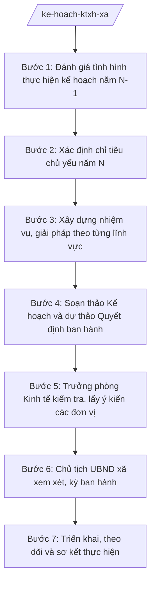

# Skill: Kế hoạch phát triển KT-XH xã hằng năm

## 2. Khi nào dùng

- Cuối năm, cần xây dựng kế hoạch phát triển kinh tế – xã hội của xã cho năm mới;
- Cần đánh giá kết quả thực hiện các chỉ tiêu kinh tế – xã hội năm cũ làm cơ sở đề ra chỉ tiêu năm mới;
- UBND xã cần ban hành kế hoạch năm kèm Quyết định để giao nhiệm vụ cho các đơn vị;
- Cần rà soát, điều chỉnh kế hoạch giữa năm khi có biến động về tình hình thực tế.

## 3. Đầu vào (Input)

| Trường | Mô tả | Bắt buộc |
|--------|-------|----------|
| `nam_ke_hoach` | Năm kế hoạch (năm N) | Có |
| `ket_qua_thuc_hien_nam_truoc` | Kết quả thực hiện các chỉ tiêu KT-XH năm N-1 (tăng trưởng, thu ngân sách, giảm nghèo, xây dựng...) | Có |
| `dinh_huong_cap_tren` | Định hướng, chỉ tiêu phát triển KT-XH của cấp tỉnh giao cho xã (nếu có) | Có |
| `de_xuat_cac_don_vi` | Đề xuất nhiệm vụ, chỉ tiêu của các đơn vị, thôn/tổ dân phố trong xã | Không |
| `nhiem_vu_trong_tam` | Các nhiệm vụ trọng tâm, công trình, dự án dự kiến triển khai năm N | Không |
| `du_thao_nam_truoc` | Kế hoạch KT-XH năm N-1 đã ban hành (để đối chiếu cấu trúc, chỉ tiêu) | Không |

## 4. Quy trình

**Bước 1. Đánh giá tình hình thực hiện kế hoạch năm N-1**
- Làm gì: Tổng hợp, đánh giá kết quả thực hiện các chỉ tiêu KT-XH năm N-1 theo từng lĩnh vực (kinh tế, tài chính – ngân sách, đất đai, xây dựng, nông nghiệp – môi trường, văn hóa – xã hội...); chỉ rõ chỉ tiêu đạt, không đạt và nguyên nhân.
- Dùng input: `ket_qua_thuc_hien_nam_truoc`, `du_thao_nam_truoc`.
- Vai trò: Công chức Phòng Kinh tế chủ trì tổng hợp, AI hỗ trợ hệ thống hóa số liệu thành bảng đánh giá đạt/không đạt; ⏱ ~2–3 ngày làm việc (ước tính).
- Lưu ý nghiệp vụ: Đánh giá phải trung thực, chỉ rõ tồn tại, hạn chế và nguyên nhân khách quan, chủ quan; đây là cơ sở để đề ra chỉ tiêu năm mới khả thi.
- → Kết quả bước: Bản đánh giá thực hiện kế hoạch KT-XH năm N-1 theo lĩnh vực.

**Bước 2. Xác định chỉ tiêu chủ yếu năm N**
- Làm gì: Trên cơ sở kết quả năm N-1 và định hướng của cấp trên, đề xuất hệ thống chỉ tiêu chủ yếu năm N (tốc độ tăng trưởng kinh tế, tổng thu ngân sách, tỷ lệ hộ nghèo giảm, chỉ tiêu xây dựng, môi trường...) bảo đảm tính khả thi và phấn đấu.
- Dùng input: `dinh_huong_cap_tren`, kết quả Bước 1, `de_xuat_cac_don_vi`.
- Vai trò: Công chức Phòng Kinh tế đề xuất, AI hỗ trợ lập bảng chỉ tiêu so sánh năm N-1 – năm N, cảnh báo chỉ tiêu thiếu căn cứ; ⏱ ~1–2 ngày làm việc (ước tính).
- Lưu ý nghiệp vụ: Chỉ tiêu phải bám định hướng cấp trên, sát thực tế của xã; không đặt chỉ tiêu "ảo" không có khả năng thực hiện.
- → Kết quả bước: Bảng chỉ tiêu phát triển KT-XH chủ yếu năm N (bản dự kiến).

**Bước 3. Xây dựng nhiệm vụ, giải pháp theo từng lĩnh vực**
- Làm gì: Xây dựng nhiệm vụ, giải pháp cụ thể theo từng lĩnh vực: tài chính – ngân sách; đất đai, tài nguyên – môi trường; xây dựng, hạ tầng; nông nghiệp; công thương, thương mại – dịch vụ; văn hóa – xã hội; quốc phòng – an ninh; cải cách hành chính.
- Dùng input: `nhiem_vu_trong_tam`, `de_xuat_cac_don_vi`, kết quả Bước 2.
- Vai trò: Công chức Phòng Kinh tế chủ trì, phối hợp các đơn vị liên quan; AI hỗ trợ soạn thảo nội dung theo từng lĩnh vực, bảo đảm logic chỉ tiêu – nhiệm vụ – giải pháp; ⏱ ~2–3 ngày làm việc (ước tính).
- Lưu ý nghiệp vụ: Mỗi nhiệm vụ phải gắn với chỉ tiêu cụ thể, có đơn vị chủ trì và thời gian thực hiện; tránh nhiệm vụ chung chung, không kiểm đếm được.
- → Kết quả bước: Dự thảo nội dung nhiệm vụ, giải pháp theo lĩnh vực.

**Bước 4. Soạn thảo Kế hoạch và dự thảo Quyết định ban hành**
- Làm gì: Soạn thảo văn bản Kế hoạch phát triển KT-XH xã năm N (gồm: đánh giá năm N-1; chỉ tiêu chủ yếu năm N; nhiệm vụ, giải pháp; tổ chức thực hiện) và dự thảo Quyết định của UBND xã ban hành kèm Kế hoạch.
- Dùng input: Kết quả Bước 1–3; `nam_ke_hoach`.
- Vai trò: Công chức Phòng Kinh tế soạn thảo, AI hỗ trợ dựng khung văn bản đúng thể thức, rà soát tính đầy đủ các phần; ⏱ ~1–2 ngày làm việc (ước tính).
- Lưu ý nghiệp vụ: Kế hoạch là phụ lục ban hành kèm Quyết định; nội dung Quyết định và Kế hoạch phải thống nhất, đúng thể thức văn bản hành chính.
- → Kết quả bước: Dự thảo Kế hoạch KT-XH năm N + dự thảo Quyết định ban hành của UBND xã.

**Bước 5. Trưởng phòng Kinh tế kiểm tra, lấy ý kiến các đơn vị**
- Làm gì: Trưởng phòng Kinh tế kiểm tra dự thảo; tổ chức lấy ý kiến các đơn vị, thôn/tổ dân phố liên quan về chỉ tiêu, nhiệm vụ được giao; tổng hợp, tiếp thu ý kiến hợp lý.
- Dùng input: Kết quả Bước 4.
- Vai trò: Trưởng phòng Kinh tế kiểm tra và chủ trì lấy ý kiến, AI hỗ trợ tổng hợp ý kiến góp ý thành bảng tiếp thu/giải trình; ⏱ ~2–3 ngày làm việc (ước tính).
- Lưu ý nghiệp vụ: Ý kiến của đơn vị trực tiếp thực hiện giúp chỉ tiêu, nhiệm vụ sát thực tế; nội dung tiếp thu phải được thể hiện rõ trong bản hoàn chỉnh.
- → Kết quả bước: Dự thảo Kế hoạch đã hoàn chỉnh sau lấy ý kiến.

**Bước 6. Chủ tịch UBND xã xem xét, ký ban hành**
- Làm gì: Chủ tịch UBND xã xem xét toàn bộ hồ sơ kế hoạch, cho ý kiến (hoặc yêu cầu hoàn thiện), sau đó ký Quyết định ban hành Kế hoạch phát triển KT-XH xã năm N.
- Dùng input: Kết quả Bước 5.
- Vai trò: Chủ tịch UBND xã quyết định ban hành; công chức Phòng Kinh tế hoàn thiện theo ý kiến chỉ đạo, AI hỗ trợ cập nhật nhanh các chỉnh sửa; ⏱ ~1–2 ngày làm việc (ước tính).
- Lưu ý nghiệp vụ: AI chỉ hỗ trợ chỉnh sửa kỹ thuật theo chỉ đạo; quyết định nội dung kế hoạch thuộc thẩm quyền của Chủ tịch UBND xã.
- → Kết quả bước: Quyết định của UBND xã ban hành kèm Kế hoạch phát triển KT-XH năm N (đã ký, đóng dấu).

**Bước 7. Triển khai, theo dõi và sơ kết thực hiện**
- Làm gì: Gửi kế hoạch đến các đơn vị, thôn/tổ dân phố để tổ chức thực hiện; theo dõi tiến độ thực hiện chỉ tiêu, nhiệm vụ; tổ chức sơ kết 6 tháng và tổng kết năm làm cơ sở cho kế hoạch năm sau.
- Dùng input: Quyết định + Kế hoạch đã ban hành.
- Vai trò: Công chức Phòng Kinh tế theo dõi, đôn đốc; AI hỗ trợ lập bảng theo dõi tiến độ chỉ tiêu theo quý; ⏱ ~thường xuyên trong năm (ước tính).
- Lưu ý nghiệp vụ: Kế hoạch chỉ có giá trị khi được tổ chức thực hiện nghiêm túc; việc theo dõi, sơ kết giúp kịp thời điều chỉnh khi có biến động.
- → Kết quả bước: Bảng theo dõi tiến độ thực hiện kế hoạch; báo cáo sơ kết, tổng kết.

## Luồng quy trình (Workflow)

## 5. Đầu ra (Output)

- Quyết định của UBND xã ban hành Kế hoạch phát triển kinh tế – xã hội xã năm N (đã ký, đóng dấu);
- Kế hoạch phát triển kinh tế – xã hội xã năm N (phụ lục kèm Quyết định), gồm: đánh giá thực hiện năm N-1; chỉ tiêu chủ yếu năm N; nhiệm vụ, giải pháp theo lĩnh vực; tổ chức thực hiện;
- Bảng theo dõi tiến độ thực hiện kế hoạch (phục vụ sơ kết, tổng kết).

### Cấu trúc output chuẩn (Quyết định ban hành Kế hoạch)

1. Quốc hiệu "CỘNG HÒA XÃ HỘI CHỦ NGHĨA VIỆT NAM" – Tiêu ngữ "Độc lập – Tự do – Hạnh phúc"; (đúng thể thức NĐ 30/2020/NĐ-CP)
2. Tên cơ quan ban hành: ỦY BAN NHÂN DÂN XÃ A; số, ký hiệu văn bản; địa danh và ngày, tháng, năm ban hành;
3. Tên loại và trích yếu: QUYẾT ĐỊNH — Ban hành Kế hoạch phát triển kinh tế – xã hội xã A năm N;
4. Căn cứ ban hành (Luật Tổ chức chính quyền địa phương; văn bản định hướng của cấp trên...);
5. Nội dung quyết định theo điều, khoản: ban hành kèm Kế hoạch; giao Phòng Kinh tế chủ trì theo dõi, đôn đốc; trách nhiệm của các đơn vị; hiệu lực thi hành;
6. Nơi nhận;
7. Thẩm quyền, chức vụ, họ tên người ký: TM. ỦY BAN NHÂN DÂN — CHỦ TỊCH — (chữ ký, họ tên), dấu của cơ quan.

### Cấu trúc output chuẩn (Kế hoạch phát triển KT-XH — phụ lục kèm Quyết định)

1. Tiêu đề: KẾ HOẠCH — Phát triển kinh tế – xã hội xã A năm N (kèm theo Quyết định số.../QĐ-UBND);
2. Phần I. Đánh giá tình hình thực hiện kế hoạch năm N-1 (kết quả theo lĩnh vực; tồn tại, hạn chế và nguyên nhân);
3. Phần II. Chỉ tiêu phát triển kinh tế – xã hội chủ yếu năm N (bảng chỉ tiêu);
4. Phần III. Nhiệm vụ, giải pháp chủ yếu theo lĩnh vực (tài chính – ngân sách; đất đai, tài nguyên – môi trường; xây dựng, hạ tầng; nông nghiệp; công thương, thương mại – dịch vụ; văn hóa – xã hội; quốc phòng – an ninh; cải cách hành chính);
5. Phần IV. Tổ chức thực hiện (phân công đơn vị chủ trì, phối hợp; chế độ theo dõi, báo cáo).

## 6. Checklist nghiệm thu

- [ ] Có đầy đủ: Quyết định ban hành (đã ký, đóng dấu) + Kế hoạch kèm theo đúng cấu trúc 4 phần;
- [ ] Phần đánh giá năm N-1 trung thực, chỉ rõ chỉ tiêu đạt/không đạt và nguyên nhân;
- [ ] Hệ thống chỉ tiêu năm N đầy đủ, khả thi, bám định hướng cấp trên;
- [ ] Mỗi nhiệm vụ, giải pháp gắn với chỉ tiêu cụ thể, có đơn vị chủ trì;
- [ ] Đã lấy ý kiến các đơn vị liên quan và tiếp thu hợp lý;
- [ ] Căn cứ pháp lý đầy đủ, đúng văn bản còn hiệu lực, không bịa số hiệu;
- [ ] Thể thức văn bản hành chính đúng quy định;
- [ ] Đã qua kiểm tra của Trưởng phòng Kinh tế và được Chủ tịch UBND xã xem xét trước khi ký ban hành;
- [ ] Số liệu trong Kế hoạch là số liệu thật do xã cung cấp, AI không tự bịa chỉ tiêu.

## 7. Ví dụ mô phỏng

*Dữ liệu dưới đây là giả lập 100% phục vụ minh họa.*

### Input mẫu

| Trường | Giá trị giả lập |
|--------|-----------------|
| nam_ke_hoach | 2027 |
| ket_qua_thuc_hien_nam_truoc | Năm 2026: giá trị sản xuất tăng 8%; thu ngân sách đạt 102% dự toán; giảm 20 hộ nghèo; hoàn thành 2 công trình giao thông nông thôn |
| dinh_huong_cap_tren | Văn bản định hướng của tỉnh A: tăng trưởng 8–9%; thu ngân sách tăng tối thiểu 5% |
| de_xuat_cac_don_vi | Các thôn đề xuất: sửa chữa 3 km đường nội đồng; xây mới 1 nhà văn hóa thôn |
| nhiem_vu_trong_tam | Hoàn thành chợ trung tâm xã; cấp 100 GCN QSD đất tồn đọng |
| du_thao_nam_truoc | Kế hoạch KT-XH xã A năm 2026 (đã ban hành) |

### Output mẫu (Quyết định + Kế hoạch — trích)

> **CỘNG HÒA XÃ HỘI CHỦ NGHĨA VIỆT NAM**
> **Độc lập – Tự do – Hạnh phúc**
>
> **ỦY BAN NHÂN DÂN XÃ A**
> Số: 123/QĐ-UBND
> Xã A, ngày 28 tháng 12 năm 2026
>
> **QUYẾT ĐỊNH**
> **Ban hành Kế hoạch phát triển kinh tế – xã hội xã A năm 2027**
>
> **CHỦ TỊCH ỦY BAN NHÂN DÂN XÃ A**
>
> Căn cứ Luật Tổ chức chính quyền địa phương;
> Căn cứ văn bản định hướng phát triển kinh tế – xã hội của tỉnh A;
>
> **QUYẾT ĐỊNH:**
>
> **Điều 1.** Ban hành kèm theo Quyết định này Kế hoạch phát triển kinh tế – xã hội xã A năm 2027.
> **Điều 2.** Giao Phòng Kinh tế chủ trì, phối hợp các đơn vị tổ chức thực hiện, theo dõi, báo cáo UBND xã theo quy định.
> **Điều 3.** Quyết định này có hiệu lực thi hành kể từ ngày ký...
>
> ***Nơi nhận:*** ...
>
> **TM. ỦY BAN NHÂN DÂN**
> **CHỦ TỊCH**
> *(ký, đóng dấu)*
> **Nguyễn Văn A**
>
> ---
>
> **KẾ HOẠCH**
> **Phát triển kinh tế – xã hội xã A năm 2027**
> *(Kèm theo Quyết định số 123/QĐ-UBND ngày 28/12/2026 của UBND xã A)*
>
> **I. Đánh giá thực hiện năm 2026:** giá trị sản xuất tăng 8%; thu ngân sách đạt 102% dự toán...
> **II. Chỉ tiêu chủ yếu năm 2027:** tăng trưởng 8,5%; thu ngân sách 10.500 triệu đồng; giảm 25 hộ nghèo...
> **III. Nhiệm vụ, giải pháp:** 1. Tài chính – ngân sách... 2. Đất đai, tài nguyên – môi trường...
> **IV. Tổ chức thực hiện:** Phòng Kinh tế chủ trì theo dõi...

## 8. Human gate

1. Công chức Phòng Kinh tế tổng hợp, đánh giá, soạn thảo dự thảo Kế hoạch và Quyết định (Bước 1–4);
2. Trưởng phòng Kinh tế kiểm tra, chủ trì lấy ý kiến các đơn vị, hoàn chỉnh dự thảo (Bước 5);
3. Chủ tịch UBND xã xem xét, ký Quyết định ban hành Kế hoạch (Bước 6) — quyết định cuối cùng thuộc thẩm quyền Chủ tịch UBND xã.

## 9. Giới hạn

- AI KHÔNG ra quyết định về chỉ tiêu, nhiệm vụ, giải pháp thay người có thẩm quyền;
- AI KHÔNG tự ký, tự phát hành Quyết định, Kế hoạch hay bất kỳ văn bản nào;
- AI KHÔNG bịa số liệu, chỉ tiêu, kết quả thực hiện; mọi số liệu phải do xã cung cấp;
- AI KHÔNG bịa căn cứ pháp lý, không trích dẫn văn bản đã hết hiệu lực;
- AI KHÔNG thay Chủ tịch UBND xã ban hành kế hoạch — đây là thẩm quyền của Chủ tịch UBND xã.

## 10. Căn cứ & lưu ý

- Thông tư 57/2025/TT-BTC hướng dẫn chức năng, nhiệm vụ, quyền hạn của Sở Tài chính và lĩnh vực tài chính – kế hoạch của phòng chuyên môn thuộc UBND cấp xã;
- Nghị định 150/2025/NĐ-CP về tổ chức cơ quan chuyên môn thuộc UBND cấp tỉnh, cấp xã;
- Nghị định 30/2020/NĐ-CP về công tác văn thư (chỉ dùng cho thể thức văn bản);
- Lưu ý: kế hoạch phát triển KT-XH xã do Chủ tịch UBND xã ký ban hành; Phòng Kinh tế là đơn vị chủ trì tham mưu, theo dõi, đôn đốc thực hiện.
