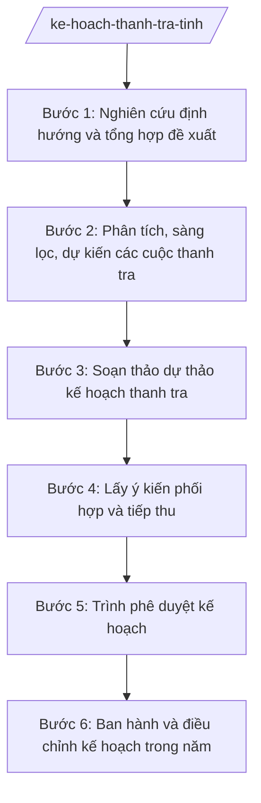

# Skill: Kế hoạch thanh tra hằng năm

## 2. Khi nào dùng

- Cuối năm (theo lịch công tác) xây dựng kế hoạch thanh tra năm sau của Thanh tra tỉnh.
- Tổng hợp đề xuất thanh tra của các sở, ban, ngành, UBND xã và đơn vị trực thuộc để lồng ghép, tránh trùng lặp.
- Lấy ý kiến phối hợp của các cơ quan liên quan trước khi trình phê duyệt.
- Trình Chủ tịch UBND tỉnh phê duyệt kế hoạch thanh tra hằng năm.
- Điều chỉnh, bổ sung kế hoạch thanh tra khi có yêu cầu đột xuất hoặc tình hình mới phát sinh trong năm.

## 3. Đầu vào (Input)

| Trường | Mô tả | Bắt buộc |
|--------|-------|----------|
| `dinh_huong_thanh_tra_cua_thanh_tra_chinh_phu` | Định hướng công tác thanh tra năm của ngành (nếu đã ban hành) | Không |
| `de_xuat_thanh_tra_cua_cac_co_quan` | Danh sách đối tượng, nội dung đề xuất từ sở, ban, ngành, UBND xã | Có |
| `ket_qua_thanh_tra_nam_truoc` | Báo cáo tổng kết công tác thanh tra năm trước, các cuộc còn dở dang | Có |
| `yeu_cau_dot_xuat` | Chỉ đạo của Chủ tịch UBND tỉnh, đề xuất của HĐND, đơn thư tố cáo có dấu hiệu cần thanh tra | Không |
| `luc_luong_thanh_tra_vien` | Số lượng thanh tra viên, cộng tác viên có thể huy động | Có |
| `danh_muc_thanh_tra_cua_bo_nganh_trung_uong` | Các cuộc thanh tra do bộ, ngành trung ương triển khai trên địa bàn (để tránh trùng) | Không |

## 4. Quy trình

**Bước 1. Nghiên cứu định hướng và tổng hợp đề xuất**

- Làm gì: Nghiên cứu định hướng công tác thanh tra của ngành và nghị quyết, chỉ đạo của Tỉnh ủy, HĐND, UBND tỉnh; tổng hợp toàn bộ đề xuất thanh tra của các sở, ban, ngành, UBND xã gửi về, ghi nhận đối tượng, nội dung, lý do đề xuất.
- Dùng input: `dinh_huong_thanh_tra_cua_thanh_tra_chinh_phu`, `de_xuat_thanh_tra_cua_cac_co_quan`, `yeu_cau_dot_xuat`.
- Vai trò: Chuyên viên Phòng Nghiệp vụ tổng hợp AI hỗ trợ: đối chiếu, gom nhóm các đề xuất trùng nội dung/đối tượng, lập bảng tổng hợp ⏱ ~5 ngày làm việc (ước tính).
- Lưu ý nghiệp vụ: Ghi đầy đủ lý do đề xuất của từng cơ quan để có cơ sở lựa chọn; không loại bỏ đề xuất khi chưa có ý kiến thẩm định.
- → Kết quả bước: Bảng tổng hợp đề xuất thanh tra (đối tượng, nội dung, cơ quan đề xuất, lý do).

**Bước 2. Phân tích, sàng lọc, dự kiến các cuộc thanh tra**

- Làm gì: Phân tích đề xuất theo tiêu chí: trọng điểm, nguy cơ vi phạm, dư luận, đơn thư tố cáo, khả năng lực lượng; loại bỏ đề xuất trùng với thanh tra bộ/ngành trung ương; dự kiến số cuộc, đối tượng, nội dung, thời gian, lực lượng từng cuộc.
- Dùng input: Bảng tổng hợp đề xuất (bước 1), `ket_qua_thanh_tra_nam_truoc`, `luc_luong_thanh_tra_vien`, `danh_muc_thanh_tra_cua_bo_nganh_trung_uong`.
- Vai trò: Chuyên viên Phòng Nghiệp vụ phân tích AI hỗ trợ: kiểm tra trùng lặp đối tượng với danh mục thanh tra trung ương và các cuộc năm trước; chuyên viên quyết định lựa chọn cuối cùng ⏱ ~5 ngày làm việc (ước tính).
- Lưu ý nghiệp vụ: AI chỉ hỗ trợ phát hiện trùng lặp, không quyết định loại bỏ đề xuất thay người; ưu tiên các lĩnh vực có nhiều đơn thư, khiếu nại, tố cáo hoặc nguy cơ tham nhũng.
- → Kết quả bước: Danh mục dự kiến các cuộc thanh tra năm (có lý do lựa chọn/loại bỏ).

**Bước 3. Soạn thảo dự thảo kế hoạch thanh tra**

- Làm gì: Soạn dự thảo kế hoạch thanh tra năm gồm: mục đích, yêu cầu; danh mục các cuộc thanh tra (đối tượng, nội dung, phạm vi, thời gian, trưởng đoàn dự kiến, lực lượng); kinh phí; tổ chức thực hiện; cơ chế điều chỉnh kế hoạch trong năm.
- Dùng input: Danh mục dự kiến các cuộc thanh tra (bước 2), `luc_luong_thanh_tra_vien`.
- Vai trò: Chuyên viên soạn thảo AI hỗ trợ: dựng khung kế hoạch theo mẫu, rà soát tính đầy đủ các nội dung bắt buộc; Trưởng phòng thẩm định nội dung ⏱ ~5 ngày làm việc (ước tính).
- Lưu ý nghiệp vụ: Kế hoạch phải vừa sức lực lượng, không dàn trải; ghi rõ cơ chế điều chỉnh khi có yêu cầu đột xuất của cấp trên hoặc tình hình phát sinh.
- → Kết quả bước: Dự thảo kế hoạch thanh tra năm của Thanh tra tỉnh.

**Bước 4. Lấy ý kiến phối hợp và tiếp thu**

- Làm gì: Gửi dự thảo lấy ý kiến các sở, ban, ngành, UBND xã có liên quan (đặc biệt các đơn vị là đối tượng thanh tra); tổng hợp ý kiến, tiếp thu, chỉnh sửa dự thảo, giải trình ý kiến không tiếp thu.
- Dùng input: Dự thảo kế hoạch (bước 3).
- Vai trò: Phòng Nghiệp vụ tổ chức lấy ý kiến AI hỗ trợ: tổng hợp ý kiến, đối chiếu các ý kiến trái chiều, soạn văn bản tiếp thu giải trình; Trưởng phòng duyệt trước khi báo cáo Chánh Thanh tra ⏱ ~7 ngày làm việc (ước tính).
- Lưu ý nghiệp vụ: Đơn vị là đối tượng thanh tra chỉ tham gia ý kiến về nội dung, phạm vi, thời gian (để phối hợp), không được can thiệp vào quyết định thanh tra; ý kiến không tiếp thu phải có văn bản giải trình rõ lý do.
- → Kết quả bước: Dự thảo kế hoạch sau tiếp thu kèm bảng tổng hợp ý kiến và giải trình.

**Bước 5. Trình phê duyệt kế hoạch**

- Làm gì: Soạn tờ trình của Chánh Thanh tra gửi Chủ tịch UBND tỉnh đề nghị phê duyệt kế hoạch thanh tra năm; chuẩn bị đầy đủ hồ sơ trình (dự thảo kế hoạch, bảng tổng hợp ý kiến, dự thảo quyết định phê duyệt).
- Dùng input: Dự thảo kế hoạch sau tiếp thu (bước 4).
- Vai trò: Chánh Thanh tra tỉnh ký tờ trình AI hỗ trợ: soạn tờ trình, rà soát hồ sơ trình đầy đủ; Văn phòng UBND tỉnh tiếp nhận, tham mưu Chủ tịch UBND tỉnh phê duyệt ⏱ ~5 ngày làm việc (ước tính).
- Lưu ý nghiệp vụ: Hồ sơ trình phải thể hiện rõ việc đã lấy ý kiến phối hợp và xử lý trùng lặp với thanh tra cấp trên; Chánh Thanh tra là người chịu trách nhiệm về nội dung trình.
- → Kết quả bước: Tờ trình + hồ sơ đề nghị phê duyệt kế hoạch thanh tra năm.

**Bước 6. Ban hành và điều chỉnh kế hoạch trong năm**

- Làm gì: Sau khi Chủ tịch UBND tỉnh phê duyệt, công bố kế hoạch đến các đơn vị liên quan; trong năm, khi có yêu cầu đột xuất (chỉ đạo của cấp trên, tố cáo có dấu hiệu vi phạm, vụ việc nổi cộm) thì tham mưu điều chỉnh, bổ sung kế hoạch theo thẩm quyền.
- Dùng input: Quyết định phê duyệt kế hoạch của Chủ tịch UBND tỉnh, `yeu_cau_dot_xuat` phát sinh.
- Vai trò: Chuyên viên theo dõi thực hiện AI hỗ trợ: nhắc lịch các cuộc thanh tra theo kế hoạch, soạn dự thảo điều chỉnh khi có yêu cầu; Chánh Thanh tra quyết định điều chỉnh thuộc thẩm quyền, trình Chủ tịch UBND tỉnh đối với điều chỉnh vượt thẩm quyền. ⏱ ~xuyên suốt năm (ước tính).
- Lưu ý nghiệp vụ: Điều chỉnh kế hoạch phải có căn cứ rõ ràng và được phê duyệt bằng văn bản; không tự ý đưa thêm cuộc thanh tra ngoài kế hoạch khi chưa được phê duyệt.
- → Kết quả bước: Kế hoạch thanh tra năm đã ban hành; văn bản điều chỉnh kế hoạch (nếu có).

## Luồng quy trình (Workflow)

## 5. Đầu ra (Output)

- Kế hoạch thanh tra hằng năm của Thanh tra tỉnh (sản phẩm chính, đã được phê duyệt).
- Tờ trình của Chánh Thanh tra đề nghị phê duyệt kế hoạch.
- Quyết định phê duyệt kế hoạch thanh tra của Chủ tịch UBND tỉnh (dự thảo để trình).
- Bảng tổng hợp đề xuất, ý kiến phối hợp và giải trình tiếp thu.
- Văn bản điều chỉnh, bổ sung kế hoạch thanh tra (khi phát sinh).

**Cấu trúc output chuẩn:**

**KẾ HOẠCH THANH TRA NĂM ... CỦA THANH TRA TỈNH A** — các phần bắt buộc theo đúng thứ tự, đúng thể thức văn bản hành chính theo NĐ 30/2020/NĐ-CP:

1. Quốc hiệu "CỘNG HÒA XÃ HỘI CHỦ NGHĨA VIỆT NAM", Tiêu ngữ "Độc lập – Tự do – Hạnh phúc".
2. Tên cơ quan ban hành: THANH TRA TỈNH A. Số, ký hiệu văn bản; địa danh và thời gian ban hành.
3. Tên loại và trích yếu nội dung: KẾ HOẠCH — Thanh tra năm ... của Thanh tra tỉnh A.
4. Căn cứ ban hành (NĐ 141/2025/NĐ-CP; định hướng công tác thanh tra của ngành; quyết định phê duyệt của Chủ tịch UBND tỉnh...).
5. Mục đích, yêu cầu của công tác thanh tra năm.
6. Danh mục các cuộc thanh tra: số thứ tự; đối tượng thanh tra; nội dung thanh tra; phạm vi; thời gian thực hiện; trưởng đoàn dự kiến; lực lượng tham gia.
7. Kinh phí thực hiện.
8. Tổ chức thực hiện: trách nhiệm của Thanh tra tỉnh, các sở, ban, ngành, UBND xã phối hợp.
9. Cơ chế điều chỉnh, bổ sung kế hoạch trong năm.
10. Nơi nhận; ký, đóng dấu (Chánh Thanh tra tỉnh ký ban hành kế hoạch sau khi được phê duyệt).

## 6. Checklist nghiệm thu

1. 100% đề xuất thanh tra của các cơ quan được tổng hợp, không bỏ sót.
2. Danh mục cuộc thanh tra không trùng với thanh tra của bộ/ngành trung ương trên địa bàn.
3. Đã lấy ý kiến phối hợp của các đơn vị liên quan, có bảng tổng hợp và giải trình tiếp thu.
4. Kế hoạch vừa sức lực lượng, ghi rõ thời gian, trưởng đoàn, lực lượng từng cuộc.
5. Có cơ chế điều chỉnh kế hoạch trong năm được quy định rõ.
6. Hồ sơ trình phê duyệt đầy đủ: tờ trình, dự thảo kế hoạch, bảng tổng hợp ý kiến, dự thảo quyết định phê duyệt.
7. Kế hoạch được Chủ tịch UBND tỉnh phê duyệt bằng văn bản trước khi ban hành.
8. Thể thức văn bản đúng NĐ 30/2020/NĐ-CP; căn cứ pháp lý còn hiệu lực.

## 7. Ví dụ mô phỏng

*Dữ liệu dưới đây là giả lập 100% phục vụ minh họa.*

**Input mẫu:**

| Trường | Giá trị mẫu |
|--------|-------------|
| Định hướng thanh tra của Thanh tra Chính phủ | Định hướng công tác thanh tra năm 2027: tập trung lĩnh vực đất đai, đầu tư công, quản lý tài chính ngân sách |
| Đề xuất thanh tra của các cơ quan | 12 đề xuất từ 8 sở và 3 UBND xã (lĩnh vực: đất đai 4, đầu tư xây dựng 3, tài chính 3, giáo dục 2) |
| Kết quả thanh tra năm trước | Năm 2026 thực hiện 10/10 cuộc theo kế hoạch; 2 cuộc chuyển sang năm sau do trùng thanh tra bộ |
| Yêu cầu đột xuất | Chủ tịch UBND tỉnh yêu cầu đưa vào kế hoạch cuộc thanh tra quản lý đất đai tại xã A |
| Lực lượng thanh tra viên | 15 thanh tra viên, có thể huy động 10 cộng tác viên |
| Danh mục thanh tra của bộ/ngành trung ương | Bộ Tài nguyên và Môi trường dự kiến thanh tra 2 dự án đất đai trên địa bàn tỉnh A |

**Output mẫu (trích Kế hoạch thanh tra năm 2027):**

**THANH TRA TỈNH A**

Số: 1234/KH-TTr
Tỉnh A, ngày 15 tháng 12 năm 2026

**KẾ HOẠCH**
**Thanh tra năm 2027 của Thanh tra tỉnh A**

*Căn cứ Nghị định số 141/2025/NĐ-CP ngày 12/6/2025 của Chính phủ về phân định thẩm quyền của chính quyền địa phương 2 cấp trong lĩnh vực quản lý nhà nước của Thanh tra Chính phủ;*
*Căn cứ Quyết định số 1234/QĐ-UBND ngày 25/12/2026 của Chủ tịch UBND tỉnh A phê duyệt Kế hoạch thanh tra năm 2027;*

**I. MỤC ĐÍCH, YÊU CẦU**
1. Mục đích: phát hiện, xử lý vi phạm; phòng ngừa tham nhũng, lãng phí; nâng cao hiệu lực quản lý nhà nước trên địa bàn tỉnh A...

**II. DANH MỤC CÁC CUỘC THANH TRA NĂM 2027**
1. Thanh tra việc quản lý, sử dụng đất đai tại xã A (theo chỉ đạo của Chủ tịch UBND tỉnh) — thời gian: quý I/2027; trưởng đoàn dự kiến: ông Bùi Văn X — Trưởng phòng Nghiệp vụ 1.
2. Thanh tra công tác quản lý đầu tư xây dựng 3 dự án vốn ngân sách tại 2 xã (loại 2 đề xuất trùng với thanh tra của Bộ) — thời gian: quý II/2027.
3. Thanh tra quản lý tài chính, ngân sách tại Sở Tài chính tỉnh A — thời gian: quý III/2027.
(Tổng 8 cuộc, vừa sức 15 thanh tra viên.)

**III. KINH PHÍ, TỔ CHỨC THỰC HIỆN, ĐIỀU CHỈNH KẾ HOẠCH**
...

*Nơi nhận:* ...
**CHÁNH THANH TRA**
(Ký, đóng dấu — ông Hoàng Văn S)

## 8. Human gate (người kiểm duyệt)

- Chuyên viên soạn thảo, tổng hợp đề xuất → Trưởng phòng thẩm định nội dung, danh mục cuộc thanh tra → Chánh Thanh tra tỉnh duyệt dự thảo và ký tờ trình → Chủ tịch UBND tỉnh phê duyệt kế hoạch thanh tra năm.
- Điều chỉnh, bổ sung kế hoạch trong năm: Chánh Thanh tra tỉnh quyết định đối với nội dung thuộc thẩm quyền; trình Chủ tịch UBND tỉnh phê duyệt đối với điều chỉnh vượt thẩm quyền.

## 9. Giới hạn (guardrails)

- AI không quyết định danh mục cuộc thanh tra, không loại bỏ hay thêm cuộc thanh tra thay người có thẩm quyền.
- AI không tự ký, ban hành kế hoạch thanh tra; kế hoạch chỉ có hiệu lực sau khi được phê duyệt bằng văn bản của người có thẩm quyền.
- AI không bịa đặt căn cứ pháp lý, số hiệu văn bản; chỉ viện dẫn văn bản còn hiệu lực (NĐ 141/2025/NĐ-CP, NĐ 30/2020/NĐ-CP...).
- AI không sử dụng thông tin về đối tượng thanh tra vào mục đích khác ngoài xây dựng kế hoạch; bảo mật danh mục thanh tra chưa công bố theo quy định.

## 10. Căn cứ & lưu ý

- NĐ 141/2025/NĐ-CP: phân định thẩm quyền của chính quyền địa phương 2 cấp trong lĩnh vực quản lý nhà nước của Thanh tra Chính phủ — căn cứ chính về tổ chức, hoạt động thanh tra cấp tỉnh.
- NĐ 150/2025/NĐ-CP: Thanh tra tỉnh là cơ quan chuyên môn thuộc UBND cấp tỉnh; kế hoạch thanh tra do Chủ tịch UBND tỉnh phê duyệt.
- NĐ 30/2020/NĐ-CP: thể thức và kỹ thuật trình bày văn bản hành chính.
- Lưu ý: tính đến thời điểm hiện tại, chưa có thông tư hướng dẫn riêng về chức năng, nhiệm vụ của Thanh tra tỉnh; các nội dung chi tiết về trình tự, thủ tục thanh tra thực hiện theo quy định hiện hành của pháp luật về thanh tra.
