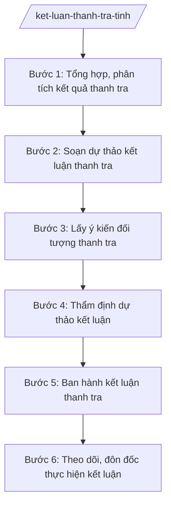

# Skill: Kết luận thanh tra

## 2. Khi nào dùng

- Đoàn thanh tra của Thanh tra tỉnh kết thúc kiểm tra, xác minh và có báo cáo kết quả thanh tra.
- Soạn dự thảo kết luận thanh tra để lấy ý kiến đối tượng thanh tra.
- Thẩm định dự thảo kết luận trước khi người ra quyết định thanh tra ký ban hành.
- Ban hành kết luận thanh tra và gửi đến đối tượng thanh tra, cơ quan, tổ chức, cá nhân liên quan.
- Theo dõi, đôn đốc, kiểm tra việc thực hiện kết luận, kiến nghị trong kết luận thanh tra.

## 3. Đầu vào (Input)

| Trường | Mô tả | Bắt buộc |
|--------|-------|----------|
| `quyet_dinh_thanh_tra` | Quyết định của người có thẩm quyền về việc thanh tra (số, ngày, đối tượng, nội dung) | Có |
| `bao_cao_ket_qua_thanh_tra` | Báo cáo của trưởng đoàn thanh tra về kết quả kiểm tra, xác minh | Có |
| `bien_ban_tai_lieu_thu_thap` | Biên bản làm việc, tài liệu, chứng cứ thu thập trong quá trình thanh tra | Có |
| `y_kien_cua_doi_tuong_thanh_tra` | Văn bản giải trình, ý kiến của đối tượng được thanh tra về dự thảo kết luận | Không |
| `quy_dinh_phap_luat_lien_quan` | Căn cứ pháp lý áp dụng cho nội dung, kiến nghị xử lý | Có |
| `ho_so_vu_viec_lien_quan` | Kết quả thanh tra, kiểm tra trước đây đối với cùng đối tượng (nếu có) | Không |

## 4. Quy trình

**Bước 1. Tổng hợp, phân tích kết quả thanh tra**

- Làm gì: Nghiên cứu báo cáo kết quả thanh tra của trưởng đoàn, rà soát biên bản, tài liệu, chứng cứ; phân loại các nội dung: ưu điểm, tồn tại, vi phạm, nguyên nhân, trách nhiệm của tập thể, cá nhân.
- Dùng input: `bao_cao_ket_qua_thanh_tra`, `bien_ban_tai_lieu_thu_thap`, `quyet_dinh_thanh_tra`, `ho_so_vu_viec_lien_quan`.
- Vai trò: Chuyên viên Phòng Nghiệp vụ phân tích AI hỗ trợ: trích xuất, hệ thống hóa các phát hiện theo nhóm nội dung, đối chiếu với quyết định thanh tra để phát hiện nội dung còn thiếu ⏱ ~5 ngày làm việc (ước tính).
- Lưu ý nghiệp vụ: Mọi nhận định trong kết luận phải có tài liệu, chứng cứ cụ thể; không đưa vào kết luận nội dung vượt phạm vi quyết định thanh tra.
- → Kết quả bước: Bảng tổng hợp phân tích kết quả thanh tra (ưu điểm, tồn tại, vi phạm, nguyên nhân, trách nhiệm).

**Bước 2. Soạn dự thảo kết luận thanh tra**

- Làm gì: Soạn dự thảo kết luận gồm: đánh giá chung; kết quả kiểm tra, xác minh theo từng nội dung; nhận xét, đánh giá; kết luận về tính đúng/sai, mức độ vi phạm; kiến nghị xử lý (thu hồi, xử phạt, kiểm điểm, chuyển cơ quan điều tra nếu có dấu hiệu tội phạm); kiến nghị hoàn thiện cơ chế, chính sách.
- Dùng input: Bảng tổng hợp phân tích (bước 1), `quy_dinh_phap_luat_lien_quan`.
- Vai trò: Chuyên viên soạn thảo AI hỗ trợ: dựng khung kết luận theo mẫu, rà soát tính đầy đủ các phần, kiểm tra viện dẫn pháp luật còn hiệu lực; Trưởng phòng thẩm định nội dung ⏱ ~7 ngày làm việc (ước tính).
- Lưu ý nghiệp vụ: Kiến nghị xử lý phải đúng thẩm quyền của người ra kết luận; nội dung có dấu hiệu tội phạm phải kiến nghị chuyển cơ quan điều tra theo quy định, không tự kết luận về tội danh.
- → Kết quả bước: Dự thảo kết luận thanh tra (kèm hồ sơ tài liệu minh chứng).

**Bước 3. Lấy ý kiến đối tượng thanh tra**

- Làm gì: Gửi dự thảo kết luận cho đối tượng được thanh tra để có ý kiến giải trình bằng văn bản; nghiên cứu ý kiến giải trình, đối chiếu với tài liệu, chứng cứ để tiếp thu hoặc bảo lưu quan điểm.
- Dùng input: Dự thảo kết luận (bước 2), `y_kien_cua_doi_tuong_thanh_tra`.
- Vai trò: Trưởng đoàn thanh tra tổ chức lấy ý kiến AI hỗ trợ: tổng hợp ý kiến giải trình, đối chiếu từng ý kiến với chứng cứ, soạn văn bản tiếp thu/bảo lưu; Trưởng phòng báo cáo Chánh Thanh tra ⏱ ~7 ngày làm việc (ước tính).
- Lưu ý nghiệp vụ: Phải cho đối tượng thanh tra đủ thời gian giải trình theo quy định; ý kiến giải trình có căn cứ, chứng cứ mới thì phải tiếp thu, điều chỉnh dự thảo.
- → Kết quả bước: Dự thảo kết luận sau tiếp thu ý kiến đối tượng thanh tra.

**Bước 4. Thẩm định dự thảo kết luận**

- Làm gì: Phòng Nghiệp vụ (hoặc tổ thẩm định) thẩm định dự thảo về: tính đầy đủ, chính xác của nội dung; tính hợp pháp của căn cứ pháp lý; tính khả thi, đúng thẩm quyền của các kiến nghị xử lý.
- Dùng input: Dự thảo kết luận sau tiếp thu (bước 3), toàn bộ hồ sơ thanh tra.
- Vai trò: Tổ thẩm định/Phòng Nghiệp vụ thẩm định AI hỗ trợ: kiểm tra chéo viện dẫn pháp luật, phát hiện mâu thuẫn nội dung, rà soát kiến nghị vượt thẩm quyền; Chánh Thanh tra tỉnh xem xét, cho ý kiến chỉ đạo hoàn thiện ⏱ ~5 ngày làm việc (ước tính).
- Lưu ý nghiệp vụ: Người tham gia đoàn thanh tra không tham gia thẩm định để bảo đảm khách quan; kết quả thẩm định phải thể hiện bằng văn bản.
- → Kết quả bước: Báo cáo thẩm định dự thảo kết luận thanh tra.

**Bước 5. Ban hành kết luận thanh tra**

- Làm gì: Hoàn thiện kết luận theo ý kiến thẩm định; trình người ra quyết định thanh tra ký ban hành; gửi kết luận đến đối tượng thanh tra, cơ quan quản lý cấp trên của đối tượng, cơ quan, tổ chức, cá nhân có liên quan; công khai kết luận theo quy định.
- Dùng input: Dự thảo kết luận đã hoàn thiện, Báo cáo thẩm định (bước 4).
- Vai trò: Chánh Thanh tra tỉnh (hoặc người ra quyết định thanh tra theo phân cấp) ký ban hành AI hỗ trợ: rà soát lần cuối thể thức, số hiệu, nơi nhận; không thay người ký ⏱ ~3 ngày làm việc (ước tính).
- Lưu ý nghiệp vụ: Kết luận thanh tra là văn bản có giá trị pháp lý bắt buộc thực hiện; phải gửi đúng, đủ nơi nhận và đúng thời hạn theo quy định.
- → Kết quả bước: Kết luận thanh tra đã ban hành.

**Bước 6. Theo dõi, đôn đốc thực hiện kết luận**

- Làm gì: Lập kế hoạch theo dõi thực hiện kết luận: giao nhiệm vụ cụ thể cho từng cơ quan, đơn vị, cá nhân; đôn đốc báo cáo tiến độ; kiểm tra thực tế việc thực hiện các kiến nghị (thu hồi tiền, xử lý kỷ luật, khắc phục tồn tại); tổng hợp báo cáo tình hình thực hiện.
- Dùng input: Kết luận thanh tra đã ban hành.
- Vai trò: Chuyên viên theo dõi AI hỗ trợ: nhắc lịch báo cáo, tổng hợp tiến độ từ báo cáo của các đơn vị, cảnh báo nội dung chậm thực hiện; Trưởng phòng báo cáo Chánh Thanh tra; trường hợp không thực hiện kết luận thì tham mưu biện pháp xử lý theo quy định. ⏱ ~định kỳ đến khi hoàn thành 100% kiến nghị (ước tính).
- Lưu ý nghiệp vụ: Theo dõi đến cùng, không buông lỏng sau khi ban hành kết luận; đơn vị không thực hiện kết luận phải được xử lý theo quy định hiện hành.
- → Kết quả bước: Báo cáo tình hình thực hiện kết luận thanh tra (định kỳ và khi hoàn thành).

## Luồng quy trình (Workflow)

## 5. Đầu ra (Output)

- Kết luận thanh tra của Thanh tra tỉnh (sản phẩm chính).
- Dự thảo kết luận thanh tra (các phiên bản qua các vòng tiếp thu, thẩm định).
- Báo cáo thẩm định dự thảo kết luận.
- Văn bản đôn đốc thực hiện kết luận.
- Báo cáo tình hình thực hiện kết luận thanh tra.

**Cấu trúc output chuẩn:**

**KẾT LUẬN THANH TRA** — các phần bắt buộc theo đúng thứ tự, đúng thể thức văn bản hành chính theo NĐ 30/2020/NĐ-CP:

1. Quốc hiệu "CỘNG HÒA XÃ HỘI CHỦ NGHĨA VIỆT NAM", Tiêu ngữ "Độc lập – Tự do – Hạnh phúc".
2. Tên cơ quan ban hành: THANH TRA TỈNH A. Số, ký hiệu văn bản; địa danh và thời gian ban hành.
3. Tên loại và trích yếu: KẾT LUẬN THANH TRA — về việc ... (ghi rõ nội dung, đối tượng thanh tra).
4. Căn cứ ban hành (quyết định thanh tra; NĐ 141/2025/NĐ-CP; các văn bản pháp luật liên quan còn hiệu lực).
5. Phần đánh giá chung về đối tượng được thanh tra.
6. Kết quả kiểm tra, xác minh theo từng nội dung thanh tra (nêu rõ sự việc, tài liệu, chứng cứ).
7. Nhận xét, đánh giá: ưu điểm; tồn tại, vi phạm; nguyên nhân (khách quan, chủ quan); trách nhiệm của tập thể, cá nhân.
8. Kiến nghị xử lý: biện pháp khắc phục; xử lý kinh tế (thu hồi); xử lý hành chính, kỷ luật; chuyển cơ quan điều tra (nếu có dấu hiệu tội phạm); kiến nghị hoàn thiện cơ chế, chính sách.
9. Tổ chức thực hiện: trách nhiệm của đối tượng thanh tra, cơ quan, đơn vị liên quan; thời hạn thực hiện; chế độ báo cáo.
10. Nơi nhận; ký, đóng dấu (người ra quyết định thanh tra ký).

## 6. Checklist nghiệm thu

1. Kết luận bao quát đầy đủ nội dung trong quyết định thanh tra, không bỏ sót, không vượt phạm vi.
2. Mọi nhận định về vi phạm đều có tài liệu, chứng cứ cụ thể kèm theo.
3. Đã lấy ý kiến đối tượng thanh tra và xử lý ý kiến giải trình (tiếp thu hoặc bảo lưu có lý do).
4. Dự thảo đã qua thẩm định bằng văn bản trước khi trình ký ban hành.
5. Kiến nghị xử lý đúng thẩm quyền, đúng quy định pháp luật còn hiệu lực.
6. Kết luận được gửi đúng, đủ nơi nhận và công khai theo quy định.
7. Có kế hoạch theo dõi thực hiện kết luận với nhiệm vụ, thời hạn cụ thể cho từng đơn vị.
8. Thể thức văn bản đúng NĐ 30/2020/NĐ-CP; căn cứ pháp lý còn hiệu lực.

## 7. Ví dụ mô phỏng

*Dữ liệu dưới đây là giả lập 100% phục vụ minh họa.*

**Input mẫu:**

| Trường | Giá trị mẫu |
|--------|-------------|
| Quyết định thanh tra | Quyết định số 1234/QĐ-TTr ngày 10/3/2027 của Chánh Thanh tra tỉnh A về thanh tra việc quản lý, sử dụng ngân sách tại Trung tâm Giáo dục nghề nghiệp tỉnh A, thời kỳ 2025–2026 |
| Báo cáo kết quả thanh tra | Đoàn thanh tra báo cáo ngày 20/5/2027: phát hiện chi sai chế độ 500 triệu đồng; 3 khoản chi thiếu chứng từ |
| Biên bản, tài liệu thu thập | 15 biên bản làm việc, 40 chứng từ kế toán, báo cáo giải trình của đơn vị |
| Ý kiến của đối tượng thanh tra | Đơn vị giải trình: 2/3 khoản chi thiếu chứng từ đã bổ sung; đề nghị xem xét nguyên nhân khách quan |
| Quy định pháp luật liên quan | Quy định về quản lý, sử dụng ngân sách nhà nước (còn hiệu lực) |
| Hồ sơ vụ việc liên quan | Năm 2024 đơn vị đã bị nhắc nhở về công tác chứng từ kế toán |

**Output mẫu (trích Kết luận thanh tra):**

**THANH TRA TỈNH A**

Số: 1234/KL-TTr
Tỉnh A, ngày 10 tháng 6 năm 2027

**KẾT LUẬN THANH TRA**
**Về việc quản lý, sử dụng ngân sách tại Trung tâm Giáo dục nghề nghiệp tỉnh A, thời kỳ 2025–2026**

*Căn cứ Quyết định số 1234/QĐ-TTr ngày 10/3/2027 của Chánh Thanh tra tỉnh A;*
*Căn cứ Nghị định số 141/2025/NĐ-CP ngày 12/6/2025 của Chính phủ;*

**I. ĐÁNH GIÁ CHUNG**
Trung tâm cơ bản chấp hành quy định về quản lý ngân sách; tuy nhiên còn một số tồn tại, vi phạm như sau.

**II. KẾT QUẢ KIỂM TRA, XÁC MINH**
1. Chi sai chế độ 500 triệu đồng tại 4 nội dung (có chứng từ kèm theo)...
2. 3 khoản chi thiếu chứng từ, đơn vị đã bổ sung 2 khoản sau giải trình...

**III. NHẬN XÉT, ĐÁNH GIÁ**
- Nguyên nhân: chủ quan là chính (kế toán chưa nắm vững chế độ); đơn vị từng bị nhắc nhở năm 2024 nhưng chưa khắc phục triệt để.
- Trách nhiệm: Giám đốc Trung tâm, kế toán trưởng.

**IV. KIẾN NGHỊ XỬ LÝ**
1. Thu hồi nộp ngân sách 500 triệu đồng chi sai chế độ.
2. Kiểm điểm trách nhiệm Giám đốc và kế toán trưởng Trung tâm.
3. Kiến nghị Sở Tài chính tỉnh A tăng cường hướng dẫn nghiệp vụ kế toán cho các đơn vị sự nghiệp.

**V. TỔ CHỨC THỰC HIỆN**
Trung tâm thực hiện trong 30 ngày, báo cáo Thanh tra tỉnh A kết quả...

*Nơi nhận:* ...
**CHÁNH THANH TRA**
(Ký, đóng dấu — ông Hoàng Văn S)

## 8. Human gate (người kiểm duyệt)

- Chuyên viên soạn dự thảo → Trưởng đoàn thanh tra rà soát tính đúng đắn với thực tế kiểm tra → Trưởng phòng thẩm định → Tổ thẩm định thẩm định độc lập → Chánh Thanh tra tỉnh (người ra quyết định thanh tra) ký ban hành.
- Đối tượng thanh tra được quyền giải trình về dự thảo kết luận trước khi ban hành.

## 9. Giới hạn (guardrails)

- AI không kết luận đúng/sai, không xác định trách nhiệm, mức độ vi phạm thay đoàn thanh tra và người có thẩm quyền.
- AI không quyết định kiến nghị xử lý (thu hồi, kỷ luật, chuyển cơ quan điều tra) thay người ra quyết định thanh tra.
- AI không tự ký, ban hành kết luận thanh tra; không bịa đặt tài liệu, chứng cứ, số liệu vi phạm.
- AI không viện dẫn văn bản pháp luật đã hết hiệu lực; mọi kiến nghị phải có căn cứ pháp lý còn hiệu lực rõ ràng.

## 10. Căn cứ & lưu ý

- NĐ 141/2025/NĐ-CP: phân định thẩm quyền của chính quyền địa phương 2 cấp trong lĩnh vực quản lý nhà nước của Thanh tra Chính phủ — căn cứ chính về tổ chức, hoạt động thanh tra cấp tỉnh.
- NĐ 30/2020/NĐ-CP: thể thức và kỹ thuật trình bày văn bản hành chính.
- Lưu ý: tính đến thời điểm hiện tại, chưa có thông tư hướng dẫn riêng về chức năng, nhiệm vụ của Thanh tra tỉnh; trình tự, thủ tục thanh tra, ban hành và thực hiện kết luận thanh tra thực hiện theo quy định hiện hành của pháp luật về thanh tra.
