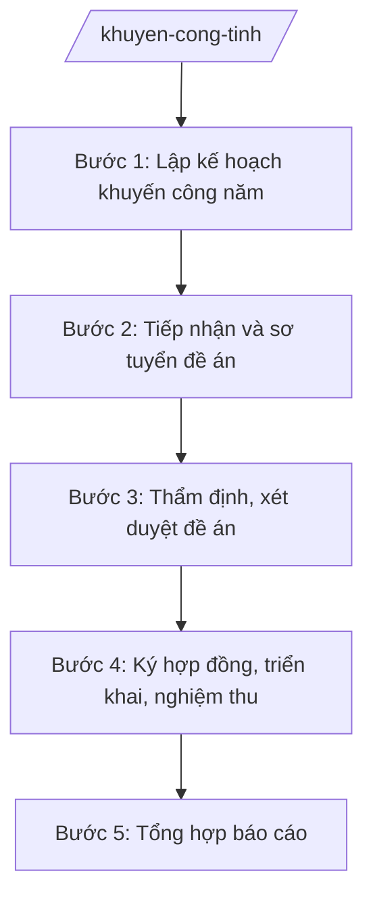

# Skill: Chương trình khuyến công

## 2. Khi nào dùng

- Khi lập kế hoạch khuyến công hằng năm của tỉnh.
- Khi tiếp nhận, xét duyệt đề án khuyến công của tổ chức, cá nhân, cơ sở công nghiệp nông thôn.
- Khi nghiệm thu, thanh quyết toán kinh phí khuyến công hỗ trợ.
- Khi tổng hợp báo cáo kết quả khuyến công gửi Bộ Công Thương, UBND tỉnh.

## 3. Đầu vào (Input)

| Trường | Mô tả | Bắt buộc |
|--------|-------|----------|
| `nam_ke_hoach` | Năm kế hoạch khuyến công | Có |
| `loai_viec` | lập kế hoạch / xét duyệt đề án / nghiệm thu / báo cáo | Có |
| `de_an` | Tên đề án, chủ đề án, nội dung, kinh phí đề nghị hỗ trợ | Không |
| `kinh_phi_du_kien` | Tổng kinh phí khuyến công dự kiến của năm | Không |

## 4. Quy trình

**Bước 1. Lập kế hoạch khuyến công năm**
- Làm gì: Rà soát nhu cầu hỗ trợ của cơ sở công nghiệp nông thôn; xây dựng kế hoạch khuyến công năm (nội dung, đối tượng, kinh phí, tiến độ).
- Dùng input: `nam_ke_hoach`, `kinh_phi_du_kien`.
- Vai trò: Chuyên viên Phòng Quản lý công nghiệp dự thảo; AI hỗ trợ phân tích số liệu năm trước, gợi ý phân bổ kinh phí — ⏱ 5 ngày.
- Lưu ý nghiệp vụ: Ưu tiên: đào tạo nghề, chuyển giao công nghệ, hỗ trợ thiết bị, phát triển sản phẩm công nghiệp nông thôn tiêu biểu.
- → Kết quả bước: Dự thảo kế hoạch khuyến công năm.

**Bước 2. Tiếp nhận và sơ tuyển đề án**
- Làm gì: Thông báo, tiếp nhận hồ sơ đề án; kiểm tra tính đầy đủ, hợp lệ; phân loại theo nội dung hỗ trợ.
- Dùng input: `de_an`, `loai_viec`.
- Vai trò: Chuyên viên tiếp nhận, lập danh sách; AI hỗ trợ kiểm tra checklist hồ sơ, phát hiện thiếu sót — ⏱ 3 ngày/đợt.
- Lưu ý nghiệp vụ: Đề án phải của cơ sở công nghiệp nông thôn trên địa bàn; không trùng lặp với đề án đã được hỗ trợ từ nguồn khác.
- → Kết quả bước: Danh sách đề án đủ điều kiện xét duyệt.

**Bước 3. Thẩm định, xét duyệt đề án**
- Làm gì: Tổ chức thẩm định nội dung, tính khả thi, hiệu quả; họp hội đồng xét duyệt; xác định mức hỗ trợ theo quy định.
- Dùng input: `de_an`.
- Vai trò: Phó Giám đốc Sở chủ trì hội đồng; AI hỗ trợ chấm điểm theo tiêu chí, soạn biên bản — ⏱ 7 ngày.
- Lưu ý nghiệp vụ: Mức hỗ trợ không vượt định mức quy định; ưu tiên đề án tạo việc làm, sử dụng nguyên liệu địa phương, thân thiện môi trường.
- → Kết quả bước: Biên bản họp hội đồng + danh sách đề án được duyệt, mức hỗ trợ.

**Bước 4. Ký hợp đồng, triển khai, nghiệm thu**
- Làm gì: Ký hợp đồng hỗ trợ với chủ đề án; theo dõi tiến độ; tổ chức nghiệm thu kết quả; thanh quyết toán kinh phí.
- Dùng input: `de_an`.
- Vai trò: Trưởng phòng theo dõi; AI hỗ trợ nhắc tiến độ, soạn biên bản nghiệm thu, đối chiếu chứng từ — ⏱ theo tiến độ đề án.
- Lưu ý nghiệp vụ: Nghiệm thu phải có đại diện chủ đề án, đơn vị tư vấn (nếu có); chứng từ thanh toán hợp lệ mới giải ngân.
- → Kết quả bước: Biên bản nghiệm thu + hồ sơ thanh quyết toán.

**Bước 5. Tổng hợp báo cáo**
- Làm gì: Tổng hợp kết quả thực hiện kế hoạch khuyến công năm; đánh giá hiệu quả; báo cáo UBND tỉnh, Bộ Công Thương.
- Dùng input: `nam_ke_hoach`, `loai_viec`.
- Vai trò: Chuyên viên tổng hợp; AI hỗ trợ lập bảng số liệu, biểu đồ, dự thảo báo cáo — ⏱ 3 ngày.
- Lưu ý nghiệp vụ: Số liệu giải ngân phải khớp với kho bạc; nêu rõ đề án chậm tiến độ và nguyên nhân.
- → Kết quả bước: Báo cáo kết quả khuyến công năm.

## Luồng quy trình (Workflow)

## 5. Đầu ra (Output)

- Kế hoạch khuyến công năm của tỉnh.
- Quyết định phê duyệt danh sách đề án khuyến công được hỗ trợ.
- Biên bản nghiệm thu đề án khuyến công.
- Báo cáo tổng kết khuyến công năm.

**Cấu trúc output chuẩn (Quyết định phê duyệt đề án khuyến công):**
- Thể thức: tuân thủ Nghị định 30/2020/NĐ-CP về công tác văn thư.

1. Quốc hiệu "CỘNG HÒA XÃ HỘI CHỦ NGHĨA VIỆT NAM", Tiêu ngữ "Độc lập – Tự do – Hạnh phúc"; tên cơ quan (UBND tỉnh A / Sở Công Thương tỉnh A theo phân cấp); số, ký hiệu.
2. Tên loại: **QUYẾT ĐỊNH** — về việc phê duyệt danh sách đề án khuyến công được hỗ trợ kinh phí năm [năm].
3. Căn cứ pháp lý.
4. **Điều 1.** Phê duyệt danh sách [n] đề án (phụ lục kèm theo: tên đề án, chủ đề án, nội dung hỗ trợ, mức kinh phí).
5. **Điều 2.** Giao Sở Công Thương tổ chức thực hiện; kinh phí từ nguồn khuyến công.
6. **Điều 3.** Hiệu lực thi hành; trách nhiệm thi hành.
7. Nơi nhận; chữ ký người có thẩm quyền.

## 6. Checklist nghiệm thu

- [ ] Kế hoạch năm bám sát định hướng phát triển công nghiệp nông thôn của tỉnh.
- [ ] Đề án được duyệt đúng đối tượng, không trùng nguồn hỗ trợ khác.
- [ ] Mức hỗ trợ trong định mức quy định, có biên bản hội đồng xét duyệt.
- [ ] Nghiệm thu có đủ thành phần, chứng từ thanh toán hợp lệ.
- [ ] Báo cáo năm số liệu giải ngân khớp với kho bạc.
- [ ] Văn bản đúng thể thức NĐ 30/2020/NĐ-CP.

## 7. Ví dụ mô phỏng

*Dữ liệu dưới đây là giả lập 100% phục vụ minh họa.*

**Input mẫu:** nam_ke_hoach = 2026; loai_viec = "xét duyệt đề án"; de_an = "Hỗ trợ máy sấy nông sản cho Hợp tác xã AB, xã A — đề nghị 300 triệu đồng".

**Output mẫu (trích Quyết định):**

> **ỦY BAN NHÂN DÂN TỈNH A**
> Số: 1234/QĐ-UBND
>
> **QUYẾT ĐỊNH**
> Về việc phê duyệt đề án khuyến công được hỗ trợ kinh phí năm 2026
>
> *Căn cứ* Thông tư 37/2025/TT-BCT; Kế hoạch khuyến công năm 2026 của tỉnh A...
>
> **Điều 1.** Phê duyệt 01 đề án khuyến công được hỗ trợ kinh phí năm 2026: Đề án "Hỗ trợ máy sấy nông sản cho Hợp tác xã AB, xã A"; mức hỗ trợ: 300.000.000 đồng.
>
> **Điều 2.** Giao Sở Công Thương ký hợp đồng, tổ chức nghiệm thu, thanh quyết toán theo quy định.
>
> **Điều 3.** Quyết định có hiệu lực kể từ ngày ký./.
>
> *Nơi nhận:* ... — **CHỦ TỊCH** *(ký, đóng dấu)* — Phạm Văn P

## 8. Human gate

- Chuyên viên soạn → Trưởng phòng kiểm tra → Phó Giám đốc Sở duyệt → Giám đốc Sở ký trình → **UBND tỉnh phê duyệt** (kế hoạch năm, danh sách đề án).
- Nghiệm thu đề án: hội đồng nghiệm thu (có đại diện Sở Tài chính) thống nhất mới thanh toán.

## 9. Giới hạn

- AI không tự quyết định mức hỗ trợ kinh phí; không thay hội đồng xét duyệt chấm điểm.
- Không bịa hồ sơ năng lực của chủ đề án, số liệu giải ngân.
- Không dùng văn bản hết hiệu lực làm căn cứ.

## 10. Căn cứ & lưu ý

- Thông tư 37/2025/TT-BCT của Bộ Công Thương hướng dẫn chức năng, nhiệm vụ của cơ quan chuyên môn về công thương.
- Nghị định 150/2025/NĐ-CP về tổ chức cơ quan chuyên môn thuộc UBND cấp tỉnh.
- Nghị định 30/2020/NĐ-CP về công tác văn thư (thể thức văn bản).
- Lưu ý: kinh phí khuyến công có nguồn quốc gia và địa phương — phân định rõ trong kế hoạch, tránh trùng lặp hỗ trợ.
