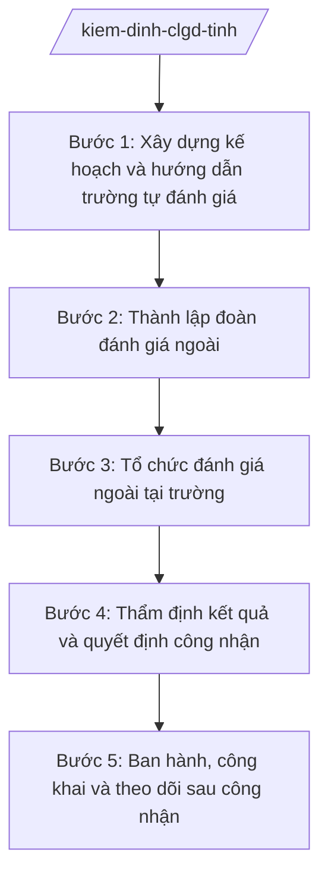

# Skill: Kiểm định chất lượng giáo dục

## 2. Khi nào dùng

- Hằng năm: xây dựng kế hoạch kiểm định chất lượng giáo dục (KĐCLGD) đối với các trường MN, TH, THCS, THPT và trung tâm GDNN-GDTX trên địa bàn tỉnh.
- Hướng dẫn các trường tự đánh giá theo tiêu chuẩn KĐCLGD.
- Thành lập đoàn đánh giá ngoài, tổ chức đánh giá tại trường; thẩm định và công nhận trường đạt KĐCLGD theo mức độ.
- Công khai kết quả kiểm định; theo dõi, đôn đốc trường duy trì, cải tiến chất lượng sau công nhận.

## 3. Đầu vào (Input)

| Trường | Mô tả | Bắt buộc |
|--------|-------|----------|
| `nam_hoc` | Năm học thực hiện kiểm định | Có |
| `danh_sach_truong_dk` | Danh sách trường đăng ký kiểm định: tên trường, cấp học, địa chỉ | Có |
| `bao_cao_tu_danh_gia` | Báo cáo tự đánh giá của trường theo tiêu chuẩn KĐCLGD | Có |
| `thanh_phan_doan_dgn` | Dự kiến thành viên đoàn đánh giá ngoài (họ tên, đơn vị, trình độ) | Có |
| `lich_danh_gia` | Lịch đánh giá ngoài tại từng trường | Có |
| `ket_qua_danh_gia` | Biên bản, phiếu đánh giá của đoàn đánh giá ngoài. Lưu ý: từ bước 3.| Có |

## 4. Quy trình

**Bước 1. Xây dựng kế hoạch và hướng dẫn trường tự đánh giá**

- Làm gì: Ban hành kế hoạch KĐCLGD năm học; hướng dẫn các trường thành lập hội đồng tự đánh giá, thu thập minh chứng, viết báo cáo tự đánh giá theo tiêu chuẩn, tiêu chí KĐCLGD.
- Dùng input: `nam_hoc`, `danh_sach_truong_dk`.
- Vai trò: Chuyên viên Phòng Khảo thí và Kiểm định chất lượng giáo dục soạn kế hoạch, tài liệu hướng dẫn. AI hỗ trợ: soạn dự thảo kế hoạch, bộ biểu mẫu tự đánh giá, checklist minh chứng theo từng tiêu chí. ⏱ ~5–7 ngày làm việc (ước tính).
- Lưu ý nghiệp vụ: Trường phải hoàn thành báo cáo tự đánh giá trước khi đoàn đánh giá ngoài đến ít nhất 15 ngày; minh chứng phải là văn bản, số liệu thật của nhà trường.
- → Kết quả bước: Kế hoạch KĐCLGD năm học + báo cáo tự đánh giá của các trường.

**Bước 2. Thành lập đoàn đánh giá ngoài**

- Làm gì: Soạn quyết định thành lập đoàn đánh giá ngoài cho từng trường (hoặc cụm trường); phân công nhiệm vụ, lịch làm việc của đoàn; tập huấn nghiệp vụ đánh giá ngoài cho thành viên đoàn.
- Dùng input: `danh_sach_truong_dk`, `thanh_phan_doan_dgn`, `lich_danh_gia`, `bao_cao_tu_danh_gia`.
- Vai trò: Trưởng phòng Khảo thí và KĐCLGD (ông Bùi Văn X) đề xuất thành phần đoàn; Phó Giám đốc Sở (ông Đỗ Văn U) xem xét; Giám đốc Sở (ông Hoàng Văn S) ký quyết định thành lập. AI hỗ trợ: lập danh sách đoàn theo trường, kiểm tra tiêu chuẩn thành viên (trình độ, kinh nghiệm, tránh xung đột lợi ích), soạn dự thảo quyết định. ⏱ ~5–7 ngày làm việc (ước tính).
- Lưu ý nghiệp vụ: Thành viên đoàn không được là cán bộ, giáo viên đang công tác tại trường được đánh giá; đoàn phải có ít nhất 05 thành viên, trong đó có chuyên gia am hiểu tiêu chuẩn KĐCLGD.
- → Kết quả bước: Quyết định thành lập đoàn đánh giá ngoài + lịch đánh giá chi tiết.

**Bước 3. Tổ chức đánh giá ngoài tại trường**

- Làm gì: Đoàn đánh giá ngoài làm việc tại trường: nghiên cứu báo cáo tự đánh giá, kiểm tra minh chứng, quan sát hoạt động dạy học, phỏng vấn cán bộ, giáo viên, học sinh, cha mẹ học sinh; chấm điểm từng tiêu chí; lập biên bản đánh giá ngoài.
- Dùng input: `bao_cao_tu_danh_gia`, `lich_danh_gia`, kết quả bước 2.
- Vai trò: Trưởng đoàn đánh giá ngoài điều hành; các thành viên thực hiện đánh giá theo phân công. AI hỗ trợ: chuẩn bị phiếu chấm điểm theo tiêu chí, biểu mẫu biên bản đánh giá ngoài, tổng hợp điểm từ phiếu của các thành viên. ⏱ ~3–5 ngày làm việc/đợt đánh giá (ước tính).
- Lưu ý nghiệp vụ: Đánh giá phải khách quan, dựa trên minh chứng; mọi điểm số phải được đoàn thảo luận, thống nhất và ghi vào biên bản có chữ ký của trưởng đoàn và hiệu trưởng.
- → Kết quả bước: Biên bản đánh giá ngoài + bảng tổng hợp điểm theo tiêu chí của từng trường.

**Bước 4. Thẩm định kết quả và quyết định công nhận**

- Làm gì: Hội đồng thẩm định của Sở xem xét biên bản đánh giá ngoài, đối chiếu với tiêu chuẩn KĐCLGD; quyết định mức độ đạt (hoặc chưa đạt) của từng trường; soạn dự thảo quyết định công nhận trường đạt KĐCLGD.
- Dùng input: `ket_qua_danh_gia` (biên bản, bảng điểm các trường).
- Vai trò: Hội đồng thẩm định (do Giám đốc Sở quyết định thành lập, Phó Giám đốc Sở — ông Đỗ Văn U làm chủ tịch hội đồng) thẩm định; chuyên viên Phòng Khảo thí và KĐCLGD soạn dự thảo quyết định. AI hỗ trợ: tổng hợp kết quả thẩm định, soạn dự thảo quyết định công nhận đúng thể thức, kiểm tra mức độ đạt theo ngưỡng tiêu chuẩn. ⏱ ~5–7 ngày làm việc (ước tính).
- Lưu ý nghiệp vụ: Trường chưa đạt được quyền khắc phục và đăng ký đánh giá lại; quyết định công nhận phải ghi rõ mức độ đạt và thời hạn hiệu lực của công nhận.
- → Kết quả bước: Biên bản thẩm định + dự thảo Quyết định công nhận trường đạt KĐCLGD.

**Bước 5. Ban hành, công khai và theo dõi sau công nhận**

- Làm gì: Trình ký ban hành quyết định công nhận; công khai danh sách trường đạt KĐCLGD trên Cổng thông tin của Sở; hướng dẫn trường xây dựng kế hoạch duy trì, cải tiến chất lượng; theo dõi, kiểm tra định kỳ.
- Dùng input: Dự thảo quyết định ở bước 4.
- Vai trò: Trưởng phòng Khảo thí và KĐCLGD (ông Bùi Văn X) kiểm tra; Giám đốc Sở (ông Hoàng Văn S) ký ban hành quyết định. AI hỗ trợ: lập phiếu trình ký, soạn thông báo công khai kết quả kiểm định, biểu mẫu theo dõi duy trì chất lượng sau công nhận. ⏱ ~3–5 ngày làm việc (ước tính).
- Lưu ý nghiệp vụ: Quyết định công nhận có thời hạn; hết hạn trường phải đăng ký kiểm định lại; trường bị phát hiện không duy trì chất lượng có thể bị xem xét thu hồi công nhận theo quy định.
- → Kết quả bước: Quyết định công nhận đã ban hành, công khai; kế hoạch theo dõi sau công nhận.

## Luồng quy trình (Workflow)

## 5. Đầu ra (Output)

### Sản phẩm

1. **Quyết định công nhận trường đạt kiểm định chất lượng giáo dục** (sản phẩm chính) — Giám đốc Sở GD&ĐT ký ban hành.
2. Kế hoạch kiểm định chất lượng giáo dục năm học (Giám đốc Sở ký).
3. Quyết định thành lập đoàn đánh giá ngoài (Giám đốc Sở ký).
4. Biên bản đánh giá ngoài, biên bản thẩm định của từng trường.
5. Thông báo công khai kết quả kiểm định trên Cổng thông tin của Sở.

**Cấu trúc output chuẩn (Quyết định công nhận trường đạt KĐCLGD):**
- Thể thức: tuân thủ Nghị định 30/2020/NĐ-CP về công tác văn thư.

1. Quốc hiệu "CỘNG HÒA XÃ HỘI CHỦ NGHĨA VIỆT NAM", Tiêu ngữ "Độc lập – Tự do – Hạnh phúc": CỘNG HÒA XÃ HỘI CHỦ NGHĨA VIỆT NAM / Độc lập – Tự do – Hạnh phúc.
2. Tên cơ quan ban hành: SỞ GIÁO DỤC VÀ ĐÀO TẠO TỈNH A.
3. Số, ký hiệu văn bản: số/QĐ-SGDĐT.
4. Địa danh, ngày tháng năm ban hành: Tỉnh A, ngày … tháng … năm ….
5. Tên loại và trích yếu nội dung: QUYẾT ĐỊNH / Về việc công nhận trường … đạt kiểm định chất lượng giáo dục.
6. Căn cứ ban hành: Luật Giáo dục; Thông tư 15/2025/TT-BGDĐT; quy định của pháp luật chuyên ngành về giáo dục về kiểm định chất lượng giáo dục (ghi rõ số hiệu, ngày ban hành); Biên bản thẩm định của Hội đồng thẩm định.
7. Nội dung quyết định theo từng điều:
   - Điều 1. Công nhận trường … đạt kiểm định chất lượng giáo dục mức độ …; thời hạn hiệu lực của công nhận;
   - Điều 2. Hiệu lực thi hành;
   - Điều 3. Trách nhiệm thi hành (Phòng Khảo thí và KĐCLGD, hiệu trưởng trường được công nhận, các đơn vị liên quan; trách nhiệm duy trì, cải tiến chất lượng).
8. Nơi nhận (UBND tỉnh; các phòng thuộc Sở; UBND xã nơi trường đặt trụ sở; trường được công nhận; lưu VT, KT&KĐCL).
9. Chữ ký, họ tên người ký: GIÁM ĐỐC / (ký, đóng dấu, ghi rõ họ tên).

## 6. Checklist nghiệm thu

- [ ] Đủ 9 phần theo Cấu trúc output chuẩn mục 5, đúng thứ tự thể thức NĐ 30/2020/NĐ-CP.
- [ ] Kế hoạch KĐCLGD ban hành đầu năm học; 100% trường đăng ký đều có báo cáo tự đánh giá đúng hạn.
- [ ] Thành viên đoàn đánh giá ngoài đạt tiêu chuẩn, không có xung đột lợi ích với trường được đánh giá.
- [ ] Biên bản đánh giá ngoài có đầy đủ chữ ký (trưởng đoàn, hiệu trưởng); điểm số do đoàn thảo luận thống nhất.
- [ ] Mức độ công nhận trong quyết định khớp với kết quả thẩm định của Hội đồng; ghi rõ thời hạn hiệu lực.
- [ ] Kết quả kiểm định được công khai trên Cổng thông tin của Sở.
- [ ] Căn cứ pháp lý ghi đúng số hiệu TT 15/2025/TT-BGDĐT; nội dung chuyên ngành ghi "theo quy định pháp luật chuyên ngành về giáo dục", không bịa số hiệu.
- [ ] Đã qua đủ nấc human gate: chuyên viên → Trưởng phòng → Hội đồng thẩm định → Phó Giám đốc Sở → Giám đốc Sở ký ban hành.

## 7. Ví dụ mô phỏng

*Dữ liệu dưới đây là giả lập 100% phục vụ minh họa.*

**Input mẫu:**

| Trường | Giá trị mẫu |
|--------|-------------|
| nam_hoc | 2026–2027 |
| danh_sach_truong_dk | Trường THCS Vĩnh An; Trường TH Tân Tiến (tỉnh A) |
| bao_cao_tu_danh_gia | 02 báo cáo tự đánh giá kèm minh chứng |
| thanh_phan_doan_dgn | 06 thành viên/đoàn, đủ tiêu chuẩn |
| lich_danh_gia | 10–12/11/2026 (THCS Vĩnh An); 17–19/11/2026 (TH Tân Tiến) |
| ket_qua_danh_gia | Đạt mức độ 2 (THCS Vĩnh An); đạt mức độ 3 (TH Tân Tiến) |

**Output mẫu:**

CỘNG HÒA XÃ HỘI CHỦ NGHĨA VIỆT NAM
Độc lập – Tự do – Hạnh phúc
---------------

SỞ GIÁO DỤC VÀ ĐÀO TẠO TỈNH A

Số: 345/QĐ-SGDĐT

Tỉnh A, ngày 05 tháng 12 năm 2026

**QUYẾT ĐỊNH**
**Về việc công nhận Trường Trung học cơ sở Vĩnh An đạt kiểm định chất lượng giáo dục**

*Căn cứ* Luật Giáo dục;
*Căn cứ* Thông tư số 15/2025/TT-BGDĐT ngày 24/7/2025 của Bộ Giáo dục và Đào tạo hướng dẫn chức năng, nhiệm vụ, quyền hạn của Sở Giáo dục và Đào tạo và Phòng Văn hóa – Xã hội trong lĩnh vực giáo dục và đào tạo;
*Căn cứ* quy định của pháp luật chuyên ngành về giáo dục về kiểm định chất lượng giáo dục;
*Xét* Biên bản thẩm định ngày 28/11/2026 của Hội đồng thẩm định kiểm định chất lượng giáo dục Sở Giáo dục và Đào tạo tỉnh A;

**QUYẾT ĐỊNH:**

**Điều 1.** Công nhận Trường Trung học cơ sở Vĩnh An, xã A, tỉnh A đạt kiểm định chất lượng giáo dục mức độ 2. Thời hạn hiệu lực của công nhận là 05 năm kể từ ngày ký Quyết định này.

**Điều 2.** Quyết định này có hiệu lực thi hành kể từ ngày ký.

**Điều 3.** Trưởng phòng Khảo thí và Kiểm định chất lượng giáo dục, Hiệu trưởng Trường THCS Vĩnh An và Thủ trưởng các đơn vị liên quan chịu trách nhiệm thi hành Quyết định này; nhà trường có trách nhiệm duy trì và cải tiến chất lượng giáo dục trong thời hạn được công nhận./.

***Nơi nhận:***
- Như Điều 3;
- UBND tỉnh (báo cáo);
- UBND xã A;
- Lưu: VT, KT&KĐCL.

**GIÁM ĐỐC**

*(Ký, đóng dấu)*

**Hoàng Văn S**

## 8. Human gate (người kiểm duyệt)

- Chuyên viên Phòng Khảo thí và KĐCLGD soạn kế hoạch, hướng dẫn, dự thảo quyết định; chịu trách nhiệm về tính chính xác của số liệu tổng hợp.
- Trưởng phòng Khảo thí và KĐCLGD (ông Bùi Văn X) kiểm tra toàn bộ hồ sơ kiểm định ở các bước 1–2 và 4–5; trả lại sửa nếu chưa đạt.
- Hội đồng thẩm định (Phó Giám đốc Sở — ông Đỗ Văn U làm chủ tịch) thẩm định kết quả đánh giá ngoài trước khi trình công nhận.
- Giám đốc Sở (ông Hoàng Văn S) ký ban hành quyết định công nhận trường đạt KĐCLGD, quyết định thành lập đoàn đánh giá ngoài.

## 9. Giới hạn (guardrails)

- AI KHÔNG ra quyết định hành chính thay người có thẩm quyền (không quyết định công nhận hay từ chối công nhận kiểm định thay Hội đồng thẩm định/Giám đốc Sở).
- AI không tự ký, đóng dấu, phát hành văn bản dưới danh nghĩa Sở GD&ĐT hay bất kỳ cá nhân nào.
- AI không bịa điểm đánh giá, kết quả thẩm định; mọi mức độ công nhận phải dựa trên biên bản đánh giá ngoài và biên bản thẩm định thực tế.
- AI không bịa căn cứ pháp lý, số hiệu văn bản; không viện dẫn văn bản đã hết hiệu lực (không dùng TT 12/2020/TT-BGDĐT đã bị TT 15/2025/TT-BGDĐT thay thế).
- AI không thay thế đoàn đánh giá ngoài làm việc tại trường; kết quả đánh giá phải từ kiểm tra thực tế của đoàn.

## 10. Căn cứ & lưu ý

- Thông tư 15/2025/TT-BGDĐT ngày 24/7/2025 của Bộ GD&ĐT (hiệu lực 24/7/2025) — chức năng, nhiệm vụ, quyền hạn của Sở GD&ĐT (thay thế TT 12/2020/TT-BGDĐT).
- Thông tư 45/2026/TT-BGDĐT ngày 10/6/2026 của Bộ GD&ĐT (hiệu lực 10/6/2026) — sửa đổi, bổ sung TT 15/2025/TT-BGDĐT.
- Nghị định 142/2025/NĐ-CP ngày 12/6/2025 — phân định thẩm quyền của chính quyền địa phương 02 cấp trong lĩnh vực quản lý nhà nước của Bộ GD&ĐT.
- Nghị định 30/2020/NĐ-CP — thể thức văn bản hành chính.
- Lưu ý: tiêu chuẩn, tiêu chí, quy trình tự đánh giá – đánh giá ngoài – công nhận kiểm định chất lượng giáo dục thực hiện theo quy định pháp luật chuyên ngành về giáo dục; số hiệu văn bản chuyên ngành không có trong danh mục được phép trích dẫn thì ghi "theo quy định pháp luật chuyên ngành về giáo dục", tuyệt đối không bịa số hiệu.
