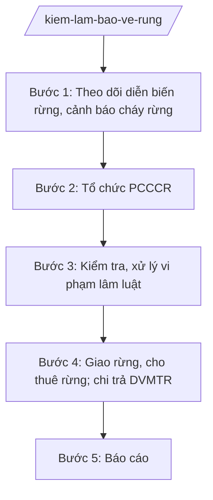

# Skill: Kiểm lâm, bảo vệ rừng

## 2. Khi nào dùng

- Khi tổ chức phòng cháy, chữa cháy rừng (PCCCR) mùa khô.
- Khi kiểm tra, xử lý vi phạm: phá rừng, khai thác, vận chuyển lâm sản trái phép.
- Khi tham mưu giao rừng, cho thuê rừng; chi trả dịch vụ môi trường rừng (DVMTR).
- Khi tổng hợp báo cáo diễn biến rừng, độ che phủ.

## 3. Đầu vào (Input)

| Trường | Mô tả | Bắt buộc |
|--------|-------|----------|
| `loai_viec` | PCCCR / kiểm tra xử lý vi phạm / giao rừng / chi trả DVMTR / báo cáo | Có |
| `dia_ban` | Khu vực rừng (tiểu khu, xã) | Không |
| `doi_tuong` | Tổ chức, cá nhân liên quan | Không |
| `noi_dung` | Mô tả vụ việc/yêu cầu | Không |

## 4. Quy trình

**Bước 1. Theo dõi diễn biến rừng, cảnh báo cháy rừng**
- Làm gì: Cập nhật diễn biến rừng (tăng/giảm diện tích); theo dõi cấp dự báo cháy rừng; cảnh báo các chủ rừng, địa phương.
- Dùng input: `loai_viec`, `dia_ban`.
- Vai trò: Chi cục Kiểm lâm theo dõi; AI hỗ trợ tổng hợp số liệu, bản đồ nguy cơ — ⏱ thường xuyên, hằng ngày trong mùa khô.
- Lưu ý nghiệp vụ: Cấp dự báo cháy rừng cấp IV–V phải cảnh báo khẩn; cập nhật diễn biến rừng hằng năm bắt buộc.
- → Kết quả bước: Bản tin cảnh báo cháy rừng + báo cáo diễn biến rừng.

**Bước 2. Tổ chức PCCCR**
- Làm gì: Xây dựng phương án PCCCR; bố trí lực lượng trực; diễn tập; huy động chữa cháy khi xảy ra.
- Dùng input: `dia_ban`.
- Vai trò: Chi cục trưởng chỉ huy; AI hỗ trợ lập phương án, danh sách lực lượng — ⏱ trước mùa khô.
- Lưu ý nghiệp vụ: Phương châm "4 tại chỗ"; chủ rừng chịu trách nhiệm chính về PCCCR trong diện tích được giao.
- → Kết quả bước: Phương án PCCCR + báo cáo chữa cháy (nếu xảy ra).

**Bước 3. Kiểm tra, xử lý vi phạm lâm luật**
- Làm gì: Tuần tra, kiểm tra; phát hiện phá rừng, khai thác/vận chuyển lâm sản trái phép; lập biên bản, xử phạt; chuyển hình sự nếu đủ dấu hiệu tội phạm.
- Dùng input: `doi_tuong`, `noi_dung`.
- Vai trò: Hạt Kiểm lâm/Đội kiểm lâm cơ động; AI hỗ trợ lập biên bản, tra cứu khung phạt — ⏱ kịp thời.
- Lưu ý nghiệp vụ: Tang vật lâm sản phải được quản lý, xử lý đúng quy định; phá rừng quy mô lớn chuyển Công an điều tra.
- → Kết quả bước: Biên bản VPHC + quyết định xử phạt / hồ sơ chuyển điều tra.

**Bước 4. Giao rừng, cho thuê rừng; chi trả DVMTR**
- Làm gì: Thẩm định hồ sơ giao rừng, cho thuê rừng cho tổ chức; xác định diện tích cung ứng DVMTR; chi trả tiền DVMTR cho chủ rừng.
- Dùng input: `doi_tuong`, `dia_ban`.
- Vai trò: Chuyên viên Chi cục thẩm định; AI hỗ trợ đối chiếu bản đồ, lập danh sách chi trả — ⏱ 10–15 ngày.
- Lưu ý nghiệp vụ: Chi trả DVMTR công khai, đúng đối tượng, đúng diện tích nghiệm thu; không để trục lợi chính sách.
- → Kết quả bước: Quyết định giao/cho thuê rừng; danh sách chi trả DVMTR.

**Bước 5. Báo cáo**
- Làm gì: Tổng hợp: diện tích rừng, độ che phủ; vụ cháy, vi phạm; kết quả chi trả DVMTR; báo cáo UBND tỉnh, Bộ NN&MT.
- Dùng input: `loai_viec` (báo cáo).
- Vai trò: Chuyên viên Chi cục tổng hợp; AI hỗ trợ lập bảng số liệu — ⏱ 3 ngày.
- Lưu ý nghiệp vụ: Số liệu diện tích rừng phải khớp giữa kiểm lâm và địa chính.
- → Kết quả bước: Báo cáo công tác kiểm lâm, bảo vệ rừng định kỳ.

## Luồng quy trình (Workflow)

## 5. Đầu ra (Output)

- Phương án PCCCR; bản tin cảnh báo cháy rừng.
- Biên bản kiểm tra, quyết định xử phạt VPHC lâm nghiệp.
- Quyết định giao rừng/cho thuê rừng; danh sách chi trả DVMTR.
- Báo cáo diễn biến rừng, công tác kiểm lâm định kỳ.

**Cấu trúc output chuẩn (Phương án PCCCR):**
- Thể thức: tuân thủ Nghị định 30/2020/NĐ-CP về công tác văn thư.

1. Quốc hiệu "CỘNG HÒA XÃ HỘI CHỦ NGHĨA VIỆT NAM", Tiêu ngữ "Độc lập – Tự do – Hạnh phúc"; tên cơ quan (Chi cục Kiểm lâm tỉnh A); số, ký hiệu.
2. Tên loại: **PHƯƠNG ÁN** — phòng cháy, chữa cháy rừng mùa khô năm [năm] tỉnh A.
3. Đánh giá tình hình (diện tích rừng, vùng trọng điểm cháy).
4. Mục tiêu, yêu cầu.
5. Lực lượng, phương tiện, kinh phí; phân công (kiểm lâm, chủ rừng, UBND cấp xã, công an, quân đội).
6. Phương án xử lý khi xảy ra cháy (chỉ huy, điều động, hậu cần).
7. Chế độ trực, báo cáo.
8. Nơi nhận; chữ ký Chi cục trưởng.

## 6. Checklist nghiệm thu

- [ ] Cảnh báo cháy rừng kịp thời khi cấp dự báo IV–V.
- [ ] Phương án PCCCR đến được chủ rừng, UBND cấp xã.
- [ ] Vi phạm lâm luật được xử lý dứt điểm; tang vật quản lý đúng quy định.
- [ ] Chi trả DVMTR đúng đối tượng, công khai, có nghiệm thu diện tích.
- [ ] Số liệu diện tích rừng khớp giữa kiểm lâm và địa chính.
- [ ] Văn bản đúng thể thức NĐ 30/2020/NĐ-CP.

## 7. Ví dụ mô phỏng

*Dữ liệu dưới đây là giả lập 100% phục vụ minh họa.*

**Input mẫu:** loai_viec = "PCCCR"; dia_ban = "Tiểu khu 12, xã A (rừng thông)".

**Output mẫu (trích Phương án):**

> **CHI CỤC KIỂM LÂM TỈNH A**
> Số: 123/PA-KL
>
> **PHƯƠNG ÁN**
> Phòng cháy, chữa cháy rừng mùa khô năm 2026
>
> 1. Vùng trọng điểm: tiểu khu 12, xã A (500 ha rừng thông, nguy cơ cháy cao).
> 2. Lực lượng: Hạt Kiểm lâm khu vực (15 người), tổ bảo vệ rừng xã A (10 người), dân quân xã A (20 người).
> 3. Phương tiện: 02 xe chữa cháy, máy thổi gió, bình xịt...; kinh phí từ ngân sách và quỹ PCCCR.
> 4. Trực 24/24 từ tháng 12 đến tháng 4; cấm đốt nương trong vùng trọng điểm khi cấp dự báo IV trở lên.
> 5. Khi xảy ra cháy: Hạt trưởng chỉ huy tại chỗ; báo cáo Chi cục trưởng điều động tăng cường trong 01 giờ./.
>
> *Nơi nhận:* ... — **CHI CỤC TRƯỞNG** *(ký, đóng dấu)*

## 8. Human gate

- Chuyên viên/Hạt Kiểm lâm soạn → Chi cục trưởng duyệt → Phó Giám đốc Sở phụ trách → Giám đốc Sở ký (văn bản quan trọng).
- Xử phạt: theo thẩm quyền; vượt thẩm quyền trình Chủ tịch UBND tỉnh.

## 9. Giới hạn

- AI không tự kết luận vi phạm lâm luật, không tự áp mức phạt.
- Không bịa số liệu diện tích rừng, vụ cháy, vi phạm.
- Không dùng văn bản hết hiệu lực làm căn cứ.

## 10. Căn cứ & lưu ý

- Thông tư 19/2025/TT-BNNMT của Bộ Nông nghiệp và Môi trường hướng dẫn chức năng, nhiệm vụ của cơ quan chuyên môn về nông nghiệp và môi trường.
- Luật Lâm nghiệp và các văn bản hướng dẫn (dẫn tên, áp dụng bản hiện hành).
- Nghị định 150/2025/NĐ-CP về tổ chức cơ quan chuyên môn thuộc UBND cấp tỉnh.
- Nghị định 30/2020/NĐ-CP về công tác văn thư (thể thức văn bản).
- Lưu ý: Chi cục Kiểm lâm là tổ chức tương đương chi cục thuộc Sở NN&MT; phối hợp Công an trong xử lý vi phạm nghiêm trọng.
