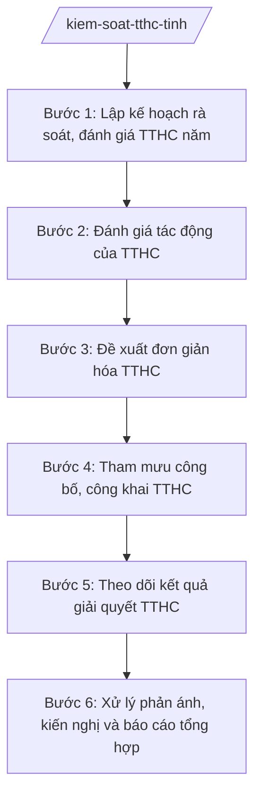

# Skill: Kiểm soát thủ tục hành chính cấp tỉnh

## 2. Khi nào dùng

- Lập kế hoạch rà soát, đánh giá thủ tục hành chính (TTHC) hằng năm của tỉnh.
- Đánh giá tác động của TTHC mới ban hành hoặc TTHC hiện hành (chi phí tuân thủ, sự cần thiết, tính hợp lý).
- Đề xuất đơn giản hóa, cắt giảm TTHC, điều kiện kinh doanh thuộc thẩm quyền của tỉnh.
- Tham mưu Chủ tịch UBND tỉnh công bố danh mục TTHC thuộc thẩm quyền giải quyết của tỉnh.
- Theo dõi, đánh giá kết quả giải quyết TTHC (thời gian, tỷ lệ đúng hạn, mức độ hài lòng).
- Tiếp nhận, xử lý phản ánh, kiến nghị của cá nhân, tổ chức về TTHC.

## 3. Đầu vào (Input)

| Trường | Mô tả | Bắt buộc |
|--------|-------|----------|
| `danh_muc_tthc_hien_hanh` | Danh sách TTHC thuộc thẩm quyền giải quyết của các sở, ban, ngành, UBND xã trên địa bàn tỉnh | Có |
| `du_thao_van_ban_co_tthc` | Dự thảo văn bản QPPL của HĐND/UBND tỉnh có quy định TTHC mới hoặc sửa đổi TTHC | Không |
| `so_lieu_giai_quyet_tthc` | Số hồ sơ tiếp nhận, đã giải quyết đúng hạn/quá hạn, hồ sơ tồn đọng (từ Trung tâm PVHCC, các sở) | Có |
| `phan_anh_kien_nghi_ve_tthc` | Phản ánh của cá nhân, tổ chức về vướng mắc, bất cập trong thực hiện TTHC | Không |
| `chi_phi_tuan_thu_tthc` | Thời gian, chi phí mà cá nhân, tổ chức phải bỏ ra để thực hiện TTHC | Không |
| `van_ban_qppl_lien_quan` | Văn bản của trung ương, của tỉnh quy định về TTHC trong lĩnh vực cụ thể | Không |

## 4. Quy trình

**Bước 1. Lập kế hoạch rà soát, đánh giá TTHC năm**

- Làm gì: Rà soát danh mục TTHC hiện hành; xác định TTHC cần rà soát, đánh giá trong năm (ưu tiên TTHC có nhiều phản ánh, tỷ lệ quá hạn cao, TTHC mới ban hành); lập kế hoạch với nội dung, đơn vị thực hiện, tiến độ.
- Dùng input: `danh_muc_tthc_hien_hanh`, `so_lieu_giai_quyet_tthc`, `phan_anh_kien_nghi_ve_tthc`.
- Vai trò: Chuyên viên Phòng Kiểm soát TTHC (Văn phòng UBND tỉnh) lập kế hoạch AI hỗ trợ: phân tích số liệu giải quyết để xác định TTHC có vấn đề, lập danh sách ưu tiên; Trưởng phòng thẩm định; Chánh Văn phòng trình Chủ tịch UBND tỉnh phê duyệt ⏱ ~7 ngày làm việc (ước tính).
- Lưu ý nghiệp vụ: Kế hoạch phải gắn với chương trình cải cách hành chính của tỉnh; ưu tiên TTHC liên quan trực tiếp đến người dân, doanh nghiệp.
- → Kết quả bước: Kế hoạch rà soát, đánh giá TTHC năm của tỉnh.

**Bước 2. Đánh giá tác động của TTHC**

- Làm gì: Đối với từng TTHC trong kế hoạch: đánh giá sự cần thiết, tính hợp lý, tính hợp pháp; tính toán chi phí tuân thủ (thời gian, chi phí đi lại, phí, lệ phí); so sánh với quy định của trung ương và thực tiễn các tỉnh.
- Dùng input: Danh mục TTHC cần đánh giá, `chi_phi_tuan_thu_tthc`, `van_ban_qppl_lien_quan`, `du_thao_van_ban_co_tthc`.
- Vai trò: Chuyên viên đánh giá AI hỗ trợ: tính toán chi phí tuân thủ, đối chiếu quy định với văn bản cấp trên để phát hiện quy định trái/vượt thẩm quyền; chuyên viên kết luận đánh giá; Trưởng phòng thẩm định ⏱ ~10 ngày làm việc/TTHC hoặc nhóm TTHC (ước tính).
- Lưu ý nghiệp vụ: Đánh giá khách quan, có số liệu minh chứng; phát hiện TTHC do tỉnh tự đặt thêm ngoài quy định của trung ương thì phải kiến nghị bãi bỏ.
- → Kết quả bước: Báo cáo đánh giá tác động từng TTHC (cần thiết/hợp lý/cần sửa đổi/bãi bỏ).

**Bước 3. Đề xuất đơn giản hóa TTHC**

- Làm gì: Trên cơ sở đánh giá tác động, đề xuất phương án đơn giản hóa: cắt giảm thành phần hồ sơ, rút ngắn thời gian giải quyết, giảm phí/lệ phí, tích hợp liên thông, chuyển sang dịch vụ công trực tuyến toàn trình; lấy ý kiến cơ quan chủ trì TTHC.
- Dùng input: Báo cáo đánh giá tác động (bước 2).
- Vai trò: Chuyên viên đề xuất AI hỗ trợ: soạn phương án đơn giản hóa, ước tính mức giảm chi phí tuân thủ sau đơn giản hóa; Trưởng phòng thẩm định; lấy ý kiến sở, ngành chủ trì TTHC ⏱ ~7 ngày làm việc (ước tính).
- Lưu ý nghiệp vụ: Phương án đơn giản hóa phải khả thi, không làm giảm yêu cầu quản lý nhà nước cần thiết; đơn giản hóa TTHC thuộc thẩm quyền trung ương thì kiến nghị cấp có thẩm quyền, không tự ý sửa đổi.
- → Kết quả bước: Phương án đơn giản hóa TTHC (kèm ước tính hiệu quả).

**Bước 4. Tham mưu công bố, công khai TTHC**

- Làm gì: Soạn dự thảo quyết định công bố danh mục TTHC (mới ban hành, sửa đổi, bãi bỏ) thuộc thẩm quyền giải quyết của tỉnh; trình Chủ tịch UBND tỉnh ký ban hành; cập nhật, công khai trên Cổng thông tin điện tử tỉnh, Cơ sở dữ liệu quốc gia về TTHC; niêm yết tại Trung tâm PVHCC.
- Dùng input: Phương án đơn giản hóa (bước 3), `danh_muc_tthc_hien_hanh`.
- Vai trò: Chuyên viên soạn dự thảo quyết định công bố AI hỗ trợ: rà soát danh mục, kiểm tra tính nhất quán với văn bản gốc, soạn dự thảo quyết định; Chánh Văn phòng trình Chủ tịch UBND tỉnh ký ⏱ ~5 ngày làm việc (ước tính).
- Lưu ý nghiệp vụ: TTHC chỉ được thực hiện sau khi công bố; công bố phải kịp thời ngay sau khi văn bản quy định TTHC có hiệu lực.
- → Kết quả bước: Quyết định công bố TTHC của Chủ tịch UBND tỉnh (dự thảo trình ký); TTHC được công khai.

**Bước 5. Theo dõi kết quả giải quyết TTHC**

- Làm gì: Thu thập số liệu giải quyết TTHC từ Trung tâm PVHCC tỉnh, các sở, UBND xã: tỷ lệ đúng hạn, hồ sơ quá hạn, nguyên nhân; đánh giá mức độ hài lòng qua khảo sát; tổng hợp vướng mắc phát sinh.
- Dùng input: `so_lieu_giai_quyet_tthc`, `phan_anh_kien_nghi_ve_tthc`.
- Vai trò: Chuyên viên theo dõi AI hỗ trợ: tổng hợp số liệu tự động, cảnh báo đơn vị có tỷ lệ quá hạn cao, phân tích nguyên nhân quá hạn; Trưởng phòng báo cáo Chánh Văn phòng. ⏱ ~hằng tháng/quý (ước tính).
- Lưu ý nghiệp vụ: Số liệu phải đầy đủ từ tất cả đầu mối giải quyết TTHC; đơn vị có tỷ lệ quá hạn cao phải được đôn đốc, làm rõ nguyên nhân bằng văn bản.
- → Kết quả bước: Báo cáo tình hình giải quyết TTHC định kỳ.

**Bước 6. Xử lý phản ánh, kiến nghị và báo cáo tổng hợp**

- Làm gì: Tiếp nhận phản ánh, kiến nghị về TTHC qua các kênh (Cổng thông tin, đường dây nóng, trực tiếp); phân loại, chuyển cơ quan có thẩm quyền xử lý, theo dõi kết quả trả lời; tổng hợp báo cáo công tác kiểm soát TTHC định kỳ gửi cấp trên.
- Dùng input: `phan_anh_kien_nghi_ve_tthc`, báo cáo tình hình giải quyết TTHC (bước 5).
- Vai trò: Chuyên viên xử lý AI hỗ trợ: phân loại phản ánh, theo dõi thời hạn trả lời, tổng hợp số liệu báo cáo; Trưởng phòng thẩm định báo cáo; Chánh Văn phòng ký báo cáo. ⏱ ~thường xuyên và định kỳ (ước tính).
- Lưu ý nghiệp vụ: Phản ánh, kiến nghị phải được trả lời đúng thời hạn; kết quả xử lý phản ánh là một tiêu chí đánh giá công tác kiểm soát TTHC.
- → Kết quả bước: Văn bản trả lời phản ánh, kiến nghị; báo cáo công tác kiểm soát TTHC.

## Luồng quy trình (Workflow)

## 5. Đầu ra (Output)

- Kế hoạch rà soát, đánh giá TTHC năm của tỉnh.
- Báo cáo đánh giá tác động TTHC.
- Phương án đơn giản hóa TTHC (sản phẩm chính).
- Dự thảo quyết định công bố danh mục TTHC của Chủ tịch UBND tỉnh.
- Báo cáo tình hình giải quyết TTHC; báo cáo công tác kiểm soát TTHC định kỳ.

**Cấu trúc output chuẩn:**

**PHƯƠNG ÁN ĐƠN GIẢN HÓA THỦ TỤC HÀNH CHÍNH** — các phần bắt buộc theo đúng thứ tự, đúng thể thức văn bản hành chính theo NĐ 30/2020/NĐ-CP:

1. Quốc hiệu "CỘNG HÒA XÃ HỘI CHỦ NGHĨA VIỆT NAM", Tiêu ngữ "Độc lập – Tự do – Hạnh phúc".
2. Tên cơ quan tham mưu: VĂN PHÒNG ỦY BAN NHÂN DÂN TỈNH A. Số, ký hiệu văn bản; địa danh và thời gian ban hành.
3. Tên loại và trích yếu: PHƯƠNG ÁN — Đơn giản hóa thủ tục hành chính thuộc thẩm quyền giải quyết của tỉnh A (đợt ...).
4. Căn cứ (NĐ 118/2025/NĐ-CP; kế hoạch rà soát TTHC năm; kết quả đánh giá tác động...).
5. Đánh giá khái quát: số TTHC đã rà soát; TTHC cần đơn giản hóa.
6. Nội dung đơn giản hóa từng TTHC: tên TTHC; cơ quan thực hiện; nội dung cắt giảm/sửa đổi (thành phần hồ sơ, thời gian, phí/lệ phí, cách thức thực hiện); lý do; ước tính chi phí tuân thủ tiết kiệm được.
7. Tổ chức thực hiện: trách nhiệm của các sở, ban, ngành; lộ trình; công bố lại TTHC sau đơn giản hóa.
8. Nơi nhận; ký, đóng dấu.

## 6. Checklist nghiệm thu

1. Kế hoạch rà soát TTHC năm được phê duyệt, ưu tiên đúng TTHC có vấn đề.
2. 100% TTHC trong kế hoạch được đánh giá tác động với số liệu minh chứng.
3. Phát hiện và kiến nghị xử lý TTHC do tỉnh tự đặt thêm trái quy định của trung ương (nếu có).
4. Phương án đơn giản hóa khả thi, có ước tính hiệu quả (chi phí tuân thủ tiết kiệm được).
5. Đã lấy ý kiến cơ quan chủ trì TTHC trước khi trình phương án.
6. Quyết định công bố TTHC được ký ban hành kịp thời; TTHC công khai đầy đủ trên Cổng thông tin và tại Trung tâm PVHCC.
7. Phản ánh, kiến nghị về TTHC được trả lời đúng thời hạn, 100% có theo dõi kết quả.
8. Báo cáo kiểm soát TTHC định kỳ đầy đủ, số liệu khớp với số liệu giải quyết thực tế.
9. Thể thức văn bản đúng NĐ 30/2020/NĐ-CP.

## 7. Ví dụ mô phỏng

*Dữ liệu dưới đây là giả lập 100% phục vụ minh họa.*

**Input mẫu:**

| Trường | Giá trị mẫu |
|--------|-------------|
| Danh mục TTHC hiện hành | 1.200 TTHC thuộc thẩm quyền giải quyết của tỉnh A (800 cấp tỉnh, 400 cấp xã) |
| Dự thảo văn bản có TTHC | Không |
| Số liệu giải quyết TTHC | 9 tháng năm 2027: 100.000 hồ sơ; tỷ lệ đúng hạn 96%; 4.000 hồ sơ quá hạn, tập trung lĩnh vực đất đai |
| Phản ánh, kiến nghị về TTHC | 50 phản ánh về thời gian giải quyết TTHC đất đai kéo dài |
| Chi phí tuân thủ TTHC | TTHC cấp giấy chứng nhận QSDĐ: người dân mất trung bình 5 lượt đi lại, 15 ngày chờ đợi |
| Văn bản QPPL liên quan | Quy định về TTHC đất đai của trung ương (còn hiệu lực) |

**Output mẫu (trích Phương án đơn giản hóa):**

**VĂN PHÒNG ỦY BAN NHÂN DÂN TỈNH A**

Số: 1234/PA-VPUBND
Tỉnh A, ngày 10 tháng 10 năm 2027

**PHƯƠNG ÁN**
**Đơn giản hóa thủ tục hành chính thuộc thẩm quyền giải quyết của tỉnh A (đợt 2 năm 2027)**

*Căn cứ Nghị định số 118/2025/NĐ-CP ngày 09/6/2025 của Chính phủ về cơ chế một cửa, một cửa liên thông trong giải quyết thủ tục hành chính;*

**I. ĐÁNH GIÁ KHÁI QUÁT**
Đã rà soát 200 TTHC; 20 TTHC cần đơn giản hóa, tập trung lĩnh vực đất đai (tỷ lệ quá hạn 8%, 50 phản ánh của người dân)...

**II. NỘI DUNG ĐƠN GIẢN HÓA**
1. TTHC "Cấp Giấy chứng nhận quyền sử dụng đất lần đầu":
   - Cắt giảm 3/8 thành phần hồ sơ (bản sao hộ khẩu, giấy xác nhận tình trạng hôn nhân — khai thác từ cơ sở dữ liệu dùng chung).
   - Rút ngắn thời gian giải quyết từ 15 ngày xuống 10 ngày làm việc.
   - Ước tính tiết kiệm: 5.000 lượt đi lại/năm của người dân.
2. (19 TTHC khác...)

**III. TỔ CHỨC THỰC HIỆN**
Sở Nông nghiệp và Môi trường tỉnh A chủ trì triển khai; công bố lại TTHC trong 15 ngày...

*Nơi nhận:* ...
**CHÁNH VĂN PHÒNG**
(Ký, đóng dấu — bà Vũ Thị T)

## 8. Human gate (người kiểm duyệt)

- Chuyên viên Phòng Kiểm soát TTHC rà soát, đánh giá, đề xuất → Trưởng phòng thẩm định → Chánh Văn phòng UBND tỉnh duyệt, trình → Chủ tịch UBND tỉnh phê duyệt kế hoạch rà soát, ký quyết định công bố TTHC.
- Phương án đơn giản hóa phải lấy ý kiến cơ quan chủ trì TTHC trước khi trình.

## 9. Giới hạn (guardrails)

- AI không quyết định bãi bỏ, sửa đổi TTHC thay người có thẩm quyền; không tự ý thay đổi quy định thuộc thẩm quyền trung ương.
- AI không tự ký, ban hành quyết định công bố TTHC.
- AI không bịa đặt số liệu giải quyết TTHC, chi phí tuân thủ; số liệu phải từ nguồn chính thức.
- AI không viện dẫn văn bản đã hết hiệu lực khi đánh giá tính hợp pháp của TTHC.

## 10. Căn cứ & lưu ý

- NĐ 118/2025/NĐ-CP: cơ chế một cửa, một cửa liên thông trong giải quyết TTHC — căn cứ chính về kiểm soát TTHC.
- NĐ 150/2025/NĐ-CP: Văn phòng UBND tỉnh là cơ quan chuyên môn thuộc UBND cấp tỉnh, tham mưu công tác kiểm soát TTHC.
- Văn bản 7216/VPCP-KSTT ngày 04/8/2025 của Văn phòng Chính phủ: hướng dẫn tổ chức, hoạt động của Trung tâm Phục vụ hành chính công (liên quan theo dõi giải quyết TTHC).
- NĐ 30/2020/NĐ-CP: thể thức và kỹ thuật trình bày văn bản hành chính.
