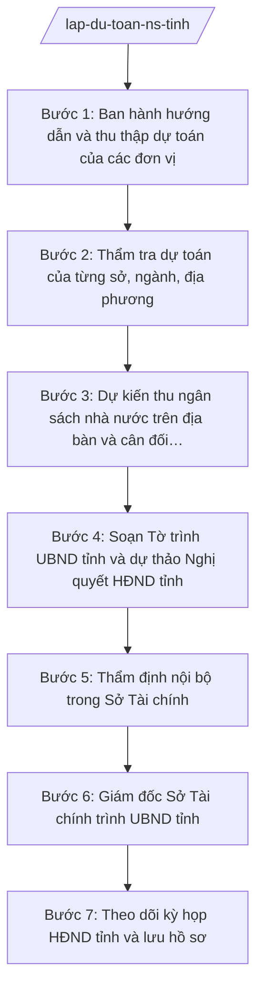

# Skill: Lập dự toán ngân sách địa phương

## 2. Khi nào dùng

- Đến kỳ lập dự toán ngân sách năm mới, Sở Tài chính tỉnh A ban hành văn bản hướng dẫn các sở, ban, ngành, UBND cấp xã lập dự toán;
- Cần tổng hợp, thẩm tra dự toán của các đơn vị dự toán cấp I, cấp xã để cân đối thu–chi toàn tỉnh;
- UBND tỉnh A cần Tờ trình và dự thảo Nghị quyết để trình HĐND tỉnh quyết nghị dự toán ngân sách địa phương tại kỳ họp cuối năm;
- Cần điều chỉnh, bổ sung dự toán giữa năm khi có biến động lớn về thu hoặc nhiệm vụ chi.

## 3. Đầu vào (Input)

| Trường | Mô tả | Bắt buộc |
|--------|-------|----------|
| `nam_du_toan` | Năm ngân sách cần lập dự toán (năm N) | Có |
| `huong_dan_bo_tai_chinh` | Văn bản hướng dẫn xây dựng dự toán của Bộ Tài chính (số hiệu, ngày ban hành, chỉ tiêu định hướng) | Có |
| `du_toan_don_vi` | Dự toán năm N do các sở, ban, ngành, đơn vị dự toán cấp I và UBND cấp xã gửi về | Có |
| `so_lieu_thu_chi_nam_truoc` | Số liệu thu–chi thực hiện/ước thực hiện năm N-1 toàn tỉnh (đối chiếu Kho bạc Nhà nước) | Có |
| `du_toan_nam_truoc` | Dự toán năm N-1 đã được HĐND tỉnh quyết nghị | Có |
| `chi_tieu_thu_giao` | Chỉ tiêu thu ngân sách trung ương giao/định hướng cho tỉnh (nếu có) | Không |
| `nhiem_vu_chi_moi` | Các nhiệm vụ chi mới, chương trình, dự án phát sinh dự kiến năm N | Không |

## 4. Quy trình

**Bước 1. Ban hành hướng dẫn và thu thập dự toán của các đơn vị**
- Làm gì: Soạn văn bản hướng dẫn các sở, ban, ngành, đơn vị dự toán cấp I và UBND cấp xã lập dự toán năm N theo định hướng của Bộ Tài chính; tiếp nhận, đăng ký đầy đủ hồ sơ dự toán các đơn vị gửi về, lập danh sách theo dõi tiến độ nộp.
- Dùng input: `huong_dan_bo_tai_chinh`, `nam_du_toan`.
- Vai trò: Chuyên viên Phòng Ngân sách (Sở Tài chính) soạn thảo, AI hỗ trợ dựng khung văn bản hướng dẫn và lập bảng theo dõi tiến độ nộp dự toán; ⏱ ~2–3 ngày làm việc (ước tính).
- Lưu ý nghiệp vụ: Văn bản hướng dẫn phải bám sát định hướng của Bộ Tài chính và khả năng cân đối của tỉnh; đôn đốc các đơn vị nộp đúng hạn để không ảnh hưởng tiến độ chung.
- → Kết quả bước: Văn bản hướng dẫn đã ban hành + danh sách theo dõi hồ sơ dự toán các đơn vị.

**Bước 2. Thẩm tra dự toán của từng sở, ngành, địa phương**
- Làm gì: Rà soát từng bộ dự toán đơn vị: căn cứ lập, tính hợp lý của các khoản thu–chi, định mức, chế độ chi, nhiệm vụ mới; làm việc với đơn vị để điều chỉnh các nội dung chưa phù hợp; lập biên bản thẩm tra từng đơn vị.
- Dùng input: `du_toan_don_vi`, `so_lieu_thu_chi_nam_truoc`, `du_toan_nam_truoc`.
- Vai trò: Chuyên viên Phòng Ngân sách thẩm tra, AI hỗ trợ đối chiếu số liệu đơn vị với số liệu thực hiện năm trước, cảnh báo các khoản tăng/giảm bất thường; ⏱ ~5–7 ngày làm việc (ước tính).
- Lưu ý nghiệp vụ: Kiên quyết loại bỏ các khoản chi không đúng chế độ, không có căn cứ; mọi điều chỉnh phải có ý kiến thống nhất với đơn vị, ghi biên bản rõ ràng.
- → Kết quả bước: Biên bản thẩm tra dự toán từng đơn vị + dự toán các đơn vị sau điều chỉnh.

**Bước 3. Dự kiến thu ngân sách nhà nước trên địa bàn và cân đối thu–chi toàn tỉnh**
- Làm gì: Phân tích từng nguồn thu (thuế, phí, lệ phí; thu từ đất đai; thu bổ sung từ NSTW...) theo số liệu thực hiện năm N-1 và chỉ tiêu được giao; tổng hợp nhu cầu chi toàn tỉnh; cân đối tổng thu – tổng chi, phân bổ chi thường xuyên, chi đầu tư phát triển, dự phòng ngân sách.
- Dùng input: `so_lieu_thu_chi_nam_truoc`, `chi_tieu_thu_giao`, kết quả Bước 2.
- Vai trò: Chuyên viên Phòng Ngân sách phân tích, AI hỗ trợ tính toán, lập bảng cân đối thu–chi nhiều phương án; ⏱ ~3–4 ngày làm việc (ước tính).
- Lưu ý nghiệp vụ: Phương án dự kiến thu phải khả thi, không "vẽ" thu để cân đối chi; ưu tiên bảo đảm chi lương, hoạt động bộ máy và các nhiệm vụ chi bắt buộc trước khi phân bổ chi đầu tư.
- → Kết quả bước: Bảng cân đối thu–chi ngân sách địa phương năm N (các phương án).

**Bước 4. Soạn Tờ trình UBND tỉnh và dự thảo Nghị quyết HĐND tỉnh**
- Làm gì: Soạn Tờ trình của UBND tỉnh trình HĐND tỉnh về dự toán ngân sách địa phương năm N (nêu căn cứ, tình hình thực hiện năm N-1, nội dung dự toán đề nghị quyết nghị) và dự thảo Nghị quyết HĐND tỉnh về dự toán ngân sách địa phương năm N, kèm các biểu thu/chi và phương án phân bổ.
- Dùng input: Kết quả Bước 3, `nam_du_toan`.
- Vai trò: Chuyên viên Phòng Ngân sách soạn thảo, AI hỗ trợ dựng khung văn bản đúng thể thức, rà soát căn cứ pháp lý và đối chiếu số liệu văn bản – biểu mẫu; ⏱ ~2–3 ngày làm việc (ước tính).
- Lưu ý nghiệp vụ: Số liệu trong Tờ trình, dự thảo Nghị quyết và biểu kèm theo phải khớp tuyệt đối; căn cứ pháp lý phải đầy đủ, đúng văn bản còn hiệu lực.
- → Kết quả bước: Bản thảo Tờ trình UBND tỉnh + dự thảo Nghị quyết HĐND tỉnh + bộ biểu dự toán.

**Bước 5. Thẩm định nội bộ trong Sở Tài chính**
- Làm gì: Trưởng phòng Ngân sách và Phó Giám đốc Sở phụ trách rà soát toàn bộ hồ sơ: tính hợp pháp của căn cứ, tính chính xác và cân đối của số liệu, tính đầy đủ của biểu mẫu và phương án phân bổ; yêu cầu chỉnh sửa, bổ sung nếu có sai sót.
- Dùng input: Toàn bộ kết quả Bước 4.
- Vai trò: Trưởng phòng Ngân sách, Phó Giám đốc Sở kiểm tra; AI hỗ trợ đối chiếu chéo số liệu giữa Tờ trình – Nghị quyết – biểu mẫu, liệt kê điểm chưa khớp; ⏱ ~1–2 ngày làm việc (ước tính).
- Lưu ý nghiệp vụ: Đây là chốt kiểm soát nội bộ cuối trước khi trình Giám đốc Sở; mọi chênh lệch số liệu phải được xử lý dứt điểm tại bước này.
- → Kết quả bước: Hồ sơ dự toán đã thẩm định nội bộ, có ý kiến kiểm tra của lãnh đạo Sở.

**Bước 6. Giám đốc Sở Tài chính trình UBND tỉnh**
- Làm gì: Giám đốc Sở Tài chính (ông Hoàng Văn S) xem xét hồ sơ, ký Tờ trình của Sở trình UBND tỉnh; phối hợp Văn phòng UBND tỉnh đưa nội dung vào chương trình họp UBND tỉnh; hoàn thiện hồ sơ theo ý kiến chỉ đạo của UBND tỉnh.
- Dùng input: Hồ sơ dự toán đã thẩm định ở Bước 5.
- Vai trò: Giám đốc Sở Tài chính quyết định; chuyên viên hoàn thiện hồ sơ theo chỉ đạo, AI hỗ trợ cập nhật nhanh các chỉnh sửa; ⏱ ~2–3 ngày làm việc (ước tính).
- Lưu ý nghiệp vụ: AI chỉ hỗ trợ chỉnh sửa kỹ thuật theo chỉ đạo; quyết định nội dung dự toán thuộc thẩm quyền của Giám đốc Sở, UBND tỉnh và HĐND tỉnh.
- → Kết quả bước: Tờ trình trình UBND tỉnh đã ký, sẵn sàng trình kỳ họp HĐND tỉnh.

**Bước 7. Theo dõi kỳ họp HĐND tỉnh và lưu hồ sơ**
- Làm gì: Theo dõi kỳ họp HĐND tỉnh cuối năm; ghi nhận nội dung Nghị quyết đã được quyết nghị (số hiệu, các chỉ tiêu thu–chi chính thức); thông báo dự toán đã quyết nghị đến các đơn vị; lưu hồ sơ đầy đủ phục vụ giao dự toán và quyết toán sau này.
- Dùng input: Nghị quyết HĐND tỉnh đã ban hành (bản chính thức sau kỳ họp).
- Vai trò: Chuyên viên Phòng Ngân sách theo dõi và cập nhật, AI hỗ trợ trích xuất các chỉ tiêu chính từ Nghị quyết vào bảng theo dõi; ⏱ ~1 ngày làm việc (ước tính).
- Lưu ý nghiệp vụ: Chỉ số liệu trong Nghị quyết đã ban hành mới là dự toán chính thức có hiệu lực thi hành; phải giao dự toán cho các đơn vị kịp thời để tổ chức thực hiện từ đầu năm ngân sách.
- → Kết quả bước: Hồ sơ dự toán hoàn chỉnh kèm Nghị quyết HĐND tỉnh đã ban hành, lưu hồ sơ theo dõi.

## Luồng quy trình (Workflow)

## 5. Đầu ra (Output)

- Văn bản hướng dẫn các đơn vị lập dự toán ngân sách năm N;
- Biên bản thẩm tra dự toán từng đơn vị dự toán cấp I, cấp xã;
- Tờ trình của UBND tỉnh trình HĐND tỉnh về dự toán ngân sách địa phương năm N (đã ký);
- Dự thảo Nghị quyết của HĐND tỉnh về dự toán ngân sách địa phương năm N;
- Các biểu dự toán thu–chi ngân sách địa phương năm N kèm theo;
- Nghị quyết HĐND tỉnh đã ban hành (bản chính thức sau kỳ họp — do HĐND ban hành, Sở lưu hồ sơ).

**Cấu trúc output chuẩn (Tờ trình UBND tỉnh về dự toán ngân sách địa phương):**
- Thể thức: tuân thủ Nghị định 30/2020/NĐ-CP về công tác văn thư.

1. Quốc hiệu "CỘNG HÒA XÃ HỘI CHỦ NGHĨA VIỆT NAM", Tiêu ngữ "Độc lập – Tự do – Hạnh phúc";
2. Tên cơ quan ban hành: ỦY BAN NHÂN DÂN TỈNH A; số, ký hiệu văn bản; địa danh và ngày, tháng, năm ban hành;
3. Tên loại và trích yếu nội dung: TỜ TRÌNH — Về việc đề nghị HĐND tỉnh quyết nghị dự toán ngân sách địa phương năm N;
4. Phần "Kính gửi": Hội đồng nhân dân tỉnh A;
5. Căn cứ ban hành (Luật Ngân sách nhà nước; văn bản hướng dẫn của Bộ Tài chính...);
6. Nội dung: đánh giá tình hình thực hiện dự toán năm N-1; nội dung dự toán năm N đề nghị quyết nghị (tổng thu NSNN trên địa bàn, tổng thu–chi ngân sách địa phương, phân bổ chi theo lĩnh vực); kiến nghị HĐND xem xét, quyết nghị;
7. Nơi nhận;
8. Thẩm quyền, chức vụ, họ tên người ký: TM. ỦY BAN NHÂN DÂN — CHỦ TỊCH — (chữ ký, họ tên), dấu của cơ quan.

**Cấu trúc output chuẩn (Nghị quyết HĐND tỉnh về dự toán ngân sách địa phương):**

1. Quốc hiệu "CỘNG HÒA XÃ HỘI CHỦ NGHĨA VIỆT NAM", Tiêu ngữ "Độc lập – Tự do – Hạnh phúc";
2. Tên cơ quan ban hành: HỘI ĐỒNG NHÂN DÂN TỈNH A; số, ký hiệu văn bản; địa danh và ngày, tháng, năm ban hành;
3. Tên loại và trích yếu: NGHỊ QUYẾT — Về dự toán ngân sách địa phương năm N;
4. Căn cứ ban hành (Luật Tổ chức chính quyền địa phương; Luật Ngân sách nhà nước; Tờ trình của UBND tỉnh...);
5. Nội dung quyết nghị theo điều, khoản: quyết nghị tổng thu NSNN trên địa bàn, tổng thu–chi ngân sách địa phương và các chỉ tiêu chủ yếu; giao UBND tỉnh tổ chức thực hiện; hiệu lực thi hành;
6. Nơi nhận;
7. Thẩm quyền, chức vụ, họ tên người ký: TM. HỘI ĐỒNG NHÂN DÂN — CHỦ TỊCH — (chữ ký, họ tên), dấu của cơ quan;
8. Các biểu dự toán thu–chi kèm theo Nghị quyết.

## 6. Checklist nghiệm thu

- [ ] Có đầy đủ 4 sản phẩm: văn bản hướng dẫn, biên bản thẩm tra đơn vị, Tờ trình UBND tỉnh, dự thảo Nghị quyết HĐND tỉnh + bộ biểu;
- [ ] 100% đơn vị dự toán cấp I và UBND cấp xã đã nộp dự toán và được thẩm tra, có biên bản;
- [ ] Số liệu trong Tờ trình, dự thảo Nghị quyết và biểu mẫu khớp nhau tuyệt đối;
- [ ] Tổng chi không vượt tổng thu; phân định rõ chi thường xuyên, chi đầu tư phát triển, dự phòng;
- [ ] Căn cứ pháp lý đầy đủ, đúng văn bản còn hiệu lực, không bịa số hiệu;
- [ ] Thể thức văn bản hành chính đúng quy định (quốc hiệu, tiêu ngữ, số/ký hiệu, nơi nhận, chữ ký, dấu);
- [ ] Đã qua thẩm định nội bộ (Trưởng phòng, Phó Giám đốc, Giám đốc Sở) trước khi trình UBND tỉnh;
- [ ] Số liệu do các đơn vị cung cấp và Kho bạc đối chiếu, AI không tự bịa thêm khoản thu/chi;
- [ ] Hồ sơ lưu đầy đủ: văn bản hướng dẫn, dự toán các đơn vị, biên bản thẩm tra, các bản thảo.

## 7. Ví dụ mô phỏng

*Dữ liệu dưới đây là giả lập 100% phục vụ minh họa.*

### Input mẫu

| Trường | Giá trị giả lập |
|--------|-----------------|
| nam_du_toan | 2027 |
| huong_dan_bo_tai_chinh | Văn bản hướng dẫn xây dựng dự toán NSNN năm 2027 của Bộ Tài chính (số hiệu giả lập 123/HD-BTC) |
| du_toan_don_vi | 20 sở, ban, ngành và 30 UBND cấp xã đã nộp dự toán năm 2027 |
| so_lieu_thu_chi_nam_truoc | Tổng thu NSNN trên địa bàn thực hiện năm 2026: 10.000 tỷ đồng; tổng chi ngân sách địa phương: 9.800 tỷ đồng |
| du_toan_nam_truoc | Dự toán năm 2026 đã quyết nghị: tổng thu–chi 9.500 tỷ đồng |
| chi_tieu_thu_giao | Chỉ tiêu thu định hướng: 10.500 tỷ đồng |
| nhiem_vu_chi_moi | Chương trình hỗ trợ DNNVV: 200 tỷ đồng; sửa chữa trường học: 300 tỷ đồng |

### Output mẫu (Tờ trình — trích)

> **CỘNG HÒA XÃ HỘI CHỦ NGHĨA VIỆT NAM**
> **Độc lập – Tự do – Hạnh phúc**
>
> **ỦY BAN NHÂN DÂN TỈNH A**
> Số: 1234/TTr-UBND
> Tỉnh A, ngày 20 tháng 11 năm 2026
>
> **TỜ TRÌNH**
> **Về việc đề nghị HĐND tỉnh quyết nghị dự toán ngân sách địa phương năm 2027**
>
> Kính gửi: Hội đồng nhân dân tỉnh A.
>
> Căn cứ Luật Ngân sách nhà nước;
> Căn cứ văn bản hướng dẫn xây dựng dự toán ngân sách nhà nước năm 2027 của Bộ Tài chính;
> UBND tỉnh A trình HĐND tỉnh quyết nghị dự toán ngân sách địa phương năm 2027 như sau:
>
> 1. Tổng thu ngân sách nhà nước trên địa bàn: 10.500 tỷ đồng...
> 2. Tổng thu ngân sách địa phương: 10.500 tỷ đồng; tổng chi ngân sách địa phương: 10.500 tỷ đồng (chi thường xuyên: 7.000 tỷ đồng; chi đầu tư phát triển: 3.200 tỷ đồng; dự phòng: 300 tỷ đồng)...
>
> UBND tỉnh A kính trình HĐND tỉnh xem xét, quyết nghị./.
>
> ***Nơi nhận:*** ...
>
> **TM. ỦY BAN NHÂN DÂN**
> **CHỦ TỊCH**
> *(ký, đóng dấu)*
> **Phạm Văn P**

## 8. Human gate

1. Chuyên viên Phòng Ngân sách tổng hợp, thẩm tra và soạn thảo hồ sơ (Bước 1–4);
2. Trưởng phòng Ngân sách và Phó Giám đốc Sở phụ trách thẩm định nội bộ, yêu cầu chỉnh sửa (Bước 5);
3. Giám đốc Sở Tài chính xem xét, ký Tờ trình trình UBND tỉnh (Bước 6);
4. UBND tỉnh thảo luận, trình HĐND tỉnh; HĐND tỉnh quyết nghị bằng Nghị quyết tại kỳ họp cuối năm (Bước 7) — quyết định cuối cùng thuộc thẩm quyền HĐND tỉnh.

## 9. Giới hạn

- AI KHÔNG ra quyết định về nội dung dự toán (mức thu, mức chi, phân bổ cho từng đơn vị) thay người có thẩm quyền;
- AI KHÔNG tự ký, tự phát hành Tờ trình, Nghị quyết hay bất kỳ văn bản nào;
- AI KHÔNG bịa số liệu thu–chi, không tự thêm khoản thu/chi không có trong input;
- AI KHÔNG bịa căn cứ pháp lý, không trích dẫn văn bản đã hết hiệu lực;
- AI KHÔNG thay HĐND tỉnh quyết nghị dự toán — đây là thẩm quyền riêng của HĐND tỉnh.

## 10. Căn cứ & lưu ý

- Thông tư 57/2025/TT-BTC hướng dẫn chức năng, nhiệm vụ, quyền hạn của Sở Tài chính và lĩnh vực tài chính – kế hoạch của phòng chuyên môn thuộc UBND cấp xã;
- Luật Ngân sách nhà nước (chỉ nêu tên luật, không kèm số hiệu);
- Nghị định 150/2025/NĐ-CP về tổ chức cơ quan chuyên môn thuộc UBND cấp tỉnh, cấp xã;
- Nghị định 30/2020/NĐ-CP về công tác văn thư (chỉ dùng cho thể thức văn bản);
- Lưu ý: dự toán ngân sách địa phương chỉ có hiệu lực sau khi HĐND tỉnh ban hành Nghị quyết quyết nghị; UBND tỉnh tổ chức thực hiện dự toán đã được quyết nghị và chịu sự giám sát của HĐND tỉnh; cấp xã lập dự toán ngân sách xã theo hướng dẫn của Sở Tài chính tỉnh (xem skill `lap-du-toan-ns-xa`).
