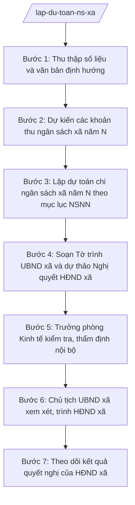

# Skill: Lập dự toán ngân sách xã hằng năm

## 2. Khi nào dùng

- Đến kỳ lập dự toán ngân sách năm mới, Sở Tài chính tỉnh A ban hành hướng dẫn xây dựng dự toán;
- Phòng Kinh tế xã A cần tổng hợp số liệu thu–chi năm trước để xây dựng dự toán chi tiết theo mục lục ngân sách nhà nước;
- UBND xã A cần Tờ trình và dự thảo Nghị quyết để trình HĐND xã quyết nghị dự toán tại kỳ họp cuối năm;
- Cần rà soát, điều chỉnh dự toán giữa năm khi có biến động lớn về thu hoặc nhiệm vụ chi.

## 3. Đầu vào (Input)

| Trường | Mô tả | Bắt buộc |
|--------|-------|----------|
| `nam_du_toan` | Năm ngân sách cần lập dự toán (năm N) | Có |
| `so_lieu_thu_nam_truoc` | Số liệu thu ngân sách năm N-1 (thực hiện/ước thực hiện), chi tiết theo nguồn thu | Có |
| `so_lieu_chi_nam_truoc` | Số liệu chi ngân sách năm N-1, chi tiết theo lĩnh vực/nhiệm vụ | Có |
| `huong_dan_so_tai_chinh` | Văn bản hướng dẫn xây dựng dự toán của Sở Tài chính tỉnh A (số hiệu, ngày ban hành, các chỉ tiêu định hướng) | Có |
| `du_toan_nam_truoc` | Dự toán năm N-1 đã được HĐND xã quyết nghị (để so sánh) | Có |
| `nhiem_vu_chi_moi` | Các nhiệm vụ chi mới/phát sinh dự kiến năm N (nếu có) | Không |
| `chi_tieu_thu_dinh_huong` | Chỉ tiêu thu ngân sách cấp trên giao/định hướng (nếu có) | Không |

## 4. Quy trình

**Bước 1. Thu thập số liệu và văn bản định hướng**
- Làm gì: Tập hợp toàn bộ số liệu thu–chi thực hiện/ước thực hiện năm N-1, dự toán năm N-1 đã quyết nghị, và văn bản hướng dẫn xây dựng dự toán của Sở Tài chính tỉnh A; lập bảng so sánh đối chiếu đầu kỳ.
- Dùng input: `so_lieu_thu_nam_truoc`, `so_lieu_chi_nam_truoc`, `du_toan_nam_truoc`, `huong_dan_so_tai_chinh`.
- Vai trò: Công chức tài chính – kế toán xã thực hiện, AI hỗ trợ trích lọc và tổng hợp số liệu thành bảng đối chiếu; ⏱ ~1–2 ngày làm việc (ước tính).
- Lưu ý nghiệp vụ: Số liệu phải lấy từ sổ kế toán, báo cáo đã được đối chiếu; văn bản hướng dẫn của Sở Tài chính là căn cứ bắt buộc, không được lập dự toán trái định hướng.
- → Kết quả bước: Bảng tổng hợp số liệu nền + văn bản hướng dẫn đã được hệ thống hóa.

**Bước 2. Dự kiến các khoản thu ngân sách xã năm N**
- Làm gì: Phân tích từng nguồn thu (thuế, phí, lệ phí được hưởng; thu từ hoạt động sự nghiệp; thu bổ sung từ ngân sách cấp trên...) theo số liệu năm N-1 và định hướng của Sở Tài chính; đề xuất mức thu dự kiến cho từng khoản, đảm bảo tính khả thi.
- Dùng input: `so_lieu_thu_nam_truoc`, `chi_tieu_thu_dinh_huong`, `huong_dan_so_tai_chinh`.
- Vai trò: Công chức tài chính – kế toán xã phân tích, AI hỗ trợ tính toán tỷ lệ tăng/giảm, lập bảng dự kiến thu chi tiết; ⏱ ~1–2 ngày làm việc (ước tính).
- Lưu ý nghiệp vụ: Mức thu dự kiến phải sát thực tế, có căn cứ; không dự kiến thu vượt quá khả năng thực hiện để tránh "vỡ" dự toán giữa năm.
- → Kết quả bước: Bảng dự kiến thu ngân sách xã năm N chi tiết theo từng nguồn thu.

**Bước 3. Lập dự toán chi ngân sách xã năm N theo mục lục NSNN**
- Làm gì: Xây dựng dự toán chi tiết cho từng lĩnh vực, nhiệm vụ (chi thường xuyên, chi đầu tư phát triển, dự phòng ngân sách...) theo đúng mục lục ngân sách nhà nước; cân đối tổng thu – tổng chi; lập các biểu mẫu dự toán kèm theo.
- Dùng input: `so_lieu_chi_nam_truoc`, `nhiem_vu_chi_moi`, `huong_dan_so_tai_chinh`, kết quả Bước 2.
- Vai trò: Công chức tài chính – kế toán xã lập, AI hỗ trợ soạn thảo biểu thu/chi, kiểm tra cân đối và cảnh báo các khoản chi vượt định mức; ⏱ ~2–3 ngày làm việc (ước tính).
- Lưu ý nghiệp vụ: Tổng chi không vượt tổng thu dự kiến; chi thường xuyên và chi đầu tư phải phân định rõ; các khoản chi bắt buộc (lương, hoạt động bộ máy) phải được bảo đảm trước.
- → Kết quả bước: Dự thảo biểu dự toán thu–chi ngân sách xã năm N (bản nháp).

**Bước 4. Soạn Tờ trình UBND xã và dự thảo Nghị quyết HĐND xã**
- Làm gì: Soạn Tờ trình của UBND xã trình HĐND xã về dự toán ngân sách năm N (nêu căn cứ, tình hình thực hiện năm N-1, nội dung dự toán đề nghị quyết nghị) và dự thảo Nghị quyết HĐND xã về dự toán NSNN xã năm N, kèm các biểu thu/chi.
- Dùng input: Kết quả Bước 2, Bước 3; `nam_du_toan`.
- Vai trò: Công chức tài chính – kế toán xã soạn thảo, AI hỗ trợ dựng khung văn bản đúng thể thức hành chính, rà soát căn cứ pháp lý; ⏱ ~1–2 ngày làm việc (ước tính).
- Lưu ý nghiệp vụ: Tờ trình và dự thảo Nghị quyết phải đúng thể thức văn bản hành chính; số liệu trong văn bản phải khớp tuyệt đối với biểu dự toán kèm theo.
- → Kết quả bước: Bản thảo Tờ trình UBND xã + dự thảo Nghị quyết HĐND xã + bộ biểu dự toán.

**Bước 5. Trưởng phòng Kinh tế kiểm tra, thẩm định nội bộ**
- Làm gì: Trưởng phòng Kinh tế rà soát toàn bộ hồ sơ dự toán: tính hợp pháp của căn cứ, tính chính xác và cân đối của số liệu, tính đầy đủ của biểu mẫu; yêu cầu chỉnh sửa, bổ sung nếu có sai sót.
- Dùng input: Toàn bộ kết quả Bước 4.
- Vai trò: Trưởng phòng Kinh tế kiểm tra, AI hỗ trợ đối chiếu chéo số liệu giữa Tờ trình – Nghị quyết – biểu mẫu, liệt kê điểm chưa khớp; ⏱ ~1 ngày làm việc (ước tính).
- Lưu ý nghiệp vụ: Đây là chốt kiểm soát nội bộ cuối trước khi trình lãnh đạo UBND; mọi chênh lệch số liệu phải được xử lý dứt điểm tại bước này.
- → Kết quả bước: Hồ sơ dự toán đã được thẩm định nội bộ, có ý kiến kiểm tra của Trưởng phòng.

**Bước 6. Chủ tịch UBND xã xem xét, trình HĐND xã**
- Làm gì: Chủ tịch UBND xã xem xét hồ sơ dự toán, cho ý kiến (hoặc yêu cầu hoàn thiện thêm), sau đó ký Tờ trình trình HĐND xã xem xét, quyết nghị tại kỳ họp cuối năm.
- Dùng input: Hồ sơ dự toán đã thẩm định ở Bước 5.
- Vai trò: Chủ tịch UBND xã quyết định; công chức tài chính – kế toán hoàn thiện hồ sơ theo ý kiến chỉ đạo, AI hỗ trợ cập nhật nhanh các chỉnh sửa; ⏱ ~1–2 ngày làm việc (ước tính).
- Lưu ý nghiệp vụ: AI chỉ hỗ trợ chỉnh sửa kỹ thuật theo chỉ đạo; quyết định nội dung dự toán thuộc thẩm quyền của Chủ tịch UBND xã và HĐND xã.
- → Kết quả bước: Tờ trình UBND xã đã ký, sẵn sàng trình kỳ họp HĐND xã.

**Bước 7. Theo dõi kết quả quyết nghị của HĐND xã**
- Làm gì: Theo dõi kỳ họp HĐND xã cuối năm; ghi nhận nội dung Nghị quyết đã được quyết nghị (số hiệu, các chỉ tiêu thu–chi chính thức); cập nhật số liệu chính thức vào hồ sơ quản lý ngân sách của xã.
- Dùng input: Nghị quyết HĐND xã đã ban hành (bản chính thức sau kỳ họp).
- Vai trò: Công chức tài chính – kế toán xã theo dõi và cập nhật, AI hỗ trợ trích xuất các chỉ tiêu chính từ Nghị quyết vào bảng theo dõi; ⏱ ~0 (ước tính),5 ngày làm việc.
- Lưu ý nghiệp vụ: Chỉ số liệu trong Nghị quyết đã ban hành mới là dự toán chính thức có hiệu lực thi hành; mọi bản thảo trước đó không có giá trị pháp lý.
- → Kết quả bước: Hồ sơ dự toán hoàn chỉnh kèm Nghị quyết HĐND xã đã ban hành, lưu hồ sơ theo dõi.

## Luồng quy trình (Workflow)

## 5. Đầu ra (Output)

- Tờ trình của UBND xã trình HĐND xã về dự toán ngân sách nhà nước xã năm N (đã ký);
- Dự thảo Nghị quyết của HĐND xã về dự toán ngân sách nhà nước xã năm N;
- Các biểu dự toán thu–chi ngân sách xã năm N kèm theo (chi tiết theo mục lục NSNN);
- Nghị quyết HĐND xã đã ban hành (bản chính thức sau kỳ họp — do HĐND ban hành, xã lưu hồ sơ).

### Cấu trúc output chuẩn (Tờ trình UBND xã về dự toán ngân sách)

1. Quốc hiệu "CỘNG HÒA XÃ HỘI CHỦ NGHĨA VIỆT NAM" – Tiêu ngữ "Độc lập – Tự do – Hạnh phúc"; (đúng thể thức NĐ 30/2020/NĐ-CP)
2. Tên cơ quan ban hành: ỦY BAN NHÂN DÂN XÃ A; số, ký hiệu văn bản; địa danh và ngày, tháng, năm ban hành;
3. Tên loại và trích yếu nội dung: TỜ TRÌNH — Về việc đề nghị HĐND xã quyết nghị dự toán ngân sách nhà nước xã năm N;
4. Phần "Kính gửi": Hội đồng nhân dân xã A;
5. Căn cứ ban hành (Luật Ngân sách nhà nước; văn bản hướng dẫn của Sở Tài chính tỉnh A...);
6. Nội dung: tình hình thực hiện dự toán năm N-1; nội dung dự toán năm N đề nghị quyết nghị (tổng thu, tổng chi, các khoản thu–chi chủ yếu); kiến nghị HĐND xem xét, quyết nghị;
7. Nơi nhận;
8. Thẩm quyền, chức vụ, họ tên người ký: TM. ỦY BAN NHÂN DÂN — CHỦ TỊCH — (chữ ký, họ tên), dấu của cơ quan.

### Cấu trúc output chuẩn (Nghị quyết HĐND xã về dự toán ngân sách)

1. Quốc hiệu "CỘNG HÒA XÃ HỘI CHỦ NGHĨA VIỆT NAM" – Tiêu ngữ "Độc lập – Tự do – Hạnh phúc";
2. Tên cơ quan ban hành: HỘI ĐỒNG NHÂN DÂN XÃ A; số, ký hiệu văn bản; địa danh và ngày, tháng, năm ban hành;
3. Tên loại và trích yếu: NGHỊ QUYẾT — Về dự toán ngân sách nhà nước xã A năm N;
4. Căn cứ ban hành (Luật Tổ chức chính quyền địa phương; Luật Ngân sách nhà nước; Tờ trình của UBND xã...);
5. Nội dung quyết nghị theo điều, khoản: quyết nghị tổng thu, tổng chi và các chỉ tiêu chủ yếu; giao UBND xã tổ chức thực hiện; hiệu lực thi hành;
6. Nơi nhận;
7. Thẩm quyền, chức vụ, họ tên người ký: TM. HỘI ĐỒNG NHÂN DÂN — CHỦ TỊCH — (chữ ký, họ tên), dấu của cơ quan;
8. Các biểu dự toán thu–chi kèm theo Nghị quyết.

## 6. Checklist nghiệm thu

- [ ] Có đầy đủ 3 sản phẩm: Tờ trình UBND xã, dự thảo Nghị quyết HĐND xã, bộ biểu thu–chi;
- [ ] Số liệu trong Tờ trình, dự thảo Nghị quyết và biểu mẫu khớp nhau tuyệt đối;
- [ ] Tổng chi không vượt tổng thu dự kiến; phân định rõ chi thường xuyên, chi đầu tư;
- [ ] Căn cứ pháp lý đầy đủ, đúng văn bản còn hiệu lực, không bịa số hiệu;
- [ ] Thể thức văn bản hành chính đúng quy định (quốc hiệu, tiêu ngữ, số/ký hiệu, nơi nhận, chữ ký, dấu);
- [ ] Đã qua kiểm tra của Trưởng phòng Kinh tế và được Chủ tịch UBND xã xem xét trước khi trình;
- [ ] Số liệu là số liệu thật của xã do công chức cung cấp, AI không tự bịa thêm khoản thu/chi;
- [ ] Hồ sơ lưu đầy đủ: số liệu nền, văn bản hướng dẫn của Sở Tài chính, các bản thảo.

## 7. Ví dụ mô phỏng

*Dữ liệu dưới đây là giả lập 100% phục vụ minh họa.*

### Input mẫu

| Trường | Giá trị giả lập |
|--------|-----------------|
| nam_du_toan | 2027 |
| so_lieu_thu_nam_truoc | Tổng thu thực hiện năm 2026: 10.000 triệu đồng (thu hưởng 100%: 4.000; thu bổ sung từ NS cấp trên: 6.000) |
| so_lieu_chi_nam_truoc | Tổng chi thực hiện năm 2026: 9.800 triệu đồng (chi thường xuyên: 7.000; chi đầu tư phát triển: 2.800) |
| huong_dan_so_tai_chinh | Văn bản số 123/HD-STC ngày 01/9/2026 của Sở Tài chính tỉnh A hướng dẫn xây dựng dự toán NSNN năm 2027 |
| du_toan_nam_truoc | Dự toán năm 2026 đã quyết nghị: tổng thu 9.500 triệu đồng, tổng chi 9.500 triệu đồng |
| nhiem_vu_chi_moi | Sửa chữa trụ sở UBND xã: 500 triệu đồng |
| chi_tieu_thu_dinh_huong | Chỉ tiêu thu định hướng: 10.500 triệu đồng |

### Output mẫu (Tờ trình — trích)

> **CỘNG HÒA XÃ HỘI CHỦ NGHĨA VIỆT NAM**
> **Độc lập – Tự do – Hạnh phúc**
>
> **ỦY BAN NHÂN DÂN XÃ A**
> Số: 123/TTr-UBND
> Xã A, ngày 15 tháng 11 năm 2026
>
> **TỜ TRÌNH**
> **Về việc đề nghị HĐND xã quyết nghị dự toán ngân sách nhà nước xã A năm 2027**
>
> Kính gửi: Hội đồng nhân dân xã A.
>
> Căn cứ Luật Ngân sách nhà nước;
> Căn cứ văn bản số 123/HD-STC ngày 01/9/2026 của Sở Tài chính tỉnh A hướng dẫn xây dựng dự toán ngân sách nhà nước năm 2027;
> UBND xã A trình HĐND xã quyết nghị dự toán ngân sách nhà nước xã A năm 2027 như sau:
>
> 1. Tổng thu ngân sách xã: 10.500 triệu đồng...
> 2. Tổng chi ngân sách xã: 10.500 triệu đồng (chi thường xuyên: 7.200; chi đầu tư phát triển: 3.300)...
>
> UBND xã A kính trình HĐND xã xem xét, quyết nghị./.
>
> ***Nơi nhận:*** ...
>
> **TM. ỦY BAN NHÂN DÂN**
> **CHỦ TỊCH**
> *(ký, đóng dấu)*
> **Nguyễn Văn A**

## 8. Human gate

1. Công chức tài chính – kế toán xã soạn thảo toàn bộ hồ sơ dự toán (Bước 1–4);
2. Trưởng phòng Kinh tế kiểm tra, thẩm định nội bộ, yêu cầu chỉnh sửa (Bước 5);
3. Chủ tịch UBND xã xem xét, ký Tờ trình trình HĐND xã (Bước 6);
4. HĐND xã thảo luận và quyết nghị bằng Nghị quyết tại kỳ họp cuối năm (Bước 7) — quyết định cuối cùng thuộc thẩm quyền HĐND xã.

## 9. Giới hạn

- AI KHÔNG ra quyết định về nội dung dự toán (mức thu, mức chi, phân bổ) thay người có thẩm quyền;
- AI KHÔNG tự ký, tự phát hành Tờ trình, Nghị quyết hay bất kỳ văn bản nào;
- AI KHÔNG bịa số liệu thu–chi, không tự thêm khoản thu/chi không có trong input;
- AI KHÔNG bịa căn cứ pháp lý, không trích dẫn văn bản đã hết hiệu lực;
- AI KHÔNG thay HĐND xã quyết nghị dự toán — đây là thẩm quyền riêng của HĐND xã.

## 10. Căn cứ & lưu ý

- Thông tư 57/2025/TT-BTC hướng dẫn chức năng, nhiệm vụ, quyền hạn của Sở Tài chính và lĩnh vực tài chính – kế hoạch của phòng chuyên môn thuộc UBND cấp xã;
- Luật Ngân sách nhà nước (chỉ nêu tên luật, không kèm số hiệu);
- Nghị định 30/2020/NĐ-CP về công tác văn thư (chỉ dùng cho thể thức văn bản);
- Lưu ý: dự toán ngân sách xã chỉ có hiệu lực sau khi HĐND xã ban hành Nghị quyết quyết nghị; UBND xã tổ chức thực hiện dự toán đã được quyết nghị và chịu sự giám sát của HĐND xã.
