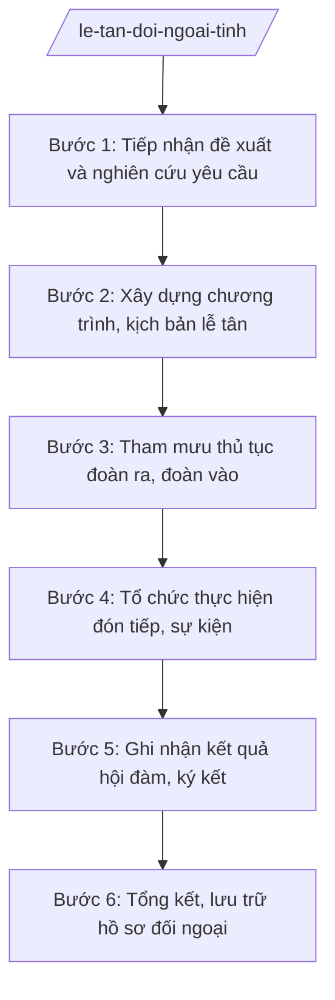

# Skill: Lễ tân, đối ngoại của UBND tỉnh

## 2. Khi nào dùng

- Đón tiếp đoàn khách trong nước và quốc tế đến thăm, làm việc với lãnh đạo UBND tỉnh.
- Tổ chức hội đàm, ký kết thỏa thuận, biên bản hợp tác giữa tỉnh với đối tác.
- Tổ chức sự kiện đối ngoại: hội nghị xúc tiến đầu tư có yếu tố nước ngoài, lễ kỷ niệm quan hệ hợp tác, đón đoàn ngoại giao.
- Tham mưu cho phép đoàn cán bộ của tỉnh đi công tác nước ngoài (đoàn ra) theo phân cấp.
- Tham mưu tiếp nhận đoàn khách nước ngoài vào làm việc tại tỉnh (đoàn vào) theo phân cấp.
- Tổng kết, lưu trữ hồ sơ hoạt động đối ngoại của UBND tỉnh.

## 3. Đầu vào (Input)

| Trường | Mô tả | Bắt buộc |
|--------|-------|----------|
| `de_xuat_don_tiep_su_kien` | Đề xuất của sở, ngành hoặc chỉ đạo của lãnh đạo UBND tỉnh về đón đoàn, tổ chức sự kiện | Có |
| `thong_tin_doan_khach` | Thành phần, cấp bậc đoàn, mục đích chuyến thăm, chương trình dự kiến của đoàn | Có |
| `de_xuat_doan_ra` | Tờ trình của sở, ngành về việc cử cán bộ đi công tác nước ngoài (mục đích, thành phần, kinh phí) | Không |
| `de_xuat_doan_vao` | Đề xuất tiếp nhận đoàn nước ngoài vào làm việc (đối tác, nội dung, thời gian) | Không |
| `thoa_thuan_hop_tac` | Dự thảo thỏa thuận, biên bản ghi nhớ dự kiến ký kết (nếu có) | Không |
| `quy_dinh_ve_doi_ngoai` | NĐ 134/2025/NĐ-CP và quy định hiện hành về quản lý đoàn ra, đoàn vào, lễ tân đối ngoại | Có |

## 4. Quy trình

**Bước 1. Tiếp nhận đề xuất và nghiên cứu yêu cầu**

- Làm gì: Tiếp nhận đề xuất đón tiếp đoàn/sự kiện, đề xuất đoàn ra/đoàn vào; nghiên cứu thông tin đoàn khách (cấp bậc, mục đích), đối chiếu quy định về phân cấp quản lý đoàn ra, đoàn vào tại NĐ 134/2025/NĐ-CP để xác định thẩm quyền cho phép.
- Dùng input: `de_xuat_don_tiep_su_kien`, `thong_tin_doan_khach`, `de_xuat_doan_ra`, `de_xuat_doan_vao`, `quy_dinh_ve_doi_ngoai`.
- Vai trò: Chuyên viên Văn phòng UBND tỉnh nghiên cứu AI hỗ trợ: tra cứu nhanh thẩm quyền cho phép đoàn ra/đoàn vào theo phân cấp, lập bảng tóm tắt thông tin đoàn; Trưởng phòng thẩm định ⏱ ~2 ngày làm việc (ước tính).
- Lưu ý nghiệp vụ: Xác định đúng thẩm quyền cho phép (thuộc Chủ tịch UBND tỉnh hay phải trình cấp trên) ngay từ đầu để tham mưu đúng trình tự; đoàn cấp cao phải báo cáo xin ý kiến lãnh đạo tỉnh sớm.
- → Kết quả bước: Bảng tóm tắt yêu cầu đối ngoại kèm xác định thẩm quyền xử lý.

**Bước 2. Xây dựng chương trình, kịch bản lễ tân**

- Làm gì: Xây dựng chương trình đón tiếp chi tiết: đón/tiễn tại sân bay, nơi ăn nghỉ, hội đàm, khảo sát thực tế, chiêu đãi; kịch bản lễ tân theo cấp bậc đoàn (nghi thức, vị trí ngồi, phát biểu, tặng quà, đưa tin); dự trù kinh phí.
- Dùng input: Bảng tóm tắt yêu cầu (bước 1), `thong_tin_doan_khach`.
- Vai trò: Chuyên viên xây dựng chương trình AI hỗ trợ: soạn chương trình, kịch bản chi tiết theo mẫu tương ứng cấp bậc đoàn, lập dự trù kinh phí; Trưởng phòng thẩm định; Chánh Văn phòng duyệt ⏱ ~3 ngày làm việc (ước tính).
- Lưu ý nghiệp vụ: Nghi thức lễ tân phải tương xứng cấp bậc đoàn, đúng phong tục, tập quán và quy định; kinh phí trong dự toán được duyệt, tiết kiệm, đúng chế độ.
- → Kết quả bước: Chương trình, kịch bản lễ tân đón tiếp đoàn/sự kiện.

**Bước 3. Tham mưu thủ tục đoàn ra, đoàn vào**

- Làm gì: Thẩm định tờ trình đoàn ra (sự cần thiết, thành phần, thời gian, kinh phí, nguồn kinh phí); thẩm định đề xuất đoàn vào; soạn tờ trình của Chánh Văn phòng đề nghị Chủ tịch UBND tỉnh cho phép (đối với nội dung thuộc thẩm quyền); hoàn thiện thủ tục trình cấp trên đối với nội dung vượt thẩm quyền.
- Dùng input: `de_xuat_doan_ra`, `de_xuat_doan_vao`, `quy_dinh_ve_doi_ngoai`.
- Vai trò: Chuyên viên thẩm định, soạn tờ trình AI hỗ trợ: kiểm tra tính đầy đủ hồ sơ đoàn ra/đoàn vào, đối chiếu điều kiện theo quy định, soạn tờ trình; Trưởng phòng thẩm định; Chánh Văn phòng trình Chủ tịch UBND tỉnh quyết định ⏱ ~5 ngày làm việc (ước tính).
- Lưu ý nghiệp vụ: AI chỉ hỗ trợ kiểm tra hồ sơ, không quyết định cho phép đoàn ra/đoàn vào thay người có thẩm quyền; đoàn ra phải bảo đảm sự cần thiết, tiết kiệm, đúng đối tượng.
- → Kết quả bước: Tờ trình + hồ sơ đoàn ra/đoàn vào trình phê duyệt.

**Bước 4. Tổ chức thực hiện đón tiếp, sự kiện**

- Làm gì: Triển khai chương trình đã duyệt: phân công nhiệm vụ cho các sở, ngành phối hợp (an ninh, y tế, phiên dịch, đưa tin); đón/tiễn đoàn; tổ chức hội đàm, ký kết, chiêu đãi theo kịch bản; xử lý tình huống phát sinh.
- Dùng input: Chương trình, kịch bản lễ tân (bước 2).
- Vai trò: Tổ lễ tân của Văn phòng UBND tỉnh chủ trì, các sở, ngành phối hợp AI hỗ trợ: lập bảng phân công, checklist công việc, nhắc lịch các mốc trong chương trình. ⏱ ~theo chương trình (ước tính).
- Lưu ý nghiệp vụ: Bảo đảm an ninh, an toàn tuyệt đối cho đoàn khách; phiên dịch chính xác, nhất là nội dung hội đàm, ký kết; mọi phát ngôn phải đúng quan điểm, đường lối đối ngoại.
- → Kết quả bước: Đoàn khách/sự kiện được tổ chức thành công theo chương trình.

**Bước 5. Ghi nhận kết quả hội đàm, ký kết**

- Làm gì: Lập biên bản hội đàm, hoàn thiện văn bản thỏa thuận/biên bản ghi nhớ đã ký kết; rà soát nội dung cam kết, phân công triển khai; gửi văn bản đến các cơ quan liên quan để thực hiện.
- Dùng input: `thoa_thuan_hop_tac`, biên bản hội đàm.
- Vai trò: Chuyên viên tổng hợp AI hỗ trợ: soạn biên bản hội đàm từ ghi chép, rà soát tính nhất quán của văn bản ký kết, lập bảng phân công triển khai cam kết; Trưởng phòng thẩm định; Chánh Văn phòng duyệt ⏱ ~3 ngày làm việc (ước tính).
- Lưu ý nghiệp vụ: Văn bản ký kết phải đúng thẩm quyền, đúng trình tự; cam kết quốc tế phải được theo dõi thực hiện, không để "ký xong bỏ đó".
- → Kết quả bước: Biên bản hội đàm; văn bản thỏa thuận đã ký kết; bảng phân công triển khai.

**Bước 6. Tổng kết, lưu trữ hồ sơ đối ngoại**

- Làm gì: Tổng kết hoạt động đón tiếp/sự kiện, đoàn ra/đoàn vào (kết quả, kinh phí thực tế, bài học kinh nghiệm); lập hồ sơ lưu trữ đầy đủ (quyết định cho phép, chương trình, biên bản, văn bản ký kết, thanh quyết toán); báo cáo định kỳ công tác đối ngoại.
- Dùng input: Toàn bộ hồ sơ các bước trên.
- Vai trò: Chuyên viên tổng kết, lập hồ sơ AI hỗ trợ: tổng hợp báo cáo, kiểm tra tính đầy đủ của hồ sơ lưu trữ; Trưởng phòng thẩm định; Chánh Văn phòng ký báo cáo. ⏱ ~sau mỗi đợt và định kỳ năm (ước tính).
- Lưu ý nghiệp vụ: Hồ sơ đối ngoại lưu trữ đầy đủ, bảo mật theo quy định; báo cáo trung thực kết quả và kinh phí.
- → Kết quả bước: Báo cáo tổng kết hoạt động đối ngoại; hồ sơ lưu trữ đầy đủ.

## Luồng quy trình (Workflow)

## 5. Đầu ra (Output)

- Chương trình, kịch bản lễ tân đón tiếp đoàn khách/tổ chức sự kiện.
- Tờ trình + hồ sơ đề nghị cho phép đoàn ra, đoàn vào (sản phẩm chính).
- Biên bản hội đàm; văn bản thỏa thuận, biên bản ghi nhớ đã ký kết.
- Báo cáo tổng kết hoạt động đối ngoại định kỳ.

**Cấu trúc output chuẩn:**

**TỜ TRÌNH VỀ VIỆC CHO PHÉP ĐOÀN RA** — các phần bắt buộc theo đúng thứ tự, đúng thể thức văn bản hành chính theo NĐ 30/2020/NĐ-CP:

1. Quốc hiệu "CỘNG HÒA XÃ HỘI CHỦ NGHĨA VIỆT NAM", Tiêu ngữ "Độc lập – Tự do – Hạnh phúc".
2. Tên cơ quan trình: VĂN PHÒNG ỦY BAN NHÂN DÂN TỈNH A. Số, ký hiệu văn bản; địa danh và thời gian ban hành.
3. Tên loại và trích yếu: TỜ TRÌNH — Về việc cho phép đoàn cán bộ tỉnh A đi công tác tại ... (đoàn ra).
4. Kính gửi: Chủ tịch UBND tỉnh A.
5. Căn cứ (NĐ 134/2025/NĐ-CP; quy định hiện hành về quản lý đoàn ra...).
6. Nội dung trình: sự cần thiết chuyến công tác; thành phần đoàn (họ tên, chức vụ từng người); thời gian; chương trình làm việc dự kiến; kinh phí và nguồn kinh phí; đơn vị tổ chức thực hiện.
7. Kiến nghị: đề nghị Chủ tịch UBND tỉnh xem xét, cho phép.
8. Hồ sơ kèm theo (tờ trình của sở, ngành đề xuất; thư mời của đối tác...).
9. Ký (Chánh Văn phòng UBND tỉnh ký tờ trình).
- Nơi nhận: liệt kê các cơ quan, đơn vị nhận để biết/thực hiện; kết thúc bằng "- Lưu: VT, [mã đơn vị]".
## 6. Checklist nghiệm thu

1. Xác định đúng thẩm quyền cho phép đoàn ra/đoàn vào theo phân cấp tại NĐ 134/2025/NĐ-CP.
2. Hồ sơ đoàn ra/đoàn vào đầy đủ: tờ trình, thư mời, chương trình, dự trù kinh phí.
3. Chương trình, kịch bản lễ tân tương xứng cấp bậc đoàn, được phê duyệt trước khi thực hiện.
4. Phân công phối hợp rõ ràng giữa Văn phòng UBND tỉnh và các sở, ngành (an ninh, y tế, phiên dịch, đưa tin).
5. Đoàn khách được bảo đảm an ninh, an toàn tuyệt đối trong suốt chương trình.
6. Biên bản hội đàm, văn bản ký kết đúng thẩm quyền, đúng trình tự; cam kết được phân công triển khai, theo dõi.
7. Kinh phí trong dự toán được duyệt, thanh quyết toán đúng chế độ.
8. Hồ sơ đối ngoại lưu trữ đầy đủ, bảo mật theo quy định; báo cáo định kỳ đầy đủ.
9. Thể thức văn bản đúng NĐ 30/2020/NĐ-CP.

## 7. Ví dụ mô phỏng

*Dữ liệu dưới đây là giả lập 100% phục vụ minh họa.*

**Input mẫu:**

| Trường | Giá trị mẫu |
|--------|-------------|
| Đề xuất đón tiếp/sự kiện | Sở Kế hoạch và Đầu tư tỉnh A đề xuất đón đoàn 10 doanh nghiệp nước ngoài đến tìm hiểu đầu tư, tháng 11/2027 |
| Thông tin đoàn khách | Đoàn 10 người do 1 trưởng đoàn cấp giám đốc dẫn đầu; mục đích: khảo sát khu công nghiệp, hội đàm xúc tiến đầu tư; thời gian 3 ngày |
| Đề xuất đoàn ra | Không |
| Đề xuất đoàn vào | Đề xuất tiếp nhận đoàn 10 doanh nghiệp vào làm việc 3 ngày (20–22/11/2027) |
| Thỏa thuận hợp tác | Dự thảo biên bản ghi nhớ hợp tác xúc tiến đầu tư giữa UBND tỉnh A và hiệp hội doanh nghiệp |
| Quy định về đối ngoại | NĐ 134/2025/NĐ-CP về phân quyền, phân cấp trong lĩnh vực đối ngoại |

**Output mẫu (trích Chương trình đón tiếp):**

**VĂN PHÒNG ỦY BAN NHÂN DÂN TỈNH A**

Số: 1234/CTr-VPUBND
Tỉnh A, ngày 10 tháng 11 năm 2027

**CHƯƠNG TRÌNH**
**Đón tiếp đoàn doanh nghiệp nước ngoài đến tìm hiểu đầu tư tại tỉnh A (20–22/11/2027)**

*Căn cứ Nghị định số 134/2025/NĐ-CP ngày 12/6/2025 của Chính phủ về phân quyền, phân cấp trong lĩnh vực đối ngoại;*

**I. THÀNH PHẦN ĐOÀN KHÁCH**
Đoàn 10 người do ông ... — Giám đốc ... làm trưởng đoàn.

**II. CHƯƠNG TRÌNH CHI TIẾT**
- Ngày 20/11: đón đoàn tại sân bay; chào xã giao Chủ tịch UBND tỉnh A (ông Phạm Văn P); chiêu đãi.
- Ngày 21/11: hội đàm xúc tiến đầu tư (chủ trì: bà Lê Thị Q — Phó Chủ tịch UBND tỉnh); ký biên bản ghi nhớ hợp tác; khảo sát khu công nghiệp.
- Ngày 22/11: làm việc với Sở Kế hoạch và Đầu tư tỉnh A; tiễn đoàn.

**III. PHÂN CÔNG PHỐI HỢP**
- Văn phòng UBND tỉnh A: chủ trì, điều phối chung, bố trí phiên dịch.
- Công an tỉnh A: bảo đảm an ninh, an toàn đoàn.
- Sở Y tế tỉnh A: bảo đảm y tế.

**IV. KINH PHÍ**: trong dự toán đối ngoại năm 2027 đã duyệt.

**CHÁNH VĂN PHÒNG**
(Ký, đóng dấu — bà Vũ Thị T)

## 8. Human gate (người kiểm duyệt)

- Chuyên viên xây dựng chương trình, thẩm định hồ sơ đoàn ra/đoàn vào → Trưởng phòng thẩm định → Chánh Văn phòng UBND tỉnh duyệt chương trình lễ tân, ký tờ trình → Chủ tịch UBND tỉnh cho phép đoàn ra/đoàn vào thuộc thẩm quyền, chủ trì đón tiếp đoàn cấp cao.
- Nội dung hội đàm, văn bản ký kết có yếu tố đối ngoại quan trọng phải xin ý kiến lãnh đạo tỉnh trước.

## 9. Giới hạn (guardrails)

- AI không quyết định cho phép đoàn ra, đoàn vào thay người có thẩm quyền; không tự ký văn bản đối ngoại.
- AI không soạn thảo, cam kết nội dung thỏa thuận quốc tế thay người có thẩm quyền đàm phán, ký kết.
- AI không tiết lộ thông tin mật trong hoạt động đối ngoại; mọi phát ngôn đối ngoại do người có thẩm quyền thực hiện.
- AI không bịa đặt căn cứ pháp lý; chỉ viện dẫn NĐ 134/2025/NĐ-CP và quy định còn hiệu lực.

## 10. Căn cứ & lưu ý

- NĐ 134/2025/NĐ-CP: phân quyền, phân cấp trong lĩnh vực đối ngoại — căn cứ chính về thẩm quyền quản lý đoàn ra, đoàn vào của chính quyền địa phương.
- NĐ 150/2025/NĐ-CP: Văn phòng UBND là cơ quan chuyên môn thuộc UBND cấp tỉnh, tham mưu công tác lễ tân, đối ngoại phục vụ lãnh đạo UBND tỉnh.
- NĐ 30/2020/NĐ-CP: thể thức và kỹ thuật trình bày văn bản hành chính.
- Lưu ý: tính đến thời điểm hiện tại, chưa có thông tư hướng dẫn riêng về chức năng, nhiệm vụ của Văn phòng UBND cấp tỉnh; các nội dung chi tiết về lễ tân, quản lý đoàn ra, đoàn vào thực hiện theo quy định hiện hành.
