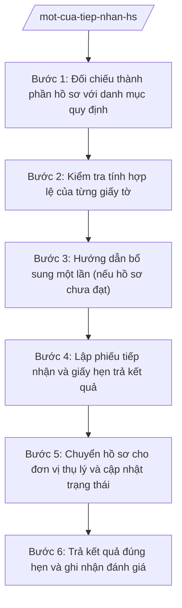

# Skill: Tiếp nhận hồ sơ một cửa

> **Ghi chú áp dụng đa cấp:** Skill dùng chung cho mọi cấp hành chính. Các chức danh, đơn vị nêu trong quy trình (ví dụ: "Chủ tịch UBND xã", "Chánh Văn phòng", "Sở Tài chính") được viết theo mẫu minh họa — khi áp dụng ở cấp khác, thay bằng chức danh/đơn vị tương ứng của cấp đó (cấp tỉnh: Chủ tịch UBND tỉnh, Giám đốc Sở; cấp trung ương: Bộ trưởng, Vụ trưởng/Cục trưởng).

## Khi nào dùng

- Công dân, tổ chức đến nộp hồ sơ thủ tục hành chính tại bộ phận một cửa của xã (trực tiếp hoặc trực tuyến).
- Kiểm tra tính đầy đủ, hợp lệ của thành phần hồ sơ trước khi tiếp nhận vào hệ thống.
- Lập phiếu tiếp nhận hồ sơ và giấy hẹn trả kết quả giao cho người nộp.
- Hướng dẫn người nộp bổ sung, hoàn thiện hồ sơ chưa đầy đủ — thực hiện một lần, đầy đủ.
- Chuyển hồ sơ cho phòng chuyên môn thụ lý, theo dõi tiến độ và trả kết quả đúng hẹn.

## Đầu vào (Input)

| Trường | Mô tả | Bắt buộc |
|--------|-------|----------|
| `ten_tthc` | Tên thủ tục hành chính người dân đề nghị giải quyết | Có |
| `nguoi_nop_ho_so` | Họ tên, địa chỉ, số điện thoại liên hệ | Có |
| `hinh_thuc_nop` | Trực tiếp / Trực tuyến | Có |
| `thanh_phan_ho_so_da_nop` | Danh mục giấy tờ thực tế người nộp mang đến | Có |
| `thanh_phan_ho_so_theo_quy_dinh` | Danh mục chuẩn đã niêm yết công khai của TTHC | Có |
| `le_phi_phi` | Mức thu theo quy định (nếu TTHC có thu) | Không |
| `ngay_hen_tra` | Ngày hẹn trả kết quả; AI tính tự động theo thời gian giải quyết đã công khai, người dùng chỉ nhập khi cần hẹn khác | Không |

## Quy trình

**Bước 1. Đối chiếu thành phần hồ sơ với danh mục quy định**

- Làm gì: So sánh từng giấy tờ người nộp mang đến với danh mục thành phần hồ sơ đã niêm yết của thủ tục; đánh dấu đủ/thiếu từng mục trong bảng đối chiếu.
- Dùng input: `ten_tthc`, `thanh_phan_ho_so_da_nop`, `thanh_phan_ho_so_theo_quy_dinh`, `hinh_thuc_nop`.
- Vai trò: Công chức một cửa kiểm tra trực tiếp (AI hỗ trợ đối chiếu tự động theo checklist, liệt kê các mục còn thiếu). ⏱ 15–30 phút (ước tính)/hồ sơ.
- Lưu ý nghiệp vụ: Chỉ được yêu cầu đúng thành phần đã niêm yết công khai; tuyệt đối không tự ý đòi thêm giấy tờ ngoài quy định.
- → Kết quả bước: Bảng đối chiếu thành phần hồ sơ (đủ/thiếu từng mục).

**Bước 2. Kiểm tra tính hợp lệ của từng giấy tờ**

- Làm gì: Kiểm tra bản chính/bản sao chứng thực, chữ ký, con dấu, thời hạn hiệu lực của giấy tờ; kiểm tra tính thống nhất thông tin giữa các giấy tờ (họ tên, ngày tháng năm sinh, địa chỉ).
- Dùng input: `thanh_phan_ho_so_da_nop`.
- Vai trò: Công chức một cửa kiểm tra (AI hỗ trợ cảnh báo sai lệch thông tin giữa các giấy tờ, giấy tờ đã hết thời hạn hiệu lực). ⏱ 15–30 phút (ước tính)/hồ sơ.
- Lưu ý nghiệp vụ: Không yêu cầu chứng thực lại khi đã có bản sao hợp lệ; giấy tờ nào chưa hợp lệ phải chỉ rõ điểm chưa hợp lệ cụ thể để người nộp khắc phục.
- → Kết quả bước: Kết luận hồ sơ hợp lệ, hoặc danh mục các điểm chưa hợp lệ cần khắc phục.

**Bước 3. Hướng dẫn bổ sung một lần (nếu hồ sơ chưa đạt)**

- Làm gì: Lập phiếu hướng dẫn hoàn thiện hồ sơ ghi đầy đủ, cụ thể từng nội dung cần bổ sung, sửa chữa; giao cho người nộp và hẹn ngày nộp lại; không được yêu cầu bổ sung lần thứ hai những nội dung đã ghi trong phiếu. Hồ sơ chưa đạt thì kết thúc vòng tại bước này; khi người nộp nộp lại hồ sơ đã bổ sung thì quay lại Bước 1 (không đi tiếp sang Bước 4).
- Dùng input: Bảng đối chiếu thành phần (bước 1), danh mục điểm chưa hợp lệ (bước 2).
- Vai trò: Công chức một cửa lập phiếu và giải thích trực tiếp cho người nộp (AI hỗ trợ soạn phiếu hướng dẫn bằng ngôn ngữ dễ hiểu, liệt kê đầy đủ mọi yêu cầu trong một lần). ⏱ ~ngay tại buổi nộp (ước tính).
- Lưu ý nghiệp vụ: Nguyên tắc "một lần": mọi yêu cầu bổ sung phải ghi hết trong một phiếu hướng dẫn; lần tiếp nhận lại chỉ được yêu cầu thêm nội dung mới phát sinh (nếu có).
- → Kết quả bước: Phiếu hướng dẫn hoàn thiện hồ sơ (một lần) đã giao cho người nộp.

**Bước 4. Lập phiếu tiếp nhận và giấy hẹn trả kết quả**

- Làm gì: Cấp mã số hồ sơ; lập phiếu tiếp nhận ghi rõ thành phần hồ sơ đã nhận; lập giấy hẹn trả kết quả ghi ngày hẹn theo thời gian giải quyết đã công khai; thu lệ phí (nếu có) và cấp biên lai.
- Dùng input: `ten_tthc`, `nguoi_nop_ho_so`, `ngay_hen_tra`, `le_phi_phi`.
- Vai trò: Công chức một cửa lập phiếu và giấy hẹn (AI hỗ trợ sinh mã số hồ sơ, tính ngày hẹn tự động loại trừ ngày nghỉ, điền các trường của phiếu); phụ trách Trung tâm PVHCC kiểm tra, xác nhận. ⏱ 15 phút (ước tính)/hồ sơ.
- Lưu ý nghiệp vụ: Ngày hẹn phải đúng thời gian giải quyết đã công khai của thủ tục; ghi rõ cách thức nhận kết quả (trực tiếp, bưu điện, trực tuyến).
- → Kết quả bước: Phiếu tiếp nhận hồ sơ + Giấy hẹn trả kết quả đã giao cho người nộp.

**Bước 5. Chuyển hồ sơ cho đơn vị thụ lý và cập nhật trạng thái**

- Làm gì: Chuyển hồ sơ (bản giấy kèm bản số hóa) cho phòng chuyên môn/công chức thụ lý trong ngày làm việc; cập nhật trạng thái "đang xử lý" trên hệ thống quản lý và sổ theo dõi.
- Dùng input: Mã số hồ sơ, `ten_tthc`.
- Vai trò: Công chức một cửa thực hiện chuyển (AI hỗ trợ gợi ý đơn vị thụ lý theo lĩnh vực của TTHC, nhắc chuyển đúng hạn trong ngày). ⏱ trong ngày làm việc tiếp nhận.
- Lưu ý nghiệp vụ: Hồ sơ liên thông nhiều đơn vị thì chuyển theo quy trình liên thông nội bộ, không để người nộp tự mang hồ sơ đi các đơn vị.
- → Kết quả bước: Hồ sơ đã chuyển đúng đầu mối thụ lý; trạng thái được cập nhật.

**Bước 6. Trả kết quả đúng hẹn và ghi nhận đánh giá**

- Làm gì: Nhận kết quả từ đơn vị thụ lý, kiểm tra trước khi trả; trả kết quả đúng ngày hẹn; thu thập đánh giá mức độ hài lòng của người nộp; ghi nhận hồ sơ trễ hạn (nếu có) để báo cáo.
- Dùng input: Mã số hồ sơ, `ngay_hen_tra`.
- Vai trò: Công chức một cửa trả kết quả (AI hỗ trợ nhắc các hồ sơ sắp đến hạn và hồ sơ trễ hạn, tổng hợp tỷ lệ giải quyết đúng hạn). ⏱ ~theo ngày hẹn của từng hồ sơ (ước tính).
- Lưu ý nghiệp vụ: Trả kết quả đúng hẹn là yêu cầu bắt buộc; hồ sơ trễ hạn phải ghi rõ lý do, có lời xin lỗi người nộp theo quy định và báo cáo phụ trách Trung tâm.
- → Kết quả bước: Kết quả TTHC đã trả cho người nộp; số liệu hồ sơ đúng hạn/trễ hạn.

## Luồng quy trình (Workflow)

## 5. Đầu ra (Output)

- Phiếu tiếp nhận hồ sơ.
- Giấy hẹn trả kết quả (sản phẩm chính).
- Phiếu hướng dẫn hoàn thiện hồ sơ (một lần) — khi hồ sơ chưa đạt.
- Biên lai thu lệ phí, phí (nếu TTHC có thu).
- Sổ theo dõi hồ sơ một cửa (cập nhật liên tục).

### Cấu trúc output chuẩn

**GIẤY HẸN TRẢ KẾT QUẢ** — các phần bắt buộc theo đúng thứ tự, đúng thể thức văn bản hành chính theo NĐ 30/2020/NĐ-CP:

1. Quốc hiệu "CỘNG HÒA XÃ HỘI CHỦ NGHĨA VIỆT NAM" – Tiêu ngữ "Độc lập – Tự do – Hạnh phúc".
2. Tên giấy: GIẤY HẸN TRẢ KẾT QUẢ; mã số hồ sơ.
3. Tên đơn vị tiếp nhận: Trung tâm Phục vụ hành chính công xã A (thuộc UBND xã A).
4. Thông tin người nộp: họ tên, địa chỉ, số điện thoại.
5. Tên thủ tục hành chính; danh mục thành phần hồ sơ đã tiếp nhận (liệt kê từng giấy tờ).
6. Ngày tiếp nhận hồ sơ; ngày hẹn trả kết quả; cách thức nhận kết quả.
7. Lệ phí, phí đã thu (nếu có); số biên lai.
8. Người lập (ký, ghi rõ họ tên); dấu của đơn vị tiếp nhận.
9. Lưu ý khi đến nhận kết quả: mang theo giấy hẹn và giấy tờ tùy thân.
10. Phân phối: 01 liên giấy hẹn giao người nộp hồ sơ; 01 liên lưu tại bộ phận một cửa để theo dõi.

## 6. Checklist nghiệm thu

1. Thành phần hồ sơ được đối chiếu đủ với danh mục đã niêm yết, không yêu cầu thêm giấy tờ ngoài quy định.
2. Mọi giấy tờ chưa hợp lệ được chỉ rõ điểm chưa hợp lệ cụ thể, không ghi chung chung.
3. Phiếu hướng dẫn hoàn thiện (nếu có) liệt kê đầy đủ mọi yêu cầu trong một lần.
4. Giấy hẹn ghi đúng mã số hồ sơ, đúng ngày hẹn theo thời gian giải quyết đã công khai.
5. Người nộp nhận đủ: phiếu tiếp nhận, giấy hẹn trả kết quả (và biên lai nếu có thu phí).
6. Hồ sơ được chuyển cho đơn vị thụ lý trong ngày làm việc, trạng thái được cập nhật.
7. Kết quả được trả đúng ngày hẹn; hồ sơ trễ hạn có lý do và được báo cáo.
8. Thể thức văn bản đúng NĐ 30/2020/NĐ-CP; không bịa đặt thời gian giải quyết, mức lệ phí.

## 7. Ví dụ mô phỏng

*Dữ liệu dưới đây là giả lập 100% phục vụ minh họa.*

**Input mẫu:**

| Trường | Giá trị mẫu |
|--------|-------------|
| Tên TTHC | Chứng thực bản sao từ bản chính |
| Người nộp hồ sơ | Ông Nguyễn Văn Dân, thôn 1, xã A, tỉnh A; SĐT: 0900 000 001 |
| Hình thức nộp | Trực tiếp tại Trung tâm PVHCC xã A |
| Thành phần hồ sơ đã nộp | Bản chính Giấy chứng nhận quyền sử dụng đất (để đối chiếu); 02 bản sao cần chứng thực |
| Thành phần hồ sơ theo quy định | Bản chính giấy tờ để đối chiếu; bản sao cần chứng thực |
| Lệ phí, phí | 4.000 đồng/bản (mức giả lập minh họa) |
| Ngày hẹn trả | 11/10/2026 (02 ngày làm việc sau ngày nhận 09/10/2026) |

**Output mẫu (Giấy hẹn trả kết quả):**

CỘNG HÒA XÃ HỘI CHỦ NGHĨA VIỆT NAM
Độc lập – Tự do – Hạnh phúc

**GIẤY HẸN TRẢ KẾT QUẢ**
Mã số hồ sơ: HSMC-2026-00120

1. Đơn vị tiếp nhận: Trung tâm Phục vụ hành chính công xã A (thuộc UBND xã A, tỉnh A).
2. Người nộp hồ sơ: Ông Nguyễn Văn Dân — thôn 1, xã A, tỉnh A; SĐT: 0900 000 001.
3. Thủ tục hành chính: Chứng thực bản sao từ bản chính.
4. Thành phần hồ sơ đã tiếp nhận: (1) Bản chính Giấy chứng nhận quyền sử dụng đất (đối chiếu xong trả lại ngay); (2) 02 bản sao cần chứng thực.
5. Ngày tiếp nhận: 09/10/2026. Ngày hẹn trả kết quả: 11/10/2026.
6. Cách thức nhận kết quả: trực tiếp tại Trung tâm PVHCC xã A.
7. Lệ phí đã thu: 8.000 đồng (02 bản × 4.000 đồng); biên lai số 000120.
8. Lưu ý: Khi đến nhận kết quả, ông Nguyễn Văn Dân mang theo giấy hẹn này và giấy tờ tùy thân.

Xã A, ngày 09 tháng 10 năm 2026
NGƯỜI TIẾP NHẬN HỒ SƠ
(Ký, ghi rõ họ tên, đóng dấu)

## 8. Human gate

- Công chức một cửa kiểm tra hồ sơ, lập phiếu tiếp nhận và giấy hẹn → Phụ trách Trung tâm Phục vụ hành chính công (hoặc Chánh Văn phòng HĐND&UBND) kiểm tra, xác nhận.
- Kết quả giải quyết TTHC do người có thẩm quyền ký duyệt trước khi trả cho công dân; công chức một cửa không tự ký kết quả thay.

## 9. Giới hạn

- AI không quyết định tiếp nhận hay từ chối hồ sơ thay công chức một cửa.
- AI không tự ý thêm, bớt thành phần hồ sơ ngoài danh mục đã niêm yết công khai.
- AI không bịa đặt thời gian giải quyết, mức thu lệ phí, phí; chỉ dùng số liệu đã công khai của thủ tục.
- AI không ký giấy hẹn, không phát hành kết quả giải quyết thay người có thẩm quyền.

## 10. Căn cứ & lưu ý

- NĐ 118/2025/NĐ-CP: quy định cơ chế một cửa, một cửa liên thông trong giải quyết thủ tục hành chính.
- Văn bản 7216/VPCP-KSTT: hướng dẫn tổ chức, hoạt động của Trung tâm Phục vụ hành chính công trong mô hình chính quyền địa phương 2 cấp.
- NĐ 150/2025/NĐ-CP: quy định về Trung tâm Phục vụ hành chính công thuộc UBND cấp xã.
- NĐ 30/2020/NĐ-CP: thể thức và kỹ thuật trình bày văn bản hành chính.
