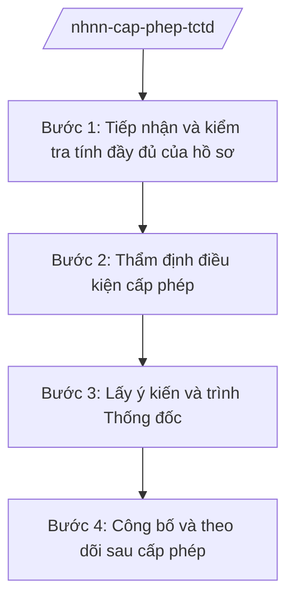

# Skill: Cấp phép tổ chức tín dụng

## 2. Khi nào dùng

Khi NHNN tiếp nhận, thẩm định hồ sơ đề nghị cấp giấy phép thành lập và hoạt động đối với tổ chức
tín dụng, chi nhánh ngân hàng nước ngoài, văn phòng đại diện (cấp mới, điều chỉnh, thu hồi).

## 3. Đầu vào (Input)

| Trường | Mô tả | Bắt buộc |
|--------|-------|----------|
| `loai_hinh` | NHTMCP / NH 100% vốn nước ngoài / Chi nhánh NH nước ngoài / ... | Có |
| `ho_so_de_nghi` | Hồ sơ đề nghị cấp phép (đơn, điều lệ, phương án kinh doanh, nhân sự...) | Có |
| `loai_thu_tuc` | Cấp mới / Điều chỉnh / Thu hồi giấy phép | Có |

## 4. Quy trình

**Bước 1. Tiếp nhận và kiểm tra tính đầy đủ của hồ sơ**

- Làm gì: Tiếp nhận hồ sơ; kiểm tra tính đầy đủ, hợp lệ theo danh mục thành phần; thông báo bổ sung nếu thiếu.
- Dùng input: `ho_so_de_nghi`, `loai_thu_tuc`.
- Vai trò: Bộ phận một cửa NHNN (hoặc vụ chuyên môn), AI hỗ trợ đối chiếu danh mục thành phần hồ sơ, lập phiếu kiểm tra ⏱ ~0,5–1 ngày (ước tính).
- Lưu ý nghiệp vụ: Chỉ tiếp nhận khi hồ sơ đầy đủ; ghi rõ thời hạn bổ sung.
- → Kết quả bước: Phiếu tiếp nhận hồ sơ (hoặc thông báo yêu cầu bổ sung).

**Bước 2. Thẩm định điều kiện cấp phép**

- Làm gì: Thẩm định vốn điều lệ/vốn được cấp, cơ cấu sở hữu, nhân sự quản trị – điều hành (tiêu chuẩn, điều kiện), phương án kinh doanh, hệ thống kiểm soát nội bộ, công nghệ thông tin.
- Dùng input: Hồ sơ đầy đủ, `loai_hinh`.
- Vai trò: Vụ chuyên môn (Vụ Tổ chức cán bộ, Vụ Chính sách tiền tệ, Cơ quan Thanh tra giám sát...) phối hợp thẩm định theo chức năng; AI hỗ trợ đối chiếu điều kiện theo checklist, tổng hợp ý kiến các đơn vị ⏱ ~10–20 ngày tùy loại hình (ước tính).
- Lưu ý nghiệp vụ: Nhân sự dự kiến (Chủ tịch HĐQT, Tổng Giám đốc...) phải đáp ứng tiêu chuẩn, điều kiện theo quy định; vốn phải được chứng minh nguồn gốc hợp pháp.
- → Kết quả bước: Báo cáo thẩm định điều kiện cấp phép.

**Bước 3. Lấy ý kiến và trình Thống đốc**

- Làm gì: Tổng hợp ý kiến các đơn vị; hoàn thiện tờ trình; trình Thống đốc NHNN xem xét, quyết định cấp/không cấp giấy phép.
- Dùng input: Báo cáo thẩm định.
- Vai trò: Vụ đầu mối trình, Phó Thống đốc phụ trách cho ý kiến, **Thống đốc NHNN (ông Lê Văn CC — giả lập) ký quyết định**; AI hỗ trợ soạn tờ trình và dự thảo giấy phép/quyết định ⏱ ~3–5 ngày (ước tính).
- Lưu ý nghiệp vụ: Trường hợp không cấp phép phải có văn bản trả lời nêu rõ lý do.
- → Kết quả bước: Giấy phép thành lập và hoạt động (hoặc văn bản từ chối có lý do).

**Bước 4. Công bố và theo dõi sau cấp phép**

- Làm gì: Công bố giấy phép; cập nhật danh sách TCTD được cấp phép; theo dõi việc đáp ứng điều kiện sau cấp phép (khai trương hoạt động đúng hạn...).
- Dùng input: Giấy phép đã cấp.
- Vai trò: Vụ chuyên môn, AI hỗ trợ cập nhật cơ sở dữ liệu và lập lịch theo dõi ⏱ ~1 ngày (ước tính).
- Lưu ý nghiệp vụ: TCTD phải khai trương hoạt động trong thời hạn quy định, nếu không giấy phép có thể bị thu hồi.
- → Kết quả bước: Giấy phép được công bố; hồ sơ lưu trữ đầy đủ.

## Luồng quy trình (Workflow)

## 5. Đầu ra (Output)

- Giấy phép thành lập và hoạt động TCTD (hoặc văn bản từ chối cấp phép nêu rõ lý do).
- Hồ sơ thẩm định lưu trữ.

### Cấu trúc output chuẩn

**Giấy phép thành lập và hoạt động** (thể thức NĐ 30/2020/NĐ-CP):
1. Quốc hiệu "CỘNG HÒA XÃ HỘI CHỦ NGHĨA VIỆT NAM", Tiêu ngữ "Độc lập – Tự do – Hạnh phúc"; "GIẤY PHÉP thành lập và hoạt động ..."; số giấy phép; địa danh, ngày tháng năm.
2. Căn cứ pháp lý.
3. Nội dung cấp phép: tên TCTD, loại hình, vốn điều lệ/vốn được cấp, thời hạn hoạt động, nội dung hoạt động được phép.
4. Điều kiện, nghĩa vụ của TCTD được cấp phép.
5. Hiệu lực; chữ ký (ghi rõ chức danh, họ tên người ký; ký hiệu "KT."/"TL." khi ký thay) Thống đốc NHNN, đóng dấu.
6. Nơi nhận (kết thúc "- Lưu: VT, [mã đơn vị].").
## 6. Checklist nghiệm thu

- [ ] Hồ sơ đầy đủ, hợp lệ theo danh mục.
- [ ] Thẩm định đủ các điều kiện: vốn, sở hữu, nhân sự, phương án kinh doanh, kiểm soát nội bộ.
- [ ] Nhân sự quản trị đáp ứng tiêu chuẩn, điều kiện.
- [ ] Có tờ trình và ý kiến các đơn vị liên quan.
- [ ] Quyết định do Thống đốc NHNN ký; từ chối cấp phép có lý do rõ ràng.
- [ ] Thể thức đúng NĐ 30/2020/NĐ-CP.
- [ ] Không bịa hồ sơ, căn cứ.

## 7. Ví dụ mô phỏng

*Dữ liệu dưới đây là giả lập 100% phục vụ minh họa.*

**Input mẫu:** loai_hinh = Ngân hàng thương mại cổ phần; loai_thu_tuc = Cấp mới (giả lập).

**Output mẫu (trích Giấy phép):**

> NGÂN HÀNG NHÀ NƯỚC VIỆT NAM
>
> Số: 123/GP-NHNN
> (Địa danh minh họa), ngày 01 tháng 12 năm 2026
>
> **GIẤY PHÉP**
> **Thành lập và hoạt động ngân hàng thương mại cổ phần**
>
> *Căn cứ Luật Các tổ chức tín dụng (tên luật, không ghi số hiệu);*
> *Căn cứ Nghị định số 26/2025/NĐ-CP ngày 24/02/2025 của Chính phủ;*
> *Xét đề nghị của ... (giả lập),*
>
> **THỐNG ĐỐC NGÂN HÀNG NHÀ NƯỚC VIỆT NAM QUYẾT ĐỊNH:**
>
> **Điều 1.** Cấp giấy phép thành lập và hoạt động cho Ngân hàng Thương mại cổ phần BB (giả lập).
> - Vốn điều lệ: ... đồng (giả lập). - Thời hạn hoạt động: 99 năm (giả lập).
> - Nội dung hoạt động: nhận tiền gửi, cấp tín dụng, cung ứng dịch vụ thanh toán... (giả lập)
> **Điều 2.** ... (điều kiện, nghĩa vụ)
> **Điều 3.** Giấy phép này có hiệu lực kể từ ngày ký.
>
> **THỐNG ĐỐC** (ký, đóng dấu — giả lập: ông Lê Văn CC)

## 8. Human gate

- Lãnh đạo vụ đầu mối duyệt báo cáo thẩm định.
- Phó Thống đốc phụ trách cho ý kiến.
- **Thống đốc NHNN ký giấy phép/quyết định.**

## 9. Giới hạn

- AI không quyết định cấp/không cấp phép thay Thống đốc NHNN.
- AI không tự ký, phát hành giấy phép; không bịa hồ sơ, kết quả thẩm định.
- Thông tin hồ sơ của tổ chức đề nghị phải được bảo mật.

## 10. Căn cứ & lưu ý

- Nghị định 26/2025/NĐ-CP ngày 24/02/2025 — chức năng, nhiệm vụ, quyền hạn và cơ cấu tổ chức của NHNN.
- Luật Các tổ chức tín dụng (tên luật, không ghi số hiệu) — điều kiện cấp phép TCTD.
- Nghị định 30/2020/NĐ-CP — thể thức văn bản (chỉ dùng cho thể thức).
- Lưu ý: giấy phép của NHNN là điều kiện để TCTD đăng ký kinh doanh và hoạt động.
