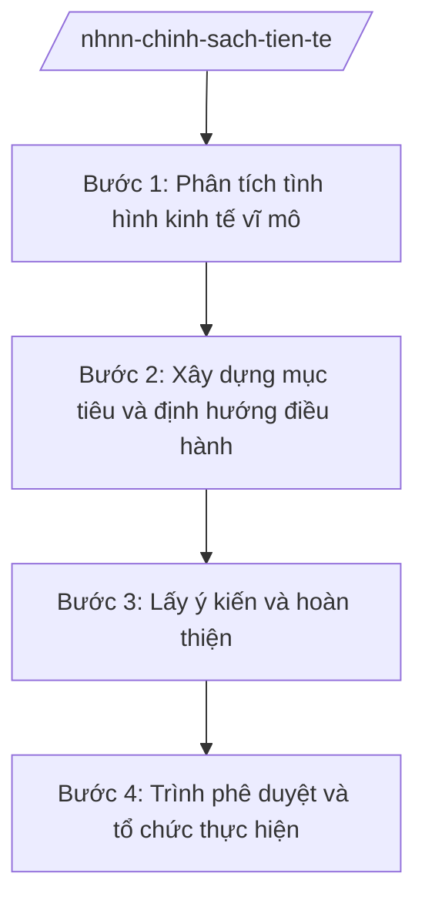

# Skill: Chính sách tiền tệ quốc gia

## 2. Khi nào dùng

Khi NHNN xây dựng định hướng, mục tiêu điều hành chính sách tiền tệ hằng năm (kiểm soát lạm phát,
ổn định kinh tế vĩ mô, hỗ trợ tăng trưởng), hoặc điều chỉnh công cụ điều hành trong năm.

## 3. Đầu vào (Input)

| Trường | Mô tả | Bắt buộc |
|--------|-------|----------|
| `nam_dieu_hanh` | Năm điều hành chính sách tiền tệ | Có |
| `muc_tieu_vi_mo` | Mục tiêu lạm phát, tăng trưởng do Quốc hội/Chính phủ giao | Có |
| `du_bao_kinh_te` | Dự báo kinh tế vĩ mô trong và ngoài nước | Có |
| `de_xuat_cong_cu` | Đề xuất điều chỉnh công cụ (lãi suất, OMO, dự trữ bắt buộc, tín dụng...) | Không |

## 4. Quy trình

**Bước 1. Phân tích tình hình kinh tế vĩ mô**

- Làm gì: Thu thập, phân tích số liệu lạm phát, tăng trưởng, tín dụng, lãi suất, tỷ giá; đánh giá bối cảnh quốc tế.
- Dùng input: `du_bao_kinh_te`, `muc_tieu_vi_mo`.
- Vai trò: Vụ Chính sách tiền tệ chủ trì, AI hỗ trợ tổng hợp số liệu, vẽ biểu đồ xu hướng và phát hiện điểm rủi ro ⏱ ~3–5 ngày (ước tính).
- Lưu ý nghiệp vụ: Số liệu phải thống nhất với số liệu thống kê nhà nước; phân tích phải tách bạch yếu tố trong nước và quốc tế.
- → Kết quả bước: Báo cáo phân tích kinh tế vĩ mô phục vụ điều hành.

**Bước 2. Xây dựng mục tiêu và định hướng điều hành**

- Làm gì: Đề xuất mục tiêu tăng trưởng tín dụng, định hướng lãi suất, tỷ giá; xây dựng các kịch bản điều hành.
- Dùng input: Báo cáo phân tích, `muc_tieu_vi_mo`, `nam_dieu_hanh`.
- Vai trò: Vụ Chính sách tiền tệ soạn thảo, AI hỗ trợ mô phỏng kịch bản và kiểm tra tính nhất quán của các mục tiêu ⏱ ~3–4 ngày (ước tính).
- Lưu ý nghiệp vụ: Mục tiêu điều hành phải phù hợp với mục tiêu Quốc hội giao và định hướng của Chính phủ.
- → Kết quả bước: Dự thảo định hướng điều hành chính sách tiền tệ năm.

**Bước 3. Lấy ý kiến và hoàn thiện**

- Làm gì: Xin ý kiến các vụ/cục trong NHNN, Hội đồng tư vấn chính sách tiền tệ quốc gia; hoàn thiện dự thảo.
- Dùng input: Dự thảo định hướng điều hành.
- Vai trò: Vụ Chính sách tiền tệ tổng hợp, AI hỗ trợ lập bảng tổng hợp ý kiến ⏱ ~2–3 ngày (ước tính).
- Lưu ý nghiệp vụ: Ý kiến của Hội đồng tư vấn chính sách tiền tệ quốc gia là căn cứ quan trọng.
- → Kết quả bước: Dự thảo hoàn thiện trình lãnh đạo NHNN.

**Bước 4. Trình phê duyệt và tổ chức thực hiện**

- Làm gì: Trình Thống đốc NHNN phê duyệt định hướng điều hành; ban hành văn bản chỉ đạo các TCTD; theo dõi, đánh giá định kỳ.
- Dùng input: Dự thảo hoàn thiện.
- Vai trò: Phó Thống đốc phụ trách cho ý kiến, **Thống đốc NHNN (ông Lê Văn CC — giả lập) phê duyệt**; AI hỗ trợ soạn văn bản chỉ đạo và khung theo dõi ⏱ ~2 ngày (ước tính).
- Lưu ý nghiệp vụ: Việc điều chỉnh công cụ trong năm phải kịp thời, linh hoạt theo diễn biến thị trường.
- → Kết quả bước: Định hướng điều hành chính sách tiền tệ được phê duyệt + văn bản chỉ đạo triển khai.

## Luồng quy trình (Workflow)

## 5. Đầu ra (Output)

- Định hướng điều hành chính sách tiền tệ năm (Thống đốc phê duyệt).
- Văn bản chỉ đạo các tổ chức tín dụng; báo cáo Chính phủ về điều hành CSTT (định kỳ).

### Cấu trúc output chuẩn

**Báo cáo Chính phủ về điều hành chính sách tiền tệ** (thể thức NĐ 30/2020/NĐ-CP):
1. Quốc hiệu "CỘNG HÒA XÃ HỘI CHỦ NGHĨA VIỆT NAM", Tiêu ngữ "Độc lập – Tự do – Hạnh phúc"; "BÁO CÁO ..."; số, ký hiệu; địa danh, ngày tháng năm.
2. Kính gửi: Chính phủ.
3. Diễn biến kinh tế vĩ mô, tiền tệ trong kỳ.
4. Kết quả điều hành (công cụ đã sử dụng, kết quả đạt được).
5. Định hướng điều hành thời gian tới.
6. Kiến nghị.
7. Nơi nhận (kết thúc "- Lưu: VT, [mã đơn vị]."); chữ ký (ghi rõ chức danh, họ tên người ký; ký hiệu "KT."/"TL." khi ký thay) Thống đốc, đóng dấu.

> **Checklist thể thức văn bản theo NĐ 30/2020/NĐ-CP** — đối chiếu trước khi trình ký:
> 1. Quốc hiệu và Tiêu ngữ.
> 2. Tên cơ quan, tổ chức ban hành văn bản.
> 3. Số, ký hiệu của văn bản.
> 4. Địa danh và thời gian ban hành văn bản.
> 5. Tên loại và trích yếu nội dung văn bản.
> 6. Nội dung văn bản.
> 7. Chức vụ, họ tên và chữ ký của người có thẩm quyền.
> 8. Dấu, chữ ký số của cơ quan, tổ chức.
> 9. Nơi nhận (kèm Phụ lục nếu có).

## 6. Checklist nghiệm thu

- [ ] Phân tích đầy đủ trong nước + quốc tế, số liệu có nguồn.
- [ ] Mục tiêu điều hành phù hợp mục tiêu Quốc hội/Chính phủ giao.
- [ ] Đã xin ý kiến Hội đồng tư vấn chính sách tiền tệ quốc gia.
- [ ] Văn bản chỉ đạo cụ thể, khả thi đối với các TCTD.
- [ ] Thể thức đúng NĐ 30/2020/NĐ-CP; đúng thẩm quyền ký.
- [ ] Không bịa số liệu, căn cứ pháp lý.

## 7. Ví dụ mô phỏng

*Dữ liệu dưới đây là giả lập 100% phục vụ minh họa.*

**Input mẫu:** nam_dieu_hanh = 2026; muc_tieu_vi_mo = "kiểm soát lạm phát, hỗ trợ tăng trưởng" (giả lập).

**Output mẫu (trích Báo cáo):**

> CỘNG HÒA XÃ HỘI CHỦ NGHĨA VIỆT NAM
> Độc lập – Tự do – Hạnh phúc
>
> Số: 1234/BC-NHNN
> (Địa danh minh họa), ngày 10 tháng 01 năm 2026
>
> **BÁO CÁO**
> **Kết quả điều hành chính sách tiền tệ năm 2025 và định hướng năm 2026**
>
> Kính gửi: Chính phủ
>
> **I. DIỄN BIẾN KINH TẾ VĨ MÔ, TIỀN TỆ NĂM 2025** ... (số liệu giả lập)
> **II. KẾT QUẢ ĐIỀU HÀNH** ... (giả lập: điều hành lãi suất, tín dụng...)
> **III. ĐỊNH HƯỚNG ĐIỀU HÀNH NĂM 2026** ... (giả lập)
> **IV. KIẾN NGHỊ** ...
>
> Nơi nhận: ...
> **THỐNG ĐỐC** (ký, đóng dấu — giả lập: ông Lê Văn CC)

## 8. Human gate

- Vụ trưởng Vụ Chính sách tiền tệ duyệt dự thảo.
- Phó Thống đốc phụ trách cho ý kiến.
- **Thống đốc NHNN phê duyệt định hướng điều hành.**

## 9. Giới hạn

- AI không quyết định mục tiêu, công cụ điều hành thay lãnh đạo NHNN.
- AI không tự ký, phát hành văn bản; không bịa số liệu kinh tế vĩ mô.
- Mọi căn cứ pháp lý phải có thật.

## 10. Căn cứ & lưu ý

- Nghị định 26/2025/NĐ-CP ngày 24/02/2025 của Chính phủ — chức năng, nhiệm vụ, quyền hạn và cơ cấu tổ chức của Ngân hàng Nhà nước Việt Nam.
- Nghị quyết 176/2025/QH15 ngày 18/02/2025 — cơ cấu tổ chức của Chính phủ (NHNN là cơ quan ngang bộ).
- Nghị định 30/2020/NĐ-CP — thể thức văn bản (chỉ dùng cho thể thức).
- Lưu ý: NHNN thực hiện chức năng quản lý nhà nước về tiền tệ, hoạt động ngân hàng và ngoại hối; mục tiêu điều hành gắn với mục tiêu Quốc hội giao.
