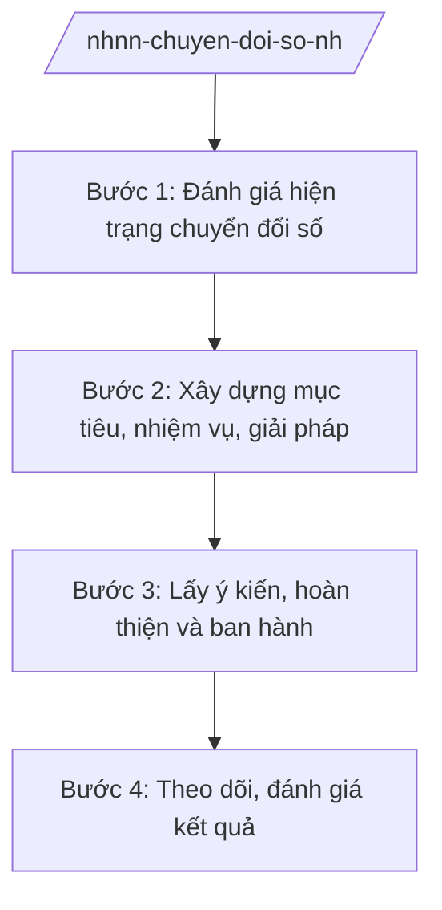

# Skill: Chuyển đổi số ngành ngân hàng

## 2. Khi nào dùng

Khi NHNN xây dựng kế hoạch chuyển đổi số ngành ngân hàng, thúc đẩy thanh toán không dùng tiền mặt,
phát triển ngân hàng số, hoặc đánh giá kết quả chuyển đổi số hằng năm.

## 3. Đầu vào (Input)

| Trường | Mô tả | Bắt buộc |
|--------|-------|----------|
| `noi_dung` | Kế hoạch CĐS / Thanh toán không dùng tiền mặt / Ngân hàng số / Đánh giá kết quả | Có |
| `hien_trang` | Hiện trạng chuyển đổi số ngành ngân hàng | Có |
| `muc_tieu` | Mục tiêu, chỉ tiêu chuyển đổi số | Có |

## 4. Quy trình

**Bước 1. Đánh giá hiện trạng chuyển đổi số**

- Làm gì: Thu thập số liệu về thanh toán không dùng tiền mặt, ngân hàng số, hạ tầng công nghệ của các TCTD; đánh giá mức độ số hóa của NHNN.
- Dùng input: `hien_trang`.
- Vai trò: Vụ chuyên môn (Vụ Thanh toán / Cục Công nghệ thông tin — theo phân công) chủ trì, AI hỗ trợ tổng hợp số liệu, dựng bảng đánh giá ⏱ ~3–4 ngày (ước tính).
- Lưu ý nghiệp vụ: Số liệu phải có nguồn rõ ràng; đánh giá cả hạ tầng kỹ thuật và an toàn thông tin.
- → Kết quả bước: Báo cáo đánh giá hiện trạng chuyển đổi số ngành ngân hàng.

**Bước 2. Xây dựng mục tiêu, nhiệm vụ, giải pháp**

- Làm gì: Xác định mục tiêu, chỉ tiêu (tỷ lệ thanh toán không dùng tiền mặt, số lượng giao dịch số...); đề xuất nhiệm vụ, giải pháp (hoàn thiện thể chế, hạ tầng, an toàn, nhân lực).
- Dùng input: Báo cáo hiện trạng, `muc_tieu`.
- Vai trò: Vụ chuyên môn soạn thảo, AI hỗ trợ xây dựng khung mục tiêu–nhiệm vụ–giải pháp ⏱ ~3–4 ngày (ước tính).
- Lưu ý nghiệp vụ: Mục tiêu phải phù hợp với Chương trình chuyển đổi số quốc gia; giải pháp phải gắn với bảo đảm an toàn, an ninh.
- → Kết quả bước: Dự thảo kế hoạch chuyển đổi số ngành ngân hàng.

**Bước 3. Lấy ý kiến, hoàn thiện và ban hành**

- Làm gì: Lấy ý kiến các vụ/cục, các TCTD, hiệp hội; hoàn thiện; trình Thống đốc NHNN ban hành kế hoạch.
- Dùng input: Dự thảo kế hoạch.
- Vai trò: Vụ chuyên môn tổng hợp, Phó Thống đốc phụ trách cho ý kiến, **Thống đốc NHNN (ông Lê Văn CC — giả lập) ký ban hành**; AI hỗ trợ tổng hợp ý kiến ⏱ ~3–5 ngày (ước tính).
- Lưu ý nghiệp vụ: Kế hoạch phải phân công rõ đơn vị chủ trì, phối hợp và lộ trình.
- → Kết quả bước: Kế hoạch chuyển đổi số ngành ngân hàng đã ban hành.

**Bước 4. Theo dõi, đánh giá kết quả**

- Làm gì: Theo dõi tiến độ thực hiện của các đơn vị; đánh giá định kỳ kết quả (sơ kết hằng năm); đề xuất điều chỉnh.
- Dùng input: Báo cáo tiến độ của các đơn vị.
- Vai trò: Vụ chuyên môn theo dõi, AI hỗ trợ tổng hợp, đối chiếu chỉ tiêu–kết quả ⏱ ~2–3 ngày/đợt (ước tính).
- Lưu ý nghiệp vụ: Đánh giá phải dựa trên số liệu thực tế, chỉ rõ đơn vị chậm tiến độ và nguyên nhân.
- → Kết quả bước: Báo cáo sơ kết/tổng kết chuyển đổi số ngành ngân hàng.

## Luồng quy trình (Workflow)

## 5. Đầu ra (Output)

- Kế hoạch chuyển đổi số ngành ngân hàng (Thống đốc ký ban hành).
- Báo cáo đánh giá kết quả chuyển đổi số định kỳ.

### Cấu trúc output chuẩn

**Kế hoạch chuyển đổi số ngành ngân hàng** (thể thức NĐ 30/2020/NĐ-CP):
1. Quốc hiệu "CỘNG HÒA XÃ HỘI CHỦ NGHĨA VIỆT NAM", Tiêu ngữ "Độc lập – Tự do – Hạnh phúc"; "KẾ HOẠCH Chuyển đổi số ngành ngân hàng ..."; số, ký hiệu; địa danh, ngày tháng năm.
2. Mục đích, yêu cầu.
3. Mục tiêu, chỉ tiêu cụ thể.
4. Nhiệm vụ, giải pháp (thể chế, hạ tầng, an toàn thông tin, nhân lực, hợp tác).
5. Tổ chức thực hiện (phân công đơn vị, lộ trình).
6. Nơi nhận (kết thúc "- Lưu: VT, [mã đơn vị]."); chữ ký (ghi rõ chức danh, họ tên người ký; ký hiệu "KT."/"TL." khi ký thay) Thống đốc, đóng dấu.
## 6. Checklist nghiệm thu

- [ ] Đánh giá hiện trạng đầy đủ, số liệu có nguồn.
- [ ] Mục tiêu, chỉ tiêu đo lường được, phù hợp chương trình CĐS quốc gia.
- [ ] Nhiệm vụ phân công rõ đơn vị, lộ trình.
- [ ] Giải pháp gắn với bảo đảm an toàn, an ninh.
- [ ] Đã lấy ý kiến các bên liên quan.
- [ ] Thể thức đúng NĐ 30/2020/NĐ-CP; Thống đốc ký.
- [ ] Không bịa số liệu, căn cứ.

## 7. Ví dụ mô phỏng

*Dữ liệu dưới đây là giả lập 100% phục vụ minh họa.*

**Input mẫu:** noi_dung = "Kế hoạch chuyển đổi số ngành ngân hàng năm 2026";
muc_tieu = "đẩy mạnh thanh toán không dùng tiền mặt" (giả lập).

**Output mẫu (trích Kế hoạch):**

> NGÂN HÀNG NHÀ NƯỚC VIỆT NAM
>
> Số: 5678/KH-NHNN
> (Địa danh minh họa), ngày 15 tháng 01 năm 2026
>
> **KẾ HOẠCH**
> **Chuyển đổi số ngành ngân hàng năm 2026**
>
> **I. MỤC ĐÍCH, YÊU CẦU** ...
> **II. MỤC TIÊU, CHỈ TIÊU** ... (giả lập: 5 chỉ tiêu định lượng)
> **III. NHIỆM VỤ, GIẢI PHÁP**
> 1. Hoàn thiện thể chế ... 2. Phát triển hạ tầng thanh toán ... 3. Bảo đảm an toàn thông tin ...
> **IV. TỔ CHỨC THỰC HIỆN** ... (phân công đơn vị, giả lập)
>
> Nơi nhận: ...
> **THỐNG ĐỐC** (ký, đóng dấu — giả lập: ông Lê Văn CC)

## 8. Human gate

- Vụ trưởng vụ chuyên môn duyệt dự thảo.
- Phó Thống đốc phụ trách cho ý kiến.
- **Thống đốc NHNN ký ban hành kế hoạch.**

## 9. Giới hạn

- AI không quyết định mục tiêu, giải pháp thay lãnh đạo NHNN.
- AI không tự ký, phát hành văn bản; không bịa số liệu.
- Mọi căn cứ pháp lý phải có thật.

## 10. Căn cứ & lưu ý

- Nghị định 26/2025/NĐ-CP ngày 24/02/2025 — chức năng, nhiệm vụ, quyền hạn và cơ cấu tổ chức của NHNN.
- Chương trình chuyển đổi số quốc gia (tên chương trình, không ghi số hiệu) — định hướng chung.
- Nghị định 30/2020/NĐ-CP — thể thức văn bản (chỉ dùng cho thể thức).
- Lưu ý: chuyển đổi số ngành ngân hàng phải gắn chặt với bảo đảm an toàn hệ thống và quyền lợi người dùng dịch vụ.
