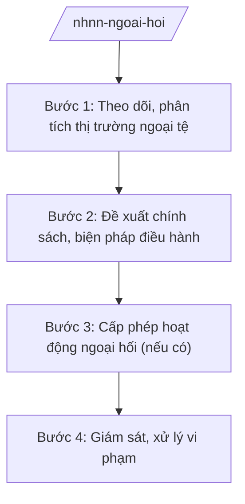

# Skill: Quản lý ngoại hối

## 2. Khi nào dùng

Khi NHNN xây dựng chính sách quản lý ngoại hối, điều hành tỷ giá, quản lý dự trữ ngoại hối nhà nước,
hoặc cấp phép hoạt động ngoại hối cho tổ chức.

## 3. Đầu vào (Input)

| Trường | Mô tả | Bắt buộc |
|--------|-------|----------|
| `noi_dung` | Chính sách tỷ giá / Dự trữ ngoại hối / Cấp phép hoạt động ngoại hối / Kiểm soát dòng vốn | Có |
| `du_lieu_thi_truong` | Diễn biến thị trường ngoại tệ trong và ngoài nước | Có |
| `de_xuat` | Đề xuất chính sách/giải pháp của đơn vị | Không |

## 4. Quy trình

**Bước 1. Theo dõi, phân tích thị trường ngoại tệ**

- Làm gì: Thu thập dữ liệu tỷ giá, cung cầu ngoại tệ, dòng vốn vào/ra; phân tích diễn biến và nguyên nhân.
- Dùng input: `du_lieu_thi_truong`.
- Vai trò: Vụ Quản lý ngoại hối chủ trì, AI hỗ trợ tổng hợp dữ liệu, vẽ biểu đồ diễn biến và cảnh báo biến động bất thường ⏱ ~1–2 ngày/lần theo dõi định kỳ (ước tính).
- Lưu ý nghiệp vụ: Dữ liệu phải cập nhật, chính xác; phân biệt biến động ngắn hạn và xu hướng.
- → Kết quả bước: Báo cáo phân tích thị trường ngoại tệ.

**Bước 2. Đề xuất chính sách, biện pháp điều hành**

- Làm gì: Đề xuất điều hành tỷ giá trung tâm, biên độ; biện pháp can thiệp thị trường (mua/bán ngoại tệ); điều chỉnh quy định quản lý ngoại hối.
- Dùng input: Báo cáo phân tích, `de_xuat`, `noi_dung`.
- Vai trò: Vụ Quản lý ngoại hối soạn thảo, AI hỗ trợ mô phỏng tác động của các phương án ⏱ ~2–3 ngày (ước tính).
- Lưu ý nghiệp vụ: Điều hành tỷ giá phải linh hoạt, phù hợp với mục tiêu chính sách tiền tệ và ổn định kinh tế vĩ mô.
- → Kết quả bước: Dự thảo chính sách/biện pháp điều hành.

**Bước 3. Cấp phép hoạt động ngoại hối (nếu có)**

- Làm gì: Tiếp nhận, thẩm định hồ sơ đề nghị cấp phép hoạt động ngoại hối của TCTD, tổ chức kinh tế; trình cấp phép.
- Dùng input: Hồ sơ đề nghị của tổ chức.
- Vai trò: Vụ Quản lý ngoại hối thẩm định, **Thống đốc NHNN (hoặc người được ủy quyền) ký giấy phép**; AI hỗ trợ kiểm tra tính đầy đủ của hồ sơ ⏱ ~5–10 ngày (ước tính).
- Lưu ý nghiệp vụ: Chỉ cấp phép khi tổ chức đáp ứng đủ điều kiện theo quy định.
- → Kết quả bước: Giấy phép hoạt động ngoại hối (hoặc văn bản từ chối có lý do).

**Bước 4. Giám sát, xử lý vi phạm**

- Làm gì: Giám sát việc chấp hành quy định quản lý ngoại hối; phối hợp thanh tra, xử lý vi phạm.
- Dùng input: Kết quả giám sát, báo cáo của TCTD.
- Vai trò: Vụ Quản lý ngoại hối phối hợp Cơ quan Thanh tra, giám sát ngân hàng; AI hỗ trợ phát hiện giao dịch bất thường từ dữ liệu báo cáo ⏱ ~định kỳ (ước tính).
- Lưu ý nghiệp vụ: Xử lý vi phạm phải đúng thẩm quyền, đúng trình tự pháp luật.
- → Kết quả bước: Báo cáo giám sát + kiến nghị xử lý (nếu có vi phạm).

## Luồng quy trình (Workflow)

## 5. Đầu ra (Output)

- Văn bản chính sách/biện pháp điều hành tỷ giá, quản lý ngoại hối.
- Giấy phép hoạt động ngoại hối; báo cáo giám sát.

### Cấu trúc output chuẩn

**Quyết định/Thông tư về quản lý ngoại hối** (thể thức NĐ 30/2020/NĐ-CP):
1. Quốc hiệu "CỘNG HÒA XÃ HỘI CHỦ NGHĨA VIỆT NAM", Tiêu ngữ "Độc lập – Tự do – Hạnh phúc"; tên loại văn bản và trích yếu; số, ký hiệu; địa danh, ngày tháng năm.
2. Căn cứ pháp lý.
3. Nội dung quy định (phạm vi, đối tượng, nội dung quản lý, trách nhiệm).
4. Điều khoản thi hành.
5. Nơi nhận (kết thúc "- Lưu: VT, [mã đơn vị]."); chữ ký (ghi rõ chức danh, họ tên người ký; ký hiệu "KT."/"TL." khi ký thay) người có thẩm quyền, đóng dấu.

> **Chuẩn tài liệu đầu ra** (thứ tự ưu tiên):
> 1. Chuẩn riêng của ngành/cơ quan chủ quản — mẫu, biểu mẫu, quy chuẩn tại văn bản quy phạm chuyên ngành (xem mục "Căn cứ & lưu ý").
> 2. Tài liệu không có quy chuẩn riêng — thể thức NĐ 30/2020/NĐ-CP: Quốc hiệu và Tiêu ngữ; tên cơ quan ban hành; số, ký hiệu; địa danh và thời gian; tên loại và trích yếu; nội dung; chức vụ, họ tên, chữ ký người có thẩm quyền; dấu, chữ ký số; nơi nhận (kèm Phụ lục nếu có).

## 6. Checklist nghiệm thu

- [ ] Phân tích thị trường đầy đủ, dữ liệu cập nhật.
- [ ] Biện pháp điều hành phù hợp mục tiêu CSTT và ổn định vĩ mô.
- [ ] Cấp phép đúng điều kiện, đúng thẩm quyền.
- [ ] Giám sát đầy đủ, xử lý vi phạm đúng trình tự.
- [ ] Thể thức đúng NĐ 30/2020/NĐ-CP.
- [ ] Không bịa số liệu, căn cứ.

## 7. Ví dụ mô phỏng

*Dữ liệu dưới đây là giả lập 100% phục vụ minh họa.*

**Input mẫu:** noi_dung = "Điều hành tỷ giá quý IV/2026"; du_lieu_thi_truong = "diễn biến giả lập".

**Output mẫu (trích Báo cáo):**

> NGÂN HÀNG NHÀ NƯỚC VIỆT NAM
>
> Số: 3456/BC-NHNN
> (Địa danh minh họa), ngày 05 tháng 10 năm 2026
>
> **BÁO CÁO**
> **Tình hình thị trường ngoại tệ 9 tháng và định hướng điều hành quý IV năm 2026**
>
> Kính gửi: Chính phủ
>
> **I. DIỄN BIẾN THỊ TRƯỜNG NGOẠI TỆ** ... (số liệu giả lập)
> **II. CÔNG TÁC ĐIỀU HÀNH** ... (giả lập)
> **III. ĐỊNH HƯỚNG QUÝ IV/2026** ... (giả lập)
>
> Nơi nhận: ...
> **THỐNG ĐỐC** (ký, đóng dấu — giả lập: ông Lê Văn CC)

## 8. Human gate

- Vụ trưởng Vụ Quản lý ngoại hối duyệt dự thảo.
- Phó Thống đốc phụ trách cho ý kiến.
- **Thống đốc NHNN (hoặc người được ủy quyền) ký ban hành.**

## 9. Giới hạn

- AI không quyết định chính sách tỷ giá thay lãnh đạo NHNN.
- AI không tự ký, phát hành văn bản; không bịa số liệu thị trường.
- Thông tin can thiệp thị trường phải được bảo mật theo quy định.

## 10. Căn cứ & lưu ý

- Nghị định 26/2025/NĐ-CP ngày 24/02/2025 — chức năng, nhiệm vụ, quyền hạn và cơ cấu tổ chức của NHNN.
- Pháp lệnh Ngoại hối (tên văn bản, không ghi số hiệu) — khung pháp lý quản lý ngoại hối.
- Nghị định 30/2020/NĐ-CP — thể thức văn bản (chỉ dùng cho thể thức).
- Lưu ý: dự trữ ngoại hối nhà nước do NHNN quản lý, sử dụng theo mục tiêu chính sách tiền tệ quốc gia.
