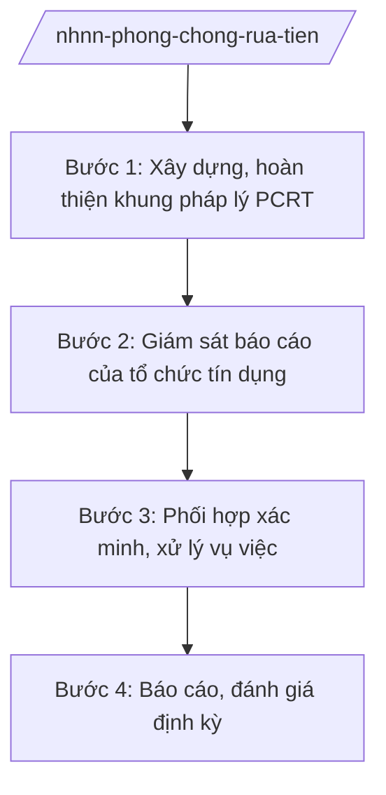

# Skill: Phòng, chống rửa tiền

## 2. Khi nào dùng

Khi NHNN xây dựng chính sách, hướng dẫn phòng chống rửa tiền (PCRT), giám sát việc báo cáo giao
dịch đáng ngờ của TCTD, hoặc phối hợp xử lý vụ việc có dấu hiệu rửa tiền.

## 3. Đầu vào (Input)

| Trường | Mô tả | Bắt buộc |
|--------|-------|----------|
| `noi_dung` | Xây dựng chính sách / Giám sát báo cáo / Xử lý vụ việc | Có |
| `du_lieu_bao_cao` | Dữ liệu báo cáo giao dịch đáng ngờ, giao dịch tiền mặt lớn của TCTD | Không |
| `vu_viec` | Thông tin vụ việc có dấu hiệu rửa tiền (nếu có) | Không |

## 4. Quy trình

**Bước 1. Xây dựng, hoàn thiện khung pháp lý PCRT**

- Làm gì: Rà soát, đề xuất sửa đổi quy định về PCRT; xây dựng hướng dẫn nhận biết giao dịch đáng ngờ cho TCTD.
- Dùng input: `noi_dung`.
- Vai trò: Vụ chuyên môn (Cục Phòng chống rửa tiền — giả lập tên đơn vị theo chức năng) chủ trì, AI hỗ trợ rà soát, soạn dự thảo ⏱ ~3–5 ngày (ước tính).
- Lưu ý nghiệp vụ: Quy định phải phù hợp với chuẩn mực quốc tế về PCRT và điều kiện Việt Nam.
- → Kết quả bước: Dự thảo văn bản quy định/hướng dẫn về PCRT.

**Bước 2. Giám sát báo cáo của tổ chức tín dụng**

- Làm gì: Tiếp nhận, phân tích báo cáo giao dịch đáng ngờ, báo cáo giao dịch tiền mặt lớn; đánh giá mức độ tuân thủ của TCTD.
- Dùng input: `du_lieu_bao_cao`.
- Vai trò: Đơn vị PCRT phân tích, AI hỗ trợ phát hiện mẫu hình bất thường từ dữ liệu báo cáo ⏱ ~định kỳ (ước tính).
- Lưu ý nghiệp vụ: Thông tin báo cáo của TCTD là thông tin mật, chỉ sử dụng đúng mục đích PCRT.
- → Kết quả bước: Báo cáo phân tích, đánh giá rủi ro rửa tiền.

**Bước 3. Phối hợp xác minh, xử lý vụ việc**

- Làm gì: Phối hợp cơ quan công an, cơ quan chức năng xác minh vụ việc có dấu hiệu rửa tiền; kiến nghị thanh tra, xử lý vi phạm của TCTD không tuân thủ.
- Dùng input: `vu_viec`, báo cáo phân tích.
- Vai trò: Đơn vị PCRT đầu mối phối hợp, AI hỗ trợ tổng hợp hồ sơ vụ việc ⏱ ~theo vụ việc (ước tính).
- Lưu ý nghiệp vụ: Việc chuyển thông tin cho cơ quan điều tra phải đúng trình tự, đúng thẩm quyền; bảo đảm bí mật.
- → Kết quả bước: Hồ sơ phối hợp xử lý vụ việc + kiến nghị thanh tra/xử phạt (nếu có).

**Bước 4. Báo cáo, đánh giá định kỳ**

- Làm gì: Tổng hợp báo cáo công tác PCRT định kỳ gửi Chính phủ; đánh giá rủi ro quốc gia về rửa tiền (theo phân công).
- Dùng input: Kết quả các bước trên.
- Vai trò: Đơn vị PCRT tổng hợp, lãnh đạo NHNN duyệt, **Thống đốc ký báo cáo**; AI hỗ trợ soạn báo cáo ⏱ ~2–3 ngày (ước tính).
- Lưu ý nghiệp vụ: Báo cáo phải trung thực, chỉ rõ hạn chế và giải pháp.
- → Kết quả bước: Báo cáo công tác PCRT định kỳ.

## Luồng quy trình (Workflow)

## 5. Đầu ra (Output)

- Văn bản quy định/hướng dẫn về PCRT; báo cáo phân tích rủi ro; báo cáo công tác PCRT định kỳ.

### Cấu trúc output chuẩn

**Báo cáo công tác phòng, chống rửa tiền** (thể thức NĐ 30/2020/NĐ-CP):
1. Quốc hiệu "CỘNG HÒA XÃ HỘI CHỦ NGHĨA VIỆT NAM", Tiêu ngữ "Độc lập – Tự do – Hạnh phúc"; "BÁO CÁO ..."; số, ký hiệu; địa danh, ngày tháng năm.
2. Kính gửi: Chính phủ.
3. Kết quả thực hiện (xây dựng thể chế, giám sát, phối hợp xử lý).
4. Đánh giá rủi ro rửa tiền.
5. Hạn chế, nguyên nhân; nhiệm vụ thời gian tới.
6. Kiến nghị.
7. Nơi nhận (kết thúc "- Lưu: VT, [mã đơn vị]."); chữ ký (ghi rõ chức danh, họ tên người ký; ký hiệu "KT."/"TL." khi ký thay) Thống đốc, đóng dấu.
## 6. Checklist nghiệm thu

- [ ] Khung pháp lý đầy đủ, phù hợp chuẩn mực.
- [ ] Giám sát bao quát các TCTD, phân tích có chiều sâu.
- [ ] Thông tin mật được bảo vệ đúng quy định.
- [ ] Phối hợp xử lý đúng trình tự, đúng thẩm quyền.
- [ ] Thể thức đúng NĐ 30/2020/NĐ-CP; đúng thẩm quyền ký.
- [ ] Không bịa số liệu, vụ việc, căn cứ.

## 7. Ví dụ mô phỏng

*Dữ liệu dưới đây là giả lập 100% phục vụ minh họa.*

**Input mẫu:** noi_dung = "Báo cáo công tác PCRT 6 tháng đầu năm 2026" (giả lập).

**Output mẫu (trích Báo cáo):**

> NGÂN HÀNG NHÀ NƯỚC VIỆT NAM
>
> Số: 4567/BC-NHNN
> (Địa danh minh họa), ngày 10 tháng 7 năm 2026
>
> **BÁO CÁO**
> **Công tác phòng, chống rửa tiền 6 tháng đầu năm 2026**
>
> Kính gửi: Chính phủ
>
> **I. KẾT QUẢ THỰC HIỆN**
> 1. Xây dựng thể chế: ... (giả lập)
> 2. Giám sát báo cáo: tiếp nhận ... báo cáo giao dịch đáng ngờ (giả lập)...
> 3. Phối hợp xử lý: ... (giả lập)
> **II. ĐÁNH GIÁ RỦI RO** ... (giả lập)
> **III. NHIỆM VỤ 6 THÁNG CUỐI NĂM** ... (giả lập)
>
> Nơi nhận: ...
> **THỐNG ĐỐC** (ký, đóng dấu — giả lập: ông Lê Văn CC)

## 8. Human gate

- Lãnh đạo đơn vị PCRT duyệt dự thảo.
- Phó Thống đốc phụ trách cho ý kiến.
- **Thống đốc NHNN ký báo cáo/văn bản.**

## 9. Giới hạn

- AI không kết luận hành vi rửa tiền thay cơ quan có thẩm quyền.
- AI không tự ký, phát hành văn bản; không bịa vụ việc, số liệu.
- Thông tin báo cáo giao dịch của TCTD và thông tin vụ việc là mật — tuyệt đối không tiết lộ.

## 10. Căn cứ & lưu ý

- Nghị định 26/2025/NĐ-CP ngày 24/02/2025 — chức năng, nhiệm vụ, quyền hạn và cơ cấu tổ chức của NHNN.
- Luật Phòng, chống rửa tiền (tên luật, không ghi số hiệu) — khung pháp lý PCRT.
- Nghị định 30/2020/NĐ-CP — thể thức văn bản (chỉ dùng cho thể thức).
- Lưu ý: NHNN là đầu mối quốc gia về PCRT trong lĩnh vực tiền tệ, ngân hàng; phối hợp chặt chẽ với Bộ Công an và các cơ quan liên quan.
