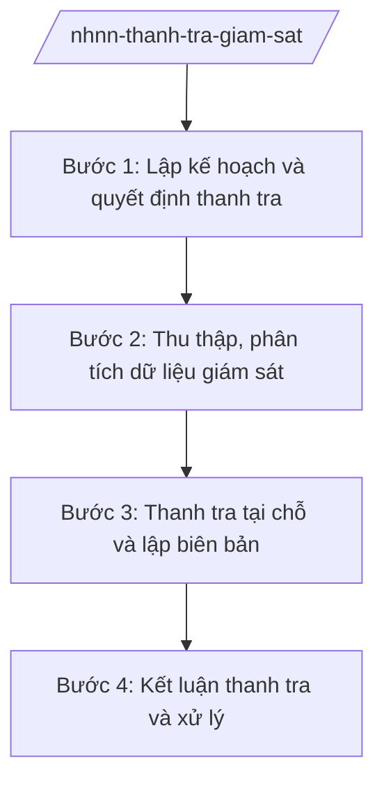

# Skill: Thanh tra, giám sát ngân hàng

## 2. Khi nào dùng

Khi Cơ quan Thanh tra, giám sát ngân hàng (NHNN) lập kế hoạch thanh tra năm, thực hiện thanh tra
tại chỗ hoặc giám sát từ xa đối với tổ chức tín dụng, chi nhánh ngân hàng nước ngoài.

## 3. Đầu vào (Input)

| Trường | Mô tả | Bắt buộc |
|--------|-------|----------|
| `doi_tuong` | TCTD/chi nhánh ngân hàng nước ngoài được thanh tra, giám sát | Có |
| `hinh_thuc` | Thanh tra tại chỗ / Giám sát từ xa / Thanh tra đột xuất | Có |
| `noi_dung` | Nội dung thanh tra, giám sát (an toàn hoạt động, tín dụng, ngoại hối...) | Có |
| `thoi_ky` | Thời kỳ thanh tra | Có |

## 4. Quy trình

**Bước 1. Lập kế hoạch và quyết định thanh tra**

- Làm gì: Xây dựng kế hoạch thanh tra năm (hoặc kế hoạch đột xuất); ban hành quyết định thanh tra, thành lập đoàn thanh tra.
- Dùng input: `doi_tuong`, `hinh_thuc`, `noi_dung`, `thoi_ky`.
- Vai trò: Cơ quan Thanh tra, giám sát ngân hàng chủ trì, AI hỗ trợ lập kế hoạch dựa trên đánh giá rủi ro và dự thảo quyết định thanh tra ⏱ ~2–3 ngày (ước tính).
- Lưu ý nghiệp vụ: Kế hoạch thanh tra phải tránh trùng lặp với thanh tra của cơ quan khác; thanh tra đột xuất phải có căn cứ rõ ràng.
- → Kết quả bước: Quyết định thanh tra + kế hoạch đoàn thanh tra được phê duyệt.

**Bước 2. Thu thập, phân tích dữ liệu giám sát**

- Làm gì: Thu thập báo cáo, số liệu của đối tượng; phân tích từ xa các chỉ số an toàn (tỷ lệ nợ xấu, an toàn vốn...); xác định trọng tâm thanh tra tại chỗ.
- Dùng input: Số liệu báo cáo của TCTD.
- Vai trò: Đoàn thanh tra/giám sát viên, AI hỗ trợ phân tích chỉ số, phát hiện dấu hiệu bất thường ⏱ ~3–5 ngày (ước tính).
- Lưu ý nghiệp vụ: Dữ liệu giám sát là cơ sở để định hướng nội dung thanh tra tại chỗ, không thay thế kiểm tra trực tiếp.
- → Kết quả bước: Báo cáo phân tích giám sát từ xa + trọng tâm thanh tra.

**Bước 3. Thanh tra tại chỗ và lập biên bản**

- Làm gì: Đoàn thanh tra làm việc tại đối tượng; kiểm tra hồ sơ, chứng từ; lập biên bản từng nội dung; yêu cầu giải trình.
- Dùng input: Trọng tâm thanh tra, hồ sơ của đối tượng.
- Vai trò: Trưởng đoàn thanh tra chỉ đạo, AI hỗ trợ tổng hợp biên bản, đối chiếu quy định ⏱ ~theo kế hoạch đoàn, 10–30 ngày (ước tính).
- Lưu ý nghiệp vụ: Tuân thủ trình tự, thủ tục thanh tra; bảo đảm khách quan, bảo mật thông tin.
- → Kết quả bước: Biên bản thanh tra + báo cáo kết quả của đoàn.

**Bước 4. Kết luận thanh tra và xử lý**

- Làm gì: Dự thảo kết luận thanh tra; kiến nghị biện pháp xử lý (chấn chỉnh, xử phạt vi phạm hành chính, chuyển cơ quan điều tra nếu có dấu hiệu tội phạm); theo dõi thực hiện kết luận.
- Dùng input: Báo cáo kết quả của đoàn thanh tra.
- Vai trò: Thủ trưởng Cơ quan Thanh tra, giám sát ngân hàng duyệt, **Thống đốc NHNN (hoặc người được ủy quyền) ký kết luận**; AI hỗ trợ soạn dự thảo kết luận ⏱ ~3–5 ngày (ước tính).
- Lưu ý nghiệp vụ: Kết luận phải chỉ rõ vi phạm, căn cứ pháp lý, biện pháp xử lý và thời hạn khắc phục; theo dõi đến khi đối tượng thực hiện xong.
- → Kết quả bước: Kết luận thanh tra + quyết định xử lý (nếu có) + kế hoạch theo dõi.

## Luồng quy trình (Workflow)

## 5. Đầu ra (Output)

- Quyết định thanh tra; biên bản thanh tra; kết luận thanh tra; quyết định xử phạt VPHC (nếu có).

### Cấu trúc output chuẩn

**Kết luận thanh tra** (thể thức NĐ 30/2020/NĐ-CP):
1. Quốc hiệu "CỘNG HÒA XÃ HỘI CHỦ NGHĨA VIỆT NAM", Tiêu ngữ "Độc lập – Tự do – Hạnh phúc"; "KẾT LUẬN THANH TRA ..."; số, ký hiệu; địa danh, ngày tháng năm.
2. Căn cứ (quyết định thanh tra, kế hoạch).
3. Khái quát về đối tượng thanh tra.
4. Kết quả kiểm tra theo từng nội dung.
5. Nhận xét, đánh giá; xác định vi phạm (nếu có) và căn cứ pháp lý.
6. Kiến nghị biện pháp xử lý; thời hạn thực hiện.
7. Nơi nhận (kết thúc "- Lưu: VT, [mã đơn vị]."); chữ ký (ghi rõ chức danh, họ tên người ký; ký hiệu "KT."/"TL." khi ký thay) người có thẩm quyền, đóng dấu.

> **Checklist thể thức văn bản theo NĐ 30/2020/NĐ-CP** — đối chiếu trước khi trình ký:
> 1. Quốc hiệu và Tiêu ngữ.
> 2. Tên cơ quan, tổ chức ban hành văn bản.
> 3. Số, ký hiệu của văn bản.
> 4. Địa danh và thời gian ban hành văn bản.
> 5. Tên loại và trích yếu nội dung văn bản.
> 6. Nội dung văn bản.
> 7. Chức vụ, họ tên và chữ ký của người có thẩm quyền.
> 8. Dấu, chữ ký số của cơ quan, tổ chức.
> 9. Nơi nhận (kèm Phụ lục nếu có).

## 6. Checklist nghiệm thu

- [ ] Có quyết định thanh tra đúng thẩm quyền, đúng trình tự.
- [ ] Nội dung thanh tra bám sát kế hoạch, không trùng lặp.
- [ ] Biên bản đầy đủ, có chữ ký các bên.
- [ ] Kết luận chỉ rõ vi phạm + căn cứ pháp lý + biện pháp xử lý + thời hạn.
- [ ] Có kế hoạch theo dõi thực hiện kết luận.
- [ ] Thể thức đúng NĐ 30/2020/NĐ-CP.
- [ ] Không bịa số liệu, căn cứ; bảo mật thông tin thanh tra.

## 7. Ví dụ mô phỏng

*Dữ liệu dưới đây là giả lập 100% phục vụ minh họa.*

**Input mẫu:** doi_tuong = "Ngân hàng TMCP AA (giả lập)"; hinh_thuc = Thanh tra tại chỗ;
noi_dung = "An toàn hoạt động tín dụng"; thoi_ky = năm 2025.

**Output mẫu (trích Kết luận thanh tra):**

> NGÂN HÀNG NHÀ NƯỚC VIỆT NAM
> CƠ QUAN THANH TRA, GIÁM SÁT NGÂN HÀNG (giả lập)
>
> Số: 234/KL-TTGSNH
> (Địa danh minh họa), ngày 15 tháng 11 năm 2026
>
> **KẾT LUẬN THANH TRA**
> **Việc chấp hành quy định về an toàn hoạt động tín dụng tại Ngân hàng TMCP AA**
>
> *Căn cứ Quyết định thanh tra số ... (giả lập);*
>
> **I. KHÁI QUÁT** ...
> **II. KẾT QUẢ KIỂM TRA**
> 1. Về cấp tín dụng: ... (giả lập)
> 2. Về phân loại nợ, trích lập dự phòng: ... (giả lập)
> **III. NHẬN XÉT, ĐÁNH GIÁ** ...
> **IV. KIẾN NGHỊ BIỆN PHÁP XỬ LÝ**
> 1. Yêu cầu Ngân hàng TMCP AA chấn chỉnh ... trong 30 ngày (giả lập)...
>
> Nơi nhận: ...
> **THỦ TRƯỞNG CƠ QUAN THANH TRA, GIÁM SÁT NGÂN HÀNG**
> (ký, đóng dấu — giả lập)

## 8. Human gate

- Thủ trưởng Cơ quan Thanh tra, giám sát ngân hàng phê duyệt kế hoạch và dự thảo kết luận.
- **Người có thẩm quyền ký kết luận thanh tra và quyết định xử lý** theo phân cấp.

## 9. Giới hạn

- AI không kết luận vi phạm thay đoàn thanh tra và người có thẩm quyền.
- AI không tự ký, phát hành kết luận; không bịa số liệu kiểm tra.
- Thông tin thanh tra phải được bảo mật theo quy định.

## 10. Căn cứ & lưu ý

- Nghị định 26/2025/NĐ-CP ngày 24/02/2025 — chức năng, nhiệm vụ, quyền hạn và cơ cấu tổ chức của NHNN (trong đó có Cơ quan Thanh tra, giám sát ngân hàng).
- Luật Thanh tra, Luật Xử lý vi phạm hành chính (tên luật, không ghi số hiệu) — trình tự, thủ tục thanh tra, xử phạt.
- Nghị định 30/2020/NĐ-CP — thể thức văn bản (chỉ dùng cho thể thức).
- Lưu ý: kết hợp giám sát từ xa và thanh tra tại chỗ theo mô hình giám sát dựa trên rủi ro.
