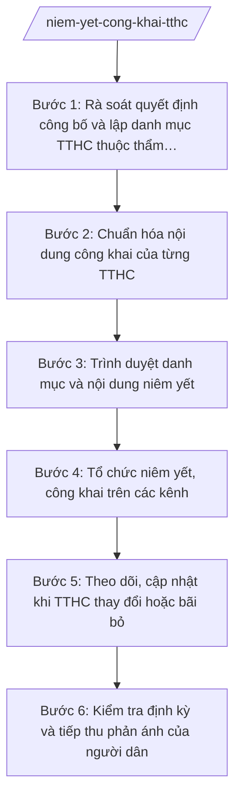

# Skill: Niêm yết, công khai TTHC

## Khi nào dùng

- Khi cần lập hoặc rà soát danh mục TTHC thuộc thẩm quyền giải quyết của cấp xã để niêm yết tại Trung tâm Phục vụ hành chính công.
- Khi cần công khai nội dung từng TTHC (thành phần hồ sơ, thời hạn giải quyết, phí, lệ phí, mẫu đơn, tờ khai) tại trụ sở Trung tâm và trên cổng/trang thông tin điện tử của xã.
- Khi có TTHC mới được công bố, TTHC sửa đổi, bổ sung hoặc bãi bỏ cần cập nhật danh mục niêm yết kịp thời.
- Khi kiểm tra định kỳ phát hiện nội dung niêm yết chưa đầy đủ, chưa đúng với quyết định công bố TTHC của cơ quan có thẩm quyền.
- Khi người dân, tổ chức phản ánh khó tra cứu thông tin TTHC, cần cải tiến hình thức niêm yết, công khai (bảng niêm yết, mã QR, trang thông tin điện tử).

## Đầu vào (Input)

| Trường | Mô tả | Bắt buộc |
|--------|-------|----------|
| `quyet_dinh_cong_bo` | Quyết định công bố danh mục TTHC của cơ quan có thẩm quyền (UBND tỉnh, bộ ngành) còn hiệu lực | Có |
| `danh_muc_tthc_hien_hanh` | Danh mục TTHC đang niêm yết tại Trung tâm PVHCC (nếu có) để đối chiếu, cập nhật | Không |
| `noi_dung_tung_tthc` | Nội dung chi tiết từng TTHC: tên TTHC, cơ quan thực hiện, thành phần hồ sơ, thời hạn giải quyết, phí/lệ phí, mẫu đơn tờ khai, căn cứ pháp lý | Có |
| `kenh_cong_khai` | Các kênh công khai: bảng niêm yết tại Trung tâm PVHCC, cổng/trang thông tin điện tử của xã, mã QR tra cứu | Không |
| `thong_bao_thay_doi` | Văn bản thông báo TTHC mới/sửa đổi/bãi bỏ cần cập nhật | Không |
| `phan_hoi_nguoi_dan` | Phản ánh của người dân, tổ chức về việc tra cứu, tiếp cận thông tin TTHC | Không |

## Quy trình

**Bước 1. Rà soát quyết định công bố và lập danh mục TTHC thuộc thẩm quyền cấp xã**

- Làm gì: Thu thập các quyết định công bố TTHC còn hiệu lực của cơ quan có thẩm quyền; lọc ra các TTHC thuộc thẩm quyền giải quyết của UBND cấp xã; lập danh mục TTHC chuẩn (mã TTHC, tên TTHC, lĩnh vực, cơ quan thực hiện).
- Dùng input: `quyet_dinh_cong_bo`, `danh_muc_tthc_hien_hanh`
- Vai trò: Công chức Trung tâm PVHCC (đầu mối) phối hợp công chức Văn phòng HĐND và UBND xã. AI hỗ trợ: đối chiếu danh mục hiện hành với quyết định công bố mới, chỉ ra TTHC thêm mới/sửa đổi/bãi bỏ. Thời gian ước tính: 1–2 ngày làm việc.
- Lưu ý nghiệp vụ: Chỉ niêm yết TTHC đã được cơ quan có thẩm quyền công bố và còn hiệu lực; tuyệt đối không tự ý đưa TTHC chưa công bố vào danh mục niêm yết.
- → Kết quả bước: Danh mục TTHC thuộc thẩm quyền cấp xã đã được rà soát, đối chiếu với quyết định công bố.

**Bước 2. Chuẩn hóa nội dung công khai của từng TTHC**

- Làm gì: Đối với từng TTHC trong danh mục, chuẩn hóa đầy đủ các nội dung công khai: tên TTHC; cơ quan thực hiện; thành phần hồ sơ; số lượng hồ sơ; thời hạn giải quyết; phí, lệ phí (nếu có); mẫu đơn, tờ khai; căn cứ pháp lý; quy trình các bước thực hiện.
- Dùng input: `noi_dung_tung_tthc`, `quyet_dinh_cong_bo`
- Vai trò: Công chức Trung tâm PVHCC biên soạn; công chức đầu mối các phòng chuyên môn (X1, X2, X3) rà soát nội dung thuộc lĩnh vực mình phụ trách. AI hỗ trợ: kiểm tra tính đầy đủ các trường nội dung, cảnh báo khi thiếu thành phần hồ sơ hoặc căn cứ pháp lý. Thời gian ước tính: 2–3 ngày làm việc.
- Lưu ý nghiệp vụ: Nội dung công khai phải trích đúng nguyên văn quyết định công bố; phí, lệ phí ghi đúng mức thu hiện hành; không tự ý diễn giải làm thay đổi nội dung TTHC.
- → Kết quả bước: Bộ nội dung công khai chuẩn của từng TTHC, sẵn sàng niêm yết.

**Bước 3. Trình duyệt danh mục và nội dung niêm yết**

- Làm gì: Tổng hợp danh mục TTHC và bộ nội dung công khai thành tờ trình/hồ sơ trình; lấy ý kiến các phòng chuyên môn liên quan; trình Phó Chủ tịch UBND xã phụ trách kiểm tra và Chủ tịch UBND xã phê duyệt trước khi niêm yết.
- Dùng input: `danh_muc_tthc_hien_hanh`, `noi_dung_tung_tthc`
- Vai trò: Công chức Trung tâm PVHCC lập hồ sơ trình; Chánh Văn phòng HĐND và UBND (Ông Phạm Văn C) thẩm tra thể thức; Phó Chủ tịch UBND xã phụ trách (Bà Trần Thị B) kiểm tra; Chủ tịch UBND xã (Ông Nguyễn Văn A) phê duyệt. AI hỗ trợ: soạn tờ trình, tổng hợp ý kiến góp ý. Thời gian ước tính: 2–3 ngày làm việc.
- Lưu ý nghiệp vụ: Không niêm yết, công khai khi chưa có phê duyệt của Chủ tịch UBND xã; mọi thay đổi sau phê duyệt phải trình lại.
- → Kết quả bước: Danh mục và nội dung TTHC đã được Chủ tịch UBND xã phê duyệt niêm yết, công khai.

**Bước 4. Tổ chức niêm yết, công khai trên các kênh**

- Làm gì: Niêm yết danh mục và nội dung TTHC tại bảng niêm yết của Trung tâm PVHCC (nơi dễ thấy, dễ đọc); đăng tải đầy đủ trên cổng/trang thông tin điện tử của xã; tạo mã QR tra cứu nhanh từng TTHC đặt tại quầy tiếp nhận.
- Dùng input: `kenh_cong_khai`, `noi_dung_tung_tthc`
- Vai trò: Công chức Trung tâm PVHCC thực hiện niêm yết; công chức phụ trách trang thông tin điện tử đăng tải. AI hỗ trợ: tạo mã QR cho từng TTHC, kiểm tra hiển thị trên trang thông tin điện tử. Thời gian ước tính: 1–2 ngày làm việc.
- Lưu ý nghiệp vụ: Nội dung niêm yết tại trụ sở và trên cổng/trang thông tin điện tử phải thống nhất; bảng niêm yết phải cập nhật ngay khi có thay đổi, không để nội dung cũ gây nhầm lẫn.
- → Kết quả bước: TTHC được niêm yết, công khai đầy đủ trên tất cả các kênh; có biên bản/xác nhận niêm yết.

**Bước 5. Theo dõi, cập nhật khi TTHC thay đổi hoặc bãi bỏ**

- Làm gì: Thường xuyên theo dõi các quyết định công bố mới của cơ quan có thẩm quyền; khi có TTHC mới/sửa đổi/bãi bỏ, thực hiện lại các bước 1–4 đối với nội dung thay đổi; gỡ bỏ kịp thời nội dung TTHC đã bãi bỏ khỏi mọi kênh niêm yết, công khai.
- Dùng input: `thong_bao_thay_doi`, `quyet_dinh_cong_bo`, `danh_muc_tthc_hien_hanh`
- Vai trò: Công chức Trung tâm PVHCC theo dõi và đề xuất cập nhật; Phó Chủ tịch UBND xã phụ trách kiểm tra; Chủ tịch UBND xã phê duyệt nội dung cập nhật. AI hỗ trợ: cảnh báo khi phát hiện quyết định công bố mới liên quan, đối chiếu nội dung cũ/mới. Thời gian ước tính: cập nhật trong vòng 05 ngày làm việc kể từ khi quyết định công bố có hiệu lực.
- Lưu ý nghiệp vụ: TTHC bãi bỏ phải được gỡ khỏi niêm yết ngay, tránh người dân nộp hồ sơ theo TTHC không còn hiệu lực; lưu hồ sơ các lần cập nhật để tra cứu khi cần.
- → Kết quả bước: Danh mục niêm yết luôn đồng bộ với quyết định công bố hiện hành; hồ sơ cập nhật được lưu trữ.

**Bước 6. Kiểm tra định kỳ và tiếp thu phản ánh của người dân**

- Làm gì: Kiểm tra định kỳ hằng quý việc niêm yết, công khai (đầy đủ, đúng nội dung, dễ tra cứu); tiếp nhận phản ánh của người dân, tổ chức về khó khăn khi tra cứu; đề xuất cải tiến hình thức niêm yết.
- Dùng input: `phan_hoi_nguoi_dan`, `kenh_cong_khai`
- Vai trò: Công chức Trung tâm PVHCC kiểm tra, tổng hợp phản ánh. AI hỗ trợ: tổng hợp phản ánh theo nhóm vấn đề, gợi ý cải tiến hình thức công khai. Thời gian ước tính: 0,5 ngày làm việc/lần kiểm tra.
- Lưu ý nghiệp vụ: Mọi phản ánh của người dân về nội dung niêm yết phải được kiểm tra, trả lời; kết quả kiểm tra định kỳ báo cáo Phó Chủ tịch UBND xã phụ trách.
- → Kết quả bước: Biên bản kiểm tra định kỳ niêm yết, công khai TTHC; danh mục cải tiến (nếu có).

## Luồng quy trình (Workflow)

## Đầu ra (Output)

- Danh mục TTHC thuộc thẩm quyền cấp xã (đã phê duyệt).
- Bộ nội dung công khai chi tiết từng TTHC (thành phần hồ sơ, thời hạn, phí/lệ phí, mẫu đơn, căn cứ pháp lý).
- Tờ trình phê duyệt niêm yết, công khai TTHC.
- Biên bản/xác nhận niêm yết tại Trung tâm PVHCC và đăng tải trên cổng/trang thông tin điện tử.
- Hồ sơ cập nhật TTHC (khi có thay đổi, bãi bỏ).
- Biên bản kiểm tra định kỳ việc niêm yết, công khai.

### Cấu trúc output chuẩn

Sản phẩm chính: **Danh mục thủ tục hành chính thuộc thẩm quyền giải quyết của UBND cấp xã** (niêm yết tại Trung tâm PVHCC), gồm các phần theo đúng thứ tự, đúng thể thức NĐ 30/2020/NĐ-CP:

1. Tiêu đề: "DANH MỤC THỦ TỤC HÀNH CHÍNH THUỘC THẨM QUYỀN GIẢI QUYẾT CỦA ỦY BAN NHÂN DÂN XÃ A (niêm yết tại Trung tâm Phục vụ hành chính công xã A)"; Quốc hiệu "CỘNG HÒA XÃ HỘI CHỦ NGHĨA VIỆT NAM" – Tiêu ngữ "Độc lập – Tự do – Hạnh phúc" (trên quyết định phê duyệt danh mục); ghi rõ căn cứ phê duyệt (số, ngày quyết định phê duyệt của Chủ tịch UBND xã) và ngày cập nhật.
2. Bảng danh mục: STT | Mã TTHC | Tên TTHC | Lĩnh vực | Cơ quan thực hiện | Thời hạn giải quyết | Phí, lệ phí | Ghi chú.
3. Phụ lục nội dung chi tiết từng TTHC (mỗi TTHC một mục, đánh số thứ tự theo bảng danh mục), mỗi mục gồm:
   a) Tên TTHC và mã TTHC;
   b) Cơ quan thực hiện;
   c) Thành phần, số lượng hồ sơ;
   d) Thời hạn giải quyết;
   đ) Phí, lệ phí (nếu có);
   e) Mẫu đơn, tờ khai (liệt kê tên mẫu);
   g) Căn cứ pháp lý (ghi rõ số hiệu văn bản);
   h) Quy trình các bước thực hiện (tóm tắt).
4. Thông tin hỗ trợ: địa chỉ Trung tâm PVHCC (Số 123 đường B, xã A, tỉnh A); số điện thoại (0900 000 001); địa chỉ trang thông tin điện tử; mã QR tra cứu.
5. Xác nhận phê duyệt: họ tên, chữ ký của Chủ tịch UBND xã; dấu của UBND xã.
6. Phân phối: niêm yết công khai tại Trung tâm Phục vụ hành chính công + đăng tải trên Cổng thông tin điện tử; Lưu: VT, hồ sơ TTHC.

> **Checklist thể thức văn bản theo NĐ 30/2020/NĐ-CP** — đối chiếu trước khi trình ký:
> 1. Quốc hiệu và Tiêu ngữ.
> 2. Tên cơ quan, tổ chức ban hành văn bản.
> 3. Số, ký hiệu của văn bản.
> 4. Địa danh và thời gian ban hành văn bản.
> 5. Tên loại và trích yếu nội dung văn bản.
> 6. Nội dung văn bản.
> 7. Chức vụ, họ tên và chữ ký của người có thẩm quyền.
> 8. Dấu, chữ ký số của cơ quan, tổ chức.
> 9. Nơi nhận (kèm Phụ lục nếu có).

## Checklist nghiệm thu

1. Danh mục chỉ gồm TTHC đã được cơ quan có thẩm quyền công bố và còn hiệu lực; có ghi rõ căn cứ phê duyệt và ngày cập nhật.
2. Mỗi TTHC có đầy đủ 8 nội dung công khai (tên, cơ quan thực hiện, thành phần hồ sơ, thời hạn, phí/lệ phí, mẫu đơn, căn cứ pháp lý, quy trình).
3. Nội dung công khai trích đúng quyết định công bố; phí, lệ phí đúng mức thu hiện hành; căn cứ pháp lý ghi đúng số hiệu văn bản còn hiệu lực.
4. Danh mục và nội dung đã được Chủ tịch UBND xã phê duyệt trước khi niêm yết.
5. Niêm yết đầy đủ tại bảng niêm yết Trung tâm PVHCC và đăng tải trên cổng/trang thông tin điện tử; nội dung hai kênh thống nhất nhau.
6. Có mã QR tra cứu tại quầy tiếp nhận; thông tin liên hệ hỗ trợ đầy đủ, chính xác.
7. TTHC bãi bỏ được gỡ khỏi mọi kênh niêm yết trong vòng 05 ngày làm việc kể từ khi quyết định bãi bỏ có hiệu lực.
8. Có biên bản/xác nhận niêm yết và hồ sơ lưu các lần cập nhật.
9. Kiểm tra định kỳ hằng quý có biên bản; phản ánh của người dân được tiếp thu, xử lý.

## Ví dụ mô phỏng
*Dữ liệu dưới đây là giả lập 100% phục vụ minh họa.*

**Input mẫu:**

- Quyết định công bố (giả lập): Quyết định số 10/QĐ-UBND ngày 01/01/2026 của UBND tỉnh A công bố danh mục TTHC thuộc thẩm quyền cấp xã.
- Danh mục: 03 TTHC — "Chứng thực bản sao" (thời hạn 01 ngày làm việc, phí 2.000 đồng/trang); "Đăng ký khai sinh" (thời hạn 01 ngày làm việc, không thu phí); "Đăng ký kết hôn" (thời hạn 03 ngày làm việc, không thu phí).
- Kênh công khai: bảng niêm yết tại Trung tâm PVHCC xã A; trang thông tin điện tử xã A; mã QR tại quầy tiếp nhận.
- Phê duyệt (giả lập): Quyết định số 05/QĐ-UBND ngày 10/02/2026 của Chủ tịch UBND xã A.

**Output mẫu:**

**DANH MỤC THỦ TỤC HÀNH CHÍNH
THUỘC THẨM QUYỀN GIẢI QUYẾT CỦA ỦY BAN NHÂN DÂN XÃ A**
*(Niêm yết tại Trung tâm Phục vụ hành chính công xã A)*

Căn cứ phê duyệt: Quyết định số 05/QĐ-UBND ngày 10/02/2026 của Chủ tịch UBND xã A.
Ngày cập nhật: 15/02/2026.

| STT | Mã TTHC | Tên TTHC | Lĩnh vực | Cơ quan thực hiện | Thời hạn giải quyết | Phí, lệ phí | Ghi chú |
|-----|---------|----------|----------|------------------|--------------------|-------------|---------|
| 1 | TTHC-A-001 | Chứng thực bản sao | Tư pháp – Hộ tịch | UBND xã A | 01 ngày làm việc | 2.000 đồng/trang | |
| 2 | TTHC-A-002 | Đăng ký khai sinh | Tư pháp – Hộ tịch | UBND xã A | 01 ngày làm việc | Không thu | |
| 3 | TTHC-A-003 | Đăng ký kết hôn | Tư pháp – Hộ tịch | UBND xã A | 03 ngày làm việc | Không thu | |

**Phụ lục: Nội dung chi tiết từng TTHC**

1. Chứng thực bản sao (TTHC-A-001)
   a) Cơ quan thực hiện: Ủy ban nhân dân xã A (Trung tâm Phục vụ hành chính công xã A tiếp nhận và trả kết quả).
   b) Thành phần, số lượng hồ sơ: bản chính giấy tờ cần chứng thực (01 bản) + bản sao cần chứng thực.
   c) Thời hạn giải quyết: 01 ngày làm việc kể từ ngày nhận đủ hồ sơ hợp lệ.
   d) Phí, lệ phí: 2.000 đồng/trang.
   đ) Mẫu đơn, tờ khai: không.
   e) Căn cứ pháp lý: Quyết định số 10/QĐ-UBND ngày 01/01/2026 của UBND tỉnh A.
   g) Quy trình: tiếp nhận, kiểm tra → chứng thực → thu phí → trả kết quả.

2. Đăng ký khai sinh (TTHC-A-002)
   a) Cơ quan thực hiện: Ủy ban nhân dân xã A.
   b) Thành phần, số lượng hồ sơ: tờ khai đăng ký khai sinh (01 bản); giấy chứng sinh (01 bản sao).
   c) Thời hạn giải quyết: 01 ngày làm việc.
   d) Phí, lệ phí: không thu.
   đ) Mẫu đơn, tờ khai: Tờ khai đăng ký khai sinh.
   e) Căn cứ pháp lý: Quyết định số 10/QĐ-UBND ngày 01/01/2026 của UBND tỉnh A.
   g) Quy trình: tiếp nhận, kiểm tra → ghi vào sổ hộ tịch → cấp giấy khai sinh → trả kết quả.

3. Đăng ký kết hôn (TTHC-A-003)
   a) Cơ quan thực hiện: Ủy ban nhân dân xã A.
   b) Thành phần, số lượng hồ sơ: tờ khai đăng ký kết hôn (01 bản); giấy tờ tùy thân của hai bên.
   c) Thời hạn giải quyết: 03 ngày làm việc.
   d) Phí, lệ phí: không thu.
   đ) Mẫu đơn, tờ khai: Tờ khai đăng ký kết hôn.
   e) Căn cứ pháp lý: Quyết định số 10/QĐ-UBND ngày 01/01/2026 của UBND tỉnh A.
   g) Quy trình: tiếp nhận, kiểm tra → xác minh (nếu cần) → ghi vào sổ hộ tịch → trao giấy chứng nhận kết hôn.

**Thông tin hỗ trợ:** Trung tâm Phục vụ hành chính công xã A — Số 123 đường B, xã A, tỉnh A; điện thoại: 0900 000 001; mã QR tra cứu đặt tại quầy tiếp nhận.

**CHỦ TỊCH UBND XÃ A**
*(Ký, ghi rõ họ tên, đóng dấu)*
Nguyễn Văn A

*(Dữ liệu trên là giả lập 100% phục vụ minh họa.)*

## Human gate

- Công chức Trung tâm PVHCC lập danh mục, chuẩn hóa nội dung → công chức đầu mối các phòng chuyên môn (X1, X2, X3) rà soát nội dung thuộc lĩnh vực mình phụ trách → Chánh Văn phòng HĐND và UBND (Ông Phạm Văn C) thẩm tra thể thức → Phó Chủ tịch UBND xã phụ trách (Bà Trần Thị B) kiểm tra → Chủ tịch UBND xã (Ông Nguyễn Văn A) phê duyệt trước khi niêm yết, công khai.
- Mọi cập nhật (thêm mới, sửa đổi, bãi bỏ TTHC) đều phải trình phê duyệt lại theo quy trình trên; không tự ý cập nhật niêm yết.

## Giới hạn

- AI KHÔNG ra quyết định hành chính thay người có thẩm quyền; không tự quyết định đưa TTHC vào hoặc gỡ TTHC khỏi danh mục niêm yết.
- AI không tự công bố, tự niêm yết TTHC khi chưa có phê duyệt của Chủ tịch UBND xã.
- AI không bịa nội dung TTHC, không bịa mức phí/lệ phí, không bịa số hiệu quyết định công bố hay căn cứ pháp lý.
- AI không dùng văn bản đã hết hiệu lực (quyết định công bố đã bị thay thế, TTHC đã bãi bỏ) làm căn cứ niêm yết.
- AI không tự ý diễn giải làm thay đổi nội dung TTHC so với quyết định công bố.

## Căn cứ & lưu ý

- Nghị định 118/2025/NĐ-CP ngày 09/6/2025 của Chính phủ về cơ chế một cửa, một cửa liên thông trong giải quyết thủ tục hành chính (quy định về công khai, minh bạch TTHC).
- Văn bản 7216/VPCP-KSTT ngày 04/8/2025 của Văn phòng Chính phủ hướng dẫn tổ chức, hoạt động của Trung tâm Phục vụ hành chính công trong mô hình chính quyền địa phương 2 cấp.
- Nghị định 150/2025/NĐ-CP ngày 12/6/2025 của Chính phủ (quy định về Trung tâm Phục vụ hành chính công thuộc UBND cấp xã).
- Nghị định 30/2020/NĐ-CP của Chính phủ về công tác văn thư (thể thức văn bản hành chính).
- Lưu ý: danh mục niêm yết là căn cứ để người dân giám sát việc giải quyết TTHC; nội dung niêm yết sai lệch có thể dẫn đến khiếu nại, vì vậy phải rà soát kỹ trước khi trình phê duyệt và cập nhật kịp thời khi có thay đổi.
