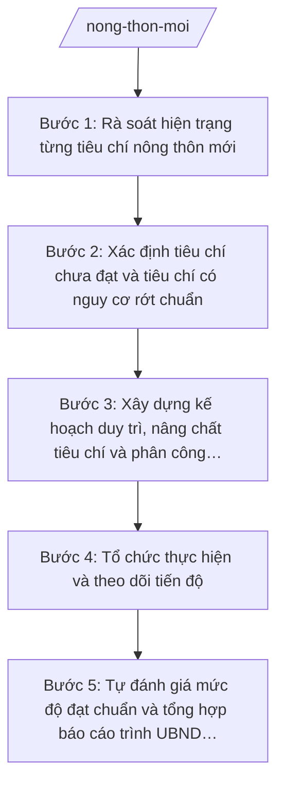

# Skill: Duy trì, nâng chất tiêu chí nông thôn mới

## 2. Khi nào dùng

- Khi Phòng Kinh tế xã được giao chủ trì công tác duy trì, nâng cao chất lượng các tiêu chí nông thôn mới hằng năm (nhiệm vụ lĩnh vực phát triển nông thôn cấp xã theo Thông tư 19/2025/TT-BNNMT).
- Khi cần rà soát hiện trạng từng tiêu chí theo Bộ tiêu chí quốc gia về xã nông thôn mới để xác định tiêu chí chưa đạt hoặc có nguy cơ rớt chuẩn.
- Khi cần xây dựng kế hoạch duy trì, nâng chất tiêu chí, phân công đầu mối thực hiện (Phòng Kinh tế chủ trì, phối hợp Phòng Văn hóa – Xã hội, các thôn, đoàn thể).
- Khi cần tổng hợp báo cáo tự đánh giá mức độ đạt chuẩn các tiêu chí trình UBND xã và báo cáo cấp trên.

## 3. Đầu vào (Input)

| Trường | Mô tả | Bắt buộc |
|--------|-------|----------|
| `nam_ke_hoach` | Năm áp dụng của kế hoạch (vd: 2026) | Có |
| `bo_tieu_chi` | Bộ tiêu chí quốc gia về xã nông thôn mới đang áp dụng (danh mục các tiêu chí, chỉ tiêu) | Có |
| `hien_trang_tieu_chi` | Hiện trạng từng tiêu chí: đạt/chưa đạt, số liệu minh chứng (đường giao thông, trường học, thu nhập, môi trường...) | Có |
| `tieu_chi_yeu` | Các tiêu chí chưa đạt hoặc có nguy cơ rớt chuẩn cần tập trung khắc phục | Có |
| `nguon_luc` | Kinh phí dự kiến (ngân sách xã, nguồn lồng ghép, huy động), nhân lực, chương trình, dự án liên quan | Có |
| `dau_moi_phoi_hop` | Đầu mối phối hợp: Phòng Văn hóa – Xã hội, các thôn, Mặt trận Tổ quốc, đoàn thể | Có |
| `van_ban_chi_dao` | Văn bản chỉ đạo của cấp trên về xây dựng nông thôn mới trong năm áp dụng | Có |
| `bao_cao_nam_truoc` | Báo cáo kết quả thực hiện năm trước và bài học rút ra (nếu có) | Không |

## 4. Quy trình

**Bước 1. Rà soát hiện trạng từng tiêu chí nông thôn mới**
- Làm gì: Đối chiếu từng tiêu chí, chỉ tiêu của Bộ tiêu chí quốc gia về xã nông thôn mới với số liệu thực tế của xã: thu thập số liệu từ các thôn, Phòng Văn hóa – Xã hội, các đoàn thể; lập bảng hiện trạng (tiêu chí – chỉ tiêu – kết quả – minh chứng).
- Dùng input: `bo_tieu_chi`, `hien_trang_tieu_chi`, `dau_moi_phoi_hop`.
- Vai trò: Công chức Phòng Kinh tế (bà Trần Thị H) chủ trì rà soát, phối hợp công chức Phòng Văn hóa – Xã hội và trưởng các thôn; AI hỗ trợ lập bảng đối chiếu tiêu chí – hiện trạng và đánh dấu các chỉ tiêu thiếu minh chứng (~3 ngày).
- Lưu ý nghiệp vụ: Số liệu phải có minh chứng cụ thể (biên bản, quyết toán, danh sách); không đánh giá "đạt" khi thiếu minh chứng; các tiêu chí liên quan văn hóa, giáo dục, y tế phải lấy số liệu từ Phòng Văn hóa – Xã hội.
- → Kết quả bước: Bảng rà soát hiện trạng từng tiêu chí nông thôn mới (kèm minh chứng).

**Bước 2. Xác định tiêu chí chưa đạt và tiêu chí có nguy cơ rớt chuẩn**
- Làm gì: Phân loại kết quả rà soát thành 3 nhóm: tiêu chí đã đạt bền vững; tiêu chí đạt nhưng có nguy cơ rớt chuẩn; tiêu chí chưa đạt; phân tích nguyên nhân của từng tiêu chí yếu (thiếu kinh phí, hạ tầng xuống cấp, ý thức người dân...).
- Dùng input: Bảng rà soát bước 1, `tieu_chi_yeu`, `bao_cao_nam_truoc`.
- Vai trò: Công chức Phòng Kinh tế (bà Trần Thị H) phân tích, xin ý kiến trưởng các thôn; AI hỗ trợ phân nhóm tiêu chí và gợi ý khung phân tích nguyên nhân (~1 ngày).
- Lưu ý nghiệp vụ: Ưu tiên xử lý tiêu chí có nguy cơ rớt chuẩn trước tiêu chí chưa đạt lâu năm; nguyên nhân phải cụ thể, tránh chung chung ("thiếu kinh phí" phải nêu rõ thiếu bao nhiêu, cho hạng mục nào).
- → Kết quả bước: Danh mục tiêu chí chưa đạt / nguy cơ rớt chuẩn kèm phân tích nguyên nhân.

**Bước 3. Xây dựng kế hoạch duy trì, nâng chất tiêu chí và phân công đầu mối**
- Làm gì: Soạn Kế hoạch duy trì, nâng cao chất lượng các tiêu chí nông thôn mới năm áp dụng: mục tiêu từng tiêu chí, nhiệm vụ, giải pháp cụ thể; phân công đầu mối (Phòng Kinh tế chủ trì chung, Phòng Văn hóa – Xã hội phụ trách nhóm tiêu chí văn hóa – xã hội, các thôn phụ trách tiêu chí trên địa bàn); tiến độ và kinh phí từng hạng mục.
- Dùng input: Danh mục tiêu chí yếu bước 2, `nguon_luc`, `dau_moi_phoi_hop`, `van_ban_chi_dao`, `nam_ke_hoach`.
- Vai trò: Công chức Phòng Kinh tế (bà Trần Thị H) soạn kế hoạch; AI hỗ trợ soạn thảo theo thể thức văn bản hành chính (NĐ 30/2020/NĐ-CP), lập bảng nhiệm vụ (tiêu chí – giải pháp – đầu mối – thời hạn – kinh phí) (~2 ngày).
- Lưu ý nghiệp vụ: Kế hoạch phải khả thi với nguồn lực thực tế của xã; hạng mục dùng ngân sách phải phù hợp dự toán đã giao; huy động sức dân phải theo đúng quy định, có sự đồng thuận.
- → Kết quả bước: Dự thảo Kế hoạch duy trì, nâng cao chất lượng các tiêu chí nông thôn mới năm ….

**Bước 4. Tổ chức thực hiện và theo dõi tiến độ**
- Làm gì: Triển khai kế hoạch sau khi được phê duyệt: đôn đốc các đầu mối thực hiện theo tiến độ; tổ chức kiểm tra thực tế các hạng mục (đường giao thông, vệ sinh môi trường, thiết chế văn hóa...); tổng hợp khó khăn, đề xuất điều chỉnh.
- Dùng input: Kế hoạch đã phê duyệt bước 3.
- Vai trò: Công chức Phòng Kinh tế (bà Trần Thị H) theo dõi, đôn đốc; Trưởng phòng Kinh tế (bà Hoàng Thị D) chỉ đạo xử lý vướng mắc; AI hỗ trợ lập bảng theo dõi tiến độ theo đầu mối và mẫu báo cáo tiến độ định kỳ (~0,5 ngày/lần theo dõi).
- Lưu ý nghiệp vụ: Kiểm tra thực tế, không chỉ nghe báo cáo; các hạng mục đầu tư xây dựng phải đúng quy trình quản lý đầu tư; kịp thời báo cáo UBND xã khi có nguy cơ không hoàn thành tiến độ.
- → Kết quả bước: Bảng theo dõi tiến độ thực hiện + báo cáo kiểm tra thực tế các hạng mục.

**Bước 5. Tự đánh giá mức độ đạt chuẩn và tổng hợp báo cáo trình UBND xã**
- Làm gì: Tổ chức tự đánh giá mức độ đạt chuẩn từng tiêu chí theo Bộ tiêu chí quốc gia (có minh chứng); soạn Báo cáo kết quả tự đánh giá: bảng tự đánh giá chi tiết, nhận xét chung, tồn tại, kiến nghị; trình Trưởng phòng Kinh tế kiểm tra, trình Chủ tịch UBND xã ký.
- Dùng input: Kết quả thực hiện bước 4, `bo_tieu_chi`, `nam_ke_hoach`.
- Vai trò: Công chức Phòng Kinh tế (bà Trần Thị H) soạn báo cáo; Trưởng phòng Kinh tế (bà Hoàng Thị D) kiểm tra; AI hỗ trợ lập bảng tự đánh giá và soạn thảo báo cáo theo thể thức NĐ 30/2020/NĐ-CP (~2 ngày).
- Lưu ý nghiệp vụ: Tự đánh giá phải trung thực, đúng thực tế; tiêu chí nào chưa đạt phải nêu rõ và có kế hoạch khắc phục, không "làm đẹp" số liệu; báo cáo là cơ sở để cấp trên thẩm tra, công nhận.
- → Kết quả bước: Báo cáo tự đánh giá mức độ đạt chuẩn các tiêu chí nông thôn mới xã A năm … trình ký.

## Luồng quy trình (Workflow)

## 5. Đầu ra (Output)

**Danh sách sản phẩm:**
1. Kế hoạch duy trì, nâng cao chất lượng các tiêu chí nông thôn mới xã A năm … (sản phẩm chính 1).
2. Báo cáo tự đánh giá mức độ đạt chuẩn các tiêu chí nông thôn mới xã A năm … (sản phẩm chính 2).
3. Bảng rà soát hiện trạng từng tiêu chí (kèm minh chứng) (tài liệu kèm theo).
4. Bảng theo dõi tiến độ thực hiện kế hoạch (tài liệu kèm theo).

### Cấu trúc output chuẩn — Kế hoạch duy trì, nâng cao chất lượng tiêu chí nông thôn mới

1. Quốc hiệu – tiêu ngữ: "CỘNG HÒA XÃ HỘI CHỦ NGHĨA VIỆT NAM / Độc lập – Tự do – Hạnh phúc". (đúng thể thức NĐ 30/2020/NĐ-CP)
2. Tên cơ quan ban hành: "ỦY BAN NHÂN DÂN XÃ A".
3. Số, ký hiệu văn bản: số/ký hiệu theo quy định (vd: 45/KH-UBND).
4. Địa danh, ngày tháng năm ban hành: "Xã A, ngày … tháng … năm …".
5. Tên loại và trích yếu: "KẾ HOẠCH — Duy trì, nâng cao chất lượng các tiêu chí nông thôn mới xã A năm …".
6. Căn cứ: Thông tư số 19/2025/TT-BNNMT ngày 19/6/2025 của Bộ Nông nghiệp và Môi trường; Nghị định số 150/2025/NĐ-CP ngày 12/6/2025 của Chính phủ; Bộ tiêu chí quốc gia về xã nông thôn mới (nêu tên); văn bản chỉ đạo của cấp trên về xây dựng nông thôn mới.
7. Nội dung: I. Đánh giá hiện trạng các tiêu chí; II. Mục tiêu năm …; III. Nhiệm vụ, giải pháp (bảng: tiêu chí – hiện trạng – mục tiêu – giải pháp – đầu mối thực hiện – thời hạn – kinh phí); IV. Tổ chức thực hiện (Phòng Kinh tế chủ trì, Phòng Văn hóa – Xã hội phối hợp, các thôn, đoàn thể); V. Kinh phí thực hiện.
8. Thẩm quyền – chức vụ – họ tên người ký: Chủ tịch UBND xã — Nguyễn Văn A; ký, đóng dấu UBND xã.
9. Nơi nhận: Thường trực Đảng ủy, HĐND xã; Sở Nông nghiệp và Môi trường tỉnh A; Phòng Kinh tế, Phòng Văn hóa – Xã hội; các thôn; lưu VP.

### Cấu trúc output chuẩn — Báo cáo tự đánh giá mức độ đạt chuẩn tiêu chí nông thôn mới

1. Quốc hiệu – tiêu ngữ.
2. Tên cơ quan ban hành: "ỦY BAN NHÂN DÂN XÃ A".
3. Số, ký hiệu văn bản (vd: 123/BC-UBND).
4. Địa danh, ngày tháng năm ban hành.
5. Tên loại và trích yếu: "BÁO CÁO — Kết quả tự đánh giá mức độ đạt chuẩn các tiêu chí nông thôn mới xã A năm …".
6. Căn cứ: như Kế hoạch (TT 19/2025/TT-BNNMT; NĐ 150/2025/NĐ-CP; Bộ tiêu chí quốc gia về xã nông thôn mới).
7. Nội dung: I. Kết quả tự đánh giá (bảng chi tiết từng tiêu chí: nội dung – kết quả đạt/chưa đạt – minh chứng); II. Nhận xét, đánh giá chung; III. Tồn tại, hạn chế và nguyên nhân; IV. Kiến nghị, đề xuất.
8. Thẩm quyền – chức vụ – họ tên người ký: Chủ tịch UBND xã — Nguyễn Văn A; ký, đóng dấu UBND xã.
9. Nơi nhận: như Kế hoạch.

## 6. Checklist nghiệm thu

- [ ] Kế hoạch đủ các phần theo cấu trúc output chuẩn; bảng nhiệm vụ nêu rõ tiêu chí – giải pháp – đầu mối – thời hạn – kinh phí.
- [ ] Báo cáo tự đánh giá có bảng chi tiết từng tiêu chí kèm minh chứng cụ thể, không đánh giá "đạt" khi thiếu minh chứng.
- [ ] Danh mục tiêu chí chưa đạt / nguy cơ rớt chuẩn đầy đủ, có phân tích nguyên nhân cụ thể.
- [ ] Phân công đầu mối rõ ràng: Phòng Kinh tế chủ trì, Phòng Văn hóa – Xã hội phối hợp nhóm tiêu chí văn hóa – xã hội, các thôn chịu trách nhiệm trên địa bàn.
- [ ] Kinh phí trong kế hoạch phù hợp nguồn lực thực tế của xã; hạng mục dùng ngân sách khớp dự toán được giao.
- [ ] Số liệu trong kế hoạch và báo cáo khớp đúng Input, không bịa số liệu, không "làm đẹp" kết quả.
- [ ] Văn bản đúng thể thức NĐ 30/2020/NĐ-CP (quốc hiệu, số/ký hiệu, nơi nhận, chữ ký, con dấu).
- [ ] Đã qua human gate: công chức soạn → Trưởng phòng Kinh tế kiểm tra → Chủ tịch UBND xã ký.

## 7. Ví dụ mô phỏng

*Dữ liệu dưới đây là giả lập 100% phục vụ minh họa.*

### Input mẫu

| Trường | Giá trị giả lập |
|--------|-----------------|
| nam_ke_hoach | 2026 |
| bo_tieu_chi | Bộ tiêu chí quốc gia về xã nông thôn mới (gồm các nhóm: quy hoạch, hạ tầng, kinh tế, văn hóa – xã hội, môi trường, hệ thống chính trị) |
| hien_trang_tieu_chi | 15/19 tiêu chí đạt; tiêu chí giao thông đạt 80% (còn 2 km đường thôn chưa cứng hóa); tiêu chí môi trường đạt nhưng có nguy cơ rớt (tỷ lệ thu gom rác 70%) |
| tieu_chi_yeu | Tiêu chí giao thông (chưa đạt), tiêu chí môi trường (nguy cơ rớt chuẩn), tiêu chí thu nhập (đạt nhưng thấp) |
| nguon_luc | 500 triệu đồng (ngân sách xã 300 triệu, huy động nhân dân 200 triệu); nhân lực: công chức Phòng Kinh tế, Phòng VH-XH, 5 trưởng thôn |
| dau_moi_phoi_hop | Phòng Kinh tế (chủ trì), Phòng Văn hóa – Xã hội, 5 thôn, Mặt trận Tổ quốc và các đoàn thể xã |
| van_ban_chi_dao | Văn bản của UBND tỉnh A về đẩy mạnh xây dựng nông thôn mới năm 2026 |
| bao_cao_nam_truoc | Năm 2025 đạt 15/19 tiêu chí; bài học: cần huy động sớm kinh phí đối ứng của dân |

### Output mẫu — Kế hoạch duy trì, nâng cao chất lượng tiêu chí NTM xã A năm 2026 (trích)

> CỘNG HÒA XÃ HỘI CHỦ NGHĨA VIỆT NAM
> Độc lập – Tự do – Hạnh phúc
>
> ỦY BAN NHÂN DÂN XÃ A
>
> Số: 45/KH-UBND
>
> Xã A, ngày 10 tháng 01 năm 2026
>
> **KẾ HOẠCH**
> **Duy trì, nâng cao chất lượng các tiêu chí nông thôn mới xã A năm 2026**
>
> Căn cứ Thông tư số 19/2025/TT-BNNMT ngày 19/6/2025 của Bộ Nông nghiệp và Môi trường hướng dẫn chức năng, nhiệm vụ của cơ quan chuyên môn về nông nghiệp và môi trường thuộc UBND cấp xã;
> Căn cứ Nghị định số 150/2025/NĐ-CP ngày 12/6/2025 của Chính phủ quy định tổ chức các cơ quan chuyên môn thuộc UBND cấp tỉnh, cấp xã;
> Căn cứ Bộ tiêu chí quốc gia về xã nông thôn mới;
> Theo đề nghị của Trưởng phòng Kinh tế xã A,
>
> **I. ĐÁNH GIÁ HIỆN TRẠNG**
>
> Năm 2025, xã A đạt 15/19 tiêu chí nông thôn mới. Các tiêu chí chưa đạt: giao thông (còn 2 km đường thôn chưa cứng hóa); các tiêu chí có nguy cơ rớt chuẩn: môi trường (tỷ lệ thu gom rác đạt 70%).
>
> **II. MỤC TIÊU NĂM 2026**
>
> 1. Giữ vững 15 tiêu chí đã đạt; hoàn thành tiêu chí giao thông (cứng hóa 2 km đường thôn); nâng tỷ lệ thu gom rác thải sinh hoạt lên 90%.
> 2. Nâng thu nhập bình quân đầu người của xã.
>
> **III. NHIỆM VỤ, GIẢI PHÁP**
>
> | Tiêu chí | Hiện trạng | Mục tiêu 2026 | Giải pháp | Đầu mối | Thời hạn | Kinh phí |
> |----------|-----------|---------------|-----------|----------|----------|----------|
> | Giao thông | Còn 2 km đường thôn chưa cứng hóa | Cứng hóa 2 km | Huy động nhân dân đóng góp + ngân sách xã đối ứng | Phòng Kinh tế, Thôn 3, Thôn 4 | Quý II/2026 | 300 triệu đồng |
> | Môi trường | Thu gom rác đạt 70% | Đạt 90% | Ký hợp đồng đơn vị thu gom; tuyên truyền phân loại rác tại nguồn | Phòng Kinh tế, các thôn | Quý I–IV/2026 | 200 triệu đồng |
>
> **IV. TỔ CHỨC THỰC HIỆN**
>
> 1. Phòng Kinh tế chủ trì, theo dõi, tổng hợp, báo cáo tiến độ hằng quý.
> 2. Phòng Văn hóa – Xã hội phối hợp thực hiện nhóm tiêu chí văn hóa – xã hội, giáo dục, y tế.
> 3. Trưởng các thôn tổ chức thực hiện các tiêu chí trên địa bàn thôn.
>
> **V. KINH PHÍ THỰC HIỆN**
>
> Tổng kinh phí 500 triệu đồng, trong đó ngân sách xã 300 triệu đồng, huy động nhân dân 200 triệu đồng.
>
> **Nơi nhận:**
> - Như mục IV;
> - Sở Nông nghiệp và Môi trường tỉnh A (để báo cáo);
> - Lưu: VP, Phòng Kinh tế.
>
> **CHỦ TỊCH**
>
> *(Ký, đóng dấu)*
> **Nguyễn Văn A**

## 8. Human gate (người kiểm duyệt)

- Công chức Phòng Kinh tế (bà Trần Thị H) rà soát hiện trạng, soạn kế hoạch và báo cáo tự đánh giá.
- Trưởng phòng Kinh tế (bà Hoàng Thị D) kiểm tra số liệu, minh chứng, thể thức văn bản trước khi trình.
- Chủ tịch UBND xã (ông Nguyễn Văn A) ký ban hành Kế hoạch và Báo cáo.
- Đối với nhóm tiêu chí văn hóa – xã hội, giáo dục, y tế: Trưởng phòng Văn hóa – Xã hội xác nhận số liệu trước khi đưa vào báo cáo.

## 9. Giới hạn (guardrails)

- AI KHÔNG ra quyết định hành chính thay người có thẩm quyền; không tự phê duyệt kế hoạch hay báo cáo.
- AI KHÔNG tự ký, đóng dấu hoặc phát hành văn bản dưới danh nghĩa UBND xã hay cá nhân lãnh đạo.
- AI KHÔNG bịa số liệu, minh chứng đạt chuẩn; không "làm đẹp" kết quả tự đánh giá; chỉ dùng số liệu do con người cung cấp trong Input.
- AI KHÔNG bịa số hiệu văn bản, căn cứ pháp lý; khi nhắc Bộ tiêu chí quốc gia về xã nông thôn mới chỉ nêu tên, không kèm số hiệu nếu không có trong danh sách cho phép.
- AI KHÔNG dùng văn bản đã hết hiệu lực làm căn cứ.

## 10. Căn cứ & lưu ý

- Thông tư số 19/2025/TT-BNNMT ngày 19/6/2025 của Bộ Nông nghiệp và Môi trường: hướng dẫn chức năng, nhiệm vụ của cơ quan chuyên môn về nông nghiệp và môi trường thuộc UBND cấp xã (bao gồm lĩnh vực phát triển nông thôn).
- Bộ tiêu chí quốc gia về xã nông thôn mới (chỉ nêu tên).
- Nghị định số 150/2025/NĐ-CP ngày 12/6/2025 của Chính phủ (hiệu lực 16/6/2025): tổ chức cơ quan chuyên môn thuộc UBND cấp xã (Phòng Kinh tế); sửa đổi bởi Nghị định số 370/2025/NĐ-CP ngày 31/12/2025 (hiệu lực 01/01/2026).
- Nghị định số 30/2020/NĐ-CP của Chính phủ: thể thức văn bản hành chính.
- Lưu ý: Phòng Kinh tế chủ trì chung; nhóm tiêu chí văn hóa – xã hội, giáo dục, y tế do Phòng Văn hóa – Xã hội phối hợp cung cấp số liệu; tự đánh giá phải trung thực vì là cơ sở để cấp trên thẩm tra, công nhận.
