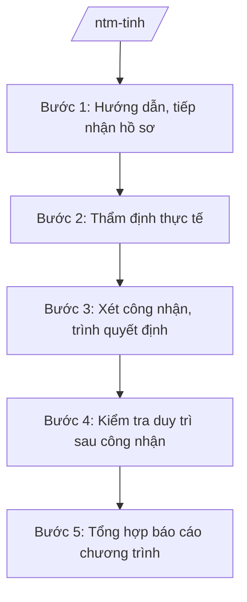

# Skill: Xây dựng nông thôn mới cấp tỉnh

## 2. Khi nào dùng

- Khi thẩm định hồ sơ, xét công nhận xã đạt chuẩn nông thôn mới, NTM nâng cao, NTM kiểu mẫu.
- Khi thẩm định huyện... (không còn cấp huyện) — nay: thẩm định xã, tổng hợp trình UBND tỉnh/Trung ương.
- Khi kiểm tra, đánh giá duy trì tiêu chí sau công nhận.
- Khi tổng hợp báo cáo chương trình NTM định kỳ.

## 3. Đầu vào (Input)

| Trường | Mô tả | Bắt buộc |
|--------|-------|----------|
| `loai_viec` | thẩm định công nhận / kiểm tra duy trì / báo cáo | Có |
| `xa` | Tên xã đề nghị công nhận | Không |
| `muc_do` | NTM / NTM nâng cao / NTM kiểu mẫu | Không |
| `tieu_chi` | Bộ tiêu chí áp dụng theo giai đoạn | Không |

## 4. Quy trình

**Bước 1. Hướng dẫn, tiếp nhận hồ sơ**
- Làm gì: Hướng dẫn UBND cấp xã lập hồ sơ đề nghị công nhận; tiếp nhận, kiểm tra tính đầy đủ hồ sơ (báo cáo tự đánh giá, biên bản lấy ý kiến hài lòng của người dân...).
- Dùng input: `xa`, `muc_do`.
- Vai trò: Chuyên viên Văn phòng Điều phối NTM tỉnh (đặt tại Sở NN&MT); AI hỗ trợ checklist hồ sơ — ⏱ 3 ngày.
- Lưu ý nghiệp vụ: Bắt buộc có kết quả lấy ý kiến sự hài lòng của người dân; nợ tiêu chí không được "làm tròn".
- → Kết quả bước: Phiếu kiểm tra hồ sơ.

**Bước 2. Thẩm định thực tế**
- Làm gì: Thành lập đoàn thẩm định liên ngành; kiểm tra thực tế từng tiêu chí (giao thông, thủy lợi, điện, trường học, y tế, môi trường, thu nhập, hộ nghèo...).
- Dùng input: `xa`, `tieu_chi`.
- Vai trò: Phó Giám đốc Sở NN&MT (Chánh Văn phòng Điều phối) làm trưởng đoàn; AI hỗ trợ lập biên bản, bảng chấm tiêu chí — ⏱ 5–7 ngày.
- Lưu ý nghiệp vụ: Kiểm tra thực chất, không hình thức; lấy ý kiến ngẫu nhiên người dân; tiêu chí môi trường, thu nhập kiểm tra kỹ.
- → Kết quả bước: Biên bản thẩm định + bảng đánh giá từng tiêu chí.

**Bước 3. Xét công nhận, trình quyết định**
- Làm gì: Họp hội đồng xét công nhận; bỏ phiếu; hoàn thiện hồ sơ trình Chủ tịch UBND tỉnh quyết định công nhận (xã NTM, NTM nâng cao) hoặc trình Trung ương (NTM kiểu mẫu theo quy định).
- Dùng input: Kết quả bước 2.
- Vai trò: Hội đồng xét công nhận cấp tỉnh; AI hỗ trợ soạn tờ trình, dự thảo quyết định — ⏱ 7 ngày.
- Lưu ý nghiệp vụ: Không công nhận khi còn nợ tiêu chí; công khai kết quả.
- → Kết quả bước: Quyết định công nhận xã đạt chuẩn.

**Bước 4. Kiểm tra duy trì sau công nhận**
- Làm gì: Kiểm tra định kỳ việc duy trì, nâng chất tiêu chí; xử lý xã bị "rớt" tiêu chí (nhắc nhở, thu hồi công nhận nếu vi phạm nghiêm trọng).
- Dùng input: `xa`.
- Vai trò: Đoàn kiểm tra; AI hỗ trợ lập kế hoạch — ⏱ hằng năm.
- Lưu ý nghiệp vụ: Chống bệnh thành tích — công nhận rồi bỏ mặc; tiêu chí thu nhập, môi trường dễ "rớt" nhất.
- → Kết quả bước: Báo cáo kiểm tra duy trì + kiến nghị.

**Bước 5. Tổng hợp báo cáo chương trình**
- Làm gì: Tổng hợp kết quả xây dựng NTM toàn tỉnh; báo cáo UBND tỉnh, Ban Chỉ đạo Trung ương.
- Dùng input: `loai_viec` (báo cáo).
- Vai trò: Văn phòng Điều phối tổng hợp; AI hỗ trợ lập bảng số liệu — ⏱ 5 ngày.
- Lưu ý nghiệp vụ: Số liệu xã đạt chuẩn phải khớp quyết định công nhận.
- → Kết quả bước: Báo cáo chương trình NTM định kỳ.

## Luồng quy trình (Workflow)

## 5. Đầu ra (Output)

- Biên bản thẩm định xã đạt chuẩn NTM.
- Tờ trình + quyết định công nhận xã NTM/NTM nâng cao/NTM kiểu mẫu.
- Báo cáo kiểm tra duy trì tiêu chí.
- Báo cáo chương trình NTM định kỳ.

**Cấu trúc output chuẩn (Quyết định công nhận xã đạt chuẩn NTM):**
- Thể thức: tuân thủ Nghị định 30/2020/NĐ-CP về công tác văn thư.

1. Quốc hiệu "CỘNG HÒA XÃ HỘI CHỦ NGHĨA VIỆT NAM", Tiêu ngữ "Độc lập – Tự do – Hạnh phúc"; tên cơ quan (UBND tỉnh A); số, ký hiệu.
2. Tên loại: **QUYẾT ĐỊNH** — về việc công nhận xã A đạt chuẩn nông thôn mới [nâng cao] năm [năm].
3. Căn cứ pháp lý; đề nghị của Sở NN&MT (Văn phòng Điều phối NTM).
4. **Điều 1.** Công nhận xã A đạt chuẩn nông thôn mới [nâng cao] năm [năm].
5. **Điều 2.** UBND xã A tiếp tục duy trì, nâng chất các tiêu chí.
6. **Điều 3.** Khen thưởng (nếu có); hiệu lực; trách nhiệm thi hành.
7. Nơi nhận; chữ ký Chủ tịch UBND tỉnh.

## 6. Checklist nghiệm thu

- [ ] Hồ sơ có kết quả lấy ý kiến hài lòng của người dân.
- [ ] Thẩm định thực tế 100% tiêu chí, có biên bản, không làm tròn tiêu chí.
- [ ] Không công nhận khi còn nợ tiêu chí.
- [ ] Kiểm tra duy trì hằng năm; xử lý xã rớt tiêu chí.
- [ ] Số liệu báo cáo khớp quyết định công nhận.
- [ ] Văn bản đúng thể thức NĐ 30/2020/NĐ-CP.

## 7. Ví dụ mô phỏng

*Dữ liệu dưới đây là giả lập 100% phục vụ minh họa.*

**Input mẫu:** loai_viec = "thẩm định công nhận"; xa = "Xã A"; muc_do = "NTM nâng cao".

**Output mẫu (trích Quyết định):**

> **ỦY BAN NHÂN DÂN TỈNH A**
> Số: 1234/QĐ-UBND
>
> **QUYẾT ĐỊNH**
> Về việc công nhận xã A đạt chuẩn nông thôn mới nâng cao năm 2026
>
> *Căn cứ* đề nghị của Sở Nông nghiệp và Môi trường tại Tờ trình số 123/TTr-SNNMT...
> *Xét* kết quả thẩm định: xã A đạt 19/19 tiêu chí NTM nâng cao; tỷ lệ hài lòng của người dân đạt 95%...
>
> **Điều 1.** Công nhận xã A, tỉnh A đạt chuẩn nông thôn mới nâng cao năm 2026.
> **Điều 2.** UBND xã A có trách nhiệm duy trì và nâng cao chất lượng các tiêu chí./.
>
> *Nơi nhận:* ... — **CHỦ TỊCH** *(ký, đóng dấu)* — Phạm Văn P

## 8. Human gate

- Chuyên viên/Văn phòng Điều phối soạn → Chánh Văn phòng Điều phối (Phó Giám đốc Sở) kiểm tra → Giám đốc Sở ký tờ trình → **Chủ tịch UBND tỉnh quyết định** công nhận.
- Hội đồng xét công nhận cấp tỉnh bỏ phiếu trước khi trình.

## 9. Giới hạn

- AI không tự chấm đạt tiêu chí, không tự quyết định công nhận.
- Không bịa kết quả thẩm định, ý kiến hài lòng của người dân.
- Không dùng văn bản hết hiệu lực (bộ tiêu chí cũ) để đánh giá.

## 10. Căn cứ & lưu ý

- Thông tư 19/2025/TT-BNNMT của Bộ Nông nghiệp và Môi trường hướng dẫn chức năng, nhiệm vụ của cơ quan chuyên môn về nông nghiệp và môi trường.
- Chương trình mục tiêu quốc gia xây dựng nông thôn mới giai đoạn hiện hành và bộ tiêu chí (dẫn tên, áp dụng bản hiện hành).
- Nghị định 150/2025/NĐ-CP về tổ chức cơ quan chuyên môn thuộc UBND cấp tỉnh.
- Nghị định 30/2020/NĐ-CP về công tác văn thư (thể thức văn bản).
- Lưu ý: Văn phòng Điều phối NTM cấp tỉnh đặt tại Sở NN&MT — đầu mối tham mưu xuyên suốt chương trình.
