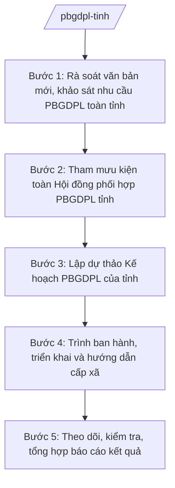

# Skill: Phổ biến, giáo dục pháp luật cấp tỉnh

## 2. Khi nào dùng
- Đầu năm cần rà soát văn bản mới của Trung ương, khảo sát nhu cầu tìm hiểu pháp luật trên địa bàn để lập Kế hoạch phổ biến, giáo dục pháp luật (PBGDPL) của tỉnh.
- Cần tham mưu kiện toàn Hội đồng phối hợp PBGDPL tỉnh (thành phần, quy chế hoạt động).
- Cần hướng dẫn, đôn đốc UBND cấp xã và các sở, ngành triển khai công tác PBGDPL; tổ chức các đợt PBGDPL trọng tâm, cao điểm của tỉnh.
- Cuối năm (hoặc cuối đợt) cần kiểm tra, tổng hợp, báo cáo kết quả PBGDPL toàn tỉnh gửi Bộ Tư pháp.

## 3. Đầu vào (Input)

| Trường | Mô tả | Bắt buộc |
|--------|-------|----------|
| `van_ban_moi_tw` | Danh mục văn bản quy phạm pháp luật mới của Trung ương cần phổ biến trong năm | Có |
| `nhu_cau_dia_phuong` | Kết quả khảo sát nhu cầu tìm hiểu pháp luật của cán bộ, nhân dân các địa phương trong tỉnh | Không |
| `ke_hoach_nam_truoc` | Kế hoạch PBGDPL năm trước của tỉnh và báo cáo kết quả thực hiện | Không |
| `doi_tuong_dac_thu` | Nhóm đối tượng đặc thù cần ưu tiên (đồng bào dân tộc thiểu số, vùng sâu, vùng xa, ngư dân...) | Không |
| `kinh_phi_du_kien` | Nguồn kinh phí dự kiến cho công tác PBGDPL của tỉnh trong năm | Có |
| `don_vi_phoi_hop` | Các sở, ngành, đoàn thể, cơ quan báo chí phối hợp thực hiện | Không |

## 4. Quy trình

**Bước 1. Rà soát văn bản mới, khảo sát nhu cầu PBGDPL toàn tỉnh**
- Làm gì: Rà soát văn bản QPPL mới của Trung ương liên quan trực tiếp đến tổ chức, cá nhân trên địa bàn; tổng hợp nhu cầu tìm hiểu pháp luật từ các sở, ngành, UBND cấp xã; đánh giá kết quả PBGDPL năm trước của tỉnh.
- Dùng input: `van_ban_moi_tw`, `nhu_cau_dia_phuong`, `ke_hoach_nam_truoc`.
- Vai trò: Chuyên viên Phòng Phổ biến, giáo dục pháp luật (Sở Tư pháp tỉnh A) chủ trì rà soát, tổng hợp. AI hỗ trợ phân loại văn bản mới theo lĩnh vực và nhóm đối tượng cần phổ biến, tổng hợp kết quả khảo sát nhu cầu ⏱ ~03 ngày làm việc (ước tính).
- Lưu ý nghiệp vụ: Chỉ đưa vào kế hoạch văn bản còn hiệu lực; ưu tiên văn bản tác động trực tiếp đến quyền, nghĩa vụ của tổ chức, cá nhân và văn bản mới về mô hình chính quyền địa phương 02 cấp.
- → Kết quả bước: Báo cáo rà soát + danh mục văn bản mới cần phổ biến trong năm, phân theo đối tượng, địa bàn.

**Bước 2. Tham mưu kiện toàn Hội đồng phối hợp PBGDPL tỉnh**
- Làm gì: Rà soát thành phần Hội đồng phối hợp PBGDPL tỉnh; dự thảo quyết định kiện toàn (Chủ tịch Hội đồng là Phó Chủ tịch UBND tỉnh, Phó Chủ tịch thường trực là Giám đốc Sở Tư pháp, thành viên là lãnh đạo các sở, ngành, đoàn thể); dự thảo quy chế hoạt động của Hội đồng.
- Dùng input: danh sách nhân sự dự kiến, quy chế hoạt động hiện hành.
- Vai trò: Trưởng phòng Phổ biến, giáo dục pháp luật soạn dự thảo; Giám đốc Sở Tư pháp ký tờ trình. AI hỗ trợ soạn dự thảo quyết định kiện toàn và quy chế hoạt động đúng thể thức ⏱ ~02 ngày làm việc (ước tính).
- Lưu ý nghiệp vụ: Thành phần Hội đồng phải bao quát các sở, ngành, đoàn thể liên quan; quy chế phân công rõ trách nhiệm từng thành viên, chế độ họp, báo cáo.
- → Kết quả bước: Dự thảo quyết định kiện toàn Hội đồng phối hợp PBGDPL tỉnh + dự thảo quy chế hoạt động, trình Chủ tịch UBND tỉnh ký ban hành.

**Bước 3. Lập dự thảo Kế hoạch PBGDPL của tỉnh**
- Làm gì: Xây dựng dự thảo kế hoạch: mục đích, yêu cầu; nội dung phổ biến; hình thức (hội nghị, tập huấn, báo chí, Cổng thông tin điện tử tỉnh, tờ gấp, pano); đối tượng; tiến độ; kinh phí; phân công sở, ngành, UBND cấp xã thực hiện.
- Dùng input: kết quả Bước 1, `doi_tuong_dac_thu`, `kinh_phi_du_kien`, `don_vi_phoi_hop`.
- Vai trò: Chuyên viên Phòng Phổ biến, giáo dục pháp luật soạn dự thảo. AI hỗ trợ soạn dự thảo kế hoạch đúng thể thức, gợi ý hình thức phổ biến phù hợp từng nhóm đối tượng, lập dự toán kinh phí chi tiết ⏱ ~02 ngày làm việc (ước tính).
- Lưu ý nghiệp vụ: Kế hoạch phải khả thi với kinh phí, nhân lực; mỗi hoạt động ghi rõ thời gian, đơn vị chủ trì/phối hợp, sản phẩm; có nội dung riêng cho vùng đồng bào dân tộc thiểu số, vùng sâu, vùng xa.
- → Kết quả bước: Dự thảo Kế hoạch PBGDPL năm của tỉnh.

**Bước 4. Trình ban hành, triển khai và hướng dẫn cấp xã**
- Làm gì: Lấy ý kiến thành viên Hội đồng phối hợp PBGDPL và các sở, ngành; hoàn thiện dự thảo; trình UBND tỉnh ban hành; gửi kế hoạch đến các sở, ngành, UBND cấp xã; ban hành văn bản hướng dẫn nghiệp vụ PBGDPL cho cấp xã.
- Dùng input: dự thảo kế hoạch từ Bước 3, ý kiến góp ý.
- Vai trò: Phó Giám đốc Sở phụ trách ký văn bản lấy ý kiến; Giám đốc Sở Tư pháp ký tờ trình; Chủ tịch UBND tỉnh ký ban hành. AI hỗ trợ tổng hợp ý kiến, rà soát thể thức và soạn văn bản hướng dẫn cấp xã ⏱ ~05 ngày làm việc (ước tính).
- Lưu ý nghiệp vụ: Kế hoạch PBGDPL tỉnh nên ban hành trong quý I; văn bản hướng dẫn cấp xã phải cụ thể, dễ thực hiện, gắn với kế hoạch PBGDPL của xã.
- → Kết quả bước: Kế hoạch PBGDPL tỉnh đã ban hành + văn bản hướng dẫn nghiệp vụ PBGDPL gửi UBND cấp xã.

**Bước 5. Theo dõi, kiểm tra, tổng hợp báo cáo kết quả**
- Làm gì: Theo dõi tiến độ của sở, ngành, UBND cấp xã; tổ chức kiểm tra việc thực hiện kế hoạch tại một số đơn vị, địa phương; tổng hợp số liệu, minh chứng; lập báo cáo kết quả PBGDPL năm của tỉnh gửi Bộ Tư pháp.
- Dùng input: báo cáo của sở, ngành, UBND cấp xã; kết quả kiểm tra.
- Vai trò: Chuyên viên Phòng Phổ biến, giáo dục pháp luật tổng hợp, soạn báo cáo. AI hỗ trợ tổng hợp số liệu hoạt động, đối chiếu với chỉ tiêu kế hoạch và soạn dự thảo báo cáo ⏱ ~03 ngày làm việc (ước tính).
- Lưu ý nghiệp vụ: Báo cáo trung thực, có số liệu minh chứng (số hội nghị, lớp tập huấn, lượt người tham dự, tài liệu phát hành...); nêu tồn tại, nguyên nhân và đề xuất năm sau.
- → Kết quả bước: Báo cáo kết quả thực hiện Kế hoạch PBGDPL năm của tỉnh đã ký, gửi Bộ Tư pháp và lưu hồ sơ.

## Luồng quy trình (Workflow)

## 5. Đầu ra (Output)

Sản phẩm:
- Kế hoạch phổ biến, giáo dục pháp luật năm của tỉnh (đã ký ban hành) — gửi các sở, ngành, UBND cấp xã
- Quyết định kiện toàn Hội đồng phối hợp PBGDPL tỉnh + Quy chế hoạt động — lưu hồ sơ, gửi thành viên Hội đồng
- Văn bản hướng dẫn nghiệp vụ PBGDPL cho cấp xã — gửi UBND cấp xã
- Tài liệu tuyên truyền cấp tỉnh: đề cương, tờ gấp, bài viết — dùng cho các đợt cao điểm
- Báo cáo kết quả thực hiện Kế hoạch PBGDPL năm của tỉnh — gửi Bộ Tư pháp, lưu hồ sơ

**Cấu trúc output chuẩn:**

Khung Kế hoạch PBGDPL năm của tỉnh gồm các phần theo đúng thứ tự, đúng thể thức NĐ 30/2020/NĐ-CP:
1. Quốc hiệu "CỘNG HÒA XÃ HỘI CHỦ NGHĨA VIỆT NAM" — Tiêu ngữ "Độc lập – Tự do – Hạnh phúc"
2. Số, ký hiệu văn bản: số.../KH-UBND
3. Địa danh, ngày, tháng, năm ban hành
4. Tên loại văn bản: "KẾ HOẠCH" + tên gọi: "Phổ biến, giáo dục pháp luật năm ..."
5. Nội dung: I. Mục đích, yêu cầu; II. Nội dung phổ biến (danh mục văn bản, lĩnh vực trọng tâm); III. Hình thức phổ biến (hội nghị, tập huấn, báo chí, Cổng thông tin điện tử, tờ gấp...); IV. Đối tượng; V. Tiến độ thực hiện; VI. Kinh phí; VII. Tổ chức thực hiện (phân công sở, ngành, UBND cấp xã; trách nhiệm của Hội đồng phối hợp PBGDPL tỉnh)
6. Nơi nhận: các sở, ngành, UBND cấp xã, thành viên Hội đồng phối hợp PBGDPL, Bộ Tư pháp (báo cáo), lưu Văn phòng
7. Chữ ký: "TM. ỦY BAN NHÂN DÂN / CHỦ TỊCH" + chữ ký + họ tên Chủ tịch UBND tỉnh, đóng dấu UBND tỉnh

> **Checklist thể thức văn bản theo NĐ 30/2020/NĐ-CP** — đối chiếu trước khi trình ký:
> 1. Quốc hiệu và Tiêu ngữ.
> 2. Tên cơ quan, tổ chức ban hành văn bản.
> 3. Số, ký hiệu của văn bản.
> 4. Địa danh và thời gian ban hành văn bản.
> 5. Tên loại và trích yếu nội dung văn bản.
> 6. Nội dung văn bản.
> 7. Chức vụ, họ tên và chữ ký của người có thẩm quyền.
> 8. Dấu, chữ ký số của cơ quan, tổ chức.
> 9. Nơi nhận (kèm Phụ lục nếu có).

## 6. Checklist nghiệm thu
- [ ] Đã rà soát văn bản mới của Trung ương còn hiệu lực và khảo sát nhu cầu toàn tỉnh trước khi lập kế hoạch
- [ ] Hội đồng phối hợp PBGDPL tỉnh được kiện toàn kịp thời, có quy chế hoạt động rõ trách nhiệm từng thành viên
- [ ] Kế hoạch có đủ 7 phần theo cấu trúc chuẩn; mỗi hoạt động ghi rõ thời gian, đơn vị chủ trì/phối hợp, sản phẩm
- [ ] Có nội dung, hình thức riêng phù hợp vùng đồng bào dân tộc thiểu số, vùng sâu, vùng xa
- [ ] Kế hoạch ban hành trong quý I, đã gửi các sở, ngành, UBND cấp xã kèm văn bản hướng dẫn nghiệp vụ
- [ ] Đã kiểm tra việc thực hiện tại một số đơn vị, địa phương; có biên bản kiểm tra
- [ ] Báo cáo kết quả có số liệu minh chứng cụ thể, trung thực; đã gửi Bộ Tư pháp đúng hạn
- [ ] Thể thức văn bản đúng NĐ 30/2020/NĐ-CP
- [ ] Không có dữ liệu, căn cứ pháp lý nào do AI bịa ra
- [ ] Đã qua human gate: chuyên viên soạn → Trưởng phòng kiểm tra → Phó Giám đốc Sở duyệt → Giám đốc Sở ký trình → Chủ tịch UBND tỉnh ký ban hành

## 7. Ví dụ mô phỏng

*Dữ liệu dưới đây là giả lập 100% phục vụ minh họa.*

### Input mẫu
- van_ban_moi_tw: Các văn bản mới về mô hình chính quyền địa phương 02 cấp; văn bản về đất đai, hộ tịch còn hiệu lực
- nhu_cau_dia_phuong: Cán bộ cấp xã cần tập huấn văn bản mới về phân cấp, phân quyền; người dân vùng cao quan tâm chính sách dân tộc, đất đai
- kinh_phi_du_kien: 500.000.000 đồng từ ngân sách tỉnh
- don_vi_phoi_hop: Các sở, ngành tỉnh A; Ủy ban Mặt trận Tổ quốc tỉnh A; Hội Luật gia tỉnh A (giả lập); Đài Phát thanh – Truyền hình tỉnh A (giả lập)

### Output mẫu

**KẾ HOẠCH PHỔ BIẾN, GIÁO DỤC PHÁP LUẬT TỈNH A NĂM 2026**

CỘNG HÒA XÃ HỘI CHỦ NGHĨA VIỆT NAM
Độc lập – Tự do – Hạnh phúc

Số: 123/KH-UBND

Tỉnh A, ngày 15 tháng 01 năm 2026

**KẾ HOẠCH**
**Phổ biến, giáo dục pháp luật tỉnh A năm 2026**

I. Mục đích, yêu cầu
Bảo đảm 100% văn bản mới của Trung ương liên quan trực tiếp đến tổ chức, cá nhân được phổ biến kịp thời; nâng cao hiểu biết pháp luật cho cán bộ, nhân dân toàn tỉnh, trọng tâm là cán bộ cấp xã và đồng bào vùng cao.

II. Nội dung phổ biến
1. Các văn bản mới về mô hình chính quyền địa phương 02 cấp, phân cấp, phân quyền.
2. Quy định về đất đai, hộ tịch, xử lý vi phạm hành chính còn hiệu lực.
3. Chính sách dân tộc, pháp luật về phòng, chống tệ nạn xã hội.

III. Hình thức phổ biến
1. Hội nghị quán triệt văn bản mới cho cán bộ chủ chốt cấp tỉnh, cấp xã: 04 hội nghị.
2. Lớp tập huấn nghiệp vụ PBGDPL cho cán bộ tư pháp cấp xã: 02 lớp.
3. Chuyên mục pháp luật trên Đài Phát thanh – Truyền hình tỉnh A và Cổng thông tin điện tử tỉnh.
4. Phát hành 10.000 tờ gấp pháp luật cho vùng đồng bào dân tộc thiểu số.

IV. Đối tượng: Cán bộ, công chức, viên chức toàn tỉnh; nhân dân các địa phương, ưu tiên vùng cao, vùng đồng bào dân tộc thiểu số.

V. Tiến độ thực hiện: Từ tháng 01 đến tháng 12 năm 2026 (chi tiết theo phụ lục).

VI. Kinh phí: 500.000.000 đồng từ ngân sách tỉnh A.

VII. Tổ chức thực hiện
1. Sở Tư pháp tỉnh A là cơ quan thường trực, tham mưu triển khai; Hội đồng phối hợp PBGDPL tỉnh A chỉ đạo, điều phối.
2. Các sở, ngành, UBND cấp xã xây dựng kế hoạch chi tiết của đơn vị, địa phương mình.
3. Sở Tài chính tỉnh A tham mưu bố trí kinh phí.

Nơi nhận:
- Bộ Tư pháp (báo cáo);
- Các sở, ngành; UBND các xã; thành viên Hội đồng phối hợp PBGDPL tỉnh;
- Lưu: Văn phòng.

TM. ỦY BAN NHÂN DÂN
CHỦ TỊCH
(ký, đóng dấu)
Phạm Văn P

## 8. Human gate
Chuyên viên Phòng Phổ biến, giáo dục pháp luật soạn, tổng hợp → Trưởng phòng kiểm tra → Phó Giám đốc Sở phụ trách duyệt → Giám đốc Sở Tư pháp ký tờ trình → Chủ tịch UBND tỉnh ký ban hành Kế hoạch PBGDPL tỉnh và quyết định kiện toàn Hội đồng. AI chỉ hỗ trợ rà soát, tổng hợp, soạn tài liệu; quyết định nội dung, kinh phí, nhân sự do con người thực hiện.

## 9. Giới hạn
AI tuyệt đối KHÔNG: quyết định nội dung, kinh phí kế hoạch thay lãnh đạo; tự ký ban hành văn bản; bịa số hiệu, nội dung văn bản pháp luật mới; dùng văn bản đã hết hiệu lực để tuyên truyền; đề xuất thành phần Hội đồng vượt thẩm quyền.

## 10. Căn cứ & lưu ý
- TT 09/2025/TT-BTP (Sở Tư pháp tham mưu quản lý nhà nước về phổ biến, giáo dục pháp luật; hiệu lực 01/7/2025)
- NĐ 150/2025/NĐ-CP; NĐ 370/2025/NĐ-CP (tổ chức cơ quan chuyên môn thuộc UBND cấp tỉnh)
- NĐ 30/2020/NĐ-CP (thể thức văn bản hành chính)
- Lưu ý: chỉ phổ biến văn bản còn hiệu lực; nội dung phải phù hợp từng nhóm đối tượng, địa bàn; báo cáo kết quả PBGDPL của tỉnh gửi Bộ Tư pháp đúng hạn, có số liệu minh chứng.
