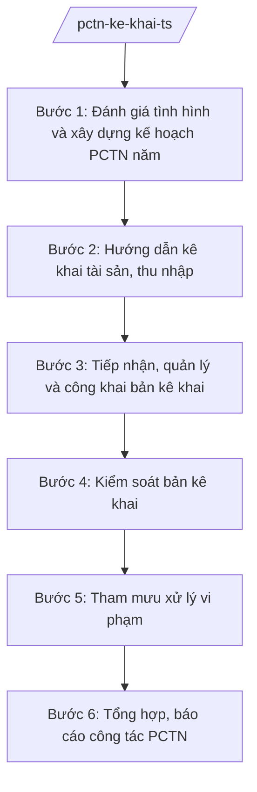

# Skill: PCTN, kê khai tài sản, thu nhập

## 2. Khi nào dùng

- Xây dựng kế hoạch công tác phòng, chống tham nhũng (PCTN) hằng năm của tỉnh, tham mưu UBND tỉnh ban hành.
- Hướng dẫn việc kê khai tài sản, thu nhập (TS-TN) hằng năm đối với cán bộ, công chức, viên chức thuộc diện phải kê khai trên địa bàn tỉnh.
- Tiếp nhận, quản lý, theo dõi và công khai bản kê khai TS-TN theo quy định.
- Kiểm soát bản kê khai: kiểm tra tính đầy đủ, chính xác; tổ chức xác minh khi có dấu hiệu kê khai không trung thực.
- Tham mưu xử lý các trường hợp vi phạm quy định về kê khai TS-TN và vi phạm PCTN.
- Tổng hợp, báo cáo công tác PCTN định kỳ và đột xuất.

## 3. Đầu vào (Input)

| Trường | Mô tả | Bắt buộc |
|--------|-------|----------|
| `danh_sach_doi_tuong_ke_khai` | Cán bộ, công chức, viên chức thuộc diện phải kê khai TS-TN hằng năm (theo phân cấp quản lý) | Có |
| `ban_ke_khai_ts_tn` | Bản kê khai của từng đối tượng theo mẫu quy định | Có |
| `ket_qua_pctn_nam_truoc` | Báo cáo tổng kết công tác PCTN năm trước, tồn tại, hạn chế | Có |
| `chi_dao_cua_cap_tren` | Chỉ đạo của Thanh tra Chính phủ, Tỉnh ủy, UBND tỉnh về PCTN | Không |
| `thong_tin_dau_hieu_vi_pham` | Đơn thư, phản ánh, thông tin báo chí về dấu hiệu kê khai không trung thực, tham nhũng | Không |
| `quy_dinh_phap_luat_pctn` | Các quy định hiện hành về PCTN, kê khai TS-TN (còn hiệu lực) | Có |

## 4. Quy trình

**Bước 1. Đánh giá tình hình và xây dựng kế hoạch PCTN năm**

- Làm gì: Đánh giá kết quả PCTN năm trước (số bản kê khai đã nộp, vi phạm đã xử lý, tồn tại); nghiên cứu chỉ đạo của cấp trên; xây dựng kế hoạch PCTN năm gồm: mục tiêu, nhiệm vụ trọng tâm, phân công trách nhiệm, tiến độ.
- Dùng input: `ket_qua_pctn_nam_truoc`, `chi_dao_cua_cap_tren`, `quy_dinh_phap_luat_pctn`.
- Vai trò: Chuyên viên Phòng Nghiệp vụ soạn thảo AI hỗ trợ: tổng hợp số liệu năm trước, dựng khung kế hoạch, rà soát tính đầy đủ các nhiệm vụ trọng tâm; Trưởng phòng thẩm định; Chánh Thanh tra tỉnh trình Chủ tịch UBND tỉnh phê duyệt ⏱ ~7 ngày làm việc (ước tính).
- Lưu ý nghiệp vụ: Kế hoạch phải gắn với đặc thù địa phương (lĩnh vực nhạy cảm: đất đai, đầu tư công, tài chính); phân công rõ trách nhiệm từng cơ quan.
- → Kết quả bước: Kế hoạch công tác PCTN năm của tỉnh (dự thảo trình phê duyệt).

**Bước 2. Hướng dẫn kê khai tài sản, thu nhập**

- Làm gì: Rà soát, cập nhật danh sách đối tượng phải kê khai hằng năm; ban hành văn bản hướng dẫn: đối tượng, thời hạn kê khai, cách ghi bản kê khai, nơi nộp; tổ chức tập huấn, giải đáp vướng mắc cho các cơ quan, đơn vị.
- Dùng input: `danh_sach_doi_tuong_ke_khai`, `quy_dinh_phap_luat_pctn`.
- Vai trò: Chuyên viên hướng dẫn AI hỗ trợ: soạn văn bản hướng dẫn, lập danh sách đối tượng từ dữ liệu cán bộ, soạn tài liệu tập huấn; Trưởng phòng duyệt ⏱ ~5 ngày làm việc (ước tính).
- Lưu ý nghiệp vụ: Danh sách đối tượng phải đầy đủ, không bỏ sót người thuộc diện kê khai; hướng dẫn phải dễ hiểu, có ví dụ minh họa cách kê khai các loại tài sản.
- → Kết quả bước: Văn bản hướng dẫn kê khai TS-TN; danh sách đối tượng kê khai; tài liệu tập huấn.

**Bước 3. Tiếp nhận, quản lý và công khai bản kê khai**

- Làm gì: Tiếp nhận bản kê khai của các cơ quan, đơn vị gửi về; kiểm tra tính đầy đủ về hình thức (chữ ký, xác nhận); lập sổ theo dõi, lưu trữ bản kê khai; tổ chức công khai bản kê khai theo quy định (niêm yết, công khai tại cơ quan).
- Dùng input: `ban_ke_khai_ts_tn`, `danh_sach_doi_tuong_ke_khai`.
- Vai trò: Chuyên viên tiếp nhận, quản lý AI hỗ trợ: kiểm tra danh sách nộp/thiếu, nhắc đơn vị chậm nộp, lập sổ theo dõi điện tử ⏱ ~thực hiện trong thời hạn kê khai (theo quy định (ước tính).).
- Lưu ý nghiệp vụ: Bản kê khai là tài liệu mật theo quy định — quản lý, lưu trữ, công khai đúng chế độ bảo mật; đơn vị chậm nộp phải được đôn đốc bằng văn bản.
- → Kết quả bước: Sổ theo dõi nộp bản kê khai; danh sách đơn vị/cá nhân chậm nộp; biên bản công khai.

**Bước 4. Kiểm soát bản kê khai**

- Làm gì: Kiểm tra tính đầy đủ, chính xác, trung thực của bản kê khai (đối chiếu với hồ sơ cán bộ, thông tin có được); lựa chọn ngẫu nhiên và theo dấu hiệu để xác minh; khi có dấu hiệu kê khai không trung thực thì tổ chức xác minh theo quy định.
- Dùng input: `ban_ke_khai_ts_tn`, `thong_tin_dau_hieu_vi_pham`.
- Vai trò: Chuyên viên kiểm soát AI hỗ trợ: đối chiếu số liệu giữa các năm để phát hiện biến động bất thường, lập danh sách kiểm tra ngẫu nhiên; chuyên viên và người có thẩm quyền quyết định việc xác minh ⏱ ~15–30 ngày làm việc (ước tính).
- Lưu ý nghiệp vụ: AI chỉ hỗ trợ phát hiện dấu hiệu bất thường, không kết luận kê khai không trung thực thay người có thẩm quyền; việc xác minh phải đúng trình tự, bảo đảm quyền của người được xác minh.
- → Kết quả bước: Báo cáo kết quả kiểm soát bản kê khai; quyết định xác minh (đối với trường hợp có dấu hiệu).

**Bước 5. Tham mưu xử lý vi phạm**

- Làm gì: Đối với trường hợp kê khai không trung thực, chậm kê khai, không kê khai hoặc vi phạm PCTN: tổng hợp hồ sơ, đề xuất hình thức xử lý theo quy định (kỷ luật, xử lý hành chính, chuyển cơ quan điều tra nếu có dấu hiệu tội phạm); soạn dự thảo văn bản xử lý trình người có thẩm quyền.
- Dùng input: Báo cáo kết quả kiểm soát, quyết định xác minh (bước 4), `quy_dinh_phap_luat_pctn`.
- Vai trò: Chuyên viên soạn thảo đề xuất xử lý AI hỗ trợ: soạn dự thảo văn bản, đối chiếu khung xử lý theo quy định; không quyết định hình thức xử lý thay người có thẩm quyền; Trưởng phòng, Chánh Thanh tra tỉnh thẩm định; người có thẩm quyền quyết định ⏱ ~10 ngày làm việc (ước tính).
- Lưu ý nghiệp vụ: Xử lý phải đúng người, đúng vi phạm, đúng thẩm quyền; trường hợp có dấu hiệu tội phạm tham nhũng phải chuyển cơ quan điều tra theo quy định, không tự kết luận.
- → Kết quả bước: Tờ trình + dự thảo văn bản xử lý vi phạm.

**Bước 6. Tổng hợp, báo cáo công tác PCTN**

- Làm gì: Tổng hợp số liệu: bản kê khai đã nộp, kết quả kiểm soát, vi phạm đã xử lý; đánh giá kết quả thực hiện kế hoạch PCTN; soạn báo cáo định kỳ (quý, năm) và đột xuất gửi cấp trên.
- Dùng input: Sổ theo dõi nộp bản kê khai, báo cáo kiểm soát, kết quả xử lý vi phạm.
- Vai trò: Chuyên viên tổng hợp AI hỗ trợ: tổng hợp số liệu tự động từ sổ theo dõi, dựng biểu đồ, soạn dự thảo báo cáo; Trưởng phòng thẩm định; Chánh Thanh tra tỉnh ký báo cáo. ⏱ ~định kỳ (ước tính).
- Lưu ý nghiệp vụ: Số liệu báo cáo phải khớp với sổ theo dõi và hồ sơ lưu; báo cáo trung thực, không che giấu vi phạm.
- → Kết quả bước: Báo cáo công tác PCTN định kỳ (quý, năm).

## Luồng quy trình (Workflow)

## 5. Đầu ra (Output)

- Kế hoạch công tác PCTN năm của tỉnh (sản phẩm chính).
- Văn bản hướng dẫn kê khai tài sản, thu nhập.
- Danh sách đối tượng kê khai; sổ theo dõi nộp bản kê khai.
- Báo cáo kết quả kiểm soát bản kê khai TS-TN.
- Tờ trình + dự thảo văn bản xử lý vi phạm.
- Báo cáo công tác PCTN định kỳ.

**Cấu trúc output chuẩn:**

**KẾ HOẠCH CÔNG TÁC PHÒNG, CHỐNG THAM NHŨNG NĂM ... CỦA TỈNH A** — các phần bắt buộc theo đúng thứ tự, đúng thể thức văn bản hành chính theo NĐ 30/2020/NĐ-CP:

1. Quốc hiệu "CỘNG HÒA XÃ HỘI CHỦ NGHĨA VIỆT NAM", Tiêu ngữ "Độc lập – Tự do – Hạnh phúc".
2. Tên cơ quan ban hành: ỦY BAN NHÂN DÂN TỈNH A. Số, ký hiệu văn bản; địa danh và thời gian ban hành.
3. Tên loại và trích yếu: KẾ HOẠCH — Công tác phòng, chống tham nhũng năm ... của tỉnh A.
4. Căn cứ ban hành (quy định pháp luật về PCTN còn hiệu lực; chỉ đạo của cấp trên; NĐ 141/2025/NĐ-CP...).
5. Đánh giá khái quát tình hình PCTN năm trước.
6. Mục tiêu, yêu cầu của công tác PCTN năm.
7. Nhiệm vụ trọng tâm: (1) tuyên truyền, giáo dục; (2) kê khai, kiểm soát tài sản, thu nhập; (3) kiểm tra, thanh tra trách nhiệm PCTN; (4) xử lý vi phạm; (5) phối hợp với các cơ quan.
8. Tổ chức thực hiện: trách nhiệm của Thanh tra tỉnh, các sở, ban, ngành, UBND xã; tiến độ; chế độ báo cáo.
9. Nơi nhận; ký, đóng dấu (Chủ tịch UBND tỉnh ký ban hành).

## 6. Checklist nghiệm thu

1. Kế hoạch PCTN năm được xây dựng từ đánh giá thực tế năm trước, có nhiệm vụ trọng tâm rõ ràng.
2. Danh sách đối tượng kê khai đầy đủ, không bỏ sót người thuộc diện phải kê khai.
3. Văn bản hướng dẫn kê khai ban hành kịp thời, dễ hiểu, có tập huấn cho các đơn vị.
4. 100% bản kê khai được tiếp nhận, kiểm tra hình thức, lập sổ theo dõi; đơn vị chậm nộp được đôn đốc bằng văn bản.
5. Bản kê khai được quản lý, công khai đúng chế độ bảo mật theo quy định.
6. Kiểm soát bản kê khai có lựa chọn ngẫu nhiên và theo dấu hiệu; phát hiện bất thường được xác minh đúng trình tự.
7. Vi phạm được tham mưu xử lý đúng người, đúng vi phạm, đúng thẩm quyền.
8. Báo cáo PCTN định kỳ trung thực, số liệu khớp với sổ theo dõi; thể thức văn bản đúng NĐ 30/2020/NĐ-CP.

## 7. Ví dụ mô phỏng

*Dữ liệu dưới đây là giả lập 100% phục vụ minh họa.*

**Input mẫu:**

| Trường | Giá trị mẫu |
|--------|-------------|
| Danh sách đối tượng kê khai | 500 cán bộ thuộc diện kê khai hằng năm (lãnh đạo sở, UBND xã và tương đương trở lên) |
| Bản kê khai TS-TN | Đã nhận 480/500 bản tính đến hạn; 20 trường hợp chậm nộp |
| Kết quả PCTN năm trước | Năm 2026: 495/500 bản kê khai đúng hạn; kiểm soát 50 bản, phát hiện 2 trường hợp kê khai thiếu tài sản, đã xử lý kỷ luật |
| Chỉ đạo của cấp trên | Thanh tra Chính phủ yêu cầu tăng cường kiểm soát kê khai trong lĩnh vực đất đai, đầu tư công |
| Thông tin dấu hiệu vi phạm | Phản ánh 1 cán bộ có tài sản tăng bất thường so với thu nhập kê khai |
| Quy định pháp luật PCTN | Quy định hiện hành về PCTN và kê khai tài sản, thu nhập |

**Output mẫu (trích Kế hoạch PCTN năm 2027):**

**ỦY BAN NHÂN DÂN TỈNH A**

Số: 1234/KH-UBND
Tỉnh A, ngày 20 tháng 1 năm 2027

**KẾ HOẠCH**
**Công tác phòng, chống tham nhũng năm 2027 của tỉnh A**

*Căn cứ quy định của pháp luật về phòng, chống tham nhũng (còn hiệu lực);*
*Căn cứ Nghị định số 141/2025/NĐ-CP ngày 12/6/2025 của Chính phủ;*

**I. ĐÁNH GIÁ KHÁI QUÁT NĂM 2026**
Năm 2026, 495/500 cán bộ kê khai đúng hạn; kiểm soát 50 bản kê khai, xử lý kỷ luật 2 trường hợp kê khai thiếu tài sản...

**II. MỤC TIÊU, YÊU CẦU**
100% đối tượng kê khai đúng hạn; kiểm soát tối thiểu 60 bản kê khai, tập trung lĩnh vực đất đai, đầu tư công...

**III. NHIỆM VỤ TRỌNG TÂM**
1. Thanh tra tỉnh chủ trì hướng dẫn kê khai TS-TN năm 2027, hoàn thành trước 31/3/2027.
2. Kiểm soát 60 bản kê khai (40 ngẫu nhiên, 20 theo dấu hiệu)...
3. Xử lý nghiêm vi phạm; chuyển cơ quan điều tra khi có dấu hiệu tội phạm.

**IV. TỔ CHỨC THỰC HIỆN**
...

*Nơi nhận:* ...
**CHỦ TỊCH**
(Ký, đóng dấu — ông Phạm Văn P)

## 8. Human gate (người kiểm duyệt)

- Chuyên viên soạn thảo, tổng hợp → Trưởng phòng thẩm định → Chánh Thanh tra tỉnh duyệt, trình → Chủ tịch UBND tỉnh phê duyệt kế hoạch PCTN năm, quyết định xử lý vi phạm thuộc thẩm quyền.
- Việc xác minh bản kê khai có dấu hiệu không trung thực do người có thẩm quyền quyết định; AI chỉ hỗ trợ phát hiện dấu hiệu.

## 9. Giới hạn (guardrails)

- AI không kết luận bản kê khai không trung thực, không quyết định hình thức xử lý vi phạm thay người có thẩm quyền.
- AI không tự ký, ban hành văn bản PCTN, văn bản xử lý vi phạm.
- AI không tiết lộ nội dung bản kê khai TS-TN (tài liệu mật) cho người không có thẩm quyền.
- AI không bịa đặt số liệu kê khai, căn cứ pháp lý; chỉ viện dẫn quy định còn hiệu lực.

## 10. Căn cứ & lưu ý

- NĐ 141/2025/NĐ-CP: phân định thẩm quyền của chính quyền địa phương 2 cấp trong lĩnh vực quản lý nhà nước của Thanh tra Chính phủ (Thanh tra tỉnh tham mưu công tác PCTN).
- NĐ 150/2025/NĐ-CP: Thanh tra tỉnh là cơ quan chuyên môn thuộc UBND cấp tỉnh, tham mưu UBND tỉnh về PCTN.
- NĐ 30/2020/NĐ-CP: thể thức và kỹ thuật trình bày văn bản hành chính.
- Công tác PCTN, kê khai tài sản, thu nhập và xử lý vi phạm thực hiện theo quy định hiện hành của pháp luật về phòng, chống tham nhũng (không gắn số hiệu cụ thể do chưa xác thực trong tài liệu).
- Lưu ý: tính đến thời điểm hiện tại, chưa có thông tư hướng dẫn riêng về chức năng, nhiệm vụ của Thanh tra tỉnh.
