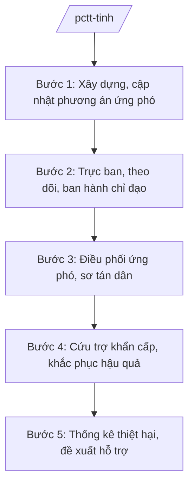

# Skill: PCTT-TKCN cấp tỉnh

## 2. Khi nào dùng

- Khi xây dựng, cập nhật phương án ứng phó thiên tai cấp tỉnh theo loại hình (bão, lũ, sạt lở, hạn hán...).
- Khi tổ chức trực ban, theo dõi diễn biến thiên tai, ban hành công điện chỉ đạo.
- Khi điều phối lực lượng, phương tiện cứu hộ, cứu trợ khẩn cấp.
- Khi tổng hợp báo cáo thiệt hại, đề xuất hỗ trợ khắc phục.

## 3. Đầu vào (Input)

| Trường | Mô tả | Bắt buộc |
|--------|-------|----------|
| `loai_viec` | xây dựng phương án / trực ban ứng phó / cứu trợ khẩn cấp / báo cáo thiệt hại | Có |
| `loai_hinh_thien_tai` | bão / lũ / sạt lở đất / hạn hán / dông lốc... | Không |
| `dia_ban_anh_huong` | Khu vực bị ảnh hưởng | Không |
| `cap_do` | Cấp độ rủi ro thiên tai (nếu có) | Không |

## 4. Quy trình

**Bước 1. Xây dựng, cập nhật phương án ứng phó**
- Làm gì: Rà soát kịch bản thiên tai theo loại hình; xây dựng phương án ứng phó cấp độ rủi ro thiên tai (sơ tán dân, bảo vệ đê điều, hồ đập, sản xuất).
- Dùng input: `loai_hinh_thien_tai`.
- Vai trò: Văn phòng Thường trực Ban Chỉ huy PCTT-TKCN tỉnh (đặt tại Sở NN&MT) dự thảo; AI hỗ trợ cập nhật kịch bản, bản đồ nguy cơ — ⏱ 15 ngày/năm, cập nhật trước mùa mưa bão.
- Lưu ý nghiệp vụ: Phương châm "4 tại chỗ" (chỉ huy, lực lượng, phương tiện, hậu cần tại chỗ); phương án phải đến được cấp xã, thôn.
- → Kết quả bước: Phương án ứng phó thiên tai cấp tỉnh được phê duyệt.

**Bước 2. Trực ban, theo dõi, ban hành chỉ đạo**
- Làm gì: Tổ chức trực ban 24/24 khi có thiên tai; theo dõi bản tin dự báo; tham mưu ban hành công điện, văn bản chỉ đạo của Ban Chỉ huy / Chủ tịch UBND tỉnh.
- Dùng input: `loai_hinh_thien_tai`, `cap_do`, `dia_ban_anh_huong`.
- Vai trò: Trực ban Văn phòng Thường trực; AI hỗ trợ tổng hợp bản tin, dự thảo công điện — ⏱ ngay khi có cảnh báo.
- Lưu ý nghiệp vụ: Công điện phải rõ: đối tượng, nhiệm vụ, thời hạn; gửi đến UBND cấp xã bằng nhiều kênh (văn bản, điện thoại, nhóm điều hành).
- → Kết quả bước: Công điện/văn bản chỉ đạo + nhật ký trực ban.

**Bước 3. Điều phối ứng phó, sơ tán dân**
- Làm gì: Điều phối lực lượng (quân đội, công an, dân quân), phương tiện; tổ chức sơ tán dân vùng nguy hiểm; bảo đảm an toàn hồ đập, đê điều.
- Dùng input: `dia_ban_anh_huong`, `cap_do`.
- Vai trò: Trưởng Ban Chỉ huy PCTT-TKCN tỉnh (Chủ tịch UBND tỉnh) chỉ huy; AI hỗ trợ tổng hợp báo cáo nhanh từ các địa phương — ⏱ khẩn cấp.
- Lưu ý nghiệp vụ: Tính mạng người dân là trên hết — sơ tán cưỡng chế khi cần; tuyệt đối không để người dân quay lại vùng nguy hiểm.
- → Kết quả bước: Lệnh điều động lực lượng; báo cáo sơ tán.

**Bước 4. Cứu trợ khẩn cấp, khắc phục hậu quả**
- Làm gì: Cứu trợ lương thực, nước uống, thuốc men cho vùng bị chia cắt; huy động nguồn lực khắc phục hạ tầng, sản xuất.
- Dùng input: `dia_ban_anh_huong`.
- Vai trò: Sở NN&MT phối hợp Sở LĐ-TB&XH (nay thuộc Sở Nội vụ), Mặt trận; AI hỗ trợ lập danh sách, theo dõi phân bổ — ⏱ ngay sau thiên tai.
- Lưu ý nghiệp vụ: Cứu trợ công khai, đúng đối tượng; không để dân đói, rét, thiếu nước sạch.
- → Kết quả bước: Kế hoạch cứu trợ + biên bản phân bổ.

**Bước 5. Thống kê thiệt hại, đề xuất hỗ trợ**
- Làm gì: Tổng hợp thiệt hại (người, nhà, sản xuất, hạ tầng) từ cấp xã; thẩm định; đề xuất hỗ trợ từ ngân sách, quỹ PCTT; báo cáo Chính phủ, Bộ NN&MT.
- Dùng input: `loai_viec` (báo cáo).
- Vai trò: Chuyên viên tổng hợp; AI hỗ trợ lập bảng số liệu — ⏱ 5–7 ngày sau thiên tai.
- Lưu ý nghiệp vụ: Số liệu phải có xác nhận của UBND cấp xã; phân loại thiệt hại theo quy định để áp mức hỗ trợ.
- → Kết quả bước: Báo cáo thiệt hại + tờ trình đề xuất hỗ trợ.

## Luồng quy trình (Workflow)

## 5. Đầu ra (Output)

- Phương án ứng phó thiên tai cấp tỉnh.
- Công điện, văn bản chỉ đạo ứng phó.
- Kế hoạch cứu trợ khẩn cấp.
- Báo cáo thiệt hại + tờ trình đề xuất hỗ trợ.

**Cấu trúc output chuẩn (Công điện chỉ đạo ứng phó):**
- Thể thức: tuân thủ Nghị định 30/2020/NĐ-CP về công tác văn thư.

1. Quốc hiệu "CỘNG HÒA XÃ HỘI CHỦ NGHĨA VIỆT NAM", Tiêu ngữ "Độc lập – Tự do – Hạnh phúc"; tên cơ quan (Ban Chỉ huy PCTT-TKCN tỉnh A); số, ký hiệu.
2. Tên loại: **CÔNG ĐIỆN** — về việc ứng phó với [loại hình thiên tai].
3. Diễn biến, dự báo (ngắn gọn).
4. Nội dung chỉ đạo: từng nhiệm vụ cụ thể giao cho sở, ngành, UBND cấp xã; thời hạn hoàn thành.
5. Chế độ trực ban, báo cáo.
6. Nơi nhận; chữ ký Trưởng ban.

## 6. Checklist nghiệm thu

- [ ] Phương án ứng phó cập nhật hằng năm, đến được cấp xã.
- [ ] Trực ban 24/24 khi có thiên tai; nhật ký trực đầy đủ.
- [ ] Công điện rõ nhiệm vụ, thời hạn, đầu mối chịu trách nhiệm.
- [ ] Sơ tán dân vùng nguy hiểm kịp thời, không để thiệt hại về người do chủ quan.
- [ ] Cứu trợ công khai, đúng đối tượng; số liệu thiệt hại có xác nhận cấp xã.
- [ ] Văn bản đúng thể thức NĐ 30/2020/NĐ-CP.

## 7. Ví dụ mô phỏng

*Dữ liệu dưới đây là giả lập 100% phục vụ minh họa.*

**Input mẫu:** loai_viec = "trực ban ứng phó"; loai_hinh_thien_tai = "bão"; cap_do = "cấp 3"; dia_ban_anh_huong = "Các xã ven biển A, B".

**Output mẫu (trích Công điện):**

> **BAN CHỈ HUY PCTT-TKCN TỈNH A**
> Số: 12/CĐ-PCTT
>
> **CÔNG ĐIỆN**
> Về việc ứng phó với bão (cấp độ rủi ro thiên tai cấp 3)
>
> Theo bản tin dự báo, bão sẽ ảnh hưởng trực tiếp các xã ven biển A, B trong 24 giờ tới. Trưởng Ban Chỉ huy yêu cầu:
> 1. UBND xã A, xã B khẩn trương sơ tán dân vùng nguy hiểm xong trước 18h hôm nay; tuyệt đối không để người ở lại trên tàu thuyền, lồng bè.
> 2. Bộ Chỉ huy Quân sự tỉnh, Công an tỉnh sẵn sàng lực lượng, phương tiện ứng cứu.
> 3. Sở NN&MT theo dõi an toàn đê điều, hồ đập; báo cáo 6 giờ/lần.
> 4. Các sở, ngành trực ban nghiêm túc 24/24.
>
> *Nơi nhận:* ... — **TRƯỞNG BAN** *(ký)* — Phạm Văn P

## 8. Human gate

- Chuyên viên/Văn phòng Thường trực soạn → Phó Giám đốc Sở NN&MT (Phó Trưởng ban Thường trực) duyệt → **Trưởng Ban Chỉ huy (Chủ tịch UBND tỉnh) ký** (công điện, lệnh điều động).
- Báo cáo thiệt hại: UBND cấp xã xác nhận → Sở tổng hợp → UBND tỉnh phê duyệt.

## 9. Giới hạn

- AI không tự ban hành công điện, lệnh sơ tán, điều động lực lượng.
- Không bịa số liệu thiệt hại, diễn biến thiên tai.
- Không dùng văn bản hết hiệu lực làm căn cứ.

## 10. Căn cứ & lưu ý

- Thông tư 19/2025/TT-BNNMT của Bộ Nông nghiệp và Môi trường hướng dẫn chức năng, nhiệm vụ của cơ quan chuyên môn về nông nghiệp và môi trường.
- Luật Phòng, chống thiên tai và các văn bản hướng dẫn (dẫn tên, áp dụng bản hiện hành).
- Nghị định 150/2025/NĐ-CP về tổ chức cơ quan chuyên môn thuộc UBND cấp tỉnh.
- Nghị định 30/2020/NĐ-CP về công tác văn thư (thể thức văn bản).
- Lưu ý: Văn phòng Thường trực Ban Chỉ huy PCTT-TKCN tỉnh đặt tại Sở NN&MT — là đầu mối tham mưu xuyên suốt.
