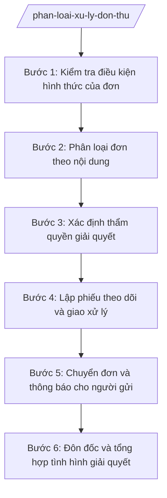

# Skill: Phân loại, xử lý đơn thư

## Khi nào dùng

- Tiếp nhận đơn thư gửi đến cơ quan hằng ngày qua các hình thức: trực tiếp, bưu điện, dịch vụ công trực tuyến.
- Phân loại đơn theo nội dung: khiếu nại, tố cáo, kiến nghị, phản ánh, tranh chấp đất đai hoặc đơn có nhiều nội dung.
- Xác định đơn thuộc thẩm quyền giải quyết của cơ quan hay phải chuyển đến cơ quan cấp trên.
- Lập phiếu theo dõi, giao đơn vị xử lý và đôn đốc bảo đảm đúng thời hạn giải quyết.
- Rà soát đơn trùng lặp, đơn nặc danh, đơn không đủ điều kiện thụ lý để xử lý đúng quy định.

## Đầu vào (Input)

| Trường | Mô tả | Bắt buộc |
|--------|-------|----------|
| `ngay_nhan_don` | Ngày cơ quan nhận được đơn | Có |
| `hinh_thuc_nhan` | Trực tiếp / Bưu điện / Dịch vụ công trực tuyến | Có |
| `nguoi_gui_don` | Họ tên, địa chỉ, số điện thoại liên hệ. Lưu ý: đơn nặc danh ghi "Không rõ".| Có |
| `loai_don_so_bo` | Khiếu nại / Tố cáo / Kiến nghị / Phản ánh / Chưa xác định | Có |
| `noi_dung_don` | Tóm tắt nội dung, yêu cầu của người gửi | Có |
| `linh_vuc` | Đất đai / Xây dựng / Hộ tịch / Chính sách xã hội / Khác | Có |
| `tai_lieu_kem_theo` | Danh mục giấy tờ, chứng cứ kèm theo đơn | Không |
| `don_da_gui_truoc_day` | Có/Không; mã đơn cũ nếu là đơn trùng lặp | Không |

## Quy trình

**Bước 1. Kiểm tra điều kiện hình thức của đơn**

- Làm gì: Kiểm tra đơn có đủ họ tên, địa chỉ người gửi, chữ ký (hoặc điểm chỉ), nội dung rõ ràng; phân biệt đơn hợp lệ, đơn nặc danh, đơn mạo danh, đơn trùng lặp với đơn đã xử lý.
- Dùng input: `ngay_nhan_don`, `hinh_thuc_nhan`, `nguoi_gui_don`, `noi_dung_don`, `don_da_gui_truoc_day`.
- Vai trò: Công chức Văn phòng kiểm tra (AI hỗ trợ đối chiếu với danh sách đơn đã nhận để phát hiện trùng lặp, trích xuất thông tin người gửi và nội dung chính của đơn). ⏱ 0,5 ngày (ước tính) làm việc.
- Lưu ý nghiệp vụ: Đơn chưa đủ điều kiện thì hướng dẫn người gửi bổ sung hoặc lưu theo quy định, không tự ý hủy đơn; đơn nặc danh nhưng có nội dung rõ ràng, chứng cứ cụ thể vẫn phải xem xét theo quy định.
- → Kết quả bước: Bảng kiểm tra điều kiện hình thức của đơn (đạt/không đạt từng tiêu chí).

**Bước 2. Phân loại đơn theo nội dung**

- Làm gì: Đọc kỹ nội dung, phân loại thành: khiếu nại (không đồng ý với quyết định hành chính, hành vi hành chính), tố cáo (tố giác hành vi vi phạm pháp luật), kiến nghị/phản ánh (đề xuất, phản ánh tình hình), tranh chấp đất đai, hoặc đơn có nhiều nội dung cần tách xử lý.
- Dùng input: Loại đơn (sơ bộ), `noi_dung_don`, `linh_vuc`, `tai_lieu_kem_theo`, `loai_don_so_bo`.
- Vai trò: Công chức Văn phòng phân loại (AI hỗ trợ gợi ý phân loại dựa trên từ ngữ nội dung và lĩnh vực; công chức là người quyết định phân loại cuối cùng). ⏱ 0,5 ngày (ước tính) làm việc.
- Lưu ý nghiệp vụ: AI chỉ gợi ý, không kết luận thay người; đơn có nhiều nội dung thì tách từng nội dung để xử lý theo loại tương ứng; phân biệt rõ kiến nghị/phản ánh với khiếu nại, tố cáo về thủ tục xử lý.
- → Kết quả bước: Phiếu phân loại đơn (loại đơn chính thức kèm lý do phân loại).

**Bước 3. Xác định thẩm quyền giải quyết**

- Làm gì: Đối chiếu nội dung đơn với thẩm quyền giải quyết của cơ quan theo quy định phân cấp hiện hành: đơn thuộc thẩm quyền của cơ quan thì đề xuất thụ lý; đơn thuộc thẩm quyền của cơ quan cấp trên thì đề xuất chuyển.
- Dùng input: Loại đơn (chính thức), `linh_vuc`, `noi_dung_don`.
- Vai trò: Công chức Văn phòng đề xuất (AI hỗ trợ tra cứu nhanh thẩm quyền theo lĩnh vực từ bảng phân cấp, cảnh báo khi nội dung có dấu hiệu vượt thẩm quyền của cơ quan); Chánh Văn phòng thẩm định; người đứng đầu cơ quan quyết định. ⏱ 1 ngày (ước tính) làm việc.
- Lưu ý nghiệp vụ: Không giữ lại xử lý đơn thuộc thẩm quyền cấp trên; khi chuyển đơn phải đầy đủ hồ sơ và thông báo cho người gửi biết cơ quan nhận chuyển.
- → Kết quả bước: Đề xuất xử lý thẩm quyền (thụ lý tại cơ quan hoặc chuyển cơ quan cấp trên, ghi rõ cơ quan nhận).

**Bước 4. Lập phiếu theo dõi và giao xử lý**

- Làm gì: Cấp mã số đơn theo quy ước; lập phiếu theo dõi ghi nội dung, loại đơn, đơn vị/cá nhân được giao xử lý, thời hạn giải quyết theo quy định của từng loại đơn; giao cho phòng/ban/công chức phụ trách lĩnh vực.
- Dùng input: Kết quả phân loại (bước 2), kết quả xác định thẩm quyền (bước 3), `nguoi_gui_don`.
- Vai trò: Công chức Văn phòng lập phiếu (AI hỗ trợ sinh mã số đơn, tính thời hạn giải quyết, điền các trường của phiếu); Chánh Văn phòng ký giao. ⏱ 0,5 ngày (ước tính) làm việc.
- Lưu ý nghiệp vụ: Thời hạn giải quyết khác nhau giữa khiếu nại, tố cáo, kiến nghị — phải ghi đúng theo loại đơn; đơn tố cáo phải bảo mật tuyệt đối thông tin người tố cáo.
- → Kết quả bước: Phiếu theo dõi giải quyết đơn (có mã số, đơn vị xử lý, thời hạn).

**Bước 5. Chuyển đơn và thông báo cho người gửi**

- Làm gì: Soạn công văn chuyển đơn đến cơ quan có thẩm quyền (đối với đơn phải chuyển cấp trên); thông báo bằng văn bản cho người gửi biết đơn đã được thụ lý tại cơ quan hoặc đã chuyển đến cơ quan nào.
- Dùng input: Đề xuất xử lý thẩm quyền, `nguoi_gui_don`, `noi_dung_don`.
- Vai trò: Công chức Văn phòng soạn thảo (AI hỗ trợ soạn công văn chuyển đơn và thông báo cho người gửi theo mẫu); Chánh Văn phòng kiểm tra; người đứng đầu cơ quan ký. ⏱ 1 ngày (ước tính) làm việc.
- Lưu ý nghiệp vụ: Chuyển đơn phải kèm toàn bộ hồ sơ gốc của người gửi; cơ quan giữ bản lưu (bản sao) để theo dõi, đôn đốc.
- → Kết quả bước: Công văn chuyển đơn / Thông báo thụ lý đơn đã phát hành.

**Bước 6. Đôn đốc và tổng hợp tình hình giải quyết**

- Làm gì: Mở và cập nhật Sổ theo dõi đơn thư; theo dõi tiến độ các đơn đang xử lý; trước thời hạn 5 ngày làm việc gửi văn bản đôn đốc đơn vị xử lý; tổng hợp báo cáo định kỳ: số đơn nhận, đã giải quyết, đang xử lý, quá hạn.
- Dùng input: Các phiếu theo dõi đơn đang trong thời hạn xử lý.
- Vai trò: Công chức Văn phòng theo dõi (AI hỗ trợ cảnh báo đơn sắp quá hạn, tổng hợp số liệu báo cáo tự động từ phiếu theo dõi); Chánh Văn phòng báo cáo người đứng đầu cơ quan. ⏱ ~hằng tuần/tháng (ước tính).
- Lưu ý nghiệp vụ: Đơn quá hạn phải báo cáo ngay người đứng đầu cơ quan để chỉ đạo; số liệu báo cáo phải khớp với sổ theo dõi đơn thư.
- → Kết quả bước: Báo cáo tình hình giải quyết đơn thư định kỳ.

## Luồng quy trình (Workflow)

## 5. Đầu ra (Output)

- Phiếu phân loại đơn thư.
- Phiếu theo dõi giải quyết đơn (sản phẩm chính).
- Công văn chuyển đơn đến cơ quan có thẩm quyền.
- Thông báo thụ lý/chuyển đơn gửi người gửi đơn.
- Sổ theo dõi đơn thư (cập nhật liên tục).
- Báo cáo tình hình giải quyết đơn thư định kỳ.

### Cấu trúc output chuẩn

**PHIẾU THEO DÕI GIẢI QUYẾT ĐƠN THƯ** — các phần bắt buộc theo đúng thứ tự, đúng thể thức văn bản hành chính theo NĐ 30/2020/NĐ-CP:

1. Quốc hiệu "CỘNG HÒA XÃ HỘI CHỦ NGHĨA VIỆT NAM" – Tiêu ngữ "Độc lập – Tự do – Hạnh phúc" (đối với văn bản phát hành) hoặc tiêu đề phiếu (đối với phiếu nội bộ).
2. Tên phiếu: PHIẾU THEO DÕI GIẢI QUYẾT ĐƠN THƯ.
3. Mã số đơn; ngày nhận đơn; hình thức nhận đơn.
4. Người gửi đơn: họ tên, địa chỉ, số điện thoại liên hệ.
5. Loại đơn (khiếu nại/tố cáo/kiến nghị/phản ánh); lĩnh vực; tóm tắt nội dung đơn.
6. Thẩm quyền giải quyết: thụ lý tại cơ quan / chuyển đến (ghi rõ cơ quan nhận chuyển).
7. Đơn vị/cá nhân được giao xử lý; thời hạn giải quyết.
8. Tiến độ xử lý: các mốc đã thực hiện, kết quả từng mốc.
9. Người lập phiếu (ký, ghi rõ họ tên); người duyệt (ký, ghi rõ họ tên).
10. Phân phối, lưu trữ: phiếu theo dõi lưu tại bộ phận tiếp công dân; chuyển đơn vị/cá nhân được giao thụ lý theo phân công.

> **Checklist thể thức văn bản theo NĐ 30/2020/NĐ-CP** — đối chiếu trước khi trình ký:
> 1. Quốc hiệu và Tiêu ngữ.
> 2. Tên cơ quan, tổ chức ban hành văn bản.
> 3. Số, ký hiệu của văn bản.
> 4. Địa danh và thời gian ban hành văn bản.
> 5. Tên loại và trích yếu nội dung văn bản.
> 6. Nội dung văn bản.
> 7. Chức vụ, họ tên và chữ ký của người có thẩm quyền.
> 8. Dấu, chữ ký số của cơ quan, tổ chức.
> 9. Nơi nhận (kèm Phụ lục nếu có).

## 6. Checklist nghiệm thu

1. 100% đơn nhận được kiểm tra điều kiện hình thức, không bỏ sót.
2. Phân loại đơn đúng bản chất nội dung (khiếu nại/tố cáo/kiến nghị/phản ánh), có lý do phân loại rõ ràng.
3. Xác định thẩm quyền đúng: đơn thuộc cơ quan thì thụ lý, đơn vượt thẩm quyền thì chuyển cấp trên kịp thời.
4. Mỗi đơn có mã số duy nhất, phiếu theo dõi ghi đủ đơn vị xử lý và thời hạn.
5. Công văn chuyển đơn kèm đủ hồ sơ gốc; người gửi được thông báo bằng văn bản.
6. Thông tin người tố cáo được bảo mật trong toàn bộ quy trình.
7. Đơn sắp quá hạn được đôn đốc trước 5 ngày làm việc; đơn quá hạn được báo cáo người đứng đầu cơ quan.
8. Số liệu báo cáo khớp với sổ theo dõi; thể thức văn bản đúng NĐ 30/2020/NĐ-CP.

## 7. Ví dụ mô phỏng

*Dữ liệu dưới đây là giả lập 100% phục vụ minh họa.*

**Input mẫu:**

| Trường | Giá trị mẫu |
|--------|-------------|
| Ngày nhận đơn | 05/10/2026 |
| Hình thức nhận | Trực tiếp tại Văn phòng HĐND&UBND xã A |
| Người gửi đơn | Bà Trần Thị Dân, thôn 2, xã A, tỉnh A; SĐT: 0900 000 002 |
| Loại đơn (sơ bộ) | Kiến nghị |
| Nội dung đơn | Kiến nghị UBND xã A lắp đặt 10 bóng đèn chiếu sáng trên tuyến đường thôn 2 (dài khoảng 1.000 m) để bảo đảm an toàn đi lại ban đêm |
| Lĩnh vực | Xây dựng |
| Tài liệu kèm theo | Đơn kiến nghị có chữ ký của 30 hộ dân thôn 2 |
| Đơn đã gửi trước đây | Không |

**Output mẫu (Phiếu theo dõi giải quyết đơn thư):**

**PHIẾU THEO DÕI GIẢI QUYẾT ĐƠN THƯ**
Xã A, ngày 06 tháng 10 năm 2026

1. Mã số đơn: ĐTXA-2026-045. Ngày nhận: 05/10/2026. Hình thức: trực tiếp.
2. Người gửi đơn: Bà Trần Thị Dân — thôn 2, xã A, tỉnh A; SĐT: 0900 000 002.
3. Loại đơn: Kiến nghị. Lĩnh vực: xây dựng — hạ tầng.
4. Tóm tắt nội dung: Kiến nghị lắp đặt 10 bóng đèn chiếu sáng trên tuyến đường thôn 2 (dài khoảng 1.000 m).
5. Thẩm quyền giải quyết: Thụ lý tại UBND xã A (thuộc thẩm quyền cấp xã).
6. Đơn vị được giao xử lý: Phòng Kinh tế xã A. Thời hạn giải quyết: trước ngày 05/11/2026.
7. Tiến độ xử lý:
   - 06/10/2026: Lập phiếu, giao Phòng Kinh tế xử lý.
   - (cập nhật khi có mốc mới)
8. Người lập phiếu: (ký, ghi rõ họ tên công chức Văn phòng). Người duyệt: Ông Phạm Văn C — Chánh Văn phòng HĐND&UBND xã A.

## 8. Human gate

- Công chức Văn phòng kiểm tra, phân loại sơ bộ → Chánh Văn phòng thẩm định phân loại và đề xuất thẩm quyền → người đứng đầu cơ quan quyết định thụ lý hoặc chuyển cấp trên.
- Công văn chuyển đơn, thông báo thụ lý do người đứng đầu cơ quan ký trước khi phát hành.

## 9. Giới hạn

- AI không kết luận đúng/sai về nội dung khiếu nại, tố cáo của công dân; không đánh giá tính có căn cứ của đơn thay người có thẩm quyền.
- AI không quyết định thụ lý, từ chối hay chuyển đơn thay người đứng đầu cơ quan.
- AI không tiết lộ danh tính, thông tin của người tố cáo dưới bất kỳ hình thức nào.
- AI không bịa đặt thời hạn giải quyết, căn cứ pháp lý; không viện dẫn văn bản đã hết hiệu lực.

## 10. Căn cứ & lưu ý

- NĐ 150/2025/NĐ-CP: tổ chức và thẩm quyền của UBND cấp xã trong mô hình chính quyền địa phương 2 cấp.
- NĐ 141/2025/NĐ-CP: phân định thẩm quyền của chính quyền địa phương 2 cấp trong lĩnh vực quản lý nhà nước của Thanh tra Chính phủ (liên quan thẩm quyền giải quyết khiếu nại, tố cáo).
- Chuỗi 28 nghị định 120–152/2025/NĐ-CP: căn cứ tra cứu thẩm quyền theo từng lĩnh vực khi xác định đơn thuộc cấp xã hay phải chuyển cấp trên.
- NĐ 30/2020/NĐ-CP: thể thức và kỹ thuật trình bày văn bản hành chính.
- Trình tự, thủ tục giải quyết khiếu nại, tố cáo thực hiện theo quy định pháp luật về khiếu nại, tố cáo (không gắn số hiệu cụ thể do chưa xác thực trong tài liệu).
