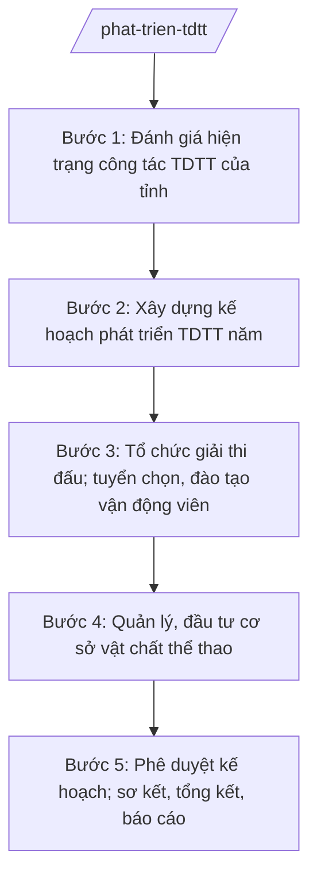

# Skill: Phát triển thể dục thể thao

## 2. Khi nào dùng

- Xây dựng kế hoạch phát triển thể dục thể thao (TDTT) hằng năm và giai đoạn của tỉnh: thể thao quần chúng, thể thao thành tích cao, thể thao học đường.
- Tổ chức các giải thi đấu thể thao cấp tỉnh; cử đoàn vận động viên tham gia giải khu vực, quốc gia.
- Tuyển chọn, đào tạo vận động viên năng khiếu, đội tuyển tỉnh; thực hiện chế độ, chính sách đối với vận động viên, huấn luyện viên.
- Quản lý, đầu tư xây dựng, khai thác cơ sở vật chất thể thao cấp tỉnh (sân vận động, nhà thi đấu, bể bơi...); hướng dẫn nghiệp vụ TDTT cho cấp xã.
- Sơ kết, tổng kết, khen thưởng và báo cáo công tác TDTT gửi UBND tỉnh, Bộ VHTTDL.

## 3. Đầu vào (Input)

| Trường | Mô tả | Bắt buộc |
|--------|-------|----------|
| `hien_trang_tdtt` | Số liệu hiện trạng: người tập luyện TDTT thường xuyên, câu lạc bộ thể thao, VĐV/HLV, cơ sở vật chất, thành tích thi đấu năm trước | Có |
| `chi_tieu_nam` | Chỉ tiêu kế hoạch năm: tỷ lệ dân số tập luyện thường xuyên, số VĐV đẳng cấp, chỉ tiêu huy chương các giải | Có |
| `danh_muc_giai` | Danh mục giải thi đấu dự kiến tổ chức (cấp tỉnh) và tham gia (khu vực, quốc gia): tên giải, thời gian, địa điểm, kinh phí | Không |
| `doi_tuyen` | Danh sách đội tuyển tỉnh, VĐV năng khiếu; kế hoạch đào tạo, tập huấn; chế độ dinh dưỡng, tiền công theo quy định | Không |
| `co_so_vat_chat` | Hiện trạng và nhu cầu đầu tư, sửa chữa cơ sở thể thao cấp tỉnh | Không |
| `du_toan_kinh_phi` | Dự toán kinh phí thực hiện kế hoạch năm | Có |
| `thoi_han` | Thời hạn ban hành kế hoạch năm | Có |

## 4. Quy trình

**Bước 1. Đánh giá hiện trạng công tác TDTT của tỉnh**

- Làm gì: Thu thập, tổng hợp số liệu: phong trào TDTT quần chúng (người tập thường xuyên, CLB), thể thao thành tích cao (VĐV, HLV, huy chương), cơ sở vật chất; đánh giá mặt được, tồn tại, nguyên nhân của năm trước.
- Dùng input: `hien_trang_tdtt`, `co_so_vat_chat`.
- Vai trò: Chuyên viên Phòng Thể dục thể thao (bà Hoàng Thị R) chủ trì tổng hợp số liệu từ các đơn vị trực thuộc và Phòng Văn hóa – Xã hội các xã; Trưởng phòng (ông Phạm Văn Z) kiểm tra. AI hỗ trợ: thiết kế biểu mẫu thu thập số liệu, tổng hợp thành bảng, soạn báo cáo đánh giá hiện trạng. ⏱ ~5–7 ngày làm việc (ước tính).
- Lưu ý nghiệp vụ: Số liệu phải có đối chiếu với báo cáo năm trước để thấy xu hướng; phân tách rõ 3 mảng: quần chúng, thành tích cao, cơ sở vật chất.
- → Kết quả bước: Báo cáo đánh giá hiện trạng công tác TDTT tỉnh (số liệu + nhận định).

**Bước 2. Xây dựng kế hoạch phát triển TDTT năm**

- Làm gì: Dự thảo Kế hoạch phát triển TDTT năm của tỉnh: mục tiêu, chỉ tiêu cụ thể (quần chúng, thành tích cao); nhiệm vụ tổ chức giải, đào tạo VĐV, đầu tư cơ sở vật chất; phân công đơn vị thực hiện; dự toán kinh phí.
- Dùng input: `chi_tieu_nam`, `danh_muc_giai`, `doi_tuyen`, `co_so_vat_chat`, `du_toan_kinh_phi`, kết quả bước 1.
- Vai trò: Chuyên viên Phòng Thể dục thể thao soạn dự thảo, phối hợp Phòng Kế hoạch – Tài chính Sở về dự toán; Trưởng phòng (ông Phạm Văn Z) kiểm tra; Phó Giám đốc Sở (ông Đỗ Văn U) cho ý kiến. AI hỗ trợ: soạn dự thảo kế hoạch đúng thể thức, lập bảng chỉ tiêu/nhiệm vụ/phân công, lập bảng dự toán. ⏱ ~7–10 ngày làm việc (ước tính).
- Lưu ý nghiệp vụ: Chỉ tiêu phải khả thi, gắn với nguồn lực; ưu tiên các môn thế mạnh của tỉnh; kế hoạch đầu tư cơ sở vật chất phải phù hợp quy hoạch và khả năng cân đối ngân sách.
- → Kết quả bước: Dự thảo Kế hoạch phát triển TDTT tỉnh năm + phụ lục (chỉ tiêu, danh mục giải, dự toán).

**Bước 3. Tổ chức giải thi đấu; tuyển chọn, đào tạo vận động viên**

- Làm gì: Ban hành điều lệ, tổ chức các giải cấp tỉnh theo kế hoạch; tuyển chọn VĐV năng khiếu qua giải; tổ chức tập huấn đội tuyển; thực hiện chế độ dinh dưỡng, tiền công, khen thưởng đối với VĐV, HLV theo quy định; cử đoàn tham gia giải khu vực, quốc gia.
- Dùng input: Kế hoạch đã phê duyệt; `danh_muc_giai`, `doi_tuyen`.
- Vai trò: Phòng Thể dục thể thao chủ trì, Trung tâm Huấn luyện và Thi đấu TDTT tỉnh (đơn vị sự nghiệp trực thuộc Sở) trực tiếp tổ chức; Trưởng phòng (ông Phạm Văn Z) theo dõi. AI hỗ trợ: soạn điều lệ giải, lịch thi đấu, danh sách đoàn VĐV, dự toán từng giải, bảng theo dõi thành tích. ⏱ theo lịch giải trong năm (ước tính).
- Lưu ý nghiệp vụ: Điều lệ giải phải công khai, minh bạch; công tác trọng tài, y tế, an ninh tại giải phải được bảo đảm; chế độ VĐV thực hiện đúng quy định hiện hành, có hồ sơ thanh quyết toán đầy đủ.
- → Kết quả bước: Các giải đấu được tổ chức theo kế hoạch + danh sách VĐV đội tuyển + bảng thành tích.

**Bước 4. Quản lý, đầu tư cơ sở vật chất thể thao**

- Làm gì: Rà soát hiện trạng sân vận động tỉnh, nhà thi đấu, bể bơi và các thiết chế thể thao; đề xuất đầu tư xây mới, sửa chữa; quản lý khai thác, cho thuê đúng quy định; hướng dẫn cấp xã quản lý thiết chế thể thao cơ sở.
- Dùng input: `co_so_vat_chat`, kết quả bước 1.
- Vai trò: Chuyên viên Phòng Thể dục thể thao phối hợp Văn phòng Sở (bà Ngô Thị V) về quản lý tài sản công; Trưởng phòng (ông Phạm Văn Z) kiểm tra. AI hỗ trợ: lập danh mục cơ sở vật chất, bảng nhu cầu đầu tư theo mức độ ưu tiên, soạn văn bản hướng dẫn cấp xã. ⏱ ~5–7 ngày làm việc/đợt rà soát (ước tính).
- Lưu ý nghiệp vụ: Đầu tư công phải đúng trình tự pháp luật về đầu tư công; khai thác cơ sở thể thao không làm ảnh hưởng nhiệm vụ chính trị, đào tạo VĐV.
- → Kết quả bước: Danh mục đầu tư, sửa chữa cơ sở thể thao + văn bản hướng dẫn quản lý thiết chế thể thao cấp xã.

**Bước 5. Phê duyệt kế hoạch; sơ kết, tổng kết, báo cáo**

- Làm gì: Trình Giám đốc Sở phê duyệt Kế hoạch phát triển TDTT năm; định kỳ sơ kết 6 tháng, tổng kết năm; xét khen thưởng tập thể, cá nhân có thành tích; báo cáo UBND tỉnh, Bộ VHTTDL.
- Dùng input: Dự thảo kế hoạch bước 2; kết quả thực hiện các bước 3–4.
- Vai trò: Trưởng phòng (ông Phạm Văn Z) trình; Giám đốc Sở (bà Vũ Thị T) phê duyệt kế hoạch; chuyên viên tổng hợp báo cáo sơ kết/tổng kết. AI hỗ trợ: rà soát thể thức lần cuối, soạn báo cáo sơ kết/tổng kết, lập danh sách khen thưởng. ⏱ ~3–5 ngày làm việc (ước tính).
- Lưu ý nghiệp vụ: Báo cáo phải đối chiếu chỉ tiêu kế hoạch với kết quả thực hiện; khen thưởng đúng đối tượng, đúng thành tích.
- → Kết quả bước: Kế hoạch phát triển TDTT năm đã phê duyệt + báo cáo sơ kết/tổng kết gửi UBND tỉnh, Bộ VHTTDL.

## Luồng quy trình (Workflow)

## 5. Đầu ra (Output)

### Sản phẩm

1. **Kế hoạch phát triển thể dục, thể thao tỉnh năm …** (sản phẩm chính) — văn bản của Sở VHTTDL.
2. Báo cáo đánh giá hiện trạng công tác TDTT.
3. Điều lệ, lịch thi đấu các giải cấp tỉnh; danh sách đội tuyển, VĐV.
4. Danh mục đầu tư, sửa chữa cơ sở vật chất thể thao.
5. Báo cáo sơ kết 6 tháng, tổng kết năm công tác TDTT.

**Cấu trúc output chuẩn (Kế hoạch phát triển TDTT tỉnh năm):**
- Thể thức: tuân thủ Nghị định 30/2020/NĐ-CP về công tác văn thư.

1. Quốc hiệu "CỘNG HÒA XÃ HỘI CHỦ NGHĨA VIỆT NAM", Tiêu ngữ "Độc lập – Tự do – Hạnh phúc": CỘNG HÒA XÃ HỘI CHỦ NGHĨA VIỆT NAM / Độc lập – Tự do – Hạnh phúc.
2. Tên cơ quan ban hành: SỞ VĂN HÓA, THỂ THAO VÀ DU LỊCH TỈNH A.
3. Số, ký hiệu văn bản: số/KH-SVHTTDL.
4. Địa danh, ngày tháng năm ban hành: Tỉnh A, ngày … tháng … năm ….
5. Tên loại và trích yếu nội dung: KẾ HOẠCH / Phát triển thể dục, thể thao tỉnh A năm ….
6. Căn cứ ban hành: Thông tư số 10/2025/TT-BVHTTDL ngày 19/6/2025; Nghị định số 137/2025/NĐ-CP ngày 12/6/2025; Nghị định số 138/2025/NĐ-CP ngày 12/6/2025 (ghi rõ số hiệu, ngày ban hành).
7. Nội dung chính:
   - I. Mục đích, yêu cầu;
   - II. Chỉ tiêu kế hoạch (thể thao quần chúng; thể thao thành tích cao; cơ sở vật chất);
   - III. Nhiệm vụ và giải pháp (tổ chức giải thi đấu; tuyển chọn, đào tạo VĐV; đầu tư cơ sở vật chất; xã hội hóa TDTT; hướng dẫn cấp xã);
   - IV. Kinh phí thực hiện;
   - V. Tổ chức thực hiện (phân công đơn vị, thời gian).
8. Nơi nhận (UBND tỉnh (báo cáo); Bộ VHTTDL (báo cáo); các phòng, đơn vị trực thuộc Sở; Phòng VH-XH các xã; lưu VT, TDTT).
9. Chữ ký, họ tên người ký: KT. GIÁM ĐỐC / PHÓ GIÁM ĐỐC (hoặc GIÁM ĐỐC) / (ký, đóng dấu, ghi rõ họ tên).

## 6. Checklist nghiệm thu

- [ ] Đủ 9 phần theo Cấu trúc output chuẩn mục 5, đúng thứ tự thể thức NĐ 30/2020/NĐ-CP.
- [ ] Chỉ tiêu kế hoạch cụ thể, đo lường được, gắn với số liệu hiện trạng và nguồn lực.
- [ ] Đủ 3 mảng: thể thao quần chúng, thể thao thành tích cao, cơ sở vật chất.
- [ ] Danh mục giải thi đấu có thời gian, địa điểm, đơn vị tổ chức, dự toán.
- [ ] Kế hoạch đào tạo VĐV nêu rõ đối tượng, chế độ theo quy định hiện hành.
- [ ] Căn cứ pháp lý ghi đúng số hiệu, ngày ban hành của TT 10/2025/TT-BVHTTDL, NĐ 137/2025, NĐ 138/2025.
- [ ] Phân công thực hiện cụ thể đến từng đơn vị, có thời gian.
- [ ] Đã qua đủ human gate: chuyên viên soạn → Trưởng phòng kiểm tra → Phó Giám đốc Sở → Giám đốc Sở phê duyệt.

## 7. Ví dụ mô phỏng

*Dữ liệu dưới đây là giả lập 100% phục vụ minh họa.*

**Input mẫu:**

| Trường | Giá trị mẫu |
|--------|-------------|
| hien_trang_tdtt | Năm 2026: 35% dân số tập luyện TDTT thường xuyên; 120 CLB thể thao cơ sở; 45 VĐV đội tuyển tỉnh; 08 huy chương giải quốc gia; sân vận động tỉnh xuống cấp khán đài B |
| chi_tieu_nam | Năm 2027: 38% dân số tập luyện thường xuyên; 10 VĐV đạt đẳng cấp kiện tướng; 12 huy chương giải quốc gia |
| danh_muc_giai | Giải bóng đá nhi đồng tỉnh (tháng 6); Giải việt dã truyền thống (tháng 3); Đại hội TDTT tỉnh (tháng 9) |
| du_toan_kinh_phi | 8 tỷ đồng (ngân sách tỉnh 6 tỷ, xã hội hóa 2 tỷ) |
| thoi_han | 31/01/2027 |

**Output mẫu:**

CỘNG HÒA XÃ HỘI CHỦ NGHĨA VIỆT NAM
Độc lập – Tự do – Hạnh phúc
---------------

SỞ VĂN HÓA, THỂ THAO VÀ DU LỊCH TỈNH A

Số: 1234/KH-SVHTTDL

Tỉnh A, ngày 25 tháng 01 năm 2027

**KẾ HOẠCH**
**Phát triển thể dục, thể thao tỉnh A năm 2027**

*Căn cứ* Thông tư số 10/2025/TT-BVHTTDL ngày 19/6/2025 của Bộ Văn hóa, Thể thao và Du lịch; Nghị định số 137/2025/NĐ-CP ngày 12/6/2025 của Chính phủ; Nghị định số 138/2025/NĐ-CP ngày 12/6/2025 của Chính phủ;

Sở Văn hóa, Thể thao và Du lịch tỉnh A ban hành Kế hoạch phát triển thể dục, thể thao năm 2027 như sau:

**I. MỤC ĐÍCH, YÊU CẦU**

Đẩy mạnh phong trào TDTT quần chúng; nâng cao thành tích thể thao của tỉnh; đầu tư, khai thác hiệu quả cơ sở vật chất thể thao.

**II. CHỈ TIÊU KẾ HOẠCH**

1. Thể thao quần chúng: 38% dân số tập luyện TDTT thường xuyên; mỗi xã duy trì ít nhất 02 câu lạc bộ thể thao.
2. Thể thao thành tích cao: 10 VĐV đạt đẳng cấp kiện tướng; giành 12 huy chương tại các giải quốc gia.
3. Cơ sở vật chất: sửa chữa khán đài B sân vận động tỉnh; nâng cấp 05 sân thể thao xã.

**III. NHIỆM VỤ VÀ GIẢI PHÁP**

1. Tổ chức Giải việt dã truyền thống (tháng 3), Giải bóng đá nhi đồng tỉnh (tháng 6), Đại hội TDTT tỉnh (tháng 9).
2. Tuyển chọn 20 VĐV năng khiếu qua các giải; tổ chức 02 đợt tập huấn đội tuyển; thực hiện đầy đủ chế độ đối với VĐV, HLV theo quy định.
3. Đẩy mạnh xã hội hóa TDTT; hướng dẫn Phòng Văn hóa – Xã hội các xã quản lý thiết chế thể thao cơ sở.

**IV. KINH PHÍ THỰC HIỆN**

Tổng dự toán 8 tỷ đồng: ngân sách tỉnh 6 tỷ đồng, xã hội hóa 2 tỷ đồng (chi tiết tại phụ lục).

**V. TỔ CHỨC THỰC HIỆN**

Phòng Thể dục thể thao chủ trì; Trung tâm Huấn luyện và Thi đấu TDTT tỉnh trực tiếp tổ chức giải và đào tạo VĐV; Văn phòng Sở theo dõi kinh phí; báo cáo sơ kết 6 tháng và tổng kết năm./.

***Nơi nhận:***
- UBND tỉnh (báo cáo); Bộ VHTTDL (báo cáo);
- Các phòng, đơn vị trực thuộc Sở;
- Phòng Văn hóa – Xã hội các xã;
- Lưu: VT, TDTT.

**GIÁM ĐỐC**

*(Ký, đóng dấu)*

**Vũ Thị T**

## 8. Human gate (người kiểm duyệt)

- Chuyên viên Phòng Thể dục thể thao (bà Hoàng Thị R) soạn dự thảo kế hoạch, tổng hợp số liệu, chịu trách nhiệm về tính chính xác của số liệu TDTT.
- Trưởng phòng Thể dục thể thao (ông Phạm Văn Z) kiểm tra nội dung, chỉ tiêu, dự toán ở bước 1–2 và bước 5.
- Phó Giám đốc Sở (ông Đỗ Văn U) cho ý kiến trước khi trình Giám đốc Sở.
- Giám đốc Sở (bà Vũ Thị T) phê duyệt Kế hoạch phát triển TDTT năm. Kế hoạch chỉ có hiệu lực sau khi Giám đốc Sở ký.

## 9. Giới hạn (guardrails)

- AI KHÔNG phê duyệt kế hoạch, quyết định đầu tư, công nhận thành tích thay Giám đốc Sở và người có thẩm quyền.
- AI không bịa số liệu phong trào, thành tích VĐV, huy chương; không đặt chỉ tiêu viển vông không gắn với nguồn lực.
- AI không bịa căn cứ pháp lý, số hiệu văn bản; không viện dẫn văn bản đã hết hiệu lực.
- AI không đề xuất chế độ VĐV/HLV trái quy định hiện hành.
- AI không quyết định đầu tư công thay cơ quan có thẩm quyền; nội dung đầu tư xây dựng cơ bản thực hiện theo quy định pháp luật về đầu tư công.

## 10. Căn cứ & lưu ý

- Thông tư 10/2025/TT-BVHTTDL ngày 19/6/2025 (hiệu lực 01/7/2025) của Bộ VHTTDL — hướng dẫn chức năng, nhiệm vụ của Sở Văn hóa, Thể thao và Du lịch (thay thế TT 08/2021/TT-BVHTTDL).
- Nghị định 137/2025/NĐ-CP ngày 12/6/2025 — phân định thẩm quyền của chính quyền địa phương 02 cấp trong lĩnh vực văn hóa, thể thao và du lịch.
- Nghị định 138/2025/NĐ-CP ngày 12/6/2025 — phân quyền, phân cấp trong lĩnh vực văn hóa, thể thao và du lịch.
- Các quy định về chế độ, chính sách đối với vận động viên, huấn luyện viên thực hiện theo quy định pháp luật chuyên ngành về thể dục, thể thao.
- Nghị định 150/2025/NĐ-CP ngày 12/6/2025 (hiệu lực 16/6/2025) — tổ chức Sở Văn hóa, Thể thao và Du lịch thuộc UBND cấp tỉnh.
- Nghị định 30/2020/NĐ-CP — thể thức văn bản hành chính.
