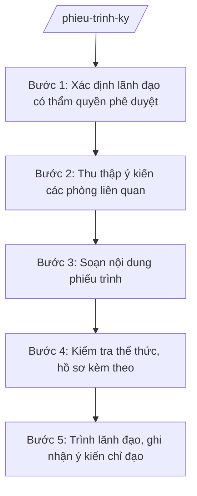

# Skill: Phiếu trình ký duyệt

## Khi nào dùng

- Lập phiếu trình kèm dự thảo công văn, tờ trình, quyết định, thông báo trước khi trình lãnh đạo ký.
- Tổng hợp ý kiến tham gia của các phòng liên quan vào một phiếu trình duy nhất để lãnh đạo nắm nhanh.
- Trình lãnh đạo cho ý kiến về phương án xử lý công việc (chọn phương án, cho chủ trương) trước khi soạn văn bản chính thức.
- Trình lãnh đạo phê duyệt kế hoạch, dự toán, danh sách (khen thưởng, hỗ trợ...) do phòng chuyên môn đề xuất.
- Trình xin ý kiến chỉ đạo đối với vụ việc phức tạp, có ý kiến khác nhau giữa các phòng.
- Lưu hồ sơ trình ký để phục vụ kiểm tra, thanh tra về quy trình ban hành văn bản sau này.

## Đầu vào (Input)

| Trường | Mô tả | Bắt buộc |
|--------|-------|----------|
| `van_ban_trinh` | Tên loại và trích yếu của văn bản trình ký (ví dụ: dự thảo Công văn đôn đốc báo cáo quý III) | Có |
| `tom_tat_noi_dung` | Tóm tắt nội dung chính của văn bản trình (5–10 dòng, nêu rõ vấn đề và nội dung quyết định) | Có |
| `can_cu_tom_tat` | Căn cứ pháp lý, văn bản liên quan chính (ghi gọn) | Có |
| `y_kien_cac_phong` | Ý kiến tham gia của từng phòng liên quan (tên phòng + nội dung ý kiến, kể cả ý kiến trái chiều) | Không |
| `de_xuat_don_vi` | Đề xuất, kiến nghị của đơn vị soạn thảo gửi lãnh đạo (phương án đề xuất, nội dung xin ý kiến) | Có |
| `nguoi_trinh` | Họ tên, chức vụ người trình (thường là Trưởng phòng hoặc công chức được giao) | Có |
| `don_vi_soan_thao` | Phòng/ban soạn thảo | Có |
| `lanh_dao_phe_duyet` | Chức vụ lãnh đạo trình (Chủ tịch / Phó Chủ tịch UBND xã theo phân công) | Có |
| `tai_lieu_kem_theo` | Danh sách tài liệu kèm theo phiếu trình (dự thảo văn bản, hồ sơ liên quan...) | Không |
| `ngay_trinh` | Ngày trình | Không |

## Quy trình

**Bước 1. Xác định lãnh đạo có thẩm quyền phê duyệt**

- Làm gì: Đọc `van_ban_trinh`, `de_xuat_don_vi` để xác định nội dung thuộc lĩnh vực phụ trách của Chủ tịch hay Phó Chủ tịch UBND xã (theo phân công của UBND xã); kiểm tra nội dung có cần báo cáo tập thể lãnh đạo không.
- Dùng input: `van_ban_trinh`, `de_xuat_don_vi`, `lanh_dao_phe_duyet`.
- Vai trò: Trưởng phòng/đơn vị soạn thảo xác định; AI hỗ trợ đối chiếu với phân công phụ trách của lãnh đạo UBND xã ⏱ ~5 phút (ước tính).
- Lưu ý nghiệp vụ: Trình đúng người phụ trách lĩnh vực; nội dung quan trọng (chủ trương lớn, kinh phí lớn) phải báo cáo tập thể lãnh đạo UBND xã trước khi trình ký cá nhân.
- → Kết quả bước: Xác định đúng lãnh đạo trình ký.

**Bước 2. Thu thập ý kiến các phòng liên quan**

- Làm gì: Gửi dự thảo văn bản xin ý kiến các phòng có liên quan (`y_kien_cac_phong`); thu thập đầy đủ ý kiến bằng văn bản hoặc phiếu xin ý kiến; ghi nhận cả ý kiến đồng ý và ý kiến khác.
- Dùng input: `y_kien_cac_phong`, `van_ban_trinh`, `don_vi_soan_thao`.
- Vai trò: Công chức soạn thảo gửi và thu thập ý kiến; AI hỗ trợ tổng hợp các ý kiến thành bảng (phòng – nội dung ý kiến – tiếp thu/không tiếp thu và lý do) ⏱ ~15–20 phút (chưa tính thời gian chờ các phòng trả lời) (ước tính).
- Lưu ý nghiệp vụ: Phải xin ý kiến đầy đủ các phòng liên quan đến nội dung; không được giấu ý kiến trái chiều — ý kiến khác nhau phải được trình bày trung thực để lãnh đạo quyết định. Ghi rõ ý kiến nào đã tiếp thu, ý kiến nào chưa và lý do.
- → Kết quả bước: Bảng tổng hợp ý kiến các phòng đầy đủ, trung thực.

**Bước 3. Soạn nội dung phiếu trình**

- Làm gì: Viết phiếu trình gồm: thông tin văn bản trình; tóm tắt nội dung (`tom_tat_noi_dung`); căn cứ tóm tắt (`can_cu_tom_tat`); ý kiến các phòng; đề xuất của đơn vị soạn thảo (`de_xuat_don_vi`); danh mục tài liệu kèm theo.
- Dùng input: `van_ban_trinh`, `tom_tat_noi_dung`, `can_cu_tom_tat`, `y_kien_cac_phong`, `de_xuat_don_vi`, `tai_lieu_kem_theo`, `nguoi_trinh`.
- Vai trò: Công chức soạn thảo thực hiện; AI hỗ trợ tóm tắt nội dung súc tích (lãnh đạo chỉ đọc 1 trang), diễn đạt đề xuất rõ ràng theo từng phương án ⏱ ~20 phút (ước tính).
- Lưu ý nghiệp vụ: Phiếu trình tối đa 1–2 trang; tóm tắt phải nêu được "vấn đề gì – đề xuất gì – xin ý kiến gì". Đề xuất phải cụ thể: đề nghị lãnh đạo ký ban hành / cho ý kiến về phương án / chỉ đạo thêm nội dung gì.
- → Kết quả bước: Dự thảo phiếu trình súc tích, đầy đủ.

**Bước 4. Kiểm tra thể thức, hồ sơ kèm theo**

- Làm gì: Kiểm tra phiếu trình có đủ các mục theo cấu trúc chuẩn; đối chiếu danh mục `tai_lieu_kem_theo` với hồ sơ thực tế (dự thảo văn bản đã đúng thể thức, đủ chữ ký nháy của người soạn thảo và lãnh đạo đơn vị).
- Dùng input: `tai_lieu_kem_theo`, `van_ban_trinh`, `don_vi_soan_thao`.
- Vai trò: Công chức văn thư/văn phòng kiểm tra; AI hỗ trợ checklist đối chiếu hồ sơ kèm theo ⏱ ~10 phút (ước tính).
- Lưu ý nghiệp vụ: Dự thảo văn bản trình ký phải có chữ ký nháy của người soạn thảo và Trưởng phòng ở lề trái cuối văn bản. Hồ sơ thiếu tài liệu kèm theo thì chưa trình — tránh lãnh đạo phải ký khi chưa đủ thông tin.
- → Kết quả bước: Phiếu trình + bộ hồ sơ đầy đủ, đúng quy định.

**Bước 5. Trình lãnh đạo, ghi nhận ý kiến chỉ đạo**

- Làm gì: Người trình (`nguoi_trinh`) trình trực tiếp hoặc qua Văn phòng; lãnh đạo xem xét, cho ý kiến (đồng ý ký / sửa nội dung / không đồng ý); ghi nhận đầy đủ ý kiến chỉ đạo của lãnh đạo vào phiếu trình; chuyển lại đơn vị soạn thảo hoàn thiện (nếu có sửa).
- Dùng input: `nguoi_trinh`, `lanh_dao_phe_duyet`, `ngay_trinh`.
- Vai trò: Người trình (Trưởng phòng/công chức) trình bày ngắn gọn (3–5 phút); Chánh Văn phòng HĐND&UBND theo dõi, đôn đốc; Chủ tịch/Phó Chủ tịch UBND xã cho ý kiến, ký duyệt (10–15 phút); AI hỗ trợ: tổng hợp đầy đủ hồ sơ trình ký, nhắc các nội dung chờ ý kiến — tổng ước tính 20 phút (chưa tính thời gian chờ).
- Lưu ý nghiệp vụ: Mọi ý kiến chỉ đạo của lãnh đạo (kể cả chỉ đạo miệng) phải được ghi lại đầy đủ, chính xác vào phiếu trình. Nếu lãnh đạo yêu cầu sửa nội dung, đơn vị soạn thảo phải sửa và trình lại, không tự ý phát hành bản chưa được duyệt.
- → Kết quả bước: Phiếu trình có ý kiến phê duyệt/ký duyệt của lãnh đạo; văn bản được ký ban hành hoặc trả lại để hoàn thiện.

## Luồng quy trình (Workflow)

## Đầu ra (Output)

- Phiếu trình ký hoàn chỉnh (có chữ ký người trình, ý kiến của Chánh Văn phòng, phê duyệt của lãnh đạo).
- Bảng tổng hợp ý kiến các phòng liên quan (kèm theo).
- Hồ sơ lưu: phiếu trình + dự thảo văn bản + tài liệu kèm theo.

### Cấu trúc output chuẩn

Khung cố định của một phiếu trình, các phần bắt buộc theo đúng thứ tự, đúng thể thức NĐ 30/2020/NĐ-CP:

1. **Tiêu đề phiếu** (canh giữa, phía trên cùng):
   ỦY BAN NHÂN DÂN XÃ A / PHIẾU TRÌNH / Số: .../PT-VP (số phiếu theo sổ theo dõi của Văn phòng)
2. **Thông tin trình**: Người trình (họ tên, chức vụ); Đơn vị soạn thảo; Ngày trình; Trình (chức vụ lãnh đạo: Chủ tịch/Phó Chủ tịch UBND xã).
3. **Văn bản trình ký**: tên loại và trích yếu văn bản (kèm số dự thảo nếu có).
4. **Tóm tắt nội dung**: vấn đề, nội dung chính của văn bản trình (ngắn gọn, tối đa 10 dòng).
5. **Căn cứ**: liệt kê gọn căn cứ pháp lý, văn bản liên quan chính.
6. **Ý kiến các phòng liên quan**: bảng (Phòng – Nội dung ý kiến – Tiếp thu/Không tiếp thu và lý do); ghi rõ ý kiến trái chiều nếu có.
7. **Đề xuất của đơn vị soạn thảo**: phương án đề xuất, nội dung cụ thể xin ý kiến/phê duyệt của lãnh đạo.
8. **Tài liệu kèm theo**: danh sách tài liệu (dự thảo văn bản, hồ sơ liên quan...).
9. **Chữ ký và ý kiến phê duyệt**:
   - Người trình (ký, ghi rõ họ tên);
   - Ý kiến của Chánh Văn phòng HĐND&UBND (ký, ghi rõ họ tên);
   - Phê duyệt của lãnh đạo: "Đồng ý" / "Sửa ..." / "Không đồng ý, lý do ..." + chữ ký, họ tên, ngày tháng.
10. Phân phối, lưu trữ: phiếu trình kèm theo hồ sơ văn bản trình ký; Văn phòng lưu 01 bản để theo dõi.

## Checklist nghiệm thu

1. Có đủ 9 phần theo đúng thứ tự mục 5; phiếu trình tối đa 1–2 trang, súc tích.
2. Trình đúng lãnh đạo phụ trách lĩnh vực; nội dung quan trọng đã báo cáo tập thể lãnh đạo (nếu cần).
3. Tóm tắt nội dung nêu rõ "vấn đề gì – đề xuất gì – xin ý kiến gì"; lãnh đạo đọc 1 trang nắm được toàn bộ.
4. Căn cứ pháp lý ghi gọn nhưng đủ, chỉ dùng văn bản còn hiệu lực, có số hiệu xác thực.
5. Ý kiến các phòng được tổng hợp đầy đủ, trung thực, kể cả ý kiến trái chiều; ghi rõ tiếp thu/không tiếp thu và lý do.
6. Đề xuất của đơn vị soạn thảo cụ thể (ký ban hành / chọn phương án / cho ý kiến), không chung chung.
7. Danh mục tài liệu kèm theo khớp với hồ sơ thực tế; dự thảo văn bản có chữ ký nháy của người soạn thảo và Trưởng phòng.
8. Có chữ ký người trình, ý kiến của Chánh Văn phòng, phê duyệt (kèm chữ ký, ngày tháng) của lãnh đạo.
9. Mọi ý kiến chỉ đạo của lãnh đạo (kể cả chỉ đạo miệng) được ghi lại đầy đủ, chính xác.
10. Không bịa số liệu, căn cứ; phiếu trình và hồ sơ được lưu đầy đủ phục vụ kiểm tra sau này.

## Ví dụ mô phỏng

*Dữ liệu dưới đây là giả lập 100% phục vụ minh họa.*

**Input mẫu:**

| Trường | Giá trị |
|--------|---------|
| van_ban_trinh | Dự thảo Công văn số 105/CV-UBND về việc đôn đốc báo cáo tiến độ thực hiện nhiệm vụ quý III năm 2026 |
| tom_tat_noi_dung | Đến nay Phòng Kinh tế và Phòng Văn hóa – Xã hội chưa gửi báo cáo tiến độ quý III theo yêu cầu tại Công văn số 100/CV-UBND ngày 01/10/2026. Dự thảo công văn yêu cầu 02 phòng gửi báo cáo về Văn phòng HĐND&UBND trước ngày 15/10/2026 để tổng hợp trình Chủ tịch UBND xã |
| can_cu_tom_tat | Công văn số 100/CV-UBND ngày 01/10/2026 của UBND xã A; phân công phụ trách của lãnh đạo UBND xã |
| y_kien_cac_phong | Không (văn bản đôn đốc nội bộ, không cần xin ý kiến) |
| de_xuat_don_vi | Đề nghị Chánh Văn phòng xem xét, trình Chủ tịch UBND xã cho ý kiến; đề xuất ký ban hành để đôn đốc tiến độ chung |
| nguoi_trinh | Nguyễn Văn G – Chuyên viên Văn phòng HĐND&UBND xã A |
| don_vi_soan_thao | Văn phòng HĐND&UBND xã A |
| lanh_dao_phe_duyet | Chủ tịch UBND xã |
| tai_lieu_kem_theo | Dự thảo Công văn số 105/CV-UBND (có chữ ký nháy); Công văn số 100/CV-UBND ngày 01/10/2026 (bản sao) |
| ngay_trinh | 10/10/2026 |

**Output mẫu:**

ỦY BAN NHÂN DÂN XÃ A
PHIẾU TRÌNH
Số: 30/PT-VP

Người trình: Nguyễn Văn G – Chuyên viên Văn phòng HĐND&UBND xã A
Đơn vị soạn thảo: Văn phòng HĐND&UBND xã A
Ngày trình: 10/10/2026
Trình: Chủ tịch UBND xã A

1. Văn bản trình ký: Dự thảo Công văn số 105/CV-UBND về việc đôn đốc báo cáo tiến độ thực hiện nhiệm vụ quý III năm 2026.

2. Tóm tắt nội dung: Đến nay Phòng Kinh tế và Phòng Văn hóa – Xã hội chưa gửi báo cáo tiến độ thực hiện nhiệm vụ quý III năm 2026 theo yêu cầu tại Công văn số 100/CV-UBND ngày 01/10/2026 của UBND xã A. Dự thảo công văn yêu cầu Trưởng 02 phòng khẩn trương gửi báo cáo về Văn phòng HĐND&UBND trước ngày 15/10/2026 để tổng hợp, trình Chủ tịch UBND xã.

3. Căn cứ:
- Công văn số 100/CV-UBND ngày 01/10/2026 của UBND xã A;
- Phân công phụ trách của lãnh đạo UBND xã A.

4. Ý kiến các phòng liên quan: Không (văn bản đôn đốc nội bộ, không cần xin ý kiến các phòng).

5. Đề xuất của đơn vị soạn thảo: Đề nghị Chánh Văn phòng xem xét, trình Chủ tịch UBND xã cho ý kiến; đề xuất ký ban hành để đôn đốc tiến độ chung của xã.

6. Tài liệu kèm theo:
- Dự thảo Công văn số 105/CV-UBND (có chữ ký nháy của người soạn thảo và Chánh Văn phòng);
- Công văn số 100/CV-UBND ngày 01/10/2026 (bản sao).

Người trình
(Ký, ghi rõ họ tên)
Nguyễn Văn G

Ý kiến của Chánh Văn phòng HĐND&UBND:
Nhất trí với đề xuất của đơn vị soạn thảo. Kính trình Chủ tịch xem xét, quyết định.
(Ký, ghi rõ họ tên)
Phạm Văn C

Phê duyệt của lãnh đạo:
☐ Đồng ý ký ban hành.
☐ Sửa nội dung: ...
☐ Không đồng ý. Lý do: ...
(Ký, ghi rõ họ tên, ngày tháng)
Nguyễn Văn A

## Human gate

- **Công chức soạn thảo (người trình)** → soạn phiếu trình, chịu trách nhiệm về tính trung thực của tóm tắt và ý kiến các phòng.
- **Trưởng phòng/đơn vị soạn thảo** → kiểm tra, ký nháy xác nhận trước khi trình.
- **Chánh Văn phòng HĐND&UBND** → kiểm tra thể thức, tính đầy đủ hồ sơ; cho ý kiến vào phiếu trình; theo dõi, đôn đốc việc trình ký.
- **Chủ tịch / Phó Chủ tịch UBND xã** → xem xét, cho ý kiến phê duyệt, ký duyệt văn bản trình.
- Văn bản chỉ được ban hành sau khi lãnh đạo ký duyệt trên phiếu trình (hoặc ký trực tiếp vào văn bản).

## Giới hạn

- AI KHÔNG ra quyết định hành chính thay người có thẩm quyền; phiếu trình chỉ là công cụ tham mưu.
- AI KHÔNG tự ký duyệt, tự ghi ý kiến phê duyệt của lãnh đạo vào phiếu trình dưới bất kỳ hình thức nào.
- AI KHÔNG bịa ý kiến của các phòng; chỉ tổng hợp ý kiến do người dùng cung cấp, ghi rõ ý kiến trái chiều.
- AI KHÔNG tóm tắt sai lệch nội dung văn bản trình để "làm đẹp" hồ sơ — tóm tắt phải trung thực.
- AI KHÔNG thay thế việc trình bày trực tiếp khi nội dung phức tạp, cần giải trình thêm.

## Căn cứ & lưu ý

- NĐ 30/2020/NĐ-CP về công tác văn thư: nguyên tắc quản lý, trình, ký, ban hành văn bản hành chính.
- NĐ 150/2025/NĐ-CP: tổ chức cơ quan chuyên môn thuộc UBND cấp xã (Văn phòng HĐND&UBND là đầu mối văn thư, theo dõi trình ký).
- Luật Tổ chức chính quyền địa phương 72/2025/QH15: thẩm quyền, trách nhiệm của Chủ tịch, Phó Chủ tịch UBND cấp xã.
- Lưu ý: phiếu trình là văn bản nội bộ phục vụ công tác tham mưu, không phải văn bản hành chính gửi ra ngoài; phải lưu cùng hồ sơ văn bản để phục vụ kiểm tra, thanh tra về quy trình ban hành văn bản.
