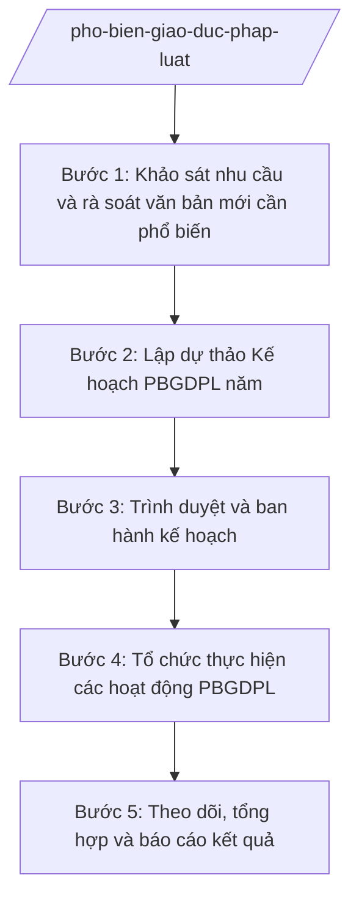

# Skill: Phổ biến, giáo dục pháp luật

## 2. Khi nào dùng
- Đầu năm cần khảo sát nhu cầu tìm hiểu pháp luật của cán bộ và nhân dân, rà soát văn bản mới cần phổ biến.
- Cần lập Kế hoạch phổ biến, giáo dục pháp luật (PBGDPL) năm của xã: xác định nội dung, hình thức, đối tượng, kinh phí, phân công thực hiện.
- Cần tổ chức các hoạt động PBGDPL: tủ sách pháp luật, câu lạc bộ pháp luật, sinh hoạt thôn/tổ dân phố, loa truyền thanh, hội nghị phổ biến.
- Cuối năm (hoặc cuối đợt) cần tổng hợp, báo cáo kết quả thực hiện kế hoạch PBGDPL.

## 3. Đầu vào (Input)

| Trường | Mô tả | Bắt buộc |
|--------|-------|----------|
| `van_ban_moi` | Danh mục văn bản quy phạm pháp luật mới ban hành cần phổ biến trong năm | Có |
| `nhu_cau_khao_sat` | Kết quả khảo sát nhu cầu tìm hiểu pháp luật của cán bộ, nhân dân các thôn/tổ dân phố | Không |
| `ke_hoach_nam_truoc` | Kế hoạch PBGDPL năm trước và báo cáo kết quả thực hiện | Không |
| `doi_tuong_uu_tien` | Nhóm đối tượng ưu tiên (đồng bào dân tộc, người cao tuổi, thanh thiếu niên, hộ nghèo...) | Không |
| `kinh_phi_du_kien` | Nguồn kinh phí dự kiến cho hoạt động PBGDPL trong năm | Có |
| `don_vi_phoi_hop` | Các đơn vị phối hợp (Mặt trận, đoàn thể, công an xã, trường học, thôn/tổ dân phố) | Không |

## 4. Quy trình

**Bước 1. Khảo sát nhu cầu và rà soát văn bản mới cần phổ biến**
- Làm gì: Tổng hợp phiếu khảo sát nhu cầu tìm hiểu pháp luật từ các thôn/tổ dân phố; rà soát văn bản quy phạm pháp luật mới ban hành liên quan trực tiếp đến người dân (đất đai, hộ tịch, an ninh trật tự, phòng chống tệ nạn...); đánh giá kết quả PBGDPL năm trước.
- Dùng input: `nhu_cau_khao_sat`, `van_ban_moi`, `ke_hoach_nam_truoc`.
- Vai trò: Công chức Tư pháp – Hộ tịch chủ trì khảo sát, rà soát. AI hỗ trợ tổng hợp kết quả khảo sát, phân loại văn bản mới theo lĩnh vực và đối tượng cần phổ biến ⏱ ~02 ngày làm việc (ước tính).
- Lưu ý nghiệp vụ: Chỉ đưa vào kế hoạch các văn bản còn hiệu lực; ưu tiên văn bản tác động trực tiếp đến quyền, nghĩa vụ của người dân. Khảo sát phải bao phủ các thôn/tổ dân phố, không làm hình thức.
- → Kết quả bước: Báo cáo tổng hợp nhu cầu + danh mục văn bản mới cần phổ biến trong năm, phân theo đối tượng.

**Bước 2. Lập dự thảo Kế hoạch PBGDPL năm**
- Làm gì: Xây dựng dự thảo kế hoạch: mục đích, yêu cầu; nội dung phổ biến; hình thức (tủ sách pháp luật, câu lạc bộ, sinh hoạt thôn/tổ dân phố, loa truyền thanh, hội nghị, tờ gấp); đối tượng; thời gian; kinh phí; phân công đơn vị thực hiện và phối hợp.
- Dùng input: kết quả Bước 1, `doi_tuong_uu_tien`, `kinh_phi_du_kien`, `don_vi_phoi_hop`.
- Vai trò: Công chức Tư pháp – Hộ tịch soạn dự thảo. AI hỗ trợ soạn dự thảo kế hoạch đúng thể thức, gợi ý hình thức phù hợp từng đối tượng và lập dự toán kinh phí chi tiết ⏱ ~01 ngày làm việc (ước tính).
- Lưu ý nghiệp vụ: Kế hoạch phải khả thi với kinh phí và nhân lực của xã; mỗi hoạt động ghi rõ thời gian, địa điểm, đơn vị chủ trì/phối hợp, sản phẩm đầu ra. Tránh dàn trải quá nhiều nội dung trong một buổi sinh hoạt.
- → Kết quả bước: Dự thảo Kế hoạch PBGDPL năm của xã.

**Bước 3. Trình duyệt và ban hành kế hoạch**
- Làm gì: Lấy ý kiến các đơn vị phối hợp (Mặt trận, đoàn thể, công an xã, trưởng thôn/tổ trưởng dân phố); hoàn thiện dự thảo; trình Chủ tịch UBND xã ký ban hành.
- Dùng input: dự thảo kế hoạch từ Bước 2, ý kiến góp ý của các đơn vị.
- Vai trò: Chánh Văn phòng HĐND và UBND tổng hợp ý kiến, hoàn thiện; Chủ tịch UBND xã ký ban hành kế hoạch. AI hỗ trợ tổng hợp ý kiến góp ý và rà soát thể thức văn bản theo NĐ 30/2020/NĐ-CP ⏱ ~03 ngày làm việc (ước tính).
- Lưu ý nghiệp vụ: Kế hoạch PBGDPL năm nên ban hành trong quý I để có đủ thời gian triển khai. Gửi kế hoạch đến các thôn/tổ dân phố và đơn vị phối hợp ngay sau khi ban hành.
- → Kết quả bước: Kế hoạch PBGDPL năm đã được Chủ tịch UBND xã ký ban hành và gửi các đơn vị liên quan.

**Bước 4. Tổ chức thực hiện các hoạt động PBGDPL**
- Làm gì: Triển khai các hoạt động theo kế hoạch: bổ sung sách, tài liệu cho tủ sách pháp luật xã; duy trì sinh hoạt câu lạc bộ pháp luật; lồng ghép phổ biến pháp luật trong sinh hoạt thôn/tổ dân phố; phát thanh trên loa truyền thanh xã; tổ chức hội nghị phổ biến văn bản mới.
- Dùng input: kế hoạch đã ban hành, `van_ban_moi`.
- Vai trò: Công chức Tư pháp – Hộ tịch chủ trì, phối hợp với Mặt trận, đoàn thể, trưởng thôn/tổ trưởng dân phố tổ chức. AI hỗ trợ soạn đề cương tuyên truyền, bài phát thanh, tờ gấp pháp luật từ nội dung văn bản mới ⏱ ~theo lịch hoạt động trong kế hoạch (ước tính).
- Lưu ý nghiệp vụ: Nội dung tuyên truyền phải chuyển tải đúng tinh thần văn bản, dùng ngôn ngữ dễ hiểu với người dân; ghi chép đầy đủ mỗi hoạt động (thời gian, địa điểm, số người tham dự, nội dung) để làm căn cứ báo cáo.
- → Kết quả bước: Các hoạt động PBGDPL đã tổ chức theo kế hoạch; có biên bản, danh sách người tham dự, hình ảnh, tài liệu tuyên truyền lưu hồ sơ.

**Bước 5. Theo dõi, tổng hợp và báo cáo kết quả**
- Làm gì: Theo dõi tiến độ thực hiện kế hoạch; thu thập số liệu, minh chứng từ các thôn/tổ dân phố và đơn vị phối hợp; lập báo cáo kết quả thực hiện PBGDPL năm; đề xuất kế hoạch năm sau.
- Dùng input: hồ sơ hoạt động từ Bước 4, `ke_hoach_nam_truoc` (để so sánh).
- Vai trò: Công chức Tư pháp – Hộ tịch tổng hợp, soạn báo cáo. AI hỗ trợ tổng hợp số liệu hoạt động, đối chiếu với chỉ tiêu kế hoạch và soạn dự thảo báo cáo ⏱ ~01 ngày làm việc (ước tính).
- Lưu ý nghiệp vụ: Báo cáo phải trung thực, có số liệu minh chứng cụ thể (số buổi, số lượt người tham dự, số đầu sách bổ sung...); nêu rõ tồn tại và nguyên nhân để rút kinh nghiệm năm sau.
- → Kết quả bước: Báo cáo kết quả thực hiện Kế hoạch PBGDPL năm đã được ký, gửi cấp trên và lưu hồ sơ.

## Luồng quy trình (Workflow)

## 5. Đầu ra (Output)

Sản phẩm:
- Kế hoạch phổ biến, giáo dục pháp luật năm của xã (đã ký ban hành) — gửi các thôn/tổ dân phố, đơn vị phối hợp
- Danh mục tủ sách pháp luật xã (đã cập nhật, bổ sung trong năm) — lưu tại tủ sách pháp luật
- Tài liệu tuyên truyền: đề cương, bài phát thanh, tờ gấp pháp luật — dùng cho các hoạt động
- Báo cáo kết quả thực hiện Kế hoạch PBGDPL năm — gửi cấp trên, lưu hồ sơ

### Cấu trúc output chuẩn

Khung Kế hoạch PBGDPL năm của xã gồm các phần theo đúng thứ tự, đúng thể thức NĐ 30/2020/NĐ-CP:
1. Quốc hiệu "CỘNG HÒA XÃ HỘI CHỦ NGHĨA VIỆT NAM" — Tiêu ngữ "Độc lập – Tự do – Hạnh phúc"
2. Số, ký hiệu văn bản: số.../KH-UBND
3. Địa danh, ngày, tháng, năm ban hành
4. Tên loại văn bản: "KẾ HOẠCH" + tên gọi: "Phổ biến, giáo dục pháp luật năm ..."
5. Nội dung: I. Mục đích, yêu cầu; II. Nội dung phổ biến (danh mục văn bản, lĩnh vực trọng tâm); III. Hình thức phổ biến (tủ sách pháp luật, câu lạc bộ, sinh hoạt thôn/tổ dân phố, loa truyền thanh, hội nghị, tờ gấp); IV. Đối tượng; V. Thời gian thực hiện (tiến độ từng hoạt động); VI. Kinh phí; VII. Tổ chức thực hiện (phân công đơn vị chủ trì, phối hợp)
6. Nơi nhận: các thôn/tổ dân phố, Mặt trận và đoàn thể xã, công an xã, lưu Văn phòng
7. Chữ ký: "TM. ỦY BAN NHÂN DÂN / CHỦ TỊCH" + chữ ký + họ tên Chủ tịch UBND xã, đóng dấu UBND xã

> **Checklist thể thức văn bản theo NĐ 30/2020/NĐ-CP** — đối chiếu trước khi trình ký:
> 1. Quốc hiệu và Tiêu ngữ.
> 2. Tên cơ quan, tổ chức ban hành văn bản.
> 3. Số, ký hiệu của văn bản.
> 4. Địa danh và thời gian ban hành văn bản.
> 5. Tên loại và trích yếu nội dung văn bản.
> 6. Nội dung văn bản.
> 7. Chức vụ, họ tên và chữ ký của người có thẩm quyền.
> 8. Dấu, chữ ký số của cơ quan, tổ chức.
> 9. Nơi nhận (kèm Phụ lục nếu có).

## 6. Checklist nghiệm thu
- [ ] Đã khảo sát nhu cầu các thôn/tổ dân phố và rà soát văn bản mới còn hiệu lực trước khi lập kế hoạch
- [ ] Kế hoạch có đủ 7 phần theo cấu trúc chuẩn (mục đích; nội dung; hình thức; đối tượng; thời gian; kinh phí; tổ chức thực hiện)
- [ ] Mỗi hoạt động ghi rõ thời gian, địa điểm, đơn vị chủ trì/phối hợp và sản phẩm đầu ra
- [ ] Hình thức phổ biến đa dạng, phù hợp đối tượng (tủ sách, sinh hoạt thôn, loa truyền thanh, hội nghị...)
- [ ] Kế hoạch ban hành trong quý I, đã gửi đến các thôn/tổ dân phố và đơn vị phối hợp
- [ ] Mỗi hoạt động đã tổ chức đều có biên bản, danh sách người tham dự, tài liệu tuyên truyền lưu hồ sơ
- [ ] Báo cáo kết quả có số liệu minh chứng cụ thể, trung thực; nêu tồn tại và đề xuất năm sau
- [ ] Thể thức văn bản đúng NĐ 30/2020/NĐ-CP
- [ ] Không có dữ liệu, căn cứ pháp lý nào do AI bịa ra (không bịa số hiệu văn bản mới)
- [ ] Đã qua human gate: công chức soạn → Chánh Văn phòng kiểm tra → Chủ tịch UBND xã ký ban hành

## 7. Ví dụ mô phỏng

*Dữ liệu dưới đây là giả lập 100% phục vụ minh họa.*

### Input mẫu
- van_ban_moi: Luật Tổ chức chính quyền địa phương 72/2025/QH15; NĐ 118/2025/NĐ-CP (cơ chế một cửa); các văn bản về đất đai, an ninh trật tự còn hiệu lực
- nhu_cau_khao_sat: Người dân 03 thôn quan tâm nhất: thủ tục đất đai, đăng ký hộ tịch, phòng chống lừa đảo qua mạng
- kinh_phi_du_kien: 30.000.000 đồng từ ngân sách xã
- don_vi_phoi_hop: Ủy ban Mặt trận Tổ quốc xã, Hội Phụ nữ xã, Đoàn Thanh niên xã, Công an xã, 03 trưởng thôn

### Output mẫu

**KẾ HOẠCH PHỔ BIẾN, GIÁO DỤC PHÁP LUẬT NĂM 2026**

CỘNG HÒA XÃ HỘI CHỦ NGHĨA VIỆT NAM
Độc lập – Tự do – Hạnh phúc

Số: 123/KH-UBND

Xã A, ngày 10 tháng 01 năm 2026

**KẾ HOẠCH**
**Phổ biến, giáo dục pháp luật năm 2026**

I. Mục đích, yêu cầu
Nâng cao hiểu biết pháp luật cho cán bộ và nhân dân xã A; bảo đảm 100% văn bản mới liên quan trực tiếp đến người dân được phổ biến kịp thời.

II. Nội dung phổ biến
1. Luật Tổ chức chính quyền địa phương 72/2025/QH15 (mô hình chính quyền địa phương 02 cấp).
2. NĐ 118/2025/NĐ-CP về cơ chế một cửa trong giải quyết thủ tục hành chính.
3. Quy định về thủ tục đất đai, đăng ký hộ tịch, phòng chống lừa đảo qua mạng.

III. Hình thức phổ biến
1. Tủ sách pháp luật xã: bổ sung 50 đầu sách, tài liệu mới.
2. Sinh hoạt thôn: lồng ghép phổ biến pháp luật mỗi quý 01 buổi/thôn.
3. Loa truyền thanh xã: phát bài tuyên truyền 02 buổi/tuần.
4. Hội nghị phổ biến văn bản mới: 02 hội nghị/năm.

IV. Đối tượng: Cán bộ, công chức xã; nhân dân 03 thôn, ưu tiên người cao tuổi, thanh thiếu niên.

V. Thời gian thực hiện: Từ tháng 01 đến tháng 12 năm 2026 (tiến độ chi tiết theo phụ lục).

VI. Kinh phí: 30.000.000 đồng từ ngân sách xã.

VII. Tổ chức thực hiện
1. Công chức Tư pháp – Hộ tịch chủ trì, tham mưu triển khai.
2. Ủy ban Mặt trận Tổ quốc, các đoàn thể, Công an xã, trưởng các thôn phối hợp thực hiện.
3. Chánh Văn phòng HĐND và UBND theo dõi, đôn đốc.

Nơi nhận:
- Các thôn, Mặt trận và đoàn thể xã, Công an xã;
- Lưu: Văn phòng.

TM. ỦY BAN NHÂN DÂN
CHỦ TỊCH
(ký, đóng dấu)
Nguyễn Văn A

## 8. Human gate
Công chức Tư pháp – Hộ tịch khảo sát, soạn dự thảo kế hoạch → Chánh Văn phòng HĐND và UBND tổng hợp ý kiến, kiểm tra thể thức → Chủ tịch UBND xã ký ban hành Kế hoạch PBGDPL năm. AI chỉ hỗ trợ tổng hợp, soạn thảo tài liệu tuyên truyền và báo cáo; việc quyết định nội dung, kinh phí do con người thực hiện.

## 9. Giới hạn
AI tuyệt đối KHÔNG: quyết định nội dung, kinh phí kế hoạch thay lãnh đạo UBND xã; tự ký ban hành kế hoạch; bịa số hiệu, nội dung văn bản pháp luật mới; dùng văn bản đã hết hiệu lực để tuyên truyền; tư vấn nội dung vượt thẩm quyền cấp xã.

## 10. Căn cứ & lưu ý
- TT 09/2025/TT-BTP (hướng dẫn chức năng, nhiệm vụ lĩnh vực tư pháp của Văn phòng HĐND & UBND cấp xã; hiệu lực 01/7/2025)
- NĐ 30/2020/NĐ-CP (thể thức văn bản hành chính)
- Lưu ý: chỉ phổ biến văn bản còn hiệu lực; nội dung tuyên truyền phải dễ hiểu, phù hợp từng đối tượng; lưu đầy đủ minh chứng mỗi hoạt động để báo cáo.
