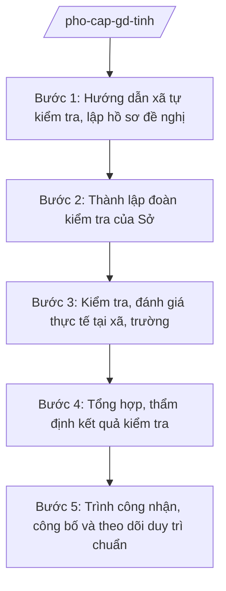

# Skill: Phổ cập giáo dục, trường chuẩn quốc gia

## 2. Khi nào dùng

- Hằng năm: chỉ đạo, kiểm tra công tác phổ cập giáo dục (PCGD), xóa mù chữ (XMC) trên địa bàn tỉnh theo các mức độ.
- Hướng dẫn UBND xã tự kiểm tra, lập hồ sơ đề nghị công nhận đạt chuẩn PCGD-XMC; Sở tổ chức kiểm tra, thẩm định.
- Tham mưu Chủ tịch UBND tỉnh công nhận xã đạt chuẩn PCGD-XMC, công nhận trường đạt chuẩn quốc gia (nội dung được TT 45/2026/TT-BGDĐT cập nhật).
- Theo dõi, đôn đốc duy trì kết quả PCGD-XMC và chuẩn quốc gia sau công nhận; xử lý trường hợp không duy trì được chuẩn.

## 3. Đầu vào (Input)

| Trường | Mô tả | Bắt buộc |
|--------|-------|----------|
| `nam_hoc` | Năm học kiểm tra, công nhận | Có |
| `danh_sach_xa_de_nghi` | Danh sách xã đề nghị công nhận đạt chuẩn PCGD-XMC, mức độ đề nghị | Có |
| `so_lieu_pcgd` | Số liệu PCGD-XMC của xã: tỷ lệ huy động, duy trì, hoàn thành chương trình; số người mù chữ được xóa | Có |
| `ho_so_truong_chuan_qg` | Hồ sơ trường đề nghị công nhận đạt chuẩn quốc gia: báo cáo tự đánh giá, minh chứng | Có (với công nhận trường chuẩn quốc gia) |
| `doan_kiem_tra` | Dự kiến thành phần đoàn kiểm tra của Sở | Có |
| `ket_qua_kiem_tra` | Biên bản kiểm tra thực tế tại xã/trường | Có (từ bước 3) |

## 4. Quy trình

**Bước 1. Hướng dẫn xã tự kiểm tra, lập hồ sơ đề nghị**

- Làm gì: Ban hành văn bản hướng dẫn UBND xã tự kiểm tra kết quả PCGD-XMC theo tiêu chí, mức độ; hướng dẫn lập hồ sơ đề nghị công nhận (báo cáo tự kiểm tra, số liệu minh chứng, biên bản họp xét của xã).
- Dùng input: `nam_hoc`, `danh_sach_xa_de_nghi`, `so_lieu_pcgd`.
- Vai trò: Chuyên viên Phòng Giáo dục Tiểu học, Phòng Giáo dục Trung học soạn văn bản hướng dẫn. AI hỗ trợ: soạn dự thảo văn bản hướng dẫn, biểu mẫu báo cáo tự kiểm tra, checklist hồ sơ đề nghị công nhận theo từng mức độ PCGD-XMC. ⏱ ~5–7 ngày làm việc (ước tính).
- Lưu ý nghiệp vụ: Nội dung hướng dẫn phải bám đúng tiêu chí PCGD-XMC và tiêu chuẩn trường đạt chuẩn quốc gia được cập nhật tại TT 45/2026/TT-BGDĐT; xã chỉ được đề nghị công nhận khi tự đánh giá đạt và có minh chứng đầy đủ.
- → Kết quả bước: Văn bản hướng dẫn + hồ sơ đề nghị công nhận của các xã/trường.

**Bước 2. Thành lập đoàn kiểm tra của Sở**

- Làm gì: Soạn quyết định thành lập đoàn kiểm tra PCGD-XMC, trường đạt chuẩn quốc gia; phân công địa bàn, lịch kiểm tra; tập huấn nghiệp vụ kiểm tra cho thành viên đoàn.
- Dùng input: `danh_sach_xa_de_nghi`, `ho_so_truong_chuan_qg`, `doan_kiem_tra`.
- Vai trò: Trưởng phòng Giáo dục Tiểu học (ông Bùi Văn X) chủ trì đề xuất thành phần đoàn; Phó Giám đốc Sở (ông Đỗ Văn U) xem xét; Giám đốc Sở (ông Hoàng Văn S) ký quyết định thành lập. AI hỗ trợ: lập danh sách đoàn theo địa bàn, kiểm tra tiêu chuẩn thành viên, soạn dự thảo quyết định và lịch kiểm tra. ⏱ ~3–5 ngày làm việc (ước tính).
- Lưu ý nghiệp vụ: Thành viên đoàn không kiểm tra địa bàn nơi mình đang công tác hoặc có người thân làm quản lý giáo dục; mỗi đoàn kiểm tra phải có cán bộ am hiểu tiêu chí PCGD-XMC.
- → Kết quả bước: Quyết định thành lập đoàn kiểm tra + lịch kiểm tra chi tiết.

**Bước 3. Kiểm tra, đánh giá thực tế tại xã, trường**

- Làm gì: Đoàn kiểm tra làm việc tại xã/trường: đối chiếu số liệu báo cáo với sổ sách, minh chứng gốc; kiểm tra thực tế cơ sở vật chất (với trường chuẩn quốc gia); phỏng vấn cán bộ, giáo viên; lập biên bản kiểm tra có xác nhận của địa phương/nhà trường.
- Dùng input: Hồ sơ đề nghị ở bước 1; kết quả bước 2.
- Vai trò: Trưởng đoàn kiểm tra điều hành; thành viên thực hiện theo phân công. AI hỗ trợ: chuẩn bị phiếu kiểm tra theo tiêu chí, biểu mẫu biên bản kiểm tra, tổng hợp kết quả kiểm tra từng xã/trường. ⏱ ~7–10 ngày làm việc/đợt kiểm tra (ước tính).
- Lưu ý nghiệp vụ: Kiểm tra phải đối chiếu số liệu gốc (sổ phổ cập, hồ sơ học sinh), không chấp nhận số liệu chỉ có trên báo cáo; biên bản phải ghi rõ đạt/không đạt từng tiêu chí và có chữ ký xác nhận của đại diện xã/trường.
- → Kết quả bước: Biên bản kiểm tra thực tế của từng xã/trường + bảng tổng hợp đạt/không đạt theo tiêu chí.

**Bước 4. Tổng hợp, thẩm định kết quả kiểm tra**

- Làm gì: Tổng hợp kết quả kiểm tra của các đoàn; tổ chức họp hội đồng thẩm định của Sở xem xét, quyết định danh sách xã/trường đủ điều kiện đề nghị công nhận; soạn tờ trình, dự thảo quyết định công nhận.
- Dùng input: `ket_qua_kiem_tra` (biên bản, bảng tổng hợp các đoàn).
- Vai trò: Chuyên viên tổng hợp; Trưởng phòng Giáo dục Tiểu học (ông Bùi Văn X) kiểm tra; Hội đồng thẩm định (Phó Giám đốc Sở — ông Đỗ Văn U làm chủ tịch) thẩm định. AI hỗ trợ: tổng hợp kết quả theo xã/trường/mức độ, soạn dự thảo tờ trình và quyết định đúng thể thức, kiểm tra tính khớp giữa biên bản kiểm tra và danh sách đề nghị công nhận. ⏱ ~5–7 ngày làm việc (ước tính).
- Lưu ý nghiệp vụ: Chỉ đề nghị công nhận xã/trường đạt 100% tiêu chí bắt buộc của mức độ/tiêu chuẩn đăng ký; xã/trường chưa đạt được hướng dẫn khắc phục và kiểm tra lại, không "châm chước".
- → Kết quả bước: Biên bản thẩm định + Tờ trình + dự thảo Quyết định công nhận.

**Bước 5. Trình công nhận, công bố và theo dõi duy trì chuẩn**

- Làm gì: Trình Chủ tịch UBND tỉnh ký quyết định công nhận xã đạt chuẩn PCGD-XMC, công nhận trường đạt chuẩn quốc gia; công bố kết quả; hướng dẫn xã/trường xây dựng kế hoạch duy trì chuẩn; kiểm tra duy trì hằng năm.
- Dùng input: Tờ trình và dự thảo quyết định ở bước 4.
- Vai trò: Giám đốc Sở (ông Hoàng Văn S) ký tờ trình trình UBND tỉnh; Chủ tịch UBND tỉnh (ông Phạm Văn P) ký ban hành quyết định công nhận. AI hỗ trợ: lập phiếu trình ký, soạn thông báo công khai kết quả, biểu mẫu theo dõi duy trì chuẩn hằng năm. ⏱ ~7–10 ngày làm việc (ước tính).
- Lưu ý nghiệp vụ: Quyết định công nhận có thời hạn; xã/trường không duy trì được chuẩn sẽ bị xem xét thu hồi công nhận; kết quả PCGD-XMC là tiêu chí đánh giá chính quyền xã.
- → Kết quả bước: Quyết định công nhận đã ký ban hành, công bố; kế hoạch theo dõi duy trì chuẩn.

## Luồng quy trình (Workflow)

## 5. Đầu ra (Output)

### Sản phẩm

1. **Quyết định công nhận xã đạt chuẩn phổ cập giáo dục, xóa mù chữ / công nhận trường đạt chuẩn quốc gia** (sản phẩm chính) — Chủ tịch UBND tỉnh ký ban hành.
2. Tờ trình UBND tỉnh kèm hồ sơ thẩm định (biên bản kiểm tra, biên bản thẩm định).
3. Quyết định thành lập đoàn kiểm tra của Sở (Giám đốc Sở ký).
4. Thông báo công khai kết quả công nhận; báo cáo duy trì chuẩn hằng năm.

**Cấu trúc output chuẩn (Quyết định công nhận đạt chuẩn PCGD-XMC / trường đạt chuẩn quốc gia):**
- Thể thức: tuân thủ Nghị định 30/2020/NĐ-CP về công tác văn thư.

1. Quốc hiệu "CỘNG HÒA XÃ HỘI CHỦ NGHĨA VIỆT NAM", Tiêu ngữ "Độc lập – Tự do – Hạnh phúc": CỘNG HÒA XÃ HỘI CHỦ NGHĨA VIỆT NAM / Độc lập – Tự do – Hạnh phúc.
2. Tên cơ quan ban hành: ỦY BAN NHÂN DÂN TỈNH A.
3. Số, ký hiệu văn bản: số 1234/QĐ-UBND.
4. Địa danh, ngày tháng năm ban hành: Tỉnh A, ngày … tháng … năm ….
5. Tên loại và trích yếu nội dung: QUYẾT ĐỊNH / Về việc công nhận xã … đạt chuẩn phổ cập giáo dục, xóa mù chữ mức độ … (hoặc: công nhận trường … đạt chuẩn quốc gia mức độ …).
6. Căn cứ ban hành: Luật Giáo dục; Thông tư 15/2025/TT-BGDĐT; Thông tư 45/2026/TT-BGDĐT (nội dung về phổ cập giáo dục, xóa mù chữ, trường đạt chuẩn quốc gia); Tờ trình của Sở GD&ĐT tỉnh A (ghi rõ số hiệu, ngày ban hành).
7. Nội dung quyết định theo từng điều:
   - Điều 1. Công nhận xã … đạt chuẩn phổ cập giáo dục … mức độ …, xóa mù chữ mức độ … (hoặc: công nhận trường … đạt chuẩn quốc gia mức độ …);
   - Điều 2. Hiệu lực thi hành;
   - Điều 3. Trách nhiệm thi hành (Sở GD&ĐT, UBND xã, hiệu trưởng trường được công nhận; trách nhiệm duy trì chuẩn).
8. Nơi nhận (Bộ GD&ĐT; Thường trực Tỉnh ủy, HĐND tỉnh; Chủ tịch, các Phó Chủ tịch UBND tỉnh; Sở GD&ĐT; UBND xã/trường được công nhận; lưu VT, GDTH/GDTrH).
9. Chữ ký, họ tên người ký: TM. ỦY BAN NHÂN DÂN / CHỦ TỊCH / (ký, đóng dấu, ghi rõ họ tên).

## 6. Checklist nghiệm thu

- [ ] Đủ 9 phần theo Cấu trúc output chuẩn mục 5, đúng thứ tự thể thức NĐ 30/2020/NĐ-CP.
- [ ] Văn bản hướng dẫn bám đúng tiêu chí PCGD-XMC và tiêu chuẩn trường chuẩn quốc gia được cập nhật tại TT 45/2026/TT-BGDĐT.
- [ ] 100% xã/trường đề nghị công nhận đều được kiểm tra thực tế; biên bản kiểm tra đối chiếu số liệu gốc, có chữ ký xác nhận.
- [ ] Chỉ đề nghị công nhận xã/trường đạt 100% tiêu chí bắt buộc; có biên bản thẩm định của Hội đồng Sở.
- [ ] Quyết định công nhận ghi rõ mức độ đạt chuẩn; danh sách khớp tuyệt đối với biên bản thẩm định.
- [ ] Kết quả công nhận được công bố công khai; có kế hoạch theo dõi duy trì chuẩn hằng năm.
- [ ] Căn cứ pháp lý ghi đúng số hiệu: TT 15/2025/TT-BGDĐT, TT 45/2026/TT-BGDĐT; không bịa số hiệu văn bản khác.
- [ ] Đã qua đủ nấc human gate: chuyên viên → Trưởng phòng → Hội đồng thẩm định → Phó Giám đốc Sở → Giám đốc Sở → Chủ tịch UBND tỉnh ký ban hành.

## 7. Ví dụ mô phỏng

*Dữ liệu dưới đây là giả lập 100% phục vụ minh họa.*

**Input mẫu:**

| Trường | Giá trị mẫu |
|--------|-------------|
| nam_hoc | 2026–2027 |
| danh_sach_xa_de_nghi | Xã A (đề nghị PCGD tiểu học mức độ 3, XMC mức độ 2); xã B (đề nghị PCGD THCS mức độ 2) |
| so_lieu_pcgd | Xã A: huy động 100% trẻ 6 tuổi; duy trì 99%; xã B: tốt nghiệp THCS 98% |
| ho_so_truong_chuan_qg | Trường TH Tân Tiến: báo cáo tự đánh giá đạt chuẩn quốc gia mức độ 1 |
| doan_kiem_tra | 02 đoàn, mỗi đoàn 05 thành viên |
| ket_qua_kiem_tra | Xã A đạt; xã B đạt; Trường TH Tân Tiến đạt chuẩn quốc gia mức độ 1 |

**Output mẫu:**

CỘNG HÒA XÃ HỘI CHỦ NGHĨA VIỆT NAM
Độc lập – Tự do – Hạnh phúc
---------------

ỦY BAN NHÂN DÂN TỈNH A

Số: 1234/QĐ-UBND

Tỉnh A, ngày 25 tháng 12 năm 2026

**QUYẾT ĐỊNH**
**Về việc công nhận xã A đạt chuẩn phổ cập giáo dục, xóa mù chữ**

*Căn cứ* Luật Giáo dục;
*Căn cứ* Thông tư số 15/2025/TT-BGDĐT ngày 24/7/2025 của Bộ Giáo dục và Đào tạo hướng dẫn chức năng, nhiệm vụ, quyền hạn của Sở Giáo dục và Đào tạo và Phòng Văn hóa – Xã hội trong lĩnh vực giáo dục và đào tạo;
*Căn cứ* Thông tư số 45/2026/TT-BGDĐT ngày 10/6/2026 của Bộ Giáo dục và Đào tạo sửa đổi, bổ sung Thông tư số 15/2025/TT-BGDĐT;
*Xét* Tờ trình số 890/TTr-SGDĐT ngày 15/12/2026 của Sở Giáo dục và Đào tạo tỉnh A;

**QUYẾT ĐỊNH:**

**Điều 1.** Công nhận xã A, tỉnh A đạt chuẩn phổ cập giáo dục tiểu học mức độ 3, phổ cập giáo dục trung học cơ sở mức độ 2, xóa mù chữ mức độ 2.

**Điều 2.** Quyết định này có hiệu lực thi hành kể từ ngày ký.

**Điều 3.** Chánh Văn phòng UBND tỉnh, Giám đốc Sở Giáo dục và Đào tạo, Chủ tịch UBND xã A và Thủ trưởng các cơ quan, đơn vị liên quan chịu trách nhiệm thi hành Quyết định này; UBND xã A có trách nhiệm duy trì, giữ vững kết quả đạt chuẩn./.

***Nơi nhận:***
- Như Điều 3;
- Bộ GD&ĐT (báo cáo);
- Thường trực Tỉnh ủy, HĐND tỉnh;
- Chủ tịch, các Phó Chủ tịch UBND tỉnh;
- Lưu: VT, GDTH.

**TM. ỦY BAN NHÂN DÂN**
**CHỦ TỊCH**

*(Ký, đóng dấu)*

**Phạm Văn P**

## 8. Human gate (người kiểm duyệt)

- Chuyên viên Phòng Giáo dục Tiểu học, Phòng Giáo dục Trung học soạn văn bản hướng dẫn, tổng hợp kết quả kiểm tra; chịu trách nhiệm về tính chính xác của số liệu.
- Trưởng phòng Giáo dục Tiểu học (ông Bùi Văn X) kiểm tra hồ sơ, dự thảo tờ trình và quyết định ở các bước 1–2 và 4; trả lại sửa nếu chưa đạt.
- Hội đồng thẩm định (Phó Giám đốc Sở — ông Đỗ Văn U làm chủ tịch) thẩm định kết quả kiểm tra thực tế trước khi trình công nhận.
- Giám đốc Sở (ông Hoàng Văn S) ký tờ trình, ký quyết định thành lập đoàn kiểm tra; trình UBND tỉnh.
- Chủ tịch UBND tỉnh (ông Phạm Văn P) ký ban hành quyết định công nhận xã đạt chuẩn PCGD-XMC, công nhận trường đạt chuẩn quốc gia.

## 9. Giới hạn (guardrails)

- AI KHÔNG ra quyết định hành chính thay người có thẩm quyền (không quyết định công nhận hay từ chối công nhận đạt chuẩn thay Hội đồng thẩm định/Chủ tịch UBND tỉnh).
- AI không tự ký, đóng dấu, phát hành văn bản dưới danh nghĩa UBND tỉnh, Sở GD&ĐT hay bất kỳ cá nhân nào.
- AI không bịa số liệu PCGD-XMC, kết quả kiểm tra; mọi con số phải có nguồn từ sổ sách gốc và biên bản kiểm tra thực tế.
- AI không bịa căn cứ pháp lý, số hiệu văn bản; nội dung về PCGD-XMC, trường chuẩn quốc gia phải bám đúng TT 45/2026/TT-BGDĐT, không suy diễn thêm.
- AI không thay thế đoàn kiểm tra làm việc thực tế tại xã, trường; không "châm chước" tiêu chí chưa đạt.

## 10. Căn cứ & lưu ý

- Thông tư 15/2025/TT-BGDĐT ngày 24/7/2025 của Bộ GD&ĐT (hiệu lực 24/7/2025) — chức năng, nhiệm vụ, quyền hạn của Sở GD&ĐT (thay thế TT 12/2020/TT-BGDĐT).
- Thông tư 45/2026/TT-BGDĐT ngày 10/6/2026 của Bộ GD&ĐT (hiệu lực 10/6/2026) — sửa đổi, bổ sung TT 15/2025/TT-BGDĐT; cập nhật nội dung về công tác phổ cập giáo dục, xóa mù chữ, trường đạt chuẩn quốc gia.
- Nghị định 142/2025/NĐ-CP ngày 12/6/2025 — phân định thẩm quyền của chính quyền địa phương 02 cấp trong lĩnh vực quản lý nhà nước của Bộ GD&ĐT.
- Nghị định 30/2020/NĐ-CP — thể thức văn bản hành chính.
- Lưu ý: tiêu chí, mức độ đạt chuẩn PCGD-XMC và tiêu chuẩn trường đạt chuẩn quốc gia thực hiện theo quy định pháp luật chuyên ngành về giáo dục được cập nhật tại TT 45/2026/TT-BGDĐT; số hiệu văn bản chuyên ngành khác không có trong danh mục được phép trích dẫn thì ghi "theo quy định pháp luật chuyên ngành về giáo dục", tuyệt đối không bịa số hiệu.
